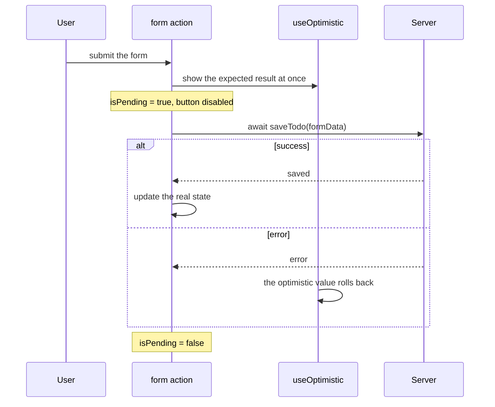

## What this lesson covers

React 19 added a built-in model for async actions: Actions, forms with `action`, and the `useActionState`, `useFormStatus` and `useOptimistic` hooks. It also covers `use` and Suspense for data, error boundaries, document metadata, and which of these jobs libraries and frameworks usually take over.

## Actions



An **Action** is a function that runs inside a transition, including an async one (React 19; in 18 transitions could only be synchronous). While it runs, React tracks the pending state itself:

```jsx
const [isPending, startTransition] = useTransition()

function handleSave() {
  startTransition(async () => {
    const error = await saveName(name)
    if (error) {
      setError(error)
      return
    }
    startTransition(() => navigate('/profile'))
  })
}
```

- `isPending` becomes `true` at once and stays so until the function finishes;
- state updates after `await` are wrapped in `startTransition` again (a limitation of the current version: the transition context is lost after `await`);
- an error thrown in an Action reaches the nearest error boundary;
- `startTransition` does not guarantee the order of responses: if requests finish out of order, state can roll back to an old response; `useActionState`, `<form action>` and server functions queue calls themselves.

## Forms and useActionState

`<form action={fn}>` calls `fn(formData)` as an Action on submit, without `preventDefault` and without state for every field. `useActionState` adds the result of the previous call:

```jsx dom
import { act, useActionState } from 'react'
import { createRoot } from 'react-dom/client'

async function subscribe(previousState, formData) {
  await new Promise((resolve) => setTimeout(resolve, 20))
  const email = formData.get('email')
  if (!email.includes('@')) return { error: 'Invalid email', count: previousState.count }
  return { error: null, count: previousState.count + 1 }
}

function Newsletter() {
  const [state, formAction, isPending] = useActionState(subscribe, { error: null, count: 0 })
  console.log('render', JSON.stringify({ ...state, isPending }))
  return (
    <form action={formAction}>
      <input name="email" />
      <button>Subscribe</button>
    </form>
  )
}

const container = document.createElement('div')
document.body.append(container)
await act(() => createRoot(container).render(<Newsletter />))
for (const value of ['nope', 'ann@example.com']) {
  container.querySelector('input').value = value
  await act(async () => {
    container.querySelector('form').requestSubmit()
    await new Promise((resolve) => setTimeout(resolve, 50))
  })
}
```

```output
render {"error":null,"count":0,"isPending":false}
render {"error":null,"count":0,"isPending":true}
render {"error":"Invalid email","count":0,"isPending":false}
render {"error":"Invalid email","count":0,"isPending":true}
render {"error":null,"count":1,"isPending":false}
```

- The function receives **the previous state** as its first argument and `FormData` as its second; the returned value becomes the new `state`.
- Validation errors are returned as data, not thrown: that way they can be shown next to the field.
- After a successful submit React resets the form's uncontrolled fields (manually: `requestFormReset`).
- With a server function (`'use server'`) the form works even before JavaScript loads, and the third argument of `useActionState` (permalink) sets the URL for such a submit.
- The hook used to be called `ReactDOM.useFormState` (canary releases); React 19 renamed it and moved it to `react`.

`useFormStatus()` from `react-dom` reads the status of the **parent** form: `{ pending, data, method, action }`. Call it in a component inside `<form>`, for example in a submit button that disables itself, so there is no need to pass `isPending` down as props.

## useOptimistic

An optimistic update shows the result before the server responds and reverts by itself when the Action finishes:

```jsx dom
import { act, startTransition, useOptimistic, useState } from 'react'
import { createRoot } from 'react-dom/client'

const save = (text) =>
  new Promise((resolve, reject) => setTimeout(() => (text === 'fail' ? reject(new Error('offline')) : resolve(text)), 20))

let send
function Messages() {
  const [messages, setMessages] = useState(['hi'])
  const [optimistic, addOptimistic] = useOptimistic(messages, (list, text) => [...list, `${text} (sending)`])
  send = (text) =>
    startTransition(async () => {
      addOptimistic(text)
      try {
        const saved = await save(text)
        startTransition(() => setMessages((list) => [...list, saved]))
      } catch (e) {
        console.log('error:', e.message)
      }
    })
  console.log(optimistic.join(', '))
  return null
}

const wait = (ms) => new Promise((resolve) => setTimeout(resolve, ms))
await act(() => createRoot(document.createElement('div')).render(<Messages />))
await act(async () => { send('hello'); await wait(50) })
await act(async () => { send('fail'); await wait(50) })
```

```output
hi
hi, hello (sending)
hi, hello
hi, hello, fail (sending)
error: offline
hi, hello
```

`addOptimistic` is called only inside an Action or a transition. While the Action runs, the optimistic value is shown; afterwards React goes back to the real state: on success it already contains the message, on error the temporary line simply disappears, with nothing to roll back.

## use and Suspense

`use(promise)` reads a promise's result. Until the promise settles, the component "suspends" and the nearest `<Suspense>` shows a fallback:

```jsx dom
import { act, Suspense, use } from 'react'
import { createRoot } from 'react-dom/client'

// The promise is created once, outside rendering (a cache or a parent would do this).
const { promise: userPromise, resolve } = Promise.withResolvers()

function User({ promise }) {
  const user = use(promise)
  return <b>{user.name}</b>
}

const container = document.createElement('div')
await act(() =>
  createRoot(container).render(
    <Suspense fallback={<i>Loading…</i>}>
      <User promise={userPromise} />
    </Suspense>,
  ),
)
console.log('first commit:', container.innerHTML)
await act(async () => {
  resolve({ name: 'Ann' }) // the response arrives
  await userPromise
})
console.log('after the promise:', container.innerHTML)
```

```output
first commit: <i>Loading…</i>
after the promise: <b>Ann</b>
```

- Do not create the promise during render of a client component (`use(fetch(url))`): every render would make a new promise, and React would show the fallback on every re-render. The promise comes from a Server Component, a cache or a data library (`useSuspenseQuery` in TanStack Query).
- A rejected promise throws the error to the nearest error boundary.
- `use(Context)` reads context; unlike other hooks, `use` can be called in conditions and loops.
- Since React 19, when something suspends, React shows the fallback right away and renders the siblings afterwards to start their loading early.
- If an update in a transition suspends content that is already shown, React keeps the old UI instead of the fallback.

## Error boundaries

A render error is caught by an error boundary, and it is still a **class** component (`static getDerivedStateFromError` for the fallback UI, `componentDidCatch` for logging). Usually the ready-made `react-error-boundary` is used. The root accepts `onCaughtError`, `onUncaughtError` and `onRecoverableError` handlers to send errors to monitoring (React 19 no longer re-throws caught errors):

```jsx dom
import { act, Component } from 'react'
import { createRoot } from 'react-dom/client'

class ErrorBoundary extends Component {
  state = { error: null }
  static getDerivedStateFromError(error) {
    return { error }
  }
  render() {
    return this.state.error ? <p>Failed: {this.state.error.message}</p> : this.props.children
  }
}

function Broken() {
  throw new Error('no data')
}

const container = document.createElement('div')
const root = createRoot(container, {
  onCaughtError: (error) => console.log('reported:', error.message),
})
await act(() => root.render(<ErrorBoundary><Broken /></ErrorBoundary>))
console.log(container.innerHTML)
```

```output
reported: no data
<p>Failed: no data</p>
```

Errors in event handlers and in code after `await` outside an Action are not caught by boundaries: handle them with `try/catch`.

## Document metadata

`<title>`, `<meta>` and `<link>` can be written in any component, and React 19 moves them into `<head>`:

```jsx dom
import { act } from 'react'
import { createRoot } from 'react-dom/client'

function Article() {
  return (
    <article>
      <title>Hooks in depth</title>
      <meta name="description" content="A guide" />
      <h1>Hooks in depth</h1>
    </article>
  )
}

const container = document.createElement('div')
document.body.append(container)
await act(() => createRoot(container).render(<Article />))
console.log('title:', document.title)
console.log('in head:', document.head.querySelector('meta[name=description]') !== null)
console.log('article:', container.innerHTML)
```

```output
title: Hooks in depth
in head: true
article: <article><h1>Hooks in depth</h1></article>
```

Similarly `<link rel="stylesheet" precedence="default">` is inserted once and in the right order, `<script async>` is not duplicated, and the `preload`, `preinit`, `preconnect` and `prefetchDNS` functions from `react-dom` hint resources to the browser early.

## Data in practice

The built-in primitives are low-level. In applications server data is usually handed to:

- **a library**: TanStack Query (`useQuery({ queryKey: ['user', id], queryFn })`, caching, refetching, invalidation after `useMutation`), SWR, RTK Query;
- **a framework**: route loaders and actions in React Router, Server Components and server functions in Next.js.

A manual `fetch` in an effect is fine for simple cases, but caching, deduplication, cancellation and races are then yours to write (see the effects lesson).

## Key points

- An Action is an async transition: `isPending`, errors in an error boundary; `useActionState` and forms guarantee response order, a bare `startTransition` does not.
- `<form action>` + `useActionState(fn, initial)`: the function gets the previous state and `FormData`, uncontrolled fields are reset after success; `useFormStatus` reads the parent form.
- `useOptimistic` shows the result during an Action and returns to the real state by itself.
- `use(promise)` with Suspense waits for a cached promise, not one created in render; `use` can be called in conditions.
- An error boundary is still a class; errors are reported through `onCaughtError` and the related root options.
- `<title>` and `<meta>` from components end up in `<head>`.
