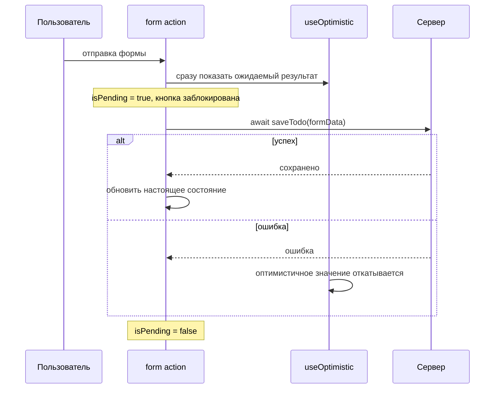

## О чём урок

React 19 добавил встроенную модель асинхронных действий: Actions, формы с `action`, хуки `useActionState`, `useFormStatus` и `useOptimistic`. Здесь же `use` и Suspense для данных, error boundary, метаданные документа и что из этого обычно берут на себя библиотеки и фреймворки.

## Actions



**Action** это функция, которая выполняется внутри перехода, в том числе асинхронная (React 19, в 18 переходы были только синхронными). Пока она работает, React сам ведёт состояние ожидания:

```jsx
const [isPending, startTransition] = useTransition()

function handleSave() {
  startTransition(async () => {
    const error = await saveName(name)
    if (error) {
      setError(error)
      return
    }
    startTransition(() => navigate('/profile'))
  })
}
```

- `isPending` становится `true` сразу и остаётся до конца функции;
- обновления состояния после `await` снова оборачивают в `startTransition` (ограничение текущей версии: контекст перехода теряется после `await`);
- ошибка, брошенная в Action, доходит до ближайшего error boundary;
- порядок ответов `startTransition` не гарантирует: если запросы завершатся не по порядку, состояние может откатиться к старому ответу; `useActionState`, `<form action>` и серверные функции выстраивают вызовы в очередь сами.

## Формы и useActionState

`<form action={fn}>` вызывает `fn(formData)` как Action при отправке, без `preventDefault` и без состояния на каждое поле. `useActionState` добавляет к этому результат прошлого вызова:

```jsx dom
import { act, useActionState } from 'react'
import { createRoot } from 'react-dom/client'

async function subscribe(previousState, formData) {
  await new Promise((resolve) => setTimeout(resolve, 20))
  const email = formData.get('email')
  if (!email.includes('@')) return { error: 'Invalid email', count: previousState.count }
  return { error: null, count: previousState.count + 1 }
}

function Newsletter() {
  const [state, formAction, isPending] = useActionState(subscribe, { error: null, count: 0 })
  console.log('render', JSON.stringify({ ...state, isPending }))
  return (
    <form action={formAction}>
      <input name="email" />
      <button>Subscribe</button>
    </form>
  )
}

const container = document.createElement('div')
document.body.append(container)
await act(() => createRoot(container).render(<Newsletter />))
for (const value of ['nope', 'ann@example.com']) {
  container.querySelector('input').value = value
  await act(async () => {
    container.querySelector('form').requestSubmit()
    await new Promise((resolve) => setTimeout(resolve, 50))
  })
}
```

```output
render {"error":null,"count":0,"isPending":false}
render {"error":null,"count":0,"isPending":true}
render {"error":"Invalid email","count":0,"isPending":false}
render {"error":"Invalid email","count":0,"isPending":true}
render {"error":null,"count":1,"isPending":false}
```

- Функция получает **предыдущее состояние** первым аргументом, а `FormData` вторым; вернувшееся значение становится новым `state`.
- Ошибки валидации возвращают как данные, а не бросают: так их можно показать рядом с полем.
- После успешной отправки React сбрасывает неуправляемые поля формы (вручную: `requestFormReset`).
- С серверной функцией (`'use server'`) форма работает и до загрузки JavaScript, а третий аргумент `useActionState` (permalink) задаёт адрес для такой отправки.
- Хук раньше назывался `ReactDOM.useFormState` (канареечные версии), в React 19 переименован и перенесён в `react`.

`useFormStatus()` из `react-dom` читает состояние **родительской** формы: `{ pending, data, method, action }`. Его вызывают в компоненте внутри `<form>`, например в кнопке отправки, которая сама блокируется, и пробрасывать `isPending` пропсами не нужно.

## useOptimistic

Оптимистичное обновление показывает результат до ответа сервера и само откатывается, когда Action закончился:

```jsx dom
import { act, startTransition, useOptimistic, useState } from 'react'
import { createRoot } from 'react-dom/client'

const save = (text) =>
  new Promise((resolve, reject) => setTimeout(() => (text === 'fail' ? reject(new Error('offline')) : resolve(text)), 20))

let send
function Messages() {
  const [messages, setMessages] = useState(['hi'])
  const [optimistic, addOptimistic] = useOptimistic(messages, (list, text) => [...list, `${text} (sending)`])
  send = (text) =>
    startTransition(async () => {
      addOptimistic(text)
      try {
        const saved = await save(text)
        startTransition(() => setMessages((list) => [...list, saved]))
      } catch (e) {
        console.log('error:', e.message)
      }
    })
  console.log(optimistic.join(', '))
  return null
}

const wait = (ms) => new Promise((resolve) => setTimeout(resolve, ms))
await act(() => createRoot(document.createElement('div')).render(<Messages />))
await act(async () => { send('hello'); await wait(50) })
await act(async () => { send('fail'); await wait(50) })
```

```output
hi
hi, hello (sending)
hi, hello
hi, hello, fail (sending)
error: offline
hi, hello
```

`addOptimistic` вызывают только внутри Action или перехода. Пока Action идёт, показывается оптимистичное значение; после него React снова берёт настоящее состояние: при успехе оно уже содержит сообщение, при ошибке временная строка просто исчезает, откатывать ничего не нужно.

## use и Suspense

`use(promise)` читает результат промиса. Пока промис не выполнен, компонент «приостанавливается», и ближайший `<Suspense>` показывает запасной интерфейс:

```jsx dom
import { act, Suspense, use } from 'react'
import { createRoot } from 'react-dom/client'

// The promise is created once, outside rendering (a cache or a parent would do this).
const { promise: userPromise, resolve } = Promise.withResolvers()

function User({ promise }) {
  const user = use(promise)
  return <b>{user.name}</b>
}

const container = document.createElement('div')
await act(() =>
  createRoot(container).render(
    <Suspense fallback={<i>Loading…</i>}>
      <User promise={userPromise} />
    </Suspense>,
  ),
)
console.log('first commit:', container.innerHTML)
await act(async () => {
  resolve({ name: 'Ann' }) // the response arrives
  await userPromise
})
console.log('after the promise:', container.innerHTML)
```

```output
first commit: <i>Loading…</i>
after the promise: <b>Ann</b>
```

- Промис нельзя создавать при рендере клиентского компонента (`use(fetch(url))`): каждый рендер даст новый промис, и React будет показывать fallback при каждом повторном рендере. Промис приходит из Server Component, из кэша или из библиотеки данных (`useSuspenseQuery` в TanStack Query).
- Отклонённый промис бросает ошибку в ближайший error boundary.
- `use(Context)` читает контекст; в отличие от других хуков `use` можно вызывать в условиях и циклах.
- С React 19 при приостановке React сразу показывает fallback, а соседей рендерит после, чтобы заранее начать их загрузки.
- Если обновление в переходе приостанавливает уже показанный контент, React оставляет старый интерфейс вместо fallback.

## Error boundary

Ошибку при рендере ловит error boundary, и до сих пор это **классовый** компонент (`static getDerivedStateFromError` для запасного интерфейса, `componentDidCatch` для логирования). Обычно берут готовый `react-error-boundary`. Корень принимает обработчики `onCaughtError`, `onUncaughtError` и `onRecoverableError` для отправки в систему мониторинга (React 19 больше не бросает пойманные ошибки повторно):

```jsx dom
import { act, Component } from 'react'
import { createRoot } from 'react-dom/client'

class ErrorBoundary extends Component {
  state = { error: null }
  static getDerivedStateFromError(error) {
    return { error }
  }
  render() {
    return this.state.error ? <p>Failed: {this.state.error.message}</p> : this.props.children
  }
}

function Broken() {
  throw new Error('no data')
}

const container = document.createElement('div')
const root = createRoot(container, {
  onCaughtError: (error) => console.log('reported:', error.message),
})
await act(() => root.render(<ErrorBoundary><Broken /></ErrorBoundary>))
console.log(container.innerHTML)
```

```output
reported: no data
<p>Failed: no data</p>
```

Ошибки в обработчиках событий и в коде после `await` вне Action границы не ловят: их обрабатывают `try/catch`.

## Метаданные документа

`<title>`, `<meta>` и `<link>` можно писать в любом компоненте, React 19 перенесёт их в `<head>`:

```jsx dom
import { act } from 'react'
import { createRoot } from 'react-dom/client'

function Article() {
  return (
    <article>
      <title>Hooks in depth</title>
      <meta name="description" content="A guide" />
      <h1>Hooks in depth</h1>
    </article>
  )
}

const container = document.createElement('div')
document.body.append(container)
await act(() => createRoot(container).render(<Article />))
console.log('title:', document.title)
console.log('in head:', document.head.querySelector('meta[name=description]') !== null)
console.log('article:', container.innerHTML)
```

```output
title: Hooks in depth
in head: true
article: <article><h1>Hooks in depth</h1></article>
```

Похожим образом `<link rel="stylesheet" precedence="default">` вставляется один раз и в нужном порядке, `<script async>` не дублируется, а функции `preload`, `preinit`, `preconnect` и `prefetchDNS` из `react-dom` подсказывают браузеру ресурсы заранее.

## Данные на практике

Встроенные примитивы низкоуровневые. В приложениях серверные данные обычно отдают:

- **библиотеке**: TanStack Query (`useQuery({ queryKey: ['user', id], queryFn })`, кэш, повторные запросы, инвалидация после `useMutation`), SWR, RTK Query;
- **фреймворку**: загрузчики и Actions маршрутов в React Router, Server Components и серверные функции в Next.js.

Ручной `fetch` в эффекте годится для простых случаев, но кэш, дедупликацию, отмену и гонки придётся писать самим (урок про эффекты).

## Главное

- Action это асинхронный переход: `isPending`, ошибки в error boundary; порядок ответов гарантируют `useActionState` и формы, а не голый `startTransition`.
- `<form action>` + `useActionState(fn, initial)`: функция получает прошлое состояние и `FormData`, неуправляемые поля сбрасываются после успеха; `useFormStatus` читает родительскую форму.
- `useOptimistic` показывает результат во время Action и сам возвращается к настоящему состоянию.
- `use(promise)` с Suspense ждёт кэшированный промис, а не созданный в рендере; `use` можно вызывать в условиях.
- Error boundary всё ещё класс; ошибки отправляют через `onCaughtError` и соседние опции корня.
- `<title>` и `<meta>` из компонентов попадают в `<head>`.
