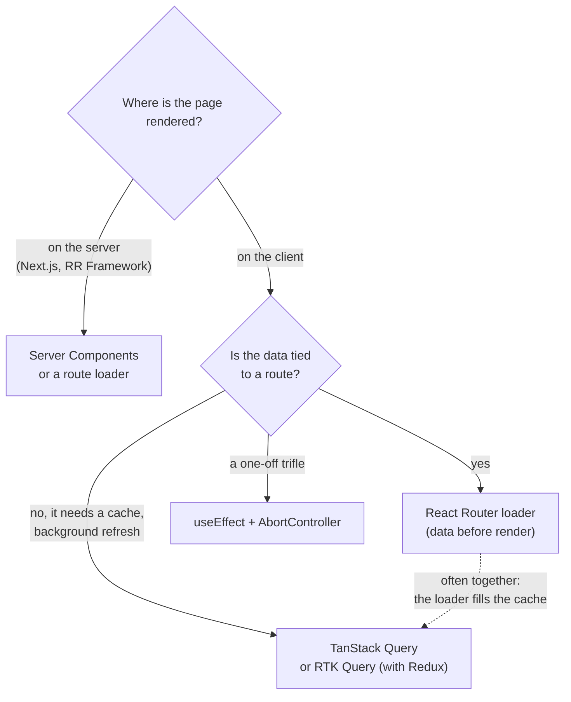
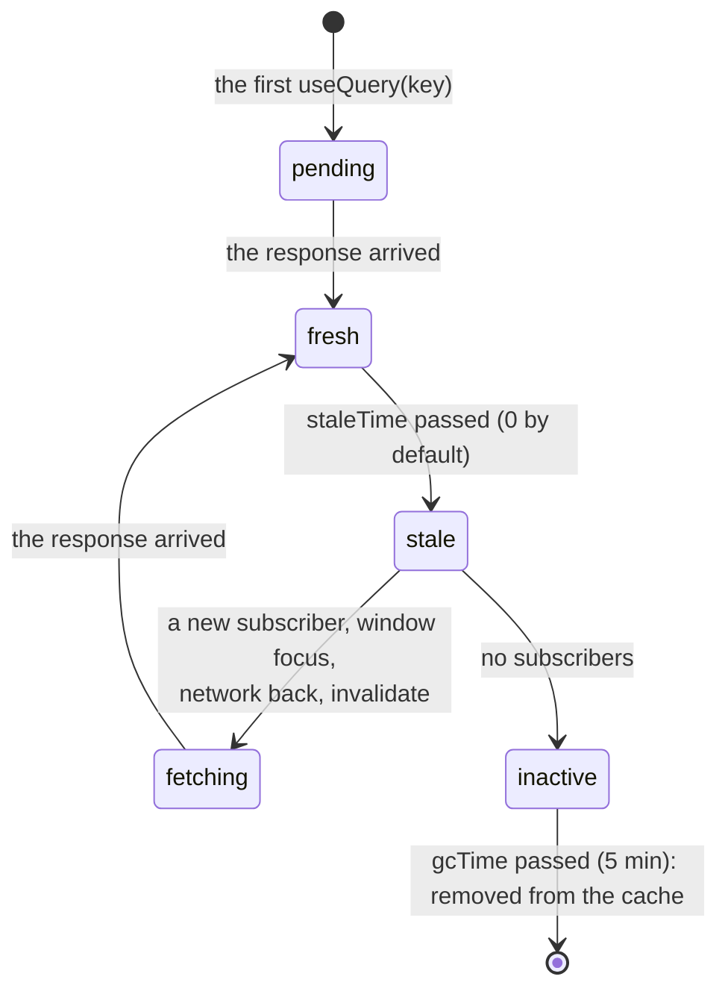

## What this lesson covers

How a React app gets server data and keeps it fresh: why "a request in `useEffect`" is weak for a real app, how TanStack Query works (keys, cache, freshness, mutations and invalidation), where router loaders and Server Components fit, how to mock an API with MSW and how to wire up WebSocket and Server-Sent Events.

## Ways to load data



A request in `useEffect` is fine for a prototype, but in an app it quickly piles up problems: response races and cancellation (the effects lesson), a repeated request from the double effect in StrictMode, no cache (come back to a page, a spinner again), duplicate requests from several components, manual `loading` and `error`, "waterfalls" of nested components, manual refresh after changes. Server-state libraries solve all of that.

## TanStack Query

Server state differs from client state: the source of truth is on the server, data can go stale without you doing anything, and many components share it. TanStack Query keeps responses in a **cache by key** and manages their freshness.



An example with an MSW mock server instead of a real API (MSW intercepts `fetch`, the app code does not know about it):

```jsx dom
import { QueryClient, QueryClientProvider, useMutation, useQuery, useQueryClient } from '@tanstack/react-query'
import { act, cleanup, render, screen } from '@testing-library/react'
import { http, HttpResponse } from 'msw'
import { setupServer } from 'msw/node'

const todos = [{ id: 1, title: 'Learn hooks' }]
let requests = 0
const server = setupServer(
  http.get('https://api.example.com/todos', () => (requests++, HttpResponse.json(todos))),
  http.post('https://api.example.com/todos', async ({ request }) => {
    const todo = { id: todos.length + 1, ...(await request.json()) }
    todos.push(todo)
    return HttpResponse.json(todo, { status: 201 })
  }),
)
server.listen()

const fetchTodos = () => fetch('https://api.example.com/todos').then((r) => r.json())

function TodoCount() {
  const { data, isPending } = useQuery({ queryKey: ['todos'], queryFn: fetchTodos })
  return <p>{isPending ? 'loading…' : `${data.length} todos`}</p>
}

function AddTodo() {
  const queryClient = useQueryClient()
  const add = useMutation({
    mutationFn: (title) => fetch('https://api.example.com/todos', { method: 'POST', body: JSON.stringify({ title }) }).then((r) => r.json()),
    onSuccess: () => queryClient.invalidateQueries({ queryKey: ['todos'] }), // refetch the list
  })
  return <button onClick={() => add.mutate('Write tests')}>Add</button>
}

// gcTime: Infinity only so this script can exit: no 5-minute cache timers
const queryClient = new QueryClient({ defaultOptions: { queries: { retry: false, gcTime: Infinity }, mutations: { gcTime: Infinity } } })
render(
  <QueryClientProvider client={queryClient}>
    <TodoCount />
    <TodoCount />
    <AddTodo />
  </QueryClientProvider>,
)
await screen.findAllByText('1 todos')
console.log('two components, requests:', requests)

await act(async () => screen.getByRole('button').click())
await screen.findAllByText('2 todos')
console.log('after the mutation, requests:', requests)
cleanup() // unmount
server.close()
```

```output
two components, requests: 1
after the mutation, requests: 2
```

- The **key** (`['todos']`, `['todo', id]`, `['todos', { status: 'done' }]`) identifies the cache entry. Everything the request depends on must be in the key: otherwise different parameters return one response.
- Two components with one key made **one** request: simultaneous requests are deduplicated.
- `staleTime` says how long data counts as fresh (0 by default, so data is immediately stale and refreshes on a new subscriber, window focus, network recovery). `gcTime` says how long unused data is kept.
- After a change (`useMutation`) the affected queries are **invalidated** and reloaded. For instant feedback there is an optimistic update: `onMutate` edits the cache at once, `onError` rolls it back.
- There is `useSuspenseQuery` for Suspense, `useInfiniteQuery` for infinite scroll, server prefetching and `HydrationBoundary` for SSR.
- RTK Query solves the same task for Redux Toolkit projects (tags instead of keys for invalidation). More on server and client state is in the State track.

## Router loaders and Server Components

- A **route loader** (the routing lesson) starts loading on navigation, before rendering and in parallel for all nested routes. It is often combined with TanStack Query: the loader calls `queryClient.ensureQueryData(...)`, and the component reads the same key with `useQuery`, getting the cache and background refresh.
- **Server Components** (the server React lesson) fetch data right on the server (`await db.query(...)` in the component) and never send that code to the browser. A client library is then needed only for interactive parts.

## MSW: mocking an API

Mock Service Worker intercepts requests at the network level: in the browser through a Service Worker, in Node.js (tests, Vitest) by intercepting `fetch` and `http`. The app makes a normal `fetch`, and one set of handlers works in development, tests and Storybook.

- Unlike module mocks (`vi.mock('./api')`), MSW exercises the real request path: URL, method, headers, response parsing.
- In tests the server starts in `beforeAll`, handlers reset in `afterEach` (`server.resetHandlers()`), and a single test swaps the response for an error: `server.use(http.get(url, () => new HttpResponse(null, { status: 500 })))`.
- `json-server` spins up a whole REST API from a JSON file: fine for a demo or prototype, not for tests.

## WebSocket and Server-Sent Events

Real-time data (chat, notifications, quotes) arrives over a persistent connection. Rules for React:

- open the connection in an effect and **close it in the cleanup**, otherwise every mount (and StrictMode) leaves an extra connection;
- one connection per app, not per component: keep it in an outer module or store, and let components subscribe (`useSyncExternalStore` or a Zustand store);
- reconnect with exponential backoff (the async patterns lesson) and resubscribe afterwards;
- messages often do not render directly but update the cache: `queryClient.setQueryData(['messages'], ...)` or `invalidateQueries`.

```jsx
function useServerEvents(url, onMessage) {
  const handler = useEffectEvent(onMessage) // always the latest callback, not a dependency
  useEffect(() => {
    const source = new EventSource(url) // reconnects by itself
    source.onmessage = (e) => handler(JSON.parse(e.data))
    return () => source.close()
  }, [url])
}
```

**Server-Sent Events** (`EventSource`) is a server-to-client stream over plain HTTP: it reconnects by itself, passes through proxies and HTTP/2, and suits notifications and task progress. **WebSocket** is needed when the client also sends often (chat, collaborative editing, games). Protocol details are in the API and realtime track.

## Key points

- A request in `useEffect` gives no cache, deduplication or refresh; apps use TanStack Query, RTK Query, router loaders or Server Components.
- TanStack Query: a cache by key, `staleTime` and `gcTime`, refresh on focus and network, identical requests deduplicated; `invalidateQueries` after a mutation.
- Put every request parameter into the key.
- A route loader starts loading before rendering and pairs with the TanStack Query cache.
- MSW mocks the network with one set of handlers for development and tests.
- WebSocket and `EventSource`: one connection, closed in the effect cleanup, reconnects, cache updates instead of separate state.
