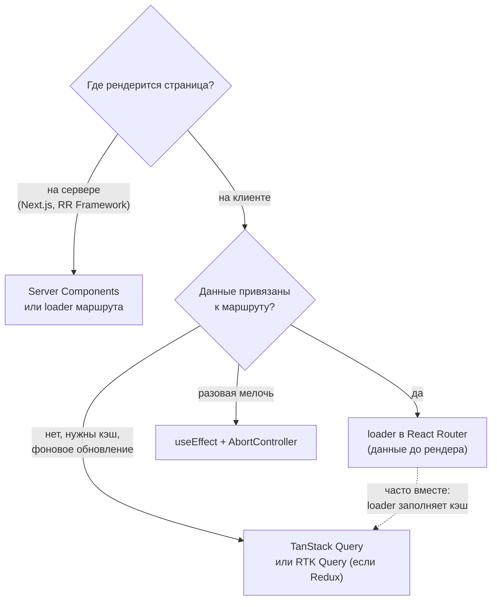
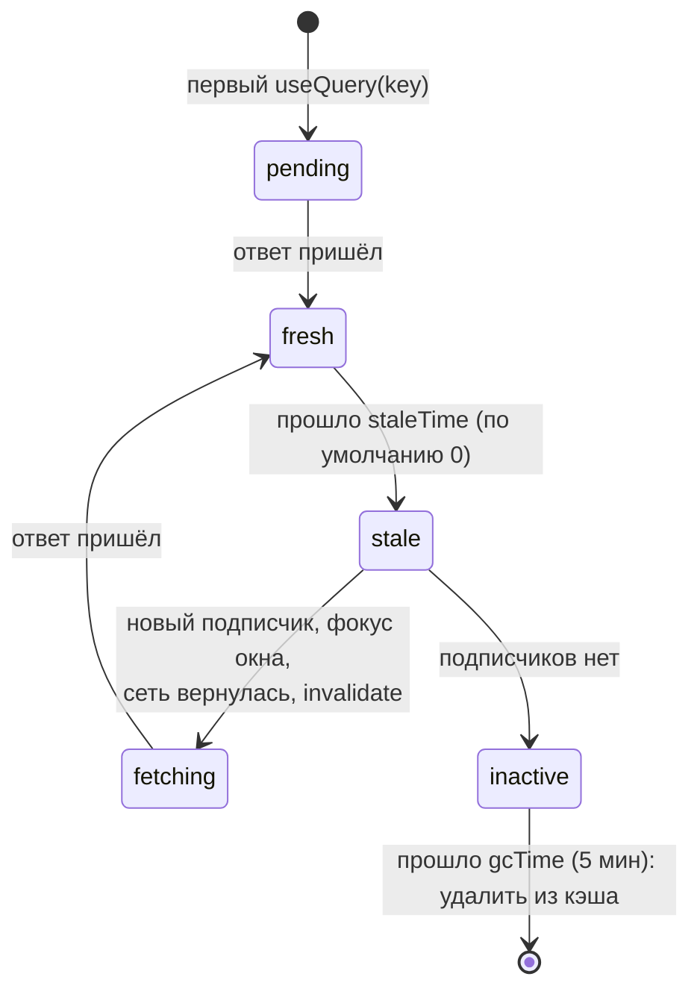

## О чём урок

Как React-приложение получает данные с сервера и держит их свежими: почему «запрос в `useEffect`» плох для реального приложения, как работает TanStack Query (ключи, кэш, свежесть, мутации и инвалидация), где место загрузчикам роутера и серверным компонентам, как мокать API через MSW и как подключать WebSocket и Server-Sent Events.

## Варианты загрузки данных



Запрос в `useEffect` годится для прототипа, но в приложении быстро обрастает проблемами: гонки ответов и отмена (урок об эффектах), повторный запрос из-за двойного эффекта в StrictMode, отсутствие кэша (вернулись на страницу, снова спиннер), дублирующиеся запросы из нескольких компонентов, ручные `loading` и `error`, «водопады» вложенных компонентов, ручное обновление после изменений. Всё это решают библиотеки серверного состояния.

## TanStack Query

Серверное состояние отличается от клиентского: источник правды на сервере, данные могут устареть без вашего участия, их делят многие компоненты. TanStack Query хранит ответы в **кэше по ключу** и управляет их свежестью.



Пример с мок-сервером MSW вместо настоящего API (MSW перехватывает `fetch`, код приложения о нём не знает):

```jsx dom
import { QueryClient, QueryClientProvider, useMutation, useQuery, useQueryClient } from '@tanstack/react-query'
import { act, cleanup, render, screen } from '@testing-library/react'
import { http, HttpResponse } from 'msw'
import { setupServer } from 'msw/node'

const todos = [{ id: 1, title: 'Learn hooks' }]
let requests = 0
const server = setupServer(
  http.get('https://api.example.com/todos', () => (requests++, HttpResponse.json(todos))),
  http.post('https://api.example.com/todos', async ({ request }) => {
    const todo = { id: todos.length + 1, ...(await request.json()) }
    todos.push(todo)
    return HttpResponse.json(todo, { status: 201 })
  }),
)
server.listen()

const fetchTodos = () => fetch('https://api.example.com/todos').then((r) => r.json())

function TodoCount() {
  const { data, isPending } = useQuery({ queryKey: ['todos'], queryFn: fetchTodos })
  return <p>{isPending ? 'loading…' : `${data.length} todos`}</p>
}

function AddTodo() {
  const queryClient = useQueryClient()
  const add = useMutation({
    mutationFn: (title) => fetch('https://api.example.com/todos', { method: 'POST', body: JSON.stringify({ title }) }).then((r) => r.json()),
    onSuccess: () => queryClient.invalidateQueries({ queryKey: ['todos'] }), // refetch the list
  })
  return <button onClick={() => add.mutate('Write tests')}>Add</button>
}

// gcTime: Infinity only so this script can exit: no 5-minute cache timers
const queryClient = new QueryClient({ defaultOptions: { queries: { retry: false, gcTime: Infinity }, mutations: { gcTime: Infinity } } })
render(
  <QueryClientProvider client={queryClient}>
    <TodoCount />
    <TodoCount />
    <AddTodo />
  </QueryClientProvider>,
)
await screen.findAllByText('1 todos')
console.log('two components, requests:', requests)

await act(async () => screen.getByRole('button').click())
await screen.findAllByText('2 todos')
console.log('after the mutation, requests:', requests)
cleanup() // unmount
server.close()
```

```output
two components, requests: 1
after the mutation, requests: 2
```

- **Ключ** (`['todos']`, `['todo', id]`, `['todos', { status: 'done' }]`) определяет запись в кэше. Всё, от чего зависит запрос, должно быть в ключе: иначе для разных параметров вернётся один ответ.
- Два компонента с одним ключом сделали **один** запрос: одновременные запросы объединяются.
- `staleTime` говорит, сколько данные считаются свежими (по умолчанию 0, то есть сразу устаревшие и обновляются при новом подписчике, фокусе окна, восстановлении сети). `gcTime` сколько хранить неиспользуемые данные.
- После изменения данных (`useMutation`) нужные запросы **инвалидируют**, и они загружаются заново. Для мгновенного отклика есть оптимистичное обновление: `onMutate` правит кэш сразу, `onError` откатывает.
- Для Suspense есть `useSuspenseQuery`, для бесконечной прокрутки `useInfiniteQuery`, для SSR предварительная загрузка на сервере и `HydrationBoundary`.
- RTK Query решает ту же задачу для проектов на Redux Toolkit (теги вместо ключей для инвалидации). Подробнее о серверном и клиентском состоянии в треке «Состояние».

## Загрузчики роутера и серверные компоненты

- **Загрузчик маршрута** (урок о роутинге) начинает загрузку при навигации, до рендера и параллельно для всех вложенных маршрутов. Часто его сочетают с TanStack Query: загрузчик вызывает `queryClient.ensureQueryData(...)`, а компонент читает тот же ключ через `useQuery` и получает кэш и фоновое обновление.
- **Server Components** (урок о серверном React) получают данные прямо на сервере (`await db.query(...)` в компоненте) и не отправляют этот код в браузер. Клиентская библиотека тогда нужна только для интерактивных частей.

## MSW: мок API

Mock Service Worker перехватывает запросы на уровне сети: в браузере через Service Worker, в Node.js (тесты, Vitest) через перехват `fetch` и `http`. Код приложения делает обычный `fetch`, и один набор обработчиков работает в разработке, тестах и Storybook.

- В отличие от моков модуля (`vi.mock('./api')`), MSW проверяет настоящий путь запроса: URL, метод, заголовки, разбор ответа.
- В тестах сервер запускают в `beforeAll`, сбрасывают обработчики в `afterEach` (`server.resetHandlers()`), а в отдельном тесте подменяют ответ на ошибку: `server.use(http.get(url, () => new HttpResponse(null, { status: 500 })))`.
- `json-server` поднимает целый REST API из JSON-файла: годится для демо и прототипа, но не для тестов.

## WebSocket и Server-Sent Events

Данные в реальном времени (чат, уведомления, котировки) приходят по постоянному соединению. Правила для React:

- соединение открывают в эффекте и **закрывают в очистке**, иначе при каждом монтировании (и в StrictMode) остаётся лишнее соединение;
- одно соединение на приложение, а не на компонент: его держат во внешнем модуле или сторе, а компоненты подписываются (`useSyncExternalStore` или стор Zustand);
- переподключение с экспоненциальной задержкой (урок об асинхронных паттернах) и повторная подписка после него;
- сообщения часто не рисуют сами, а обновляют кэш: `queryClient.setQueryData(['messages'], ...)` или `invalidateQueries`.

```jsx
function useServerEvents(url, onMessage) {
  const handler = useEffectEvent(onMessage) // always the latest callback, not a dependency
  useEffect(() => {
    const source = new EventSource(url) // reconnects by itself
    source.onmessage = (e) => handler(JSON.parse(e.data))
    return () => source.close()
  }, [url])
}
```

**Server-Sent Events** (`EventSource`) это поток только от сервера к клиенту поверх обычного HTTP: сами переподключаются, проходят через прокси и HTTP/2, подходят для уведомлений и прогресса задач. **WebSocket** нужен, когда клиент тоже часто отправляет (чат, совместное редактирование, игры). Подробности протоколов в треке «API и realtime».

## Главное

- Запрос в `useEffect` не даёт кэша, дедупликации и обновления; для приложения берут TanStack Query, RTK Query, загрузчики роутера или серверные компоненты.
- TanStack Query: кэш по ключу, `staleTime` и `gcTime`, обновление при фокусе и сети, одинаковые запросы объединяются; после мутации `invalidateQueries`.
- В ключ кладут все параметры запроса.
- Загрузчик маршрута начинает загрузку до рендера, его сочетают с кэшем TanStack Query.
- MSW мокает сеть одними обработчиками для разработки и тестов.
- WebSocket и `EventSource`: одно соединение, закрытие в очистке эффекта, переподключение, обновление кэша вместо отдельного состояния.
