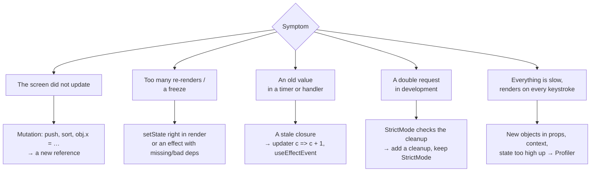

## What this lesson covers

The mistakes most often found in React code and in "find the bug" interview tasks, and the tools to find them: state mutation, infinite renders, stale closures, state that duplicates props, unnecessary effects, unnecessary re-renders; React DevTools, the Profiler, the `<Profiler>` component, StrictMode and reading React's messages.

## A map of typical bugs



## State mutation

React compares state by reference (`Object.is`). If you change an object in place and pass the same reference, React decides nothing changed:

```jsx dom
import { act, useState } from 'react'
import { createRoot } from 'react-dom/client'

let addMutating, addCopy
function List() {
  const [items, setItems] = useState(['a'])
  addMutating = () => {
    items.push('b') // the same array: React skips the update
    setItems(items)
  }
  addCopy = () => setItems((prev) => [...prev, 'c']) // a new array
  return <p>{items.join(',')}</p>
}

const el = document.createElement('div')
await act(async () => createRoot(el).render(<List />))
await act(async () => addMutating())
console.log('after push:', el.textContent)
await act(async () => addCopy())
console.log('after copy:', el.textContent)
```

```output
after push: a
after copy: a,b,c
```

After `push` the screen did not update, and the "lost" `b` showed up later together with the next update: the state was changed behind React's back. The rule: new arrays and objects (`[...prev, x]`, `{ ...user, name }`, `toSorted`, `structuredClone`) or Immer.

## Infinite renders

```jsx dom
import { act, useState } from 'react'
import { createRoot } from 'react-dom/client'

function Broken() {
  const [count, setCount] = useState(0)
  setCount(count + 1) // during render: render → update → render → …
  return <p>{count}</p>
}

try {
  await act(async () => createRoot(document.createElement('div')).render(<Broken />))
} catch (e) {
  console.log(e.message.split('.')[0])
}
```

```output
Too many re-renders
```

Causes: `setState` in the component body; `onClick={handle()}` instead of `onClick={handle}` (the function runs during render); an effect that changes its own condition (`useEffect(() => setData({...data}), [data])`); an effect dependency that is new every render (an object or a function from the component body). The cure: compute derived values in render rather than in an effect, and move objects out of dependencies.

## A stale closure

A function sees the variables of the render in which it was created. An interval from an effect with `[]` sees the first value forever:

```jsx
useEffect(() => {
  const id = setInterval(() => setCount(count + 1), 1000) // count is always 0 here: shows 1 forever
  return () => clearInterval(id)
}, [])
```

Fixes: an updater `setCount((c) => c + 1)`; correct dependencies; `useEffectEvent` for "read the fresh value without re-running the effect"; a `ref` for a mutable value that does not affect markup. Details are in the effects lesson.

## Redundant state and unnecessary effects

- **State that copies props** (`useState(props.user.name)`) does not update when the prop changes: the initial value is read once. Compute from props in render, and to reset when the entity changes, set `key={user.id}`.
- **State that can be computed** (`fullName` from `first` and `last`, a filtered list) need not be stored: it drifts from its source. Compute it in render, expensive cases through `useMemo`.
- **An effect that handles an event** ("on click set a flag, and in an effect check the flag and send") is replaced by code in the handler.
- **An index as `key`** in a list with insertions and removals: field state "moves" to neighbors (the rendering lesson).

## React DevTools and the Profiler

- **The Components tab**: the component tree with props, state and hooks (labeled through `useDebugValue`), finding a component by an element on the page, the source of each component ("rendered by").
- **Highlight updates when components render**: highlights renders right on the page. You can see half the screen re-render on every keystroke.
- **The Profiler tab**: records an interaction, a flame graph per commit, each component's render time and **why** it rendered (props, state, context or parent changed). With React Compiler, components it memoized are marked with a badge.
- In Chrome DevTools the Performance panel has React tracks (Scheduler and Components): you can see which updates ran at which priority.

The same can be measured in code with the `<Profiler>` component: it calls `onRender` after each commit of its subtree.

```jsx dom
import { act, Profiler, useState } from 'react'
import { createRoot } from 'react-dom/client'

let type
function SearchBox() {
  const [text, setText] = useState('')
  type = setText
  return <input value={text} onChange={(e) => setText(e.target.value)} />
}

const commits = []
function onRender(id, phase, actualDuration) {
  commits.push(`${id} ${phase}`) // actualDuration: ms spent rendering this commit
}

await act(async () =>
  createRoot(document.createElement('div')).render(
    <Profiler id="search" onRender={onRender}>
      <SearchBox />
    </Profiler>,
  ),
)
await act(async () => type('r'))
await act(async () => type('re'))
console.log(commits)
```

```output
[ 'search mount', 'search update', 'search update' ]
```

`actualDuration` shows the subtree render time, `baseDuration` an estimate without memoization. Profiling in production needs the separate `react-dom/profiling` build.

## StrictMode and React's messages

- In development `<StrictMode>` calls render, initializers and reducers twice, and mounts, unmounts and mounts components again (the rendering lesson). A double request or a double subscription in development means a missing cleanup, not that StrictMode should be turned off. Production has no double calls.
- React's console messages link to react.dev with an error number; in production the text is shortened to a code, and the full text is at the link.
- Common warnings: "Each child in a list should have a unique key", "A component is changing an uncontrolled input to be controlled", "Cannot update a component while rendering a different component" (a parent's `setState` during a child's render), a hydration error (server HTML did not match the client: dates, `Math.random`, `typeof window` in render; the server React lesson).

## Key points

- Mutating an array or object does not update the screen: only new references do.
- "Too many re-renders": `setState` in render, calling a handler in JSX, an effect changing its own dependency.
- A stale closure is fixed with an updater, dependencies, `useEffectEvent` or a `ref`.
- Do not store what can be computed and do not copy props into state; reset with `key`.
- Find problems with React DevTools (Components, render highlighting, the Profiler with render causes) and the `<Profiler>` component.
- StrictMode reveals missing cleanups; React errors link to react.dev by code.
