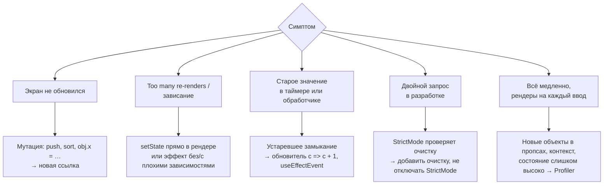

## О чём урок

Ошибки, которые чаще всего встречаются в React-коде и на собеседованиях в задачах «найди баг», и инструменты, которыми их ищут: мутация состояния, бесконечный рендер, устаревшие замыкания, состояние, которое дублирует пропсы, лишние эффекты, лишние ререндеры; React DevTools, Profiler, компонент `<Profiler>`, StrictMode и чтение сообщений React.

## Карта типичных багов



## Мутация состояния

React сравнивает состояние по ссылке (`Object.is`). Если изменить объект на месте и передать ту же ссылку, React решит, что ничего не изменилось:

```jsx dom
import { act, useState } from 'react'
import { createRoot } from 'react-dom/client'

let addMutating, addCopy
function List() {
  const [items, setItems] = useState(['a'])
  addMutating = () => {
    items.push('b') // the same array: React skips the update
    setItems(items)
  }
  addCopy = () => setItems((prev) => [...prev, 'c']) // a new array
  return <p>{items.join(',')}</p>
}

const el = document.createElement('div')
await act(async () => createRoot(el).render(<List />))
await act(async () => addMutating())
console.log('after push:', el.textContent)
await act(async () => addCopy())
console.log('after copy:', el.textContent)
```

```output
after push: a
after copy: a,b,c
```

После `push` экран не обновился, а «потерянное» `b` появилось позже вместе со следующим обновлением: состояние было изменено в обход React. Правило: новые массивы и объекты (`[...prev, x]`, `{ ...user, name }`, `toSorted`, `structuredClone`) или Immer.

## Бесконечный рендер

```jsx dom
import { act, useState } from 'react'
import { createRoot } from 'react-dom/client'

function Broken() {
  const [count, setCount] = useState(0)
  setCount(count + 1) // during render: render → update → render → …
  return <p>{count}</p>
}

try {
  await act(async () => createRoot(document.createElement('div')).render(<Broken />))
} catch (e) {
  console.log(e.message.split('.')[0])
}
```

```output
Too many re-renders
```

Причины: `setState` в теле компонента; `onClick={handle()}` вместо `onClick={handle}` (функция вызывается при рендере); эффект, который меняет своё же условие (`useEffect(() => setData({...data}), [data])`); зависимость эффекта, которая каждый рендер новая (объект или функция из тела компонента). Лечение: вычислять производные значения в рендере, а не в эффекте, и выносить объекты из зависимостей.

## Устаревшее замыкание

Функция видит переменные того рендера, в котором её создали. Интервал из эффекта с `[]` навсегда видит первое значение:

```jsx
useEffect(() => {
  const id = setInterval(() => setCount(count + 1), 1000) // count is always 0 here: shows 1 forever
  return () => clearInterval(id)
}, [])
```

Исправления: функция-обновитель `setCount((c) => c + 1)`; правильные зависимости; `useEffectEvent` для «прочитать свежее значение, но не перезапускать эффект»; `ref` для изменяемого значения, которое не влияет на разметку. Подробно в уроке об эффектах.

## Лишнее состояние и лишние эффекты

- **Состояние, которое копирует пропсы** (`useState(props.user.name)`), не обновится при новом пропсе: начальное значение читается один раз. Нужно вычислять из пропсов в рендере, а для сброса при смене сущности задавать `key={user.id}`.
- **Состояние, которое можно вычислить** (`fullName` из `first` и `last`, отфильтрованный список) хранить не нужно: оно расходится с источником. Считают в рендере, дорогое через `useMemo`.
- **Эффект для обработки события** («по клику отправить, а в эффекте посмотреть флаг и отправить») заменяют кодом в обработчике.
- **Индекс как `key`** в списке, куда вставляют и удаляют элементы: состояние полей «переезжает» к соседям (урок о рендере).

## React DevTools и Profiler

- **Вкладка Components**: дерево компонентов, их пропсы, состояние и хуки (с подписями из `useDebugValue`), поиск компонента по элементу на странице, источник каждого компонента («rendered by»).
- **Highlight updates when components render**: подсветка рендеров прямо на странице. Видно, что при вводе в поле перерисовывается половина экрана.
- **Вкладка Profiler**: запись взаимодействия, flame-график по коммитам, время рендера каждого компонента и **почему** он отрендерился (изменились пропсы, состояние, контекст, родитель). С React Compiler компоненты, которые он мемоизировал, помечены бейджем.
- В Chrome DevTools на вкладке Performance есть дорожки React (Scheduler и Components): видно, какие обновления шли с каким приоритетом.

То же можно измерить в коде компонентом `<Profiler>`: он вызывает `onRender` после каждой фиксации поддерева.

```jsx dom
import { act, Profiler, useState } from 'react'
import { createRoot } from 'react-dom/client'

let type
function SearchBox() {
  const [text, setText] = useState('')
  type = setText
  return <input value={text} onChange={(e) => setText(e.target.value)} />
}

const commits = []
function onRender(id, phase, actualDuration) {
  commits.push(`${id} ${phase}`) // actualDuration: ms spent rendering this commit
}

await act(async () =>
  createRoot(document.createElement('div')).render(
    <Profiler id="search" onRender={onRender}>
      <SearchBox />
    </Profiler>,
  ),
)
await act(async () => type('r'))
await act(async () => type('re'))
console.log(commits)
```

```output
[ 'search mount', 'search update', 'search update' ]
```

`actualDuration` показывает время рендера поддерева, `baseDuration` оценку без мемоизации. Профилирование в продакшене требует отдельной сборки `react-dom/profiling`.

## StrictMode и сообщения React

- `<StrictMode>` в разработке дважды вызывает рендер, инициализаторы и редьюсеры, монтирует, размонтирует и снова монтирует компоненты (урок о рендере). Двойной запрос или двойная подписка в разработке означают, что не хватает очистки, а не что StrictMode надо выключить. В продакшене двойных вызовов нет.
- Сообщения React в консоли содержат ссылку на react.dev с номером ошибки; в продакшене текст сокращён до кода, полный текст по ссылке.
- Частые предупреждения: «Each child in a list should have a unique key», «A component is changing an uncontrolled input to be controlled», «Cannot update a component while rendering a different component» (`setState` родителя в рендере ребёнка), ошибка гидратации (HTML сервера не совпал с клиентом: даты, `Math.random`, `typeof window` в рендере; урок о серверном React).

## Главное

- Мутация массива или объекта не обновляет экран: только новые ссылки.
- «Too many re-renders»: `setState` в рендере, вызов обработчика в JSX, эффект, меняющий свою зависимость.
- Устаревшее замыкание лечат обновителем, зависимостями, `useEffectEvent` или `ref`.
- Не храните то, что можно вычислить, и не копируйте пропсы в состояние; сброс через `key`.
- Ищут проблемы в React DevTools (Components, подсветка рендеров, Profiler с причинами рендеров) и компонентом `<Profiler>`.
- StrictMode показывает недостающую очистку; ошибки React ведут на react.dev по коду.
