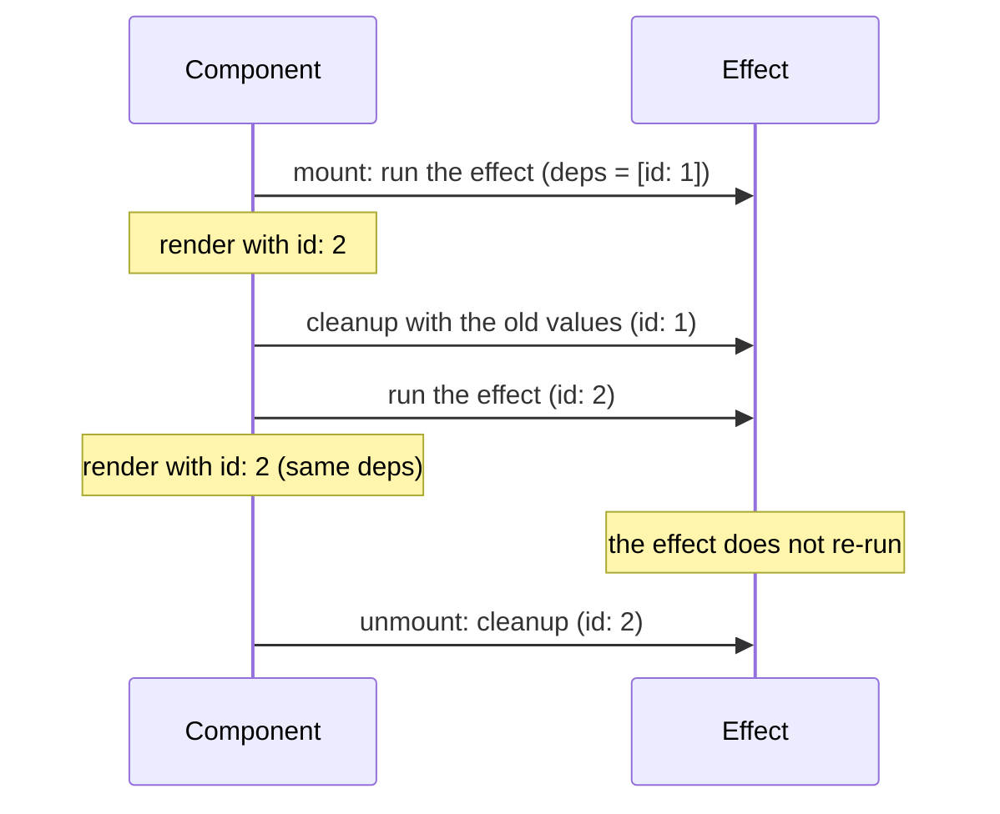

## What this lesson covers

Effects synchronize a component with the outside world: subscriptions, timers, the network, third-party widgets. This lesson covers the order in which they run and clean up, request races, when you do not need an effect at all, `useEffectEvent` from React 19.2, the difference from `useLayoutEffect`, and refs under React 19 rules: `ref` as a prop, cleanup for ref callbacks, Fragment refs.

## When an effect runs



`useEffect(setup, deps)` runs **after the commit**, usually after the browser has painted the frame. If dependencies changed, React first calls the cleanup from the previous run, then the new setup; on unmount the last cleanup is called. Dependencies are compared with `Object.is`. Without an array the effect runs after every render, with `[]` only after mount.

```jsx dom
import { act, useEffect, useLayoutEffect, useState } from 'react'
import { createRoot } from 'react-dom/client'

function Child({ id }) {
  useEffect(() => {
    console.log('child effect', id)
    return () => console.log('child cleanup', id)
  }, [id])
  return null
}

function Parent({ id }) {
  useLayoutEffect(() => console.log('parent layout effect', id), [id])
  useEffect(() => {
    console.log('parent effect', id)
    return () => console.log('parent cleanup', id)
  }, [id])
  return <Child id={id} />
}

const root = createRoot(document.createElement('div'))
await act(() => root.render(<Parent id={1} />))
console.log('--- id changes')
await act(() => root.render(<Parent id={2} />))
console.log('--- unmount')
await act(() => root.unmount())
```

```output
parent layout effect 1
child effect 1
parent effect 1
--- id changes
parent layout effect 2
child cleanup 1
parent cleanup 1
child effect 2
parent effect 2
--- unmount
parent cleanup 2
child cleanup 2
```

What this shows:

- layout effects of the whole tree run before regular ones;
- children's effects run before the parent's (the tree is walked bottom-up), so a parent's effect can rely on its children having subscribed already;
- on update, **all** cleanups first, then **all** new setups;
- on unmount, cleanups run top-down.

Do not pass an `async` function straight to `useEffect`: it returns a promise, while React expects a cleanup function. Declare the async code inside the effect and call it.

## Request races

A request in an effect can come back after the next one. Without protection the response to the old request ends up on screen:

```jsx dom
import { act, useEffect, useState } from 'react'
import { createRoot } from 'react-dom/client'

const delays = { 1: 50, 2: 10 }
const fetchUser = (id) => new Promise((resolve) => setTimeout(() => resolve(`user ${id}`), delays[id]))

function Profile({ id, safe }) {
  const [user, setUser] = useState(null)
  useEffect(() => {
    let ignore = false
    fetchUser(id).then((result) => {
      if (!safe || !ignore) setUser(result)
    })
    return () => {
      ignore = true
    }
  }, [id, safe])
  return <p>{user}</p>
}

const wait = (ms) => new Promise((resolve) => setTimeout(resolve, ms))
for (const safe of [false, true]) {
  const container = document.createElement('div')
  const root = createRoot(container)
  await act(() => root.render(<Profile id={1} safe={safe} />))
  await act(() => root.render(<Profile id={2} safe={safe} />))
  await act(() => wait(100))
  console.log(safe ? 'with cleanup:' : 'no cleanup:', container.textContent, '(asked for user 2)')
}
```

```output
no cleanup: user 1 (asked for user 2)
with cleanup: user 2 (asked for user 2)
```

An `ignore` flag set in the cleanup discards the stale response. Instead of a flag you can cancel the request itself: `const controller = new AbortController()`, `fetch(url, { signal: controller.signal })`, and `controller.abort()` in the cleanup. In practice requests are more often handed to a library (TanStack Query, SWR) or a framework's loaders: they already have caching, deduplication and cancellation, and you do not have to remember the race in every component.

## When you do not need an effect

An effect is needed only when there is an external system. Typical unnecessary effects:

- **Derived data.** `useEffect(() => setTotal(sum(items)), [items])` becomes `const total = sum(items)`.
- **Reacting to a user action.** Submitting a form, click analytics and notifications go into the event handler: that is where you know what happened.
- **Resetting state when a prop changes.** Use `key` on the component.
- **Effect chains**, where one `setState` triggers the next effect: put the logic in the handler or a reducer.
- **Telling the parent about a change**: call `onChange` in the same handler that changes the state.

## Stale closures and useEffectEvent

An effect sees the values of its render. If `count` is used in a `setInterval` inside an effect with `[]`, the interval sees `count = 0` forever. The fixes: an updater function (`setCount(c => c + 1)`), honest dependencies, or, if the value only needs to be read, `useEffectEvent` (stable since React 19.2):

```jsx dom
import { act, useEffect, useEffectEvent, useState } from 'react'
import { createRoot } from 'react-dom/client'

function Chat({ roomId, theme }) {
  const onConnected = useEffectEvent(() => console.log(`connected to ${roomId}, theme ${theme}`))
  useEffect(() => {
    console.log('connect', roomId)
    onConnected()
    return () => console.log('disconnect', roomId)
  }, [roomId])
  return null
}

const root = createRoot(document.createElement('div'))
await act(() => root.render(<Chat roomId="general" theme="light" />))
await act(() => root.render(<Chat roomId="general" theme="dark" />))
await act(() => root.render(<Chat roomId="music" theme="dark" />))
```

```output
connect general
connected to general, theme light
disconnect general
connect music
connected to music, theme dark
```

Changing the theme did not reconnect the chat, and when the room changed the event saw the current theme. A function from `useEffectEvent` is called only from effects and is not listed in dependencies; the linter (the latest `eslint-plugin-react-hooks`) knows this. Silencing `exhaustive-deps` with `eslint-disable` is not an option: that is exactly how stale closures appear.

## useLayoutEffect

`useLayoutEffect` runs synchronously after the DOM changes, **before** the frame is painted. You can measure an element in a regular effect too, since the DOM is already updated there, but if the result is used to move a tooltip or change a size, a regular effect shows one frame in the wrong place and a layout effect does not. The cost: it blocks painting, so `useEffect` is the default. Effects do not run on the server (React 19 removed the warning about `useLayoutEffect` during SSR).

## Refs

`useRef(initial)` returns a `{ current }` object that lives across renders, and changing it does **not** trigger a render. Use it for DOM nodes, timer ids, instances of third-party libraries. Do not read or write `ref.current` during render (except for lazy initialization): render must be pure, and a ref's value does not take part in it. Whatever is shown on screen belongs in state.

Since React 19 `ref` is a regular prop of a function component, and `forwardRef` is not needed:

```jsx dom
import { act, useRef } from 'react'
import { createRoot } from 'react-dom/client'

function TextInput({ ref, label }) {
  return <label>{label} <input ref={ref} /></label>
}

function Form() {
  const inputRef = useRef(null)
  return (
    <>
      <TextInput ref={inputRef} label="Name" />
      <button onClick={() => inputRef.current.focus()}>Edit</button>
    </>
  )
}

const container = document.createElement('div')
document.body.append(container)
await act(() => createRoot(container).render(<Form />))
container.querySelector('button').click()
console.log(document.activeElement.tagName)
```

```output
INPUT
```

To expose a couple of methods (`focus`, `scrollToItem`) instead of the whole DOM node, use `useImperativeHandle(ref, () => ({ ... }), deps)` with the same `ref` prop.

A ref callback can return a cleanup function (React 19): React calls it when the node is detached, instead of the old call with `null`.

```jsx dom
import { act } from 'react'
import { createRoot } from 'react-dom/client'

function Item({ name }) {
  return (
    <li
      ref={(node) => {
        console.log('attach', name, node.tagName)
        return () => console.log('detach', name)
      }}
    >
      {name}
    </li>
  )
}

const root = createRoot(document.createElement('div'))
await act(() => root.render(<ul><Item name="a" /></ul>))
await act(() => root.render(<ul></ul>))
```

```output
attach a LI
detach a
```

React 19 types require an argument for `useRef`:

```tsx check
import { useRef } from 'react'

const inputRef = useRef<HTMLInputElement>(null)
const timerRef = useRef<number | undefined>(undefined)
// @ts-expect-error: since React 19 types useRef needs an initial value
const legacyRef = useRef<number>()

export { inputRef, timerRef, legacyRef }
```

**Fragment refs** (React 19.3): `<Fragment ref={ref}>` gives a `FragmentInstance` with methods for the whole group of children without a wrapper: `addEventListener`, `focus`, `observeUsing(observer)` for `IntersectionObserver` and `ResizeObserver`, `getClientRects`, `scrollIntoView`. It is a way to attach behavior to other people's components that do not accept `ref`.

## Key points

- Effects run after the commit: children first, then the parent; when dependencies change, all cleanups first, then all setups.
- Discard a stale response with a flag in the cleanup or with `AbortController`; more often requests go to a data library.
- Derived data, reactions to actions and state resets do not need effects.
- `useEffectEvent` reads fresh values in an effect without re-running it; do not silence the linter.
- `useLayoutEffect` is for changes before paint; `useEffect` is the default.
- `ref` is a prop since React 19, ref callbacks have cleanup, and `useRef` requires an argument in the types.
