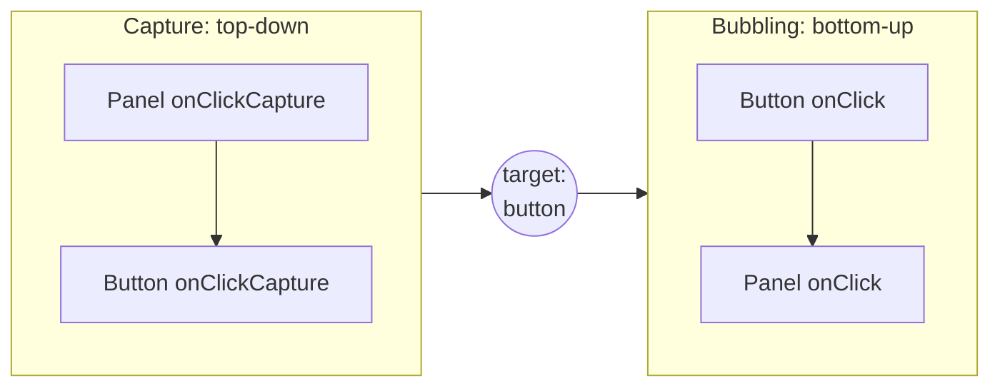
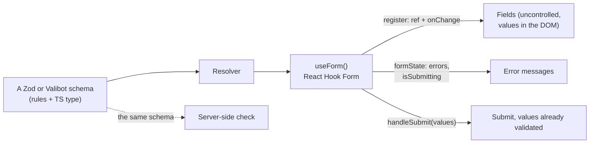

## What this lesson covers

The event details asked after the basic SyntheticEvent question (the state lesson): the capture phase, which events do not bubble, focus. Then forms in practice: controlled field pitfalls, built-in browser validation, form libraries (React Hook Form, TanStack Form) and validation schemas, accessible error messages.

## Capture and bubbling

As in the DOM, a React event goes through two phases: **capture** from the root down to the target and **bubbling** back up. A capture-phase handler has the `Capture` suffix:



```jsx dom
import { act } from 'react'
import { createRoot } from 'react-dom/client'

const log = []
function Panel() {
  return (
    <div
      onClickCapture={() => log.push('panel capture')}
      onClick={() => log.push('panel bubble')}
      onFocus={() => log.push('panel got focus from a child')}
      onMouseEnter={() => log.push('panel mouseenter')}
    >
      <button onClickCapture={() => log.push('button capture')} onClick={() => log.push('button bubble')}>
        Save
      </button>
    </div>
  )
}

const el = document.createElement('div')
document.body.append(el)
await act(async () => createRoot(el).render(<Panel />))
const button = el.querySelector('button')
button.click()
button.focus()
console.log(log.join('\n'))
```

```output
panel capture
button capture
button bubble
panel bubble
panel got focus from a child
```

- Capture is for a parent that must see the event before its children: closing a menu on a click anywhere, logging, blocking input.
- `onFocus` and `onBlur` **bubble** in React (native `focusin` and `focusout` under the hood), so a parent learns about focus inside it: that is how a dropdown closes when focus leaves (`onBlur` plus a check of `e.relatedTarget`).
- `onMouseEnter` and `onMouseLeave` **do not bubble** and do not fire when moving between children, unlike `onMouseOver`/`onMouseOut`. Since React 17 `onScroll` does not bubble either.
- One set of events for mouse, touch and pen: `onPointerDown`, `onPointerMove`, `onPointerUp`.
- `e.stopPropagation()` stops bubbling along the React tree; `e.preventDefault()` cancels the browser action (submitting a form, following a link). Returning `false` from a handler, as in old HTML, does nothing.

## Controlled field pitfalls

- `value` without `onChange` makes the field read-only, and React warns. Use `onChange`, `defaultValue` or `readOnly`.
- `value={undefined}` or `null` makes the field uncontrolled; switching to a string later makes React warn about the mode change. Start with an empty string: `useState('')`.
- `<input type="number">` gives a string: `e.target.value` is `"42"`, and an empty field is `""`. Get a number with `e.target.valueAsNumber` or an explicit conversion.
- A checkbox is controlled through `checked` and `e.target.checked`, not `value`.
- `<input type="file">` is always uncontrolled: its value cannot be set, files are read through a `ref` or `FormData`.
- For `<select>` and `<textarea>` React uses `value` (not `selected` or children) so every field is controlled the same way.

## Browser validation

The browser has built-in checks: `required`, `type="email"`, `minLength`, `pattern`, `min`, `max`. A form with errors is not submitted, and fields get a `validity` state. In React 19 a form with an `action` receives `FormData` (the Actions lesson), and the built-in checks run before the action.

```jsx dom
import { act } from 'react'
import { createRoot } from 'react-dom/client'

function Signup() {
  return (
    <form noValidate>
      <input name="email" type="email" required aria-label="Email" defaultValue="ann@" />
      <input name="password" type="password" minLength={8} aria-label="Password" defaultValue="secret-pass" />
    </form>
  )
}

const el = document.createElement('div')
await act(async () => createRoot(el).render(<Signup />))
const form = el.querySelector('form')
console.log('form valid:', form.checkValidity())
for (const field of form.elements) console.log(field.name, field.validity.valid, field.validity.typeMismatch)
console.log(Object.fromEntries(new FormData(form)))
```

```output
form valid: false
email false true
password true false
{ email: 'ann@', password: 'secret-pass' }
```

`noValidate` turns off the browser's built-in popups but keeps `validity`: that is how custom messages are drawn on top of the built-in rules. Client-side checks are always repeated on the server: the client can be bypassed.

## Form libraries and schemas



| Approach | When |
|---|---|
| `useState` per field | One or two fields, search, a filter |
| `<form action>` and `useActionState` (React 19) | Forms processed on the server, progressive enhancement, server messages |
| React Hook Form | Big forms with client validation: fields are uncontrolled, typing does not re-render the whole form, only the parts subscribed to errors re-render |
| TanStack Form | Strict typing of fields and nested arrays, one API for React, Vue, Angular, Solid |
| Formik, Redux Form | Outdated: every keystroke re-renders the whole form, Redux Form stores each key press in a global store |

A validation schema (Zod, Valibot, ArkType) describes the rules once: it gives the TypeScript type of the form values, and the same check runs on the server. Form libraries plug it in through a resolver (`zodResolver(schema)`) or directly (Standard Schema).

## Accessible errors

- Every field has a visible label: `<label htmlFor={id}>` with `useId()`, not just a `placeholder`.
- A field with an error: `aria-invalid="true"` and `aria-describedby` pointing to the error text, so a screen reader reads it together with the field.
- After a failed submit, move focus to the first invalid field or to an error summary.
- Show an error after the user leaves the field or after submit, not on every character of the first input.

More on accessibility in React is in the accessibility and testing lesson.

## Key points

- Events go through capture top-down (`onClickCapture`) and bubbling bottom-up; `onFocus`/`onBlur` bubble, `onMouseEnter`/`onMouseLeave` and `onScroll` do not.
- `value` requires `onChange`; the initial value is `''`, not `undefined`; a number field gives a string; a file input is always uncontrolled.
- Built-in browser validation (`required`, `type`, `pattern`) and `validity` work in React too; the server validates again.
- Big forms use React Hook Form or TanStack Form with a Zod schema; Formik and Redux Form are outdated.
- Errors are linked to fields with `aria-invalid` and `aria-describedby`, focus goes to the first error.
