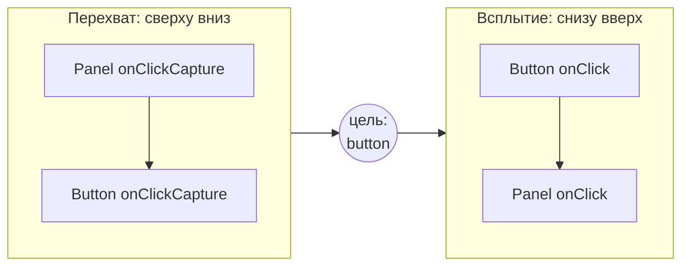
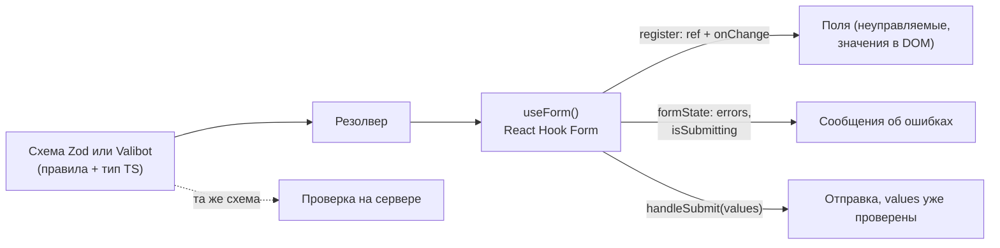

## О чём урок

Детали событий React, которые спрашивают после базового вопроса про SyntheticEvent (урок о состоянии): фаза перехвата, какие события не всплывают, фокус. Затем формы на практике: ловушки управляемых полей, встроенная валидация браузера, библиотеки форм (React Hook Form, TanStack Form) и схемы валидации, доступные сообщения об ошибках.

## Перехват и всплытие

Как и в DOM, событие в React проходит две фазы: **перехват** (capture) от корня к цели и **всплытие** (bubble) обратно. Обработчик фазы перехвата пишется с суффиксом `Capture`:



```jsx dom
import { act } from 'react'
import { createRoot } from 'react-dom/client'

const log = []
function Panel() {
  return (
    <div
      onClickCapture={() => log.push('panel capture')}
      onClick={() => log.push('panel bubble')}
      onFocus={() => log.push('panel got focus from a child')}
      onMouseEnter={() => log.push('panel mouseenter')}
    >
      <button onClickCapture={() => log.push('button capture')} onClick={() => log.push('button bubble')}>
        Save
      </button>
    </div>
  )
}

const el = document.createElement('div')
document.body.append(el)
await act(async () => createRoot(el).render(<Panel />))
const button = el.querySelector('button')
button.click()
button.focus()
console.log(log.join('\n'))
```

```output
panel capture
button capture
button bubble
panel bubble
panel got focus from a child
```

- Перехват нужен, когда родитель должен увидеть событие раньше детей: закрыть меню по клику где угодно, логировать, заблокировать ввод.
- `onFocus` и `onBlur` в React **всплывают** (под капотом нативные `focusin` и `focusout`), поэтому родитель узнаёт о фокусе внутри: так закрывают выпадающий список, когда фокус ушёл наружу (`onBlur` и проверка `e.relatedTarget`).
- `onMouseEnter` и `onMouseLeave` **не всплывают** и не срабатывают при переходе между детьми, в отличие от `onMouseOver`/`onMouseOut`. С React 17 не всплывает и `onScroll`.
- Для мыши, касания и пера один набор событий: `onPointerDown`, `onPointerMove`, `onPointerUp`.
- `e.stopPropagation()` останавливает всплытие по дереву React; `e.preventDefault()` отменяет действие браузера (отправку формы, переход по ссылке). Возврат `false` из обработчика, как в старом HTML, ничего не делает.

## Ловушки управляемых полей

- `value` без `onChange` делает поле только для чтения, React предупреждает. Нужно либо `onChange`, либо `defaultValue`, либо `readOnly`.
- `value={undefined}` или `null` превращает поле в неуправляемое; если потом прийти к строке, React предупредит о смене режима. Начальное значение пустая строка: `useState('')`.
- `<input type="number">` отдаёт строку: `e.target.value` это `"42"`, а пустое поле `""`. Число получают `e.target.valueAsNumber` или явным преобразованием.
- Чекбокс управляется через `checked` и `e.target.checked`, а не `value`.
- `<input type="file">` всегда неуправляемый: значение задать нельзя, файлы читают через `ref` или `FormData`.
- В `<select>` и `<textarea>` React использует `value` (а не `selected` и детей), чтобы все поля управлялись одинаково.

## Валидация браузера

У браузера есть встроенная проверка: `required`, `type="email"`, `minLength`, `pattern`, `min`, `max`. Форма с ошибками не отправляется, а у полей появляется состояние `validity`. В React 19 форма с `action` получает `FormData` (урок об Actions), и встроенная проверка работает до вызова действия.

```jsx dom
import { act } from 'react'
import { createRoot } from 'react-dom/client'

function Signup() {
  return (
    <form noValidate>
      <input name="email" type="email" required aria-label="Email" defaultValue="ann@" />
      <input name="password" type="password" minLength={8} aria-label="Password" defaultValue="secret-pass" />
    </form>
  )
}

const el = document.createElement('div')
await act(async () => createRoot(el).render(<Signup />))
const form = el.querySelector('form')
console.log('form valid:', form.checkValidity())
for (const field of form.elements) console.log(field.name, field.validity.valid, field.validity.typeMismatch)
console.log(Object.fromEntries(new FormData(form)))
```

```output
form valid: false
email false true
password true false
{ email: 'ann@', password: 'secret-pass' }
```

`noValidate` отключает встроенные всплывающие подсказки браузера, но оставляет `validity`: так рисуют свои сообщения, опираясь на встроенные правила. Проверку на клиенте обязательно повторяют на сервере: клиент можно обойти.

## Библиотеки форм и схемы



| Подход | Когда |
|---|---|
| `useState` на каждое поле | Одно-два поля, поиск, фильтр |
| `<form action>` и `useActionState` (React 19) | Формы с серверной обработкой, прогрессивное улучшение, сообщения с сервера |
| React Hook Form | Большие формы с клиентской валидацией: поля неуправляемые, ввод не рендерит всю форму, рендерятся только подписанные на ошибки части |
| TanStack Form | Строгая типизация полей и вложенных массивов, одинаковый API для React, Vue, Angular, Solid |
| Formik, Redux Form | Устарели: каждый ввод рендерит всю форму, Redux Form хранит каждое нажатие в глобальном сторе |

Схема валидации (Zod, Valibot, ArkType) описывает правила один раз: из неё получают тип TypeScript для значений формы и ту же проверку используют на сервере. Библиотеки форм подключают её через резолвер (`zodResolver(schema)`) или напрямую (Standard Schema).

## Доступные ошибки

- У каждого поля видимая подпись: `<label htmlFor={id}>` с `useId()`, а не только `placeholder`.
- Поле с ошибкой: `aria-invalid="true"` и `aria-describedby` на элемент с текстом ошибки, чтобы скринридер прочитал её вместе с полем.
- После неудачной отправки фокус переводят на первое поле с ошибкой или на сводку ошибок.
- Ошибку показывают после ухода из поля или после отправки, а не на каждый символ первого ввода.

Подробнее о доступности в React в уроке о доступности и тестах.

## Главное

- События идут перехватом сверху вниз (`onClickCapture`) и всплытием снизу вверх; `onFocus`/`onBlur` всплывают, `onMouseEnter`/`onMouseLeave` и `onScroll` нет.
- `value` требует `onChange`; начальное значение `''`, а не `undefined`; число из поля это строка; файл всегда неуправляемый.
- Встроенная валидация браузера (`required`, `type`, `pattern`) и `validity` работают и в React; сервер проверяет заново.
- Большие формы на React Hook Form или TanStack Form со схемой Zod; Formik и Redux Form устарели.
- Ошибки связывают с полем через `aria-invalid` и `aria-describedby`, фокус на первую ошибку.
