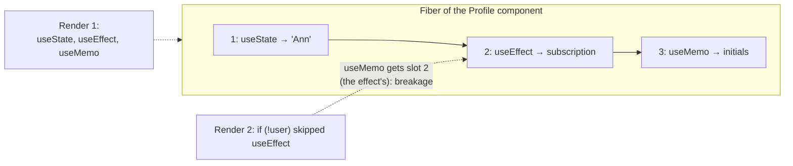
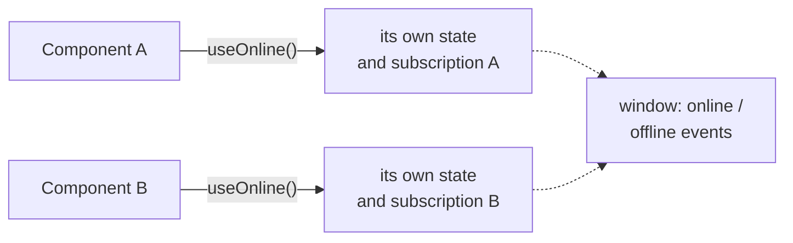

## What this lesson covers

Why hooks replaced classes, how React stores hook state and where the "top level only" rules come from, how to branch logic without breaking them, and how to write custom hooks. Plus the hooks not covered in other lessons: `useReducer`, `useContext` and `use`, `useImperativeHandle`, `useId`, `useSyncExternalStore`, `useDebugValue`.

## Why hooks appeared

Before hooks, stateful logic (subscribing to the window size, loading data, a timer) could not be reused without wrappers: HOCs (`withWindowSize(Component)`) and render props (`<WindowSize>{(size) => ...}</WindowSize>`) created "wrapper hell" in the tree and implicit props. Related logic was spread across `componentDidMount`, `componentDidUpdate` and `componentWillUnmount`, and `this` got lost in handlers. A hook is a function that connects a component to React state and effects; a custom hook is a plain function that calls other hooks. Logic is reused by calling a function, without changing the tree.

## How React stores hooks

Each component instance has, in its Fiber node, a **list of hooks in call order**. On the first render every call to `useState`, `useEffect`, `useMemo` appends a slot to the list. On later renders React walks the list from the start: the first `useState` call gets the first slot, the second call the second one. Slots have no names, only positions.



Hence the **rules of hooks**:

1. Call hooks only at the top level of a component or a custom hook: not in conditions, loops, nested functions, after an early `return` or inside `try/catch`.
2. Call hooks only from function components and custom hooks (names starting with `use`).

Breaking them changes the number or order of calls between renders, and React notices:

```jsx dom
import { act, useState } from 'react'
import { createRoot } from 'react-dom/client'

function Greeting({ withName }) {
  const [greeting] = useState('Hi')
  if (withName) {
    const [name] = useState('Ann') // a conditional hook: breaks the order
    return <p>{greeting}, {name}</p>
  }
  return <p>{greeting}</p>
}

const el = document.createElement('div')
const root = createRoot(el)
await act(async () => root.render(<Greeting withName={false} />))
try {
  await act(async () => root.render(<Greeting withName={true} />))
} catch (e) {
  console.log(e.message)
}
```

```output
Rendered more hooks than during the previous render.
```

The rules are checked by the `eslint-plugin-react-hooks` linter (version 7 also includes the React Compiler rules); every project should use it.

## Branching without breaking the rules

- **Put the condition inside the hook**, not around it: `useEffect(() => { if (!enabled) return; ... }, [enabled])`.
- **Return early after all hooks**: call every hook first, then `if (!user) return null`.
- **Split the component**: `{isAdmin ? <AdminPanel /> : <UserPanel />}`, each with its own hooks.
- The exception: React 19's `use(promise)` and `use(Context)` can be called in conditions and loops. It is not a hook in the slot-list sense: it reads a resource rather than holding state.

## useReducer

When the next state depends on the previous one in complex ways, or several fields change together, the logic moves into a **reducer**: a pure function `(state, action) => newState`. The component only dispatches actions.

```jsx dom
import { act, useReducer } from 'react'
import { createRoot } from 'react-dom/client'

function cartReducer(state, action) {
  switch (action.type) {
    case 'added': {
      const found = state.items.find((i) => i.id === action.id)
      const items = found
        ? state.items.map((i) => (i.id === action.id ? { ...i, qty: i.qty + 1 } : i))
        : [...state.items, { id: action.id, qty: 1 }]
      return { ...state, items }
    }
    case 'cleared':
      return { ...state, items: [] }
    default:
      throw new Error(`unknown action ${action.type}`)
  }
}

let dispatchRef
function Cart() {
  const [state, dispatch] = useReducer(cartReducer, { items: [] })
  dispatchRef = dispatch
  return <p>{state.items.map((i) => `${i.id}×${i.qty}`).join(', ') || 'empty'}</p>
}

const el = document.createElement('div')
await act(async () => createRoot(el).render(<Cart />))
const first = dispatchRef
await act(async () => {
  dispatchRef({ type: 'added', id: 'tea' })
  dispatchRef({ type: 'added', id: 'tea' })
  dispatchRef({ type: 'added', id: 'cake' })
})
console.log(el.textContent, '| same dispatch:', first === dispatchRef)
```

```output
tea×2, cake×1 | same dispatch: true
```

- A reducer is easy to test without the component: it is a function without React.
- `dispatch` is stable between renders: pass it to children and effects without `useCallback`.
- The same pattern (actions and a reducer) underlies Redux; `useReducer` with context replaces Redux in small apps.

## useContext and use

Context passes a value to a whole subtree without props at every level. In React 19 the context itself is the provider: `<ThemeContext value={theme}>` (`.Provider` still works but is on its way out). Read it with `useContext(ThemeContext)` or `use(ThemeContext)`; the latter can be called in a condition. How context affects re-renders and how to split it is covered in the patterns lesson.

## Refs and useImperativeHandle

`useRef` keeps a mutable value between renders, and changing `ref.current` does not trigger a render (the effects lesson). Since React 19 `ref` is passed to a function component **as a regular prop**, no `forwardRef` needed. `useImperativeHandle` lets you hand the parent not a DOM node but a limited set of methods:

```jsx dom
import { act, useImperativeHandle, useRef } from 'react'
import { createRoot } from 'react-dom/client'

function SearchInput({ ref }) {
  const input = useRef(null)
  useImperativeHandle(ref, () => ({
    focus: () => input.current.focus(),
    clear: () => (input.current.value = ''),
  }))
  return <input ref={input} aria-label="Search" defaultValue="old query" />
}

const el = document.createElement('div')
document.body.append(el)
const api = { current: null }
await act(async () => createRoot(el).render(<SearchInput ref={api} />))
api.current.clear()
api.current.focus()
console.log(Object.keys(api.current), document.activeElement === el.querySelector('input'), JSON.stringify(el.querySelector('input').value))
```

```output
[ 'focus', 'clear' ] true ""
```

An imperative API is rarely needed: focus, scrolling, starting an animation, integrating a foreign library. Whatever can be expressed with props (`isOpen`) is expressed with props.

## useId and useSyncExternalStore

- `useId()` gives a stable unique id, identical on the server and the client: for linking `<label htmlFor>` and `aria-describedby`. It is not for list keys.
- `useSyncExternalStore(subscribe, getSnapshot)` subscribes a component to an **external store** (a Zustand or Redux store, `navigator.onLine`, the window size) so that during concurrent rendering every component sees the same value (no tearing).

```jsx dom
import { act, useSyncExternalStore } from 'react'
import { createRoot } from 'react-dom/client'

function createStore(initial) {
  let state = initial
  const listeners = new Set()
  return {
    get: () => state,
    set: (next) => {
      state = next
      listeners.forEach((l) => l())
    },
    subscribe: (listener) => (listeners.add(listener), () => listeners.delete(listener)),
  }
}
const counter = createStore(0)

function Count({ label }) {
  const value = useSyncExternalStore(counter.subscribe, counter.get)
  return <span>{label}:{value} </span>
}

const el = document.createElement('div')
await act(async () => createRoot(el).render(<><Count label="a" /><Count label="b" /></>))
await act(async () => counter.set(5))
console.log(el.textContent.trim())
```

```output
a:5 b:5
```

That is how `react-redux` and Zustand work. `getSnapshot` must return the same value while the store has not changed: a new object on every call causes an infinite render loop.

## Custom hooks



A custom hook reuses **logic**, not state: every call gets its own slots. To share the state itself, lift it up, put it in context or in an external store.

```jsx dom
import { act, useDebugValue, useEffect, useState } from 'react'
import { createRoot } from 'react-dom/client'

function useLocalStorage(key, initial) {
  const [value, setValue] = useState(() => {
    const saved = localStorage.getItem(key) // lazy initializer: read storage once
    return saved === null ? initial : JSON.parse(saved)
  })
  useEffect(() => {
    localStorage.setItem(key, JSON.stringify(value))
  }, [key, value])
  useDebugValue(`${key} = ${JSON.stringify(value)}`) // shown next to the hook in React DevTools
  return [value, setValue]
}

let setTheme
function Settings() {
  const [theme, set] = useLocalStorage('theme', 'light')
  setTheme = set
  return <p>{theme}</p>
}

const el = document.createElement('div')
await act(async () => createRoot(el).render(<Settings />))
await act(async () => setTheme('dark'))
console.log(el.textContent, localStorage.getItem('theme'))
```

```output
dark "dark"
```

- The name starts with `use`: that is how the linter checks the rules of hooks inside it too.
- Return a tuple (`[value, setValue]`, easy to rename) or an object (when there are many values).
- A lazy initializer `useState(() => ...)` runs only on the first render; `useState(readStorage())` would read storage on every render.
- A good custom hook hides one task: `useDebouncedValue`, `useMediaQuery`, `useOnline`, `useLocalStorage`. A hook returning ten unrelated values is better split.

## Key points

- Hooks brought logic reuse without HOCs and render props and kept related code in one place.
- React stores hook slots as a list in call order; so hooks are called only at the top level, without conditions or loops (`use` is the exception).
- Branch with a condition inside the hook, an early `return` after the hooks, or separate components.
- `useReducer` for related state transitions, `dispatch` is stable; in React 19 the context itself is the provider.
- `ref` is a regular prop since React 19; `useImperativeHandle` exposes a limited API.
- `useId` for label linking, `useSyncExternalStore` for external stores without tearing.
- A custom hook shares logic, not state; names start with `use`, and a lazy initializer handles an expensive initial value.
