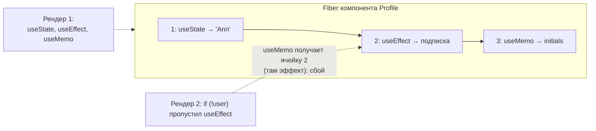
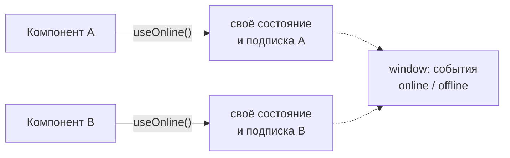

## О чём урок

Почему хуки заменили классы, как React хранит состояние хуков и откуда берутся правила «только на верхнем уровне», как ветвить логику, не нарушая их, и как писать свои хуки. Плюс хуки, которых нет в других уроках: `useReducer`, `useContext` и `use`, `useImperativeHandle`, `useId`, `useSyncExternalStore`, `useDebugValue`.

## Зачем появились хуки

До хуков логику с состоянием (подписка на размер окна, загрузка данных, таймер) нельзя было переиспользовать без обёрток: HOC (`withWindowSize(Component)`) и render props (`<WindowSize>{(size) => ...}</WindowSize>`) давали «ад обёрток» в дереве и неявные пропсы. Связанная логика размазывалась по `componentDidMount`, `componentDidUpdate` и `componentWillUnmount`, а `this` терялся в обработчиках. Хук это функция, которая подключает компонент к состоянию и эффектам React; свой хук это обычная функция, которая вызывает другие хуки. Логика переиспользуется вызовом функции, без изменения дерева.

## Как React хранит хуки

У каждого экземпляра компонента в его узле Fiber есть **список хуков в порядке вызова**. При первом рендере каждый вызов `useState`, `useEffect`, `useMemo` добавляет ячейку в конец списка. При следующих рендерах React идёт по списку с начала: первый вызов `useState` получает первую ячейку, второй вызов вторую. Имён у ячеек нет, только порядковый номер.



Отсюда **правила хуков**:

1. Вызывать хуки только на верхнем уровне компонента или своего хука: не в условиях, циклах, вложенных функциях, после раннего `return` и не в `try/catch`.
2. Вызывать хуки только из функциональных компонентов и своих хуков (имя начинается с `use`).

Нарушение меняет число или порядок вызовов между рендерами, и React замечает это:

```jsx dom
import { act, useState } from 'react'
import { createRoot } from 'react-dom/client'

function Greeting({ withName }) {
  const [greeting] = useState('Hi')
  if (withName) {
    const [name] = useState('Ann') // a conditional hook: breaks the order
    return <p>{greeting}, {name}</p>
  }
  return <p>{greeting}</p>
}

const el = document.createElement('div')
const root = createRoot(el)
await act(async () => root.render(<Greeting withName={false} />))
try {
  await act(async () => root.render(<Greeting withName={true} />))
} catch (e) {
  console.log(e.message)
}
```

```output
Rendered more hooks than during the previous render.
```

Правила проверяет линтер `eslint-plugin-react-hooks` (версия 7 включает и правила React Compiler); его подключают в каждом проекте.

## Как ветвить без нарушения правил

- **Условие внутри хука**, а не вокруг: `useEffect(() => { if (!enabled) return; ... }, [enabled])`.
- **Ранний `return` после всех хуков**: сначала все вызовы хуков, потом `if (!user) return null`.
- **Разделить компонент**: `{isAdmin ? <AdminPanel /> : <UserPanel />}`, у каждого свои хуки.
- Исключение: `use(promise)` и `use(Context)` из React 19 можно вызывать в условиях и циклах. Это не хук в смысле списка ячеек: он читает ресурс, а не хранит состояние.

## useReducer

Когда следующее состояние зависит от предыдущего сложным образом или несколько полей меняются вместе, логику выносят в **редьюсер**: чистую функцию `(state, action) => newState`. Компонент только отправляет действия.

```jsx dom
import { act, useReducer } from 'react'
import { createRoot } from 'react-dom/client'

function cartReducer(state, action) {
  switch (action.type) {
    case 'added': {
      const found = state.items.find((i) => i.id === action.id)
      const items = found
        ? state.items.map((i) => (i.id === action.id ? { ...i, qty: i.qty + 1 } : i))
        : [...state.items, { id: action.id, qty: 1 }]
      return { ...state, items }
    }
    case 'cleared':
      return { ...state, items: [] }
    default:
      throw new Error(`unknown action ${action.type}`)
  }
}

let dispatchRef
function Cart() {
  const [state, dispatch] = useReducer(cartReducer, { items: [] })
  dispatchRef = dispatch
  return <p>{state.items.map((i) => `${i.id}×${i.qty}`).join(', ') || 'empty'}</p>
}

const el = document.createElement('div')
await act(async () => createRoot(el).render(<Cart />))
const first = dispatchRef
await act(async () => {
  dispatchRef({ type: 'added', id: 'tea' })
  dispatchRef({ type: 'added', id: 'tea' })
  dispatchRef({ type: 'added', id: 'cake' })
})
console.log(el.textContent, '| same dispatch:', first === dispatchRef)
```

```output
tea×2, cake×1 | same dispatch: true
```

- Редьюсер легко тестировать отдельно от компонента: это функция без React.
- `dispatch` стабилен между рендерами: его можно передавать детям и в эффекты без `useCallback`.
- Тот же паттерн (действия и редьюсер) лежит в основе Redux; `useReducer` с контекстом заменяет Redux в небольших приложениях.

## useContext и use

Контекст передаёт значение всему поддереву без пропсов на каждом уровне. В React 19 провайдером служит сам контекст: `<ThemeContext value={theme}>` (`.Provider` работает, но устаревает). Читают его `useContext(ThemeContext)` или `use(ThemeContext)`; второй можно вызвать в условии. Как контекст влияет на ререндеры и как его делить, разобрано в уроке о паттернах.

## Refs и useImperativeHandle

`useRef` хранит изменяемое значение между рендерами, изменение `ref.current` не вызывает рендер (урок об эффектах). С React 19 `ref` передаётся функциональному компоненту **обычным пропсом**, `forwardRef` не нужен. `useImperativeHandle` позволяет отдать родителю не DOM-узел, а ограниченный набор методов:

```jsx dom
import { act, useImperativeHandle, useRef } from 'react'
import { createRoot } from 'react-dom/client'

function SearchInput({ ref }) {
  const input = useRef(null)
  useImperativeHandle(ref, () => ({
    focus: () => input.current.focus(),
    clear: () => (input.current.value = ''),
  }))
  return <input ref={input} aria-label="Search" defaultValue="old query" />
}

const el = document.createElement('div')
document.body.append(el)
const api = { current: null }
await act(async () => createRoot(el).render(<SearchInput ref={api} />))
api.current.clear()
api.current.focus()
console.log(Object.keys(api.current), document.activeElement === el.querySelector('input'), JSON.stringify(el.querySelector('input').value))
```

```output
[ 'focus', 'clear' ] true ""
```

Императивный API нужен редко: фокус, прокрутка, запуск анимации, интеграция с чужой библиотекой. Всё, что можно выразить пропсами (`isOpen`), выражают пропсами.

## useId и useSyncExternalStore

- `useId()` даёт стабильный уникальный id, одинаковый на сервере и клиенте: для связки `<label htmlFor>` и `aria-describedby`. Для ключей списков он не подходит.
- `useSyncExternalStore(subscribe, getSnapshot)` подписывает компонент на **внешнее хранилище** (стор Zustand или Redux, `navigator.onLine`, размер окна) так, чтобы при конкурентном рендере все компоненты видели одно и то же значение (без «разрыва», tearing).

```jsx dom
import { act, useSyncExternalStore } from 'react'
import { createRoot } from 'react-dom/client'

function createStore(initial) {
  let state = initial
  const listeners = new Set()
  return {
    get: () => state,
    set: (next) => {
      state = next
      listeners.forEach((l) => l())
    },
    subscribe: (listener) => (listeners.add(listener), () => listeners.delete(listener)),
  }
}
const counter = createStore(0)

function Count({ label }) {
  const value = useSyncExternalStore(counter.subscribe, counter.get)
  return <span>{label}:{value} </span>
}

const el = document.createElement('div')
await act(async () => createRoot(el).render(<><Count label="a" /><Count label="b" /></>))
await act(async () => counter.set(5))
console.log(el.textContent.trim())
```

```output
a:5 b:5
```

Так устроены `react-redux` и Zustand. `getSnapshot` должен возвращать одно и то же значение, пока хранилище не изменилось: новый объект на каждый вызов даст бесконечный цикл рендеров.

## Свои хуки



Свой хук переиспользует **логику**, а не состояние: каждый вызов получает собственные ячейки. Чтобы разделить само состояние, его поднимают выше, кладут в контекст или во внешнее хранилище.

```jsx dom
import { act, useDebugValue, useEffect, useState } from 'react'
import { createRoot } from 'react-dom/client'

function useLocalStorage(key, initial) {
  const [value, setValue] = useState(() => {
    const saved = localStorage.getItem(key) // lazy initializer: read storage once
    return saved === null ? initial : JSON.parse(saved)
  })
  useEffect(() => {
    localStorage.setItem(key, JSON.stringify(value))
  }, [key, value])
  useDebugValue(`${key} = ${JSON.stringify(value)}`) // shown next to the hook in React DevTools
  return [value, setValue]
}

let setTheme
function Settings() {
  const [theme, set] = useLocalStorage('theme', 'light')
  setTheme = set
  return <p>{theme}</p>
}

const el = document.createElement('div')
await act(async () => createRoot(el).render(<Settings />))
await act(async () => setTheme('dark'))
console.log(el.textContent, localStorage.getItem('theme'))
```

```output
dark "dark"
```

- Имя начинается с `use`: так линтер проверяет правила хуков и внутри него.
- Возвращают кортеж (`[value, setValue]`, удобно переименовывать) или объект (когда значений много).
- Ленивый инициализатор `useState(() => ...)` выполняется только при первом рендере; `useState(readStorage())` читал бы хранилище на каждом рендере.
- Хороший свой хук прячет одну задачу: `useDebouncedValue`, `useMediaQuery`, `useOnline`, `useLocalStorage`. Хук, который возвращает десять несвязанных значений, лучше разбить.

## Главное

- Хуки дали переиспользование логики без HOC и render props и собрали связанный код в одном месте.
- React хранит ячейки хуков списком в порядке вызова; поэтому хуки вызывают только на верхнем уровне, без условий и циклов (`use` исключение).
- Ветвят условием внутри хука, ранним `return` после хуков или отдельными компонентами.
- `useReducer` для связанных переходов состояния, `dispatch` стабилен; контекст в React 19 сам служит провайдером.
- `ref` обычный проп с React 19; `useImperativeHandle` отдаёт ограниченный API.
- `useId` для связки подписей, `useSyncExternalStore` для внешних хранилищ без tearing.
- Свой хук делит логику, а не состояние; имя с `use`, ленивый инициализатор для дорогого начального значения.
