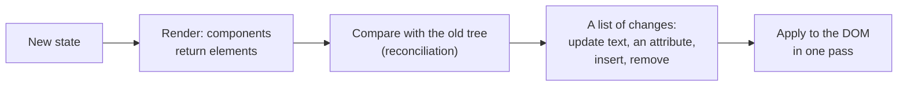
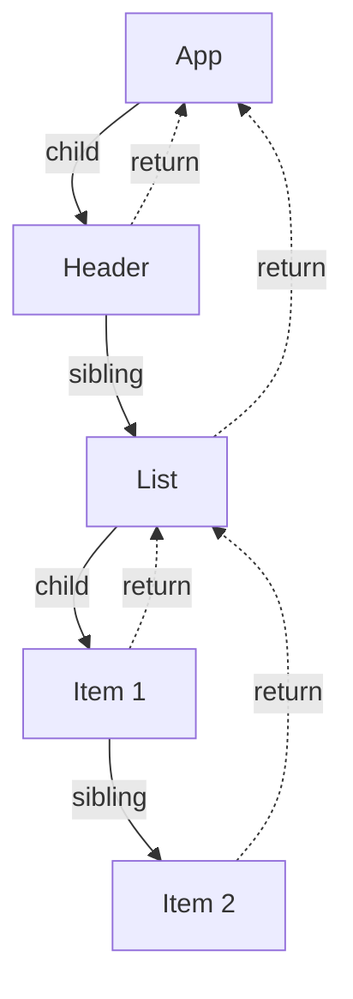
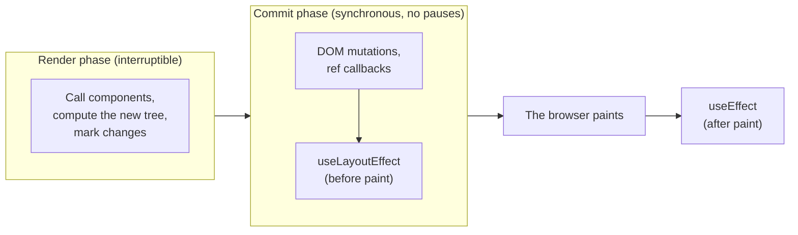

## What this lesson covers

How React works inside and why: why a Virtual DOM, how Fiber replaced the old recursive algorithm, the two phases of work (render and commit), update priorities, concurrent rendering and tearing, how batching changed from React 17 to 18 and how to opt out. Interviews ask this block of middle and senior candidates: understand the ideas, not the names of internal fields, which change between versions.

## Why a Virtual DOM

The interface is described **declaratively**: a component returns how the screen should look for the current data, not which DOM operations to perform. React compares the new description (a tree of elements) with the previous one and computes a minimal set of DOM changes.



- A Virtual DOM is not "faster than the DOM": diffing is extra work. The win is that the developer writes no manual updates, while React batches changes and leaves untouched what did not change. Svelte, Solid and Vue Vapor do without it by compiling targeted updates.
- The description is platform-independent: the same algorithm renders to the DOM (`react-dom`), native components (React Native), canvas or PDF.
- A full diff of two trees costs O(n³). React does O(n) with two assumptions: elements of different types produce different trees (if the type changes, the subtree is recreated), and list elements are identified by `key`. Details with examples are in the rendering lesson.

## Fiber: why the core was rewritten

Before React 16 the **stack reconciler** walked the whole tree recursively in one synchronous call. A big update held the main thread for hundreds of milliseconds, and input, animations and scrolling froze; the recursion could not be paused halfway.

**Fiber** (React 16, 2017) turned the recursion into a loop over a linked list of nodes. Each node is a unit of work, and between units React can stop, yield the thread to the browser and continue later, or throw away the started work if an urgent update arrives.



A Fiber node stores the type and key, the `child`, `sibling` and `return` (parent) links, new and memoized props, the **list of hooks** (the hooks lesson), flags for the needed DOM changes and a priority. The walk goes depth-first through `child`, then to `sibling`, and completes nodes while climbing back through `return`.

**Double buffering.** React keeps two trees: **current** (what is on screen) and **work-in-progress** (being built for the next frame). Nodes are linked by the `alternate` field. When the work is done, React makes the new tree current in one step. While work is in progress, the old consistent state stays on screen.

## Two phases: render and commit



- **Render** is pure: components only compute markup. React may call render several times, interrupt it or discard the result. That is why side effects in a component body (a request, a subscription, writing to an outer variable) break, and StrictMode deliberately renders twice in development.
- **Commit** applies the changes to the DOM in one synchronous pass, then runs `useLayoutEffect` before paint and `useEffect` after it.

```jsx dom
import { act, useEffect, useLayoutEffect } from 'react'
import { createRoot } from 'react-dom/client'

const log = []
function Child() {
  log.push('render Child')
  useLayoutEffect(() => log.push('layout effect Child'))
  useEffect(() => log.push('effect Child'))
  return <span ref={() => log.push('ref Child')} />
}
function Parent() {
  log.push('render Parent')
  useLayoutEffect(() => log.push('layout effect Parent'))
  useEffect(() => log.push('effect Parent'))
  return <Child />
}

await act(async () => createRoot(document.createElement('div')).render(<Parent />))
console.log(log.join('\n'))
```

```output
render Parent
render Child
ref Child
layout effect Child
layout effect Parent
effect Child
effect Parent
```

Rendering goes top-down, while effects run bottom-up: a parent sees its children already set up.

## Priorities and concurrent rendering

Each update gets a priority (in React's code these are **lanes**, bitmasks):

| Priority | What produces it | How it is interrupted |
|---|---|---|
| Synchronous (discrete events) | A click, a key press, `flushSync` | Not interrupted |
| Continuous input | Mouse movement, scrolling | Almost never |
| Default | `setState` outside events, network responses | Synchronous unless there are transitions |
| Transition | `startTransition`, `useTransition`, `useDeferredValue` | Interrupted by urgent updates |
| Idle | Hidden parts of `<Activity>`, prerendering | The lowest |

**Concurrent rendering** is enabled only for transitions, Suspense and `useDeferredValue`. In such a render React works in slices of about 5 ms and checks whether something urgent has arrived; if it has, the transition render is postponed or restarted. Regular `setState` still renders synchronously to the end. `useTransition` and `useDeferredValue` are covered in the performance lesson: the first marks an **update** as a transition (you call `setState`), the second defers a **value** that came from outside (a prop, another hook's result).

**Tearing.** If a component reads an external mutable source (a global variable, a store) during an interruptible render, part of the tree may render with the old value and part with the new. React's own state is protected from this; for external stores there is `useSyncExternalStore` (the hooks lesson), which falls back to a synchronous render when the source changes.

## Batching: from React 17 to 18

**Batching** combines several `setState` calls into one render.

| Where `setState` is called | React 17 (`ReactDOM.render`) | React 18+ (`createRoot`) |
|---|---|---|
| A React event handler | One render | One render |
| `setTimeout`, a promise, `await`, a native handler | A render per call | One render (automatic batching) |

```jsx dom
import { useState } from 'react'
import { createRoot } from 'react-dom/client'
import { flushSync } from 'react-dom'

globalThis.IS_REACT_ACT_ENVIRONMENT = false // real scheduling here, not act()
let renders = 0
let setA, setB
function Pair() {
  renders++
  const [a, sa] = useState(0)
  const [b, sb] = useState(0)
  setA = sa
  setB = sb
  return <p>{a}{b}</p>
}

const el = document.createElement('div')
createRoot(el).render(<Pair />)
await new Promise((r) => setTimeout(r, 10))
renders = 0

setTimeout(() => {
  setA(1)
  setB(1)
}, 0)
await new Promise((r) => setTimeout(r, 10))
console.log('two setState in a timer:', renders, 'render(s)')

renders = 0
flushSync(() => setA(2)) // apply right now, as its own render
flushSync(() => setB(2))
console.log('two flushSync:', renders, 'render(s), DOM:', el.textContent)
```

```output
two setState in a timer: 1 render(s)
two flushSync: 2 render(s), DOM: 22
```

- Within one batch `setState` does not change the state variable at once: the value updates for the next render. If you need the result of the previous update, use an updater `setCount((c) => c + 1)`.
- `flushSync` forces an update to apply synchronously, and the DOM is updated right after the call: for example, to scroll to a just-added element. Use it rarely, it is an extra render.
- `setState` is not "asynchronous" like a promise: it queues an update, and batching decides when to apply it.

## Key points

- A Virtual DOM gives a declarative interface and platform-independent rendering; O(n) diffing relies on the element type and `key`.
- Fiber turned recursion into an interruptible loop over nodes with `child`, `sibling`, `return`; current and work-in-progress trees swap on commit.
- Render is pure and may repeat; commit is synchronous: DOM, refs, `useLayoutEffect` before paint, `useEffect` after. Effects run bottom-up.
- Updates have priorities (lanes); concurrent rendering is only for transitions, Suspense and `useDeferredValue`.
- Tearing threatens external stores; the protection is `useSyncExternalStore`.
- With `createRoot` batching is automatic everywhere; `flushSync` applies an update immediately.
