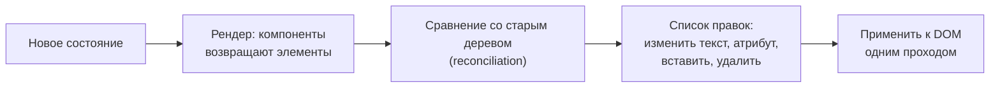
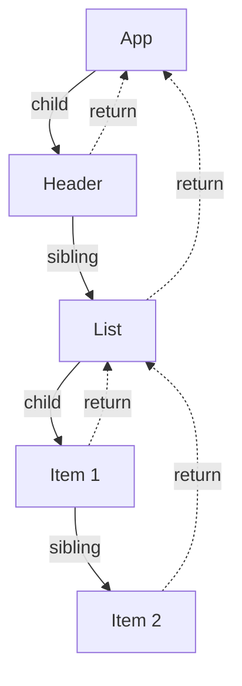
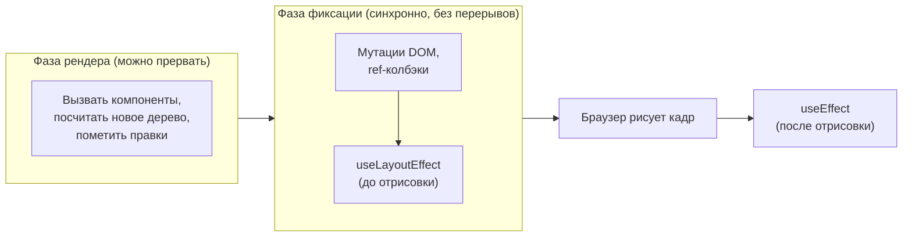

## О чём урок

Как React устроен внутри и почему: зачем Virtual DOM, чем Fiber заменил старый рекурсивный алгоритм, две фазы работы (рендер и фиксация), приоритеты обновлений, конкурентный рендер и «разрыв» (tearing), как менялся батчинг от React 17 к 18 и как его отключить. На собеседованиях этот блок спрашивают у middle и senior: важно понимать идеи, а не названия внутренних полей, которые меняются между версиями.

## Зачем Virtual DOM

Интерфейс описывается **декларативно**: компонент возвращает, как экран должен выглядеть при текущих данных, а не какие операции с DOM сделать. React сравнивает новое описание (дерево элементов) с предыдущим и вычисляет минимальный набор правок DOM.



- Virtual DOM не «быстрее DOM»: сравнение это дополнительная работа. Выигрыш в том, что разработчик не пишет ручные обновления, а React группирует правки и не трогает неизменённое. Svelte, Solid и Vue Vapor обходятся без него, компилируя точечные обновления.
- Описание не зависит от платформы: тот же алгоритм рисует в DOM (`react-dom`), в нативные компоненты (React Native), в canvas или PDF.
- Полное сравнение двух деревьев стоит O(n³). React делает O(n) за счёт двух предположений: элементы разного типа дают разные деревья (тип сменился, поддерево пересоздаётся), а элементы списка опознаются по `key`. Подробно с примерами в уроке о рендере.

## Fiber: зачем переписали ядро

До React 16 работал **stack reconciler**: рекурсивный обход всего дерева за один синхронный вызов. Большое обновление занимало главный поток на сотни миллисекунд, и ввод, анимации и прокрутка подвисали; прервать рекурсию на середине было нельзя.

**Fiber** (React 16, 2017) превратил рекурсию в цикл по связному списку узлов. Каждый узел это единица работы, и между единицами React может остановиться, отдать поток браузеру и продолжить позже или выбросить начатую работу, если пришло срочное обновление.



Узел Fiber хранит тип и ключ, ссылки `child`, `sibling` и `return` (родитель), новые и сохранённые пропсы, **список хуков** (урок о хуках), флаги нужных правок DOM и приоритет. Обход идёт в глубину по `child`, затем к `sibling`, а при подъёме по `return` завершает узлы.

**Двойная буферизация.** У React два дерева: **current** (то, что сейчас на экране) и **work-in-progress** (строится для следующего кадра). Узлы связаны полем `alternate`. Когда работа закончена, React одной операцией делает новое дерево текущим. Пока работа идёт, на экране остаётся старое согласованное состояние.

## Две фазы: рендер и фиксация



- **Рендер** чистый: компоненты только вычисляют разметку. React может вызвать рендер несколько раз, прервать его или выбросить результат. Поэтому побочные эффекты в теле компонента (запрос, подписка, запись во внешнюю переменную) ломаются, и StrictMode в разработке намеренно вызывает рендер дважды.
- **Фиксация** (commit) применяет правки к DOM за один синхронный проход, затем выполняет `useLayoutEffect` до отрисовки, а `useEffect` после неё.

```jsx dom
import { act, useEffect, useLayoutEffect } from 'react'
import { createRoot } from 'react-dom/client'

const log = []
function Child() {
  log.push('render Child')
  useLayoutEffect(() => log.push('layout effect Child'))
  useEffect(() => log.push('effect Child'))
  return <span ref={() => log.push('ref Child')} />
}
function Parent() {
  log.push('render Parent')
  useLayoutEffect(() => log.push('layout effect Parent'))
  useEffect(() => log.push('effect Parent'))
  return <Child />
}

await act(async () => createRoot(document.createElement('div')).render(<Parent />))
console.log(log.join('\n'))
```

```output
render Parent
render Child
ref Child
layout effect Child
layout effect Parent
effect Child
effect Parent
```

Рендер идёт сверху вниз, а эффекты снизу вверх: родитель видит уже готовых детей.

## Приоритеты и конкурентный рендер

Каждое обновление получает приоритет (в коде React это **lanes**, битовые маски):

| Приоритет | Что даёт | Как прерывается |
|---|---|---|
| Синхронный (дискретные события) | Клик, нажатие клавиши, `flushSync` | Не прерывается |
| Непрерывный ввод | Движение мыши, прокрутка | Почти не прерывается |
| Обычный | `setState` вне событий, ответы сети | Синхронно, если нет переходов |
| Переход | `startTransition`, `useTransition`, `useDeferredValue` | Прерывается срочными обновлениями |
| Простой (idle) | Скрытые части `<Activity>`, предварительный рендер | Самый низкий |

**Конкурентный рендер** включается только для переходов, Suspense и `useDeferredValue`. В таком рендере React работает отрезками примерно по 5 мс и проверяет, не пришло ли что-то срочное; если пришло, обычный рендер перехода откладывается или начинается заново. Обычные `setState` по-прежнему рендерятся синхронно до конца. Подробно `useTransition` и `useDeferredValue` в уроке о производительности: первый помечает переходом **обновление** (вы вызываете `setState`), второй откладывает **значение**, пришедшее извне (пропс, результат другого хука).

**Tearing (разрыв).** Если компонент читает внешний изменяемый источник (глобальную переменную, стор) во время прерываемого рендера, часть дерева может отрисоваться со старым значением, а часть с новым. Встроенное состояние React от этого защищено; для внешних сторов существует `useSyncExternalStore` (урок о хуках), который откатывает рендер на синхронный при изменении источника.

## Батчинг: от React 17 к 18

**Батчинг** объединяет несколько `setState` в один рендер.

| Где вызван `setState` | React 17 (`ReactDOM.render`) | React 18+ (`createRoot`) |
|---|---|---|
| Обработчик события React | Один рендер | Один рендер |
| `setTimeout`, промис, `await`, нативный обработчик | Рендер на каждый вызов | Один рендер (автоматический батчинг) |

```jsx dom
import { useState } from 'react'
import { createRoot } from 'react-dom/client'
import { flushSync } from 'react-dom'

globalThis.IS_REACT_ACT_ENVIRONMENT = false // real scheduling here, not act()
let renders = 0
let setA, setB
function Pair() {
  renders++
  const [a, sa] = useState(0)
  const [b, sb] = useState(0)
  setA = sa
  setB = sb
  return <p>{a}{b}</p>
}

const el = document.createElement('div')
createRoot(el).render(<Pair />)
await new Promise((r) => setTimeout(r, 10))
renders = 0

setTimeout(() => {
  setA(1)
  setB(1)
}, 0)
await new Promise((r) => setTimeout(r, 10))
console.log('two setState in a timer:', renders, 'render(s)')

renders = 0
flushSync(() => setA(2)) // apply right now, as its own render
flushSync(() => setB(2))
console.log('two flushSync:', renders, 'render(s), DOM:', el.textContent)
```

```output
two setState in a timer: 1 render(s)
two flushSync: 2 render(s), DOM: 22
```

- Внутри одного батча `setState` не меняет переменную состояния сразу: значение обновится к следующему рендеру. Нужен результат предыдущего обновления: функция-обновитель `setCount((c) => c + 1)`.
- `flushSync` заставляет применить обновление синхронно, и DOM обновлён сразу после вызова: нужно, например, прокрутить к только что добавленному элементу. Применяют редко, это лишний рендер.
- `setState` не «асинхронный» в смысле промиса: он ставит обновление в очередь, а батчинг решает, когда его применить.

## Главное

- Virtual DOM даёт декларативный интерфейс и платформонезависимый рендер; сравнение за O(n) опирается на тип элемента и `key`.
- Fiber превратил рекурсию в прерываемый цикл по узлам с `child`, `sibling`, `return`; деревья current и work-in-progress меняются местами при фиксации.
- Рендер чистый и может повторяться; фиксация синхронна: DOM, ref, `useLayoutEffect` до отрисовки, `useEffect` после. Эффекты выполняются снизу вверх.
- Обновления имеют приоритеты (lanes); конкурентный рендер только для переходов, Suspense и `useDeferredValue`.
- Tearing грозит внешним сторам, защита `useSyncExternalStore`.
- С `createRoot` батчинг автоматический везде; `flushSync` применяет обновление сразу.
