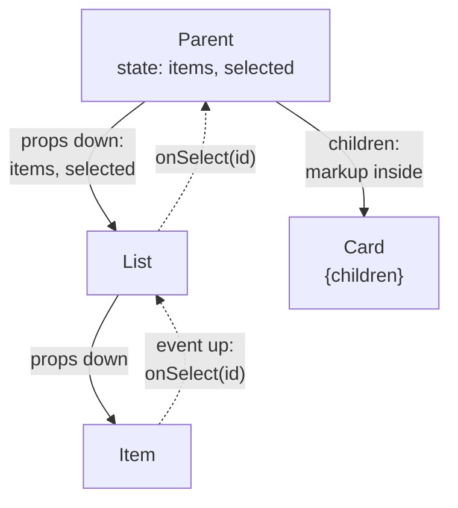
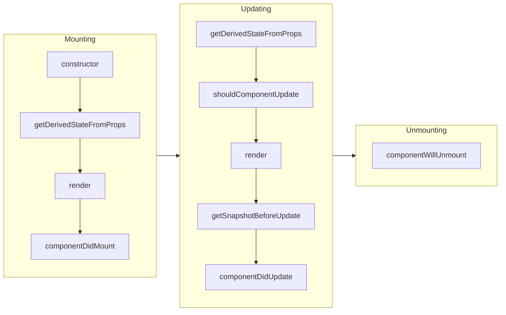

## What this lesson covers

What a React interface is made of: JSX and its rules, fragments, conditional rendering and lists, components, props and `children`, why props are read-only, what happened to `PropTypes` and `defaultProps` in React 19, and React without JSX. The second half covers class components: interviews still ask about them and old code still has them, so you need the lifecycle methods and how they map to hooks.

## JSX: the rules

JSX is syntax that the compiler turns into `jsx()` calls (the rendering lesson shows that the result is a description object). Hence the rules:

- **Expressions in curly braces**: `{user.name}`, `{items.length > 0 && <List />}`. Statements (`if`, `for`) are not allowed inside JSX: write them before `return` or use expressions (`? :`, `&&`, `map`).
- **camelCase attributes** following DOM property names: `className` instead of `class`, `htmlFor` instead of `for`, `onClick`, `tabIndex`. Exceptions: `aria-*` and `data-*` are written as in HTML.
- **`style` is an object**: `style={{ marginTop: 8 }}`; numbers without units mean pixels.
- **One root**: a component returns one expression. Several siblings are wrapped in a fragment `<>...</>`, which creates no DOM node. A keyed fragment uses the full form `<Fragment key={id}>`.
- **Component names start with a capital letter**: `<button>` is a tag, `<Button>` is your component. The compiler tells them apart exactly by case.
- **Text is escaped**: `{userInput}` is always inserted as text, so JSX protects against XSS. Inserting HTML is only possible explicitly through `dangerouslySetInnerHTML`.

## Conditional rendering and the zero trap

```jsx dom
import { act } from 'react'
import { createRoot } from 'react-dom/client'

function Inbox({ messages, user }) {
  return (
    <section>
      {messages.length && <b>{messages.length} new</b>}
      {messages.length > 0 ? <b>has mail</b> : <i>empty</i>}
      {user?.isAdmin && <button>Admin</button>}
      {null}{false}{undefined}{true}
    </section>
  )
}

const el = document.createElement('div')
await act(async () => createRoot(el).render(<Inbox messages={[]} user={null} />))
console.log(el.innerHTML)
```

```output
<section>0<i>empty</i></section>
```

`false`, `null`, `undefined` and `true` render nothing, but **the number `0` is rendered**. So `messages.length && ...` on an empty list prints "0". Convert the condition to a boolean: `messages.length > 0 && ...` or `!!messages.length && ...`. In React Native such a zero even crashes the app (text outside `<Text>`).

## Components, props and children



- A component is a function from props to markup. Data flows **down** through props, events flow **up** through callbacks (`onSelect`, `onChange`). This is one-way data flow.
- `children` is a normal prop holding whatever is between the tags: `<Card><p>text</p></Card>`. That is how wrapper components (a card, a modal, a layout) accept arbitrary content, and it is the main composition tool in React.
- Default values come from destructuring: `function Button({ size = 'medium', children })`.
- **Props are read-only.** A component must not change them: the parent relies on its data staying the same. In development React freezes the props object, and a write throws:

```jsx dom
import { act } from 'react'
import { createRoot } from 'react-dom/client'

function Badge(props) {
  try {
    props.label = props.label.toUpperCase() // a component must not change its props
  } catch (e) {
    console.log(e.constructor.name, '| frozen:', Object.isFrozen(props))
  }
  return <span>{props.label}</span>
}

const el = document.createElement('div')
await act(async () => createRoot(el).render(<Badge label="new" />))
console.log(el.innerHTML)
```

```output
TypeError | frozen: true
<span>new</span>
```

If you need a different value, compute it in a variable (`const label = props.label.toUpperCase()`) or ask the parent through a callback.

## PropTypes, defaultProps and TypeScript

React 19 removed `propTypes` checks and `defaultProps` for function components (classes keep `defaultProps`). Prop types are described in TypeScript, default values in destructuring:

```tsx check
import type { ReactNode } from 'react'

interface ButtonProps {
  variant?: 'primary' | 'ghost'
  disabled?: boolean
  onClick: () => void
  children: ReactNode
}

export function Button({ variant = 'primary', disabled = false, onClick, children }: ButtonProps) {
  return (
    <button className={`btn btn-${variant}`} disabled={disabled} onClick={onClick}>
      {children}
    </button>
  )
}

// @ts-expect-error: 'danger' is not an allowed variant
const wrong = <Button variant="danger" onClick={() => {}}>x</Button>
```

`ReactNode` describes anything renderable: elements, strings, numbers, `null`, arrays. Runtime checks are needed only for outside data (an API response, a form): use Zod or Valibot schemas for that, not `PropTypes`.

## React without JSX

JSX is optional: `createElement(type, props, ...children)` builds the same elements. It is used without a build step or in code generators.

```jsx dom
import { act, createElement as h } from 'react'
import { createRoot } from 'react-dom/client'

const List = ({ items }) => h('ul', null, items.map((text) => h('li', { key: text }, text)))
const el = document.createElement('div')
await act(async () => createRoot(el).render(h(List, { items: ['a', 'b'] })))
console.log(el.innerHTML)
```

```output
<ul><li>a</li><li>b</li></ul>
```

## Class components

Before hooks (React 16.8, 2019) state and the lifecycle existed only in classes. New class components are not written, but they live in old code, and error boundaries are still written only as classes.

```jsx dom
import { act, Component } from 'react'
import { createRoot } from 'react-dom/client'

class Clock extends Component {
  state = { ticks: 0 } // a class field: no constructor needed
  componentDidMount() {
    console.log('didMount')
    this.timer = setInterval(this.tick, 1000)
  }
  componentDidUpdate(prevProps, prevState) {
    console.log('didUpdate', prevState.ticks, '→', this.state.ticks)
  }
  componentWillUnmount() {
    console.log('willUnmount')
    clearInterval(this.timer)
  }
  tick = () => this.setState((s) => ({ ticks: s.ticks + 1 })) // an arrow field keeps `this`
  render() {
    return <p>{this.state.ticks}</p>
  }
}

const el = document.createElement('div')
const root = createRoot(el)
let clock // a ref on a class component gives the instance
await act(async () => root.render(<Clock ref={(instance) => (clock = instance)} />))
await act(async () => clock.tick()) // what the interval would do after a second
console.log(el.innerHTML)
await act(async () => root.unmount())
```

```output
didMount
didUpdate 0 → 1
<p>1</p>
willUnmount
```

The order of methods and their hook replacements:



| Class | In a function component |
|---|---|
| `this.state`, `this.setState(updater, callback)` | `useState`, `useReducer`; an effect replaces the after-update callback |
| `componentDidMount` | `useEffect(() => { ... }, [])` |
| `componentDidUpdate` | `useEffect` with dependencies |
| `componentWillUnmount` | the cleanup function returned by an effect |
| `shouldComponentUpdate`, `PureComponent` | `memo` (or React Compiler) |
| `getDerivedStateFromProps` | compute in render; reset state with `key` |
| `getSnapshotBeforeUpdate` | `useLayoutEffect` (plus a ref with the value before the update) |
| `componentDidCatch`, `getDerivedStateFromError` | no hook equivalent: an error boundary stays a class |

- **Losing `this`.** A class method is a plain function: passed as `onClick={this.handleClick}`, it is called without the object, and `this` is `undefined`. Fixes: an arrow class field (`handleClick = () => {...}`, like `tick` above) or `bind` in the constructor. `bind` or an arrow right in JSX creates a new function on every render and defeats `PureComponent`.
- `setState` merges the object into the current state (unlike `useState`, which replaces the value entirely) and is batched too.
- The legacy methods `componentWillMount`, `componentWillReceiveProps` and `componentWillUpdate` (prefixed `UNSAFE_`) are incompatible with concurrent rendering: React may call render several times before a commit.

## Key points

- JSX: expressions in `{}`, camelCase attributes (`className`, `htmlFor`), `style` as an object, one root or a fragment, capitalized components, escaped text.
- `false`, `null`, `undefined` render nothing, but `0` renders: use `list.length > 0 &&`.
- Data down through props, events up through callbacks; `children` for composition; props are read-only (frozen in development).
- React 19 does not check `propTypes` or `defaultProps` on functions: types in TypeScript, defaults in destructuring.
- Classes: the mount, update, unmount lifecycle; every method has a hook replacement except error boundaries; `this` is lost on methods without an arrow field or `bind`.
