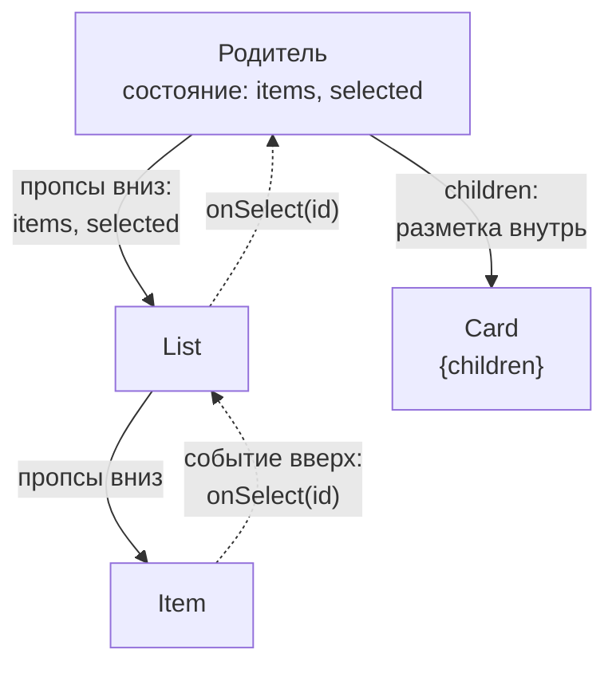
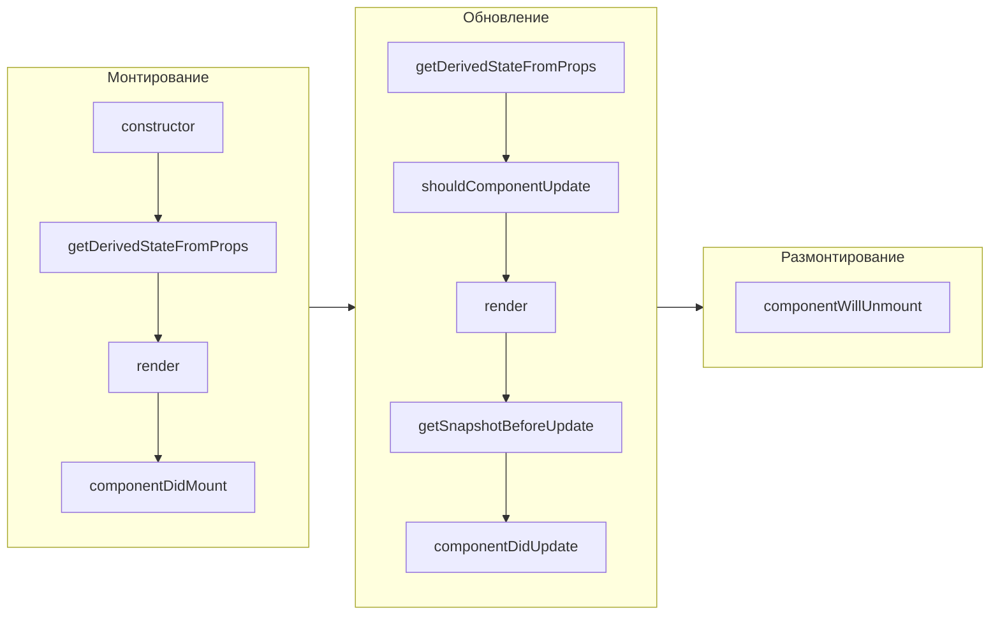

## О чём урок

Из чего состоит интерфейс на React: JSX и его правила, фрагменты, условный рендер и списки, компоненты, пропсы и `children`, почему пропсы только для чтения, что стало с `PropTypes` и `defaultProps` в React 19, React без JSX. Во второй половине классовые компоненты: их ещё спрашивают на собеседованиях и встречают в старом коде, поэтому нужно знать методы жизненного цикла и как они соотносятся с хуками.

## JSX: правила

JSX это синтаксис, который компилятор превращает в вызовы `jsx()` (урок о рендере показывает, что получается объект-описание). Отсюда правила:

- **Выражения в фигурных скобках**: `{user.name}`, `{items.length > 0 && <List />}`. Инструкции (`if`, `for`) внутри JSX нельзя: их пишут до `return` или заменяют выражениями (`? :`, `&&`, `map`).
- **Атрибуты в camelCase** по именам свойств DOM: `className` вместо `class`, `htmlFor` вместо `for`, `onClick`, `tabIndex`. Исключения: `aria-*` и `data-*` пишутся как в HTML.
- **`style` это объект**: `style={{ marginTop: 8 }}`, числа без единиц означают пиксели.
- **Один корень**: компонент возвращает одно выражение. Несколько соседей оборачивают во фрагмент `<>...</>`, который не создаёт DOM-узла. Фрагмент с ключом пишут полной формой `<Fragment key={id}>`.
- **Имя компонента с заглавной буквы**: `<button>` это тег, `<Button>` это ваш компонент. Компилятор различает их именно по регистру.
- **Текст экранируется**: `{userInput}` всегда вставляется как текст, поэтому JSX защищает от XSS. Вставка HTML возможна только явно через `dangerouslySetInnerHTML`.

## Условный рендер и ловушка с нулём

```jsx dom
import { act } from 'react'
import { createRoot } from 'react-dom/client'

function Inbox({ messages, user }) {
  return (
    <section>
      {messages.length && <b>{messages.length} new</b>}
      {messages.length > 0 ? <b>has mail</b> : <i>empty</i>}
      {user?.isAdmin && <button>Admin</button>}
      {null}{false}{undefined}{true}
    </section>
  )
}

const el = document.createElement('div')
await act(async () => createRoot(el).render(<Inbox messages={[]} user={null} />))
console.log(el.innerHTML)
```

```output
<section>0<i>empty</i></section>
```

`false`, `null`, `undefined` и `true` ничего не рисуют, а **число `0` рисуется**. Поэтому `messages.length && ...` на пустом списке выводит «0». Условие приводят к булеву значению: `messages.length > 0 && ...` или `!!messages.length && ...`. В React Native такой ноль даже роняет приложение (текст вне `<Text>`).

## Компоненты, пропсы и children



- Компонент это функция от пропсов к разметке. Данные идут **вниз** пропсами, события **вверх** колбэками (`onSelect`, `onChange`). Это однонаправленный поток данных.
- `children` это обычный проп с тем, что написано между тегами: `<Card><p>text</p></Card>`. Так компоненты-обёртки (карточка, модалка, раскладка) принимают произвольное содержимое, и это главный способ композиции в React.
- Значения по умолчанию задают деструктуризацией: `function Button({ size = 'medium', children })`.
- **Пропсы только для чтения.** Компонент не должен менять их: родитель рассчитывает, что его данные не изменятся. В режиме разработки React замораживает объект пропсов, и запись бросает ошибку:

```jsx dom
import { act } from 'react'
import { createRoot } from 'react-dom/client'

function Badge(props) {
  try {
    props.label = props.label.toUpperCase() // a component must not change its props
  } catch (e) {
    console.log(e.constructor.name, '| frozen:', Object.isFrozen(props))
  }
  return <span>{props.label}</span>
}

const el = document.createElement('div')
await act(async () => createRoot(el).render(<Badge label="new" />))
console.log(el.innerHTML)
```

```output
TypeError | frozen: true
<span>new</span>
```

Нужно другое значение: посчитать его в переменной (`const label = props.label.toUpperCase()`) или попросить родителя через колбэк.

## PropTypes, defaultProps и TypeScript

React 19 убрал проверку `propTypes` и `defaultProps` у функциональных компонентов (у классов `defaultProps` остался). Типы пропсов описывают в TypeScript, значения по умолчанию задают деструктуризацией:

```tsx check
import type { ReactNode } from 'react'

interface ButtonProps {
  variant?: 'primary' | 'ghost'
  disabled?: boolean
  onClick: () => void
  children: ReactNode
}

export function Button({ variant = 'primary', disabled = false, onClick, children }: ButtonProps) {
  return (
    <button className={`btn btn-${variant}`} disabled={disabled} onClick={onClick}>
      {children}
    </button>
  )
}

// @ts-expect-error: 'danger' is not an allowed variant
const wrong = <Button variant="danger" onClick={() => {}}>x</Button>
```

`ReactNode` описывает всё, что можно отрендерить: элементы, строки, числа, `null`, массивы. Проверка во время выполнения нужна только для данных снаружи (ответ API, форма): для этого берут схемы Zod или Valibot, а не `PropTypes`.

## React без JSX

JSX необязателен: `createElement(type, props, ...children)` строит те же элементы. Так пишут без сборщика или в генераторах кода.

```jsx dom
import { act, createElement as h } from 'react'
import { createRoot } from 'react-dom/client'

const List = ({ items }) => h('ul', null, items.map((text) => h('li', { key: text }, text)))
const el = document.createElement('div')
await act(async () => createRoot(el).render(h(List, { items: ['a', 'b'] })))
console.log(el.innerHTML)
```

```output
<ul><li>a</li><li>b</li></ul>
```

## Классовые компоненты

До хуков (React 16.8, 2019) состояние и жизненный цикл были только у классов. Новых классовых компонентов не пишут, но они живут в старом коде, а границы ошибок до сих пор пишутся только классом.

```jsx dom
import { act, Component } from 'react'
import { createRoot } from 'react-dom/client'

class Clock extends Component {
  state = { ticks: 0 } // a class field: no constructor needed
  componentDidMount() {
    console.log('didMount')
    this.timer = setInterval(this.tick, 1000)
  }
  componentDidUpdate(prevProps, prevState) {
    console.log('didUpdate', prevState.ticks, '→', this.state.ticks)
  }
  componentWillUnmount() {
    console.log('willUnmount')
    clearInterval(this.timer)
  }
  tick = () => this.setState((s) => ({ ticks: s.ticks + 1 })) // an arrow field keeps `this`
  render() {
    return <p>{this.state.ticks}</p>
  }
}

const el = document.createElement('div')
const root = createRoot(el)
let clock // a ref on a class component gives the instance
await act(async () => root.render(<Clock ref={(instance) => (clock = instance)} />))
await act(async () => clock.tick()) // what the interval would do after a second
console.log(el.innerHTML)
await act(async () => root.unmount())
```

```output
didMount
didUpdate 0 → 1
<p>1</p>
willUnmount
```

Порядок методов и их замена хуками:



| Класс | В функциональном компоненте |
|---|---|
| `this.state`, `this.setState(updater, callback)` | `useState`, `useReducer`; колбэк после обновления заменяет эффект |
| `componentDidMount` | `useEffect(() => { ... }, [])` |
| `componentDidUpdate` | `useEffect` с зависимостями |
| `componentWillUnmount` | функция очистки, которую возвращает эффект |
| `shouldComponentUpdate`, `PureComponent` | `memo` (или React Compiler) |
| `getDerivedStateFromProps` | вычисление прямо в рендере; сброс состояния через `key` |
| `getSnapshotBeforeUpdate` | `useLayoutEffect` (и ref со значением до обновления) |
| `componentDidCatch`, `getDerivedStateFromError` | аналога в хуках нет: граница ошибок остаётся классом |

- **Потеря `this`.** Метод класса это обычная функция: переданный как `onClick={this.handleClick}`, он вызывается без объекта, и `this` равен `undefined`. Решения: стрелочное поле класса (`handleClick = () => {...}`, как `tick` выше) или `bind` в конструкторе. `bind` и стрелка прямо в JSX создают новую функцию на каждый рендер и ломают `PureComponent`.
- `setState` объединяет объект с текущим состоянием (в отличие от `useState`, который заменяет значение целиком) и тоже батчится.
- Устаревшие методы `componentWillMount`, `componentWillReceiveProps`, `componentWillUpdate` (с префиксом `UNSAFE_`) несовместимы с конкурентным рендером: React может вызвать рендер несколько раз до коммита.

## Главное

- JSX: выражения в `{}`, атрибуты в camelCase (`className`, `htmlFor`), `style` объектом, один корень или фрагмент, компоненты с заглавной буквы, текст экранируется.
- `false`, `null`, `undefined` ничего не рисуют, а `0` рисуется: условие `list.length > 0 &&`.
- Данные вниз пропсами, события вверх колбэками; `children` для композиции; пропсы только для чтения (в разработке объект заморожен).
- React 19 не проверяет `propTypes` и `defaultProps` у функций: типы в TypeScript, значения по умолчанию в деструктуризации.
- Классы: жизненный цикл mount, update, unmount; каждому методу есть замена хуком, кроме границы ошибок; `this` теряется у методов без стрелочного поля или `bind`.
