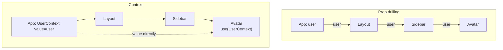
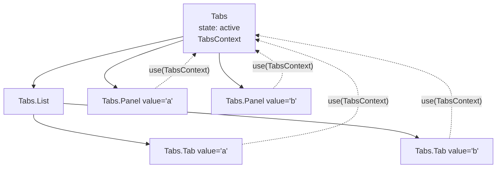

## What this lesson covers

How to build components that are easy to reuse: composition through `children` and "slots", context as a way to pass data deep (and when it hurts), a provider with its own hook, compound components, a controlled and uncontrolled component API, portals for modals, and the old HOC and render props patterns: where they still live and what replaced them.

## Composition over configuration

React's first tool is `children` and element props ("slots"). The component does not know what is inside and does not grow props like `showIcon`, `iconPosition`, `footerText`:

```jsx
// Configuration: every new need adds a prop
<Card title="Plan" showFooter footerText="Save" onFooterClick={save} icon="star" />

// Composition: the caller decides what goes where
<Card header={<h2><StarIcon /> Plan</h2>} footer={<Button onClick={save}>Save</Button>}>
  <PlanDetails />
</Card>
```

Composition also solves part of prop drilling (passing props through many levels): if an intermediate component only passes a prop along, it is often enough to hand it a ready element through `children`.

## Context: when you need it



- It fits data needed by many components at different depths that **changes rarely**: theme, language, the current user, permissions, an API client, feature settings.
- It does not fit frequently changing state (input, the cursor position, big lists): every new value re-renders **all** readers, and `memo` does not help (the performance lesson). Such state stays local or in an external store with a slice subscription (Zustand, Redux, Jotai).
- Context is not a state manager but a way to **deliver** a value. The state lives in the provider's `useState` or `useReducer`.

## A provider and its own hook

A sturdy template: a provider component owns the state, the value is memoized, and it is read through a custom hook that complains if the provider is missing.

```jsx dom
import { act, createContext, use, useMemo, useState } from 'react'
import { createRoot } from 'react-dom/client'

const CartContext = createContext(null)

function CartProvider({ children }) {
  const [items, setItems] = useState([])
  const value = useMemo(() => ({ items, add: (item) => setItems((prev) => [...prev, item]) }), [items])
  return <CartContext value={value}>{children}</CartContext>
}

function useCart() {
  const cart = use(CartContext)
  if (!cart) throw new Error('useCart must be used inside <CartProvider>')
  return cart
}

function AddButton() {
  const { add } = useCart()
  return <button onClick={() => add('tea')}>Add tea</button>
}
function Counter() {
  return <b>{useCart().items.length} in cart</b>
}

const el = document.createElement('div')
document.body.append(el)
await act(async () => createRoot(el).render(<CartProvider><AddButton /><Counter /></CartProvider>))
await act(async () => el.querySelector('button').click())
console.log(el.textContent)

try {
  await act(async () => createRoot(document.createElement('div')).render(<Counter />))
} catch (e) {
  console.log(e.message)
}
```

```output
Add tea1 in cart
useCart must be used inside <CartProvider>
```

A default of `null` plus the check in the hook turn a forgotten provider into a clear error instead of a silent `undefined`. If some components only dispatch actions, put state and actions into **two contexts**: components with only actions will not re-render when the data changes.

## Compound components

Several components act as one (`<Tabs>`, `<Tabs.List>`, `<Tabs.Panel>`) and share state through context. The user assembles the markup, while the logic stays inside:



```jsx dom
import { act, createContext, use, useState } from 'react'
import { createRoot } from 'react-dom/client'

const TabsContext = createContext(null)

function Tabs({ defaultValue, children }) {
  const [active, setActive] = useState(defaultValue)
  return <TabsContext value={{ active, setActive }}>{children}</TabsContext>
}
Tabs.List = ({ children }) => <div role="tablist">{children}</div>
Tabs.Tab = function Tab({ value, children }) {
  const { active, setActive } = use(TabsContext)
  return <button role="tab" aria-selected={active === value} onClick={() => setActive(value)}>{children}</button>
}
Tabs.Panel = function Panel({ value, children }) {
  const { active } = use(TabsContext)
  return active === value ? <div role="tabpanel">{children}</div> : null
}

const el = document.createElement('div')
document.body.append(el)
await act(async () =>
  createRoot(el).render(
    <Tabs defaultValue="a">
      <Tabs.List>
        <Tabs.Tab value="a">Profile</Tabs.Tab>
        <Tabs.Tab value="b">Billing</Tabs.Tab>
      </Tabs.List>
      <Tabs.Panel value="a">Profile form</Tabs.Panel>
      <Tabs.Panel value="b">Billing form</Tabs.Panel>
    </Tabs>,
  ),
)
await act(async () => el.querySelectorAll('[role=tab]')[1].click())
console.log(el.querySelector('[role=tabpanel]').textContent, '|', el.querySelector('[aria-selected=true]').textContent)
```

```output
Billing form | Billing
```

That is how Radix UI, Headless UI and React Aria work: unstyled (headless) components that provide behavior and accessibility, while the user decides the look.

## A controlled and uncontrolled component API

A good input component (a toggle, a date picker, tabs) supports both modes, like `<input>`:

- **uncontrolled**: `defaultValue`, the component keeps the value itself;
- **controlled**: `value` and `onChange`, the parent keeps the value.

```jsx dom
import { act, useState } from 'react'
import { createRoot } from 'react-dom/client'

function useControllableState(value, defaultValue, onChange) {
  const [inner, setInner] = useState(defaultValue)
  const controlled = value !== undefined
  const current = controlled ? value : inner
  const set = (next) => {
    if (!controlled) setInner(next) // uncontrolled: keep it here
    onChange?.(next) // always notify
  }
  return [current, set]
}

function Toggle({ on, defaultOn = false, onChange }) {
  const [isOn, setOn] = useControllableState(on, defaultOn, onChange)
  return <button aria-pressed={isOn} onClick={() => setOn(!isOn)}>{isOn ? 'ON' : 'OFF'}</button>
}

const el = document.createElement('div')
document.body.append(el)
await act(async () =>
  createRoot(el).render(
    <>
      <Toggle defaultOn={false} />
      <Toggle on={false} onChange={(v) => console.log('parent asked to set', v)} />
    </>,
  ),
)
const [free, controlled] = el.querySelectorAll('button')
await act(async () => free.click())
await act(async () => controlled.click())
console.log(free.textContent, controlled.textContent)
```

```output
parent asked to set true
ON OFF
```

The controlled toggle stayed `OFF`: the parent got the request but did not change `on`. Do not switch modes during a component's life (first `value={undefined}`, then a string): React warns about an uncontrolled field becoming controlled.

## Portals

`createPortal(children, domNode)` renders children into another DOM node (usually `document.body`) while keeping them in the React tree. Modals, tooltips, dropdowns and notifications use it: they are not clipped by `overflow: hidden` and do not depend on the parents' `z-index`.

- Context, events and state work as if there were no portal: an event from a portal bubbles to the React parent (an example is in the state lesson). So a click inside a modal portaled into `body` also reaches the `onClick` of the wrapper that opened it; stop the extra bubbling with `e.stopPropagation()`.
- The modal's accessibility is on you: focus inside on open and back on close, `Escape`, `aria-modal`. Today modals have the native `<dialog>` with `showModal()`: it traps focus itself and renders in the top layer without a portal (the dialogs lesson in the HTML track).
- During server rendering there is no `document`: create the portal after mounting.

## HOCs and render props

Both patterns appeared before hooks to share logic between components:

| Pattern | What it looks like | Downsides | Today |
|---|---|---|---|
| HOC (higher-order component) | `withAuth(Profile)`: a function from a component to a component | Wrappers in the tree, prop name clashes, implicit dependencies | Logic is shared with custom hooks; `memo` and `lazy` are HOCs too and alive |
| Render props | `<Mouse render={(pos) => <Cursor {...pos} />} />` | "Pyramid" nesting | Hooks; but render props live on where a component hands over control of markup: `Controller` in React Hook Form, rows in virtualized lists, table cells |

The interview question "write a HOC" checks your grasp of higher-order functions, but end the answer with "today this is a custom hook". Example: `withLogger = (Component) => (props) => { useEffect(...); return <Component {...props} /> }`, and the same as a hook is `useLogger(name)` inside the component.

## Key points

- Composition first: `children` and element props instead of a dozen configuration props.
- Context delivers rarely changing data deep; frequent updates in it re-render every reader.
- The provider owns the state and memoizes the value, a custom hook checks for the provider; data and actions can go into two contexts.
- Compound components share state through context; headless libraries work this way.
- An input component supports `value`/`onChange` and `defaultValue`; do not switch modes on the fly.
- Portals move the DOM, not the React tree; events from a portal bubble to the React parent.
- HOCs and render props were replaced by hooks, but `memo`, `lazy` and render props for markup live on.
