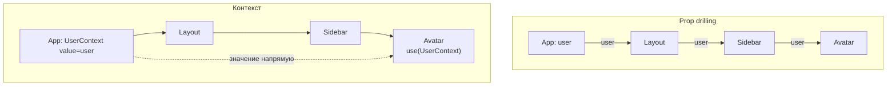
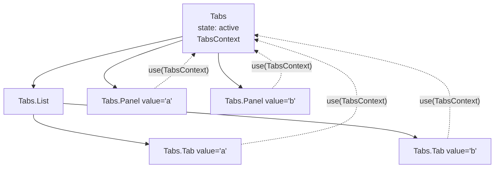

## О чём урок

Как собирают компоненты, которые удобно переиспользовать: композиция через `children` и «слоты», контекст как способ передать данные глубоко (и когда он вреден), провайдер с собственным хуком, составные компоненты, управляемый и неуправляемый API компонента, порталы для модалок, а также старые паттерны HOC и render props: где они ещё живы и чем их заменили.

## Композиция вместо конфигурации

Первый инструмент React это `children` и пропсы-элементы («слоты»). Компонент не знает, что внутри, и не разрастается пропсами вида `showIcon`, `iconPosition`, `footerText`:

```jsx
// Configuration: every new need adds a prop
<Card title="Plan" showFooter footerText="Save" onFooterClick={save} icon="star" />

// Composition: the caller decides what goes where
<Card header={<h2><StarIcon /> Plan</h2>} footer={<Button onClick={save}>Save</Button>}>
  <PlanDetails />
</Card>
```

Композиция решает и часть проблем с передачей пропсов через много уровней (prop drilling): если промежуточный компонент только передаёт проп дальше, часто достаточно передать ему готовый элемент через `children`.

## Контекст: когда он нужен



- Подходит для данных, которые нужны многим компонентам на разной глубине и **меняются редко**: тема, язык, текущий пользователь, права, клиент API, настройки фич.
- Не подходит для часто меняющегося состояния (ввод, положение курсора, большие списки): при каждом новом значении рендерятся **все** читатели, и `memo` их не спасает (урок о производительности). Такое состояние держат локально или во внешнем хранилище с подпиской на срез (Zustand, Redux, Jotai).
- Контекст это не менеджер состояния, а способ **доставки** значения. Состояние лежит в `useState` или `useReducer` провайдера.

## Провайдер и свой хук

Устойчивый шаблон: компонент-провайдер владеет состоянием, значение мемоизировано, а читают его через свой хук, который ругается, если провайдера нет.

```jsx dom
import { act, createContext, use, useMemo, useState } from 'react'
import { createRoot } from 'react-dom/client'

const CartContext = createContext(null)

function CartProvider({ children }) {
  const [items, setItems] = useState([])
  const value = useMemo(() => ({ items, add: (item) => setItems((prev) => [...prev, item]) }), [items])
  return <CartContext value={value}>{children}</CartContext>
}

function useCart() {
  const cart = use(CartContext)
  if (!cart) throw new Error('useCart must be used inside <CartProvider>')
  return cart
}

function AddButton() {
  const { add } = useCart()
  return <button onClick={() => add('tea')}>Add tea</button>
}
function Counter() {
  return <b>{useCart().items.length} in cart</b>
}

const el = document.createElement('div')
document.body.append(el)
await act(async () => createRoot(el).render(<CartProvider><AddButton /><Counter /></CartProvider>))
await act(async () => el.querySelector('button').click())
console.log(el.textContent)

try {
  await act(async () => createRoot(document.createElement('div')).render(<Counter />))
} catch (e) {
  console.log(e.message)
}
```

```output
Add tea1 in cart
useCart must be used inside <CartProvider>
```

Значение по умолчанию `null` и проверка в хуке превращают забытый провайдер в понятную ошибку вместо тихого `undefined`. Если часть компонентов только отправляет действия, состояние и действия кладут в **два контекста**: компоненты с одними действиями не будут рендериться при изменении данных.

## Составные компоненты

Несколько компонентов работают как один (`<Tabs>`, `<Tabs.List>`, `<Tabs.Panel>`) и делят общее состояние через контекст. Пользователь собирает разметку сам, а логика остаётся внутри:



```jsx dom
import { act, createContext, use, useState } from 'react'
import { createRoot } from 'react-dom/client'

const TabsContext = createContext(null)

function Tabs({ defaultValue, children }) {
  const [active, setActive] = useState(defaultValue)
  return <TabsContext value={{ active, setActive }}>{children}</TabsContext>
}
Tabs.List = ({ children }) => <div role="tablist">{children}</div>
Tabs.Tab = function Tab({ value, children }) {
  const { active, setActive } = use(TabsContext)
  return <button role="tab" aria-selected={active === value} onClick={() => setActive(value)}>{children}</button>
}
Tabs.Panel = function Panel({ value, children }) {
  const { active } = use(TabsContext)
  return active === value ? <div role="tabpanel">{children}</div> : null
}

const el = document.createElement('div')
document.body.append(el)
await act(async () =>
  createRoot(el).render(
    <Tabs defaultValue="a">
      <Tabs.List>
        <Tabs.Tab value="a">Profile</Tabs.Tab>
        <Tabs.Tab value="b">Billing</Tabs.Tab>
      </Tabs.List>
      <Tabs.Panel value="a">Profile form</Tabs.Panel>
      <Tabs.Panel value="b">Billing form</Tabs.Panel>
    </Tabs>,
  ),
)
await act(async () => el.querySelectorAll('[role=tab]')[1].click())
console.log(el.querySelector('[role=tabpanel]').textContent, '|', el.querySelector('[aria-selected=true]').textContent)
```

```output
Billing form | Billing
```

Так устроены Radix UI, Headless UI, React Aria: компоненты без навязанных стилей (headless), которые дают поведение и доступность, а внешний вид задаёт пользователь.

## Управляемый и неуправляемый API компонента

Хороший компонент ввода (переключатель, выбор даты, вкладки) поддерживает оба режима, как `<input>`:

- **неуправляемый**: `defaultValue`, компонент сам хранит значение;
- **управляемый**: `value` и `onChange`, значение хранит родитель.

```jsx dom
import { act, useState } from 'react'
import { createRoot } from 'react-dom/client'

function useControllableState(value, defaultValue, onChange) {
  const [inner, setInner] = useState(defaultValue)
  const controlled = value !== undefined
  const current = controlled ? value : inner
  const set = (next) => {
    if (!controlled) setInner(next) // uncontrolled: keep it here
    onChange?.(next) // always notify
  }
  return [current, set]
}

function Toggle({ on, defaultOn = false, onChange }) {
  const [isOn, setOn] = useControllableState(on, defaultOn, onChange)
  return <button aria-pressed={isOn} onClick={() => setOn(!isOn)}>{isOn ? 'ON' : 'OFF'}</button>
}

const el = document.createElement('div')
document.body.append(el)
await act(async () =>
  createRoot(el).render(
    <>
      <Toggle defaultOn={false} />
      <Toggle on={false} onChange={(v) => console.log('parent asked to set', v)} />
    </>,
  ),
)
const [free, controlled] = el.querySelectorAll('button')
await act(async () => free.click())
await act(async () => controlled.click())
console.log(free.textContent, controlled.textContent)
```

```output
parent asked to set true
ON OFF
```

Управляемый переключатель остался `OFF`: родитель получил запрос, но не изменил `on`. Переключать режим во время жизни компонента (сначала `value={undefined}`, потом строка) нельзя: React предупреждает о смене неуправляемого поля на управляемое.

## Порталы

`createPortal(children, domNode)` рендерит детей в другой DOM-узел (обычно `document.body`), оставляя их в дереве React. Так делают модалки, всплывающие подсказки, выпадающие меню и уведомления: они не обрезаются `overflow: hidden` и не зависят от `z-index` родителей.

- Контекст, события и состояние работают как будто портала нет: событие из портала всплывает к React-родителю (пример в уроке о состоянии). Поэтому клик внутри модалки, рендеренной порталом в `body`, дойдёт и до `onClick` обёртки, которая её открыла; лишнее всплытие останавливают `e.stopPropagation()`.
- Доступность модалки на вас: фокус внутрь при открытии и обратно при закрытии, `Escape`, `aria-modal`. Сейчас для модалок есть нативный `<dialog>` с `showModal()`: он сам ловит фокус и рисуется в верхнем слое без портала (урок о диалогах в треке HTML).
- При серверном рендере `document` нет: портал создают после монтирования.

## HOC и render props

Оба паттерна появились до хуков, чтобы делиться логикой между компонентами:

| Паттерн | Как выглядит | Минусы | Что сейчас |
|---|---|---|---|
| HOC (компонент высшего порядка) | `withAuth(Profile)`: функция от компонента к компоненту | Обёртки в дереве, конфликт имён пропсов, неявные зависимости | Логику делят своими хуками; `memo` и `lazy` по сути тоже HOC и живы |
| Render props | `<Mouse render={(pos) => <Cursor {...pos} />} />` | Вложенность «пирамидой» | Хуки; но render prop жив там, где компонент отдаёт управление разметкой: `Controller` в React Hook Form, строки в виртуализированных списках, ячейки таблиц |

Вопрос «напишите HOC» на собеседовании проверяет понимание функций высшего порядка, но ответ стоит закончить словами «сегодня это свой хук». Пример: `withLogger = (Component) => (props) => { useEffect(...); return <Component {...props} /> }`, а то же самое хуком это `useLogger(name)` внутри компонента.

## Главное

- Сначала композиция: `children` и пропсы-элементы вместо десятка конфигурационных пропсов.
- Контекст доставляет редко меняющиеся данные глубоко; частые обновления в нём рендерят всех читателей.
- Провайдер владеет состоянием и мемоизирует значение, свой хук проверяет наличие провайдера; данные и действия можно разнести по двум контекстам.
- Составные компоненты делят состояние через контекст, так устроены headless-библиотеки.
- Компонент ввода поддерживает `value`/`onChange` и `defaultValue`; режим не меняют на лету.
- Порталы выносят DOM, но не дерево React; события из портала всплывают к React-родителю.
- HOC и render props заменены хуками, но `memo`, `lazy` и render props для разметки живы.
