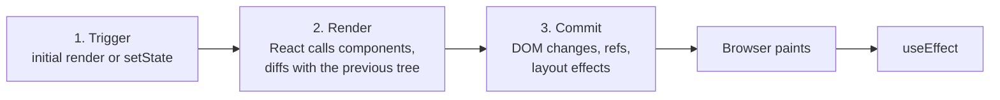
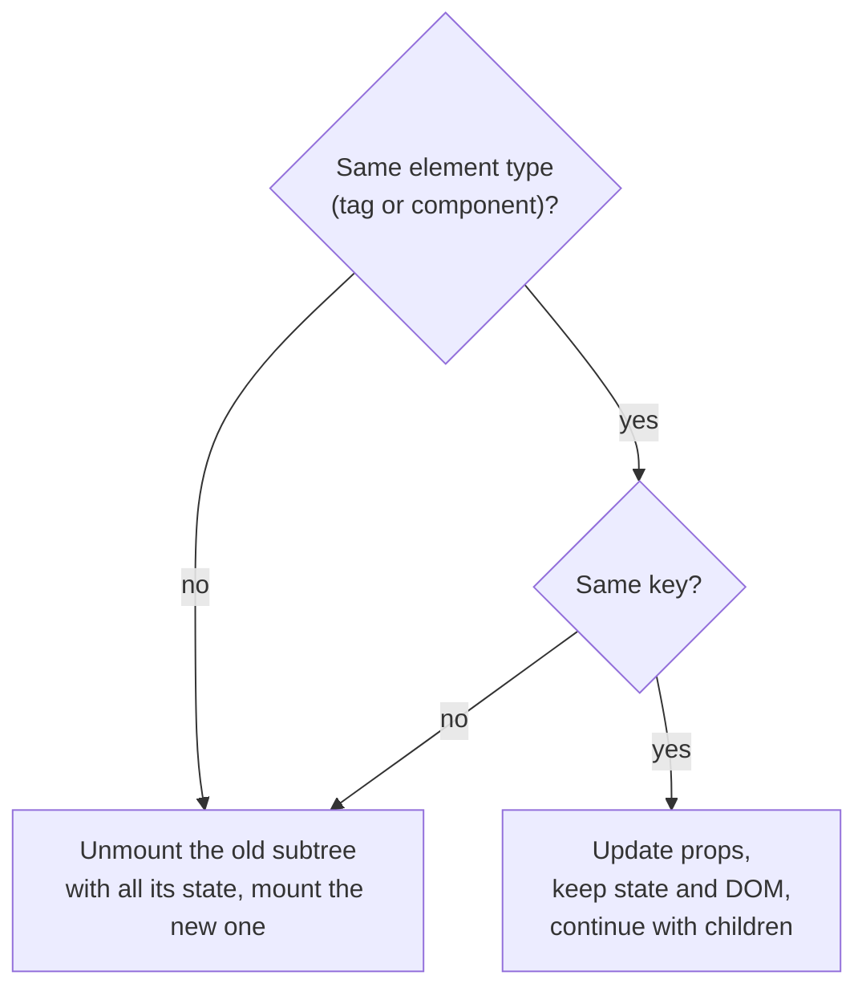

## What this lesson covers

How React turns components into DOM: what an element is, which steps an update goes through, how React decides whether to keep a component's state or create it from scratch, and why keys matter. At the end, StrictMode and what exactly it runs twice. Every example runs on React 19.3 in jsdom, and the output below it is real.

## An element is an object

JSX does not create DOM. The compiler turns `<a href="/docs">Docs</a>` into a call `jsx('a', { href: '/docs', children: 'Docs' })` from `react/jsx-runtime` (the automatic runtime, required since React 19), and the result is a plain immutable description object:

```jsx dom
const element = <a href="/docs" className="link">Docs</a>
console.log(typeof element, element.type)
console.log(JSON.stringify(element.props))
```

```output
object a
{"href":"/docs","className":"link","children":"Docs"}
```

An element's `type` is either a string (a DOM tag) or a function (a component). Children live in `props.children`. Since React 19 `ref` is a regular prop too: `element.ref` is deprecated and `forwardRef` is no longer needed (more in the lesson on effects and refs). Importing `React` into every file for JSX stopped being necessary in React 17: the old runtime called `React.createElement`, so the name had to be in scope.

## The three steps of an update



1. **Trigger.** The first `root.render()` or a state change (`setState`, `dispatch`, a new context value).
2. **Render.** React calls your components and gets a new tree of elements. This is pure computation: no requests, subscriptions or DOM edits. A render can be repeated or thrown away if a more urgent update arrives (for transitions and `useDeferredValue`).
3. **Commit.** React compares the new tree with the previous one and applies only the difference to the DOM, then attaches `ref`s, runs `useLayoutEffect`, the browser paints a frame, and after that `useEffect` runs. The commit is synchronous and cannot be interrupted.

A re-render does not mean the DOM changes: if the result is the same, React touches nothing. "The virtual DOM is faster than the real one" is inaccurate: the win is that code describes the result while React finds the minimal set of edits itself.

## Reconciliation: type and position

How React decides what to do with an element at the same position:



State belongs not to the component function but to a **place in the tree**. When comparing trees, React walks positions:

- same place, same `type` and same `key`: the component updates and keeps its state;
- different `type`: the old subtree unmounts completely (state and DOM), the new one mounts;
- different `key` at the same place: same as a different type.

```jsx dom
import { act, useState } from 'react'
import { createRoot } from 'react-dom/client'

function Counter({ label }) {
  const [count, setCount] = useState(0)
  return <button onClick={() => setCount((c) => c + 1)}>{label}: {count}</button>
}

function App({ fancy, useKeys }) {
  if (useKeys) return fancy ? <Counter key="a" label="A" /> : <Counter key="b" label="B" />
  return fancy ? <Counter label="A" /> : <Counter label="B" />
}

const container = document.createElement('div')
document.body.append(container)
const root = createRoot(container)
for (const useKeys of [false, true]) {
  await act(() => root.render(<App fancy useKeys={useKeys} />))
  await act(() => container.querySelector('button').click())
  await act(() => root.render(<App fancy={false} useKeys={useKeys} />))
  console.log(useKeys ? 'with keys:' : 'same position:', container.textContent)
}
```

```output
same position: B: 1
with keys: B: 0
```

Without keys both `Counter`s sit at the same position with the same type, so counter "A" handed its state to "B". With different `key`s React sees two different components and creates "B" from scratch. Hence the trick: `<Profile key={userId} />` resets all form state when the user changes, without a single effect.

The flip side: **do not declare components inside components.** A function created during render is new each time, so it is a different `type`, and React will unmount its subtree on every render of the parent.

## Keys in lists

In a list the position is the index, and `key` tells React which item is which. An index key breaks as soon as items are inserted, removed or sorted:

```jsx dom
import { act } from 'react'
import { createRoot } from 'react-dom/client'

function List({ items, keyBy }) {
  return (
    <ul>
      {items.map((item, index) => (
        <li key={keyBy === 'index' ? index : item}>
          {item} <input defaultValue={item.toLowerCase()} />
        </li>
      ))}
    </ul>
  )
}

const container = document.createElement('div')
const root = createRoot(container)
for (const keyBy of ['index', 'id']) {
  await act(() => root.render(<List key={keyBy} items={['Milk', 'Bread']} keyBy={keyBy} />))
  await act(() => root.render(<List key={keyBy} items={['Eggs', 'Milk', 'Bread']} keyBy={keyBy} />))
  const rows = [...container.querySelectorAll('li')].map((li) => `${li.firstChild.textContent.trim()}=${li.querySelector('input').value}`)
  console.log(keyBy, rows.join(' '))
}
```

```output
index Eggs=milk Milk=bread Bread=bread
id Eggs=eggs Milk=milk Bread=bread
```

With index keys the new row "Eggs" got key `0` and inherited the input from "Milk": the text updated, but DOM and component state stayed at the old positions. The rules:

- a key is stable across renders and unique among siblings (it does not have to be globally unique);
- take an id from the data; do not use `Math.random()` or `crypto.randomUUID()` during render, that is a new key every time and a full re-creation;
- an index is fine only if the list never changes order and its rows have no state;
- `key` is not passed to the component as a prop; if the id is needed inside, pass it separately.

## Fiber in brief

Internally React keeps a tree of **Fiber** nodes: one per component and DOM element, with links to the parent, first child and sibling, the hooks' state and marks for pending edits. There is the current tree and the work-in-progress tree; after a commit they swap roles. Work is split into units, so a concurrent render can yield to the browser roughly every 5 ms. Updates differ in priority (lanes): input is urgent, a transition is not. Field and tag names are internals and change between versions; in an interview the idea matters, not the tag numbers.

## StrictMode

In development `<StrictMode>` deliberately repeats work to expose impure code:

```jsx dom
import { act, StrictMode, useEffect, useMemo, useState } from 'react'
import { createRoot } from 'react-dom/client'

function App() {
  console.log('render')
  const [count] = useState(() => {
    console.log('state initializer')
    return 0
  })
  const doubled = useMemo(() => {
    console.log('memo calculation')
    return count * 2
  }, [count])
  useEffect(() => {
    console.log('effect setup')
    return () => console.log('effect cleanup')
  }, [])
  return <p>{doubled}</p>
}

const root = createRoot(document.createElement('div'))
await act(() => root.render(<StrictMode><App /></StrictMode>))
```

```output
render
state initializer
state initializer
memo calculation
memo calculation
render
effect setup
effect cleanup
effect setup
```

- The component body, `useState` initializers and `useMemo` functions are called twice, and the second result is thrown away. In React 19 the second render of the component reuses the result from the first for `useMemo` and `useCallback`, so there is no third call.
- Effects: setup → cleanup → setup. Cleanup runs **once**: React simulates an unmount and a remount. If something breaks after that (two subscriptions, a double request without cancellation), a cleanup is missing.
- Ref callbacks are also called twice on mount.
- None of this happens in production.

## Key points

- JSX creates element objects `{ type, props, key }`; DOM appears only at commit.
- An update: trigger → render (pure, can be interrupted) → commit (DOM, refs, layout effects, then effects).
- State lives at a position in the tree: the same type and `key` keep it, a different one resets it.
- Keys are stable and come from data; an index breaks state on insertion and sorting.
- StrictMode calls render and initializers twice and runs effects as setup → cleanup → setup.
