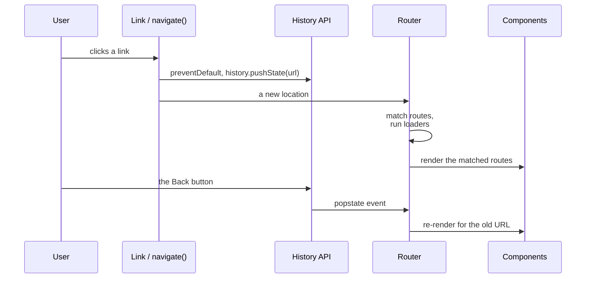
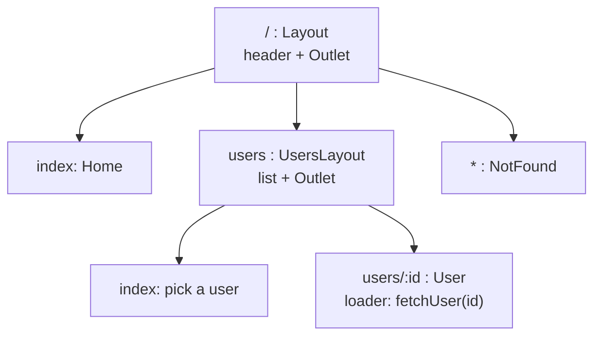

## What this lesson covers

How navigation works in a single-page app and how React Router 8 does it: the library's three modes, nested routes and `<Outlet>`, params and search params, loaders and actions (data before render), errors and redirects, protected routes, lazy routes and what changed since v5 and v6.

## How client-side routing works



The browser does not reload the page: the router changes the address with the History API (`pushState`, `replaceState`), listens to `popstate` (the Back and Forward buttons), matches the address against the route tree and renders the matches. The server must return `index.html` for any app path, otherwise a direct link to `/users/7` gives a 404.

## The three modes of React Router 8

| Mode | How it is set up | What it gives |
|---|---|---|
| Declarative | `<BrowserRouter>`, `<Routes>`, `<Route>` | Only URL matching and navigation, you load data yourself |
| Data | `createBrowserRouter([...])` and `<RouterProvider>` | Plus `loader`, `action`, pending navigation, `useFetcher`, route-level errors |
| Framework | The `@react-router/dev` Vite plugin, routes in `app/routes.ts` | Plus server rendering, code splitting, per-route types (the successor of Remix) |

Version 8 (2026) removed the `react-router-dom` package: everything is imported from `react-router`, and `RouterProvider` and `HydratedRouter` from `react-router/dom`. The packages are ESM-only, middleware is always on, and React 19.2.7+ is required.

## Nested routes, loaders and actions



A parent route renders the shared part (a header, a list) and `<Outlet />` in place of the child. In Data mode a route has a `loader` (data before render) and an `action` (handling a form submit):

```jsx dom
import { act } from 'react'
import { createRoot } from 'react-dom/client'
import { createMemoryRouter, Link, Outlet, redirect, useLoaderData, useRouteError } from 'react-router'
import { RouterProvider } from 'react-router/dom'

const users = { 7: 'Ann', 8: 'Bob' }
let loggedIn = false

const router = createMemoryRouter([
  {
    path: '/',
    element: <div><nav><Link to="/users/7">Ann</Link></nav><Outlet /></div>,
    children: [
      { index: true, element: <p>Home</p> },
      {
        path: 'users/:id',
        loader: async ({ params }) => {
          if (!loggedIn) throw redirect(`/login?next=/users/${params.id}`) // guard in the loader
          if (!users[params.id]) throw new Response('Not found', { status: 404 })
          return { name: users[params.id] }
        },
        element: <UserPage />,
        errorElement: <UserError />,
      },
      { path: 'login', element: <p>Login page</p> },
    ],
  },
])

function UserPage() {
  const { name } = useLoaderData()
  return <h1>{name}</h1>
}
function UserError() {
  const error = useRouteError()
  return <p>Error {error.status}</p>
}

const el = document.createElement('div')
await act(async () => createRoot(el).render(<RouterProvider router={router} />))
const show = () => console.log(router.state.location.pathname + router.state.location.search, '→', el.querySelector('nav').nextSibling?.textContent)

await act(async () => router.navigate('/users/7'))
show()
loggedIn = true
await act(async () => router.navigate('/users/7'))
show()
await act(async () => router.navigate('/users/99'))
show()
```

```output
/login?next=/users/7 → Login page
/users/7 → Ann
/users/99 → Error 404
```

- Loaders of the routes in one navigation run **in parallel**, before rendering: no "waterfall" where a parent loads, renders, and only then a child starts its request.
- `throw redirect(...)` in a loader is a protected route: the page does not render or flash. In version 8 a shared check for a group of routes is written as **middleware** (`middleware: [authMiddleware]`).
- An error, or a `Response` with an error status, shows the nearest `errorElement` (`ErrorBoundary` in Framework mode) instead of crashing the whole app.
- An `action` receives a `<Form method="post">` submit, after which the router re-runs the loaders, so the data on the page is fresh.
- While a navigation is in progress the old screen stays; `useNavigation().state` (`idle`, `loading`, `submitting`) drives an indicator. A slow part of the data need not block: return a promise and render it through `<Await>` or `use()` inside `<Suspense>` (the old `defer()` was removed).

## Navigation hooks

| Hook | What it gives |
|---|---|
| `useNavigate()` | `navigate('/path')`, `navigate(-1)`, `navigate(to, { replace: true, state })` |
| `useParams()` | Path params: `{ id: '7' }` (always strings) |
| `useSearchParams()` | The search string as `URLSearchParams` plus a setter |
| `useLocation()` | `pathname`, `search`, `hash`, `state` of the current address |
| `useLoaderData()`, `useActionData()` | Loader data and the action result |
| `useNavigation()`, `useFetcher()` | Navigation status; loading and submitting without navigation (a like, autosave) |

State that must survive a reload and be shareable by link (filters, the active tab, the list page) goes into the **search params**, not `useState`.

## Lazy routes

```jsx
const router = createBrowserRouter([
  { path: '/', Component: Layout, children: [
    { index: true, Component: Home },
    { path: 'reports', lazy: () => import('./routes/reports') }, // a separate chunk with Component and loader
  ] },
])
```

`lazy` loads the route module (component, loader, action) on the first visit, and it goes into a separate chunk. Framework mode splits by route automatically.

## What changed since v5

| Before (v5 and earlier) | Now |
|---|---|
| `<Switch>`, `exact` | `<Routes>` picks the best match, no `exact` needed |
| `<Redirect to>` | `<Navigate to>` in markup or `redirect()` in a loader |
| `useHistory().push` | `useNavigate()` |
| `withRouter(Component)`, `match` in props | The `useParams`, `useLocation`, `useMatch` hooks |
| `<Route component>` and `render` | `element={<Page />}` or `Component: Page` |
| `NavLink activeClassName` | `className={({ isActive }) => ...}` |
| `connected-react-router` (the router in Redux) | Not needed: the location lives in the router, data in loaders or TanStack Query |
| `react-router-dom` | Removed in v8, import from `react-router` |
| The router's view transition APIs | Deprecated in favor of `<ViewTransition>` from React 19.3 |

## Key points

- Client routing changes the URL through the History API and renders matching routes; the server returns `index.html` for any path.
- React Router 8: Declarative, Data and Framework modes; `react-router-dom` is gone, `RouterProvider` comes from `react-router/dom`.
- Nested routes render through `<Outlet>`; loaders run in parallel and before rendering.
- Route protection: `redirect()` in a loader or middleware; errors are caught by the route's `errorElement`.
- Filters and tabs live in the search params; `lazy` gives a chunk per route.
- From v5: `Switch` → `Routes`, `useHistory` → `useNavigate`, `withRouter` → hooks.
