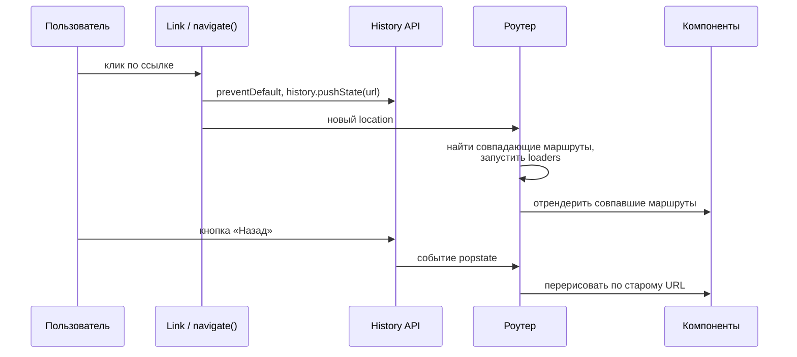
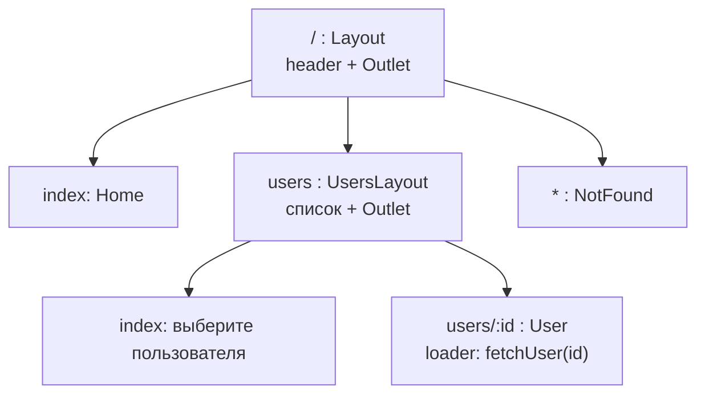

## О чём урок

Как устроена навигация в одностраничном приложении и как её делают в React Router 8: три режима библиотеки, вложенные маршруты и `<Outlet>`, параметры и поисковая строка, загрузчики и действия (данные до рендера), ошибки и редиректы, защищённые маршруты, ленивые маршруты и что поменялось со времён v5 и v6.

## Как работает клиентский роутинг



Браузер не перезагружает страницу: роутер меняет адрес через History API (`pushState`, `replaceState`), слушает `popstate` (кнопки «Назад» и «Вперёд»), сопоставляет адрес с деревом маршрутов и рендерит совпавшие. Серверу нужно отдавать `index.html` на любой путь приложения, иначе прямая ссылка на `/users/7` даст 404.

## Три режима React Router 8

| Режим | Как подключается | Что даёт |
|---|---|---|
| Declarative | `<BrowserRouter>`, `<Routes>`, `<Route>` | Только сопоставление адресов и навигация, данные грузите сами |
| Data | `createBrowserRouter([...])` и `<RouterProvider>` | Плюс `loader`, `action`, ожидание навигации, `useFetcher`, ошибки на уровне маршрутов |
| Framework | Плагин Vite `@react-router/dev`, маршруты в `app/routes.ts` | Плюс серверный рендер, разделение кода, типы для каждого маршрута (наследник Remix) |

В версии 8 (2026) пакет `react-router-dom` удалён: всё импортируют из `react-router`, а `RouterProvider` и `HydratedRouter` из `react-router/dom`. Пакеты только ESM, middleware включён всегда, нужен React 19.2.7+.

## Вложенные маршруты, загрузчики и действия



Родительский маршрут рендерит общую часть (шапку, список) и `<Outlet />` на месте дочернего. В режиме Data у маршрута есть `loader` (данные до рендера) и `action` (обработка отправки формы):

```jsx dom
import { act } from 'react'
import { createRoot } from 'react-dom/client'
import { createMemoryRouter, Link, Outlet, redirect, useLoaderData, useRouteError } from 'react-router'
import { RouterProvider } from 'react-router/dom'

const users = { 7: 'Ann', 8: 'Bob' }
let loggedIn = false

const router = createMemoryRouter([
  {
    path: '/',
    element: <div><nav><Link to="/users/7">Ann</Link></nav><Outlet /></div>,
    children: [
      { index: true, element: <p>Home</p> },
      {
        path: 'users/:id',
        loader: async ({ params }) => {
          if (!loggedIn) throw redirect(`/login?next=/users/${params.id}`) // guard in the loader
          if (!users[params.id]) throw new Response('Not found', { status: 404 })
          return { name: users[params.id] }
        },
        element: <UserPage />,
        errorElement: <UserError />,
      },
      { path: 'login', element: <p>Login page</p> },
    ],
  },
])

function UserPage() {
  const { name } = useLoaderData()
  return <h1>{name}</h1>
}
function UserError() {
  const error = useRouteError()
  return <p>Error {error.status}</p>
}

const el = document.createElement('div')
await act(async () => createRoot(el).render(<RouterProvider router={router} />))
const show = () => console.log(router.state.location.pathname + router.state.location.search, '→', el.querySelector('nav').nextSibling?.textContent)

await act(async () => router.navigate('/users/7'))
show()
loggedIn = true
await act(async () => router.navigate('/users/7'))
show()
await act(async () => router.navigate('/users/99'))
show()
```

```output
/login?next=/users/7 → Login page
/users/7 → Ann
/users/99 → Error 404
```

- Загрузчики маршрутов одной навигации выполняются **параллельно**, до рендера: нет «водопада», когда родитель загрузил данные, отрендерился, и только потом ребёнок начал свой запрос.
- `throw redirect(...)` в загрузчике это защищённый маршрут: страница не отрендерится и не мелькнёт. В версии 8 общую проверку для группы маршрутов пишут **middleware** (`middleware: [authMiddleware]`).
- Ошибка или `Response` с ошибочным статусом показывает ближайший `errorElement` (`ErrorBoundary` в режиме Framework), а не роняет всё приложение.
- `action` получает отправку `<Form method="post">`, после неё роутер сам перезапускает загрузчики, и данные на странице свежие.
- Пока идёт навигация, старый экран остаётся на месте; `useNavigation().state` (`idle`, `loading`, `submitting`) показывает индикатор. Медленную часть данных можно не ждать: вернуть промис и отрендерить его через `<Await>` или `use()` внутри `<Suspense>` (прежний `defer()` удалён).

## Хуки навигации

| Хук | Что даёт |
|---|---|
| `useNavigate()` | `navigate('/path')`, `navigate(-1)`, `navigate(to, { replace: true, state })` |
| `useParams()` | Параметры пути: `{ id: '7' }` (всегда строки) |
| `useSearchParams()` | Поисковая строка как `URLSearchParams` и функция её изменения |
| `useLocation()` | `pathname`, `search`, `hash`, `state` текущего адреса |
| `useLoaderData()`, `useActionData()` | Данные загрузчика и результат действия |
| `useNavigation()`, `useFetcher()` | Статус навигации; загрузка и отправка без перехода (лайк, автосохранение) |

Состояние, которое должно переживать перезагрузку и делиться ссылкой (фильтры, вкладка, страница списка), кладут в **поисковую строку**, а не в `useState`.

## Ленивые маршруты

```jsx
const router = createBrowserRouter([
  { path: '/', Component: Layout, children: [
    { index: true, Component: Home },
    { path: 'reports', lazy: () => import('./routes/reports') }, // a separate chunk with Component and loader
  ] },
])
```

`lazy` загружает модуль маршрута (компонент, загрузчик, действие) при первом переходе, и он попадает в отдельный чанк. В режиме Framework разделение по маршрутам делается автоматически.

## Что изменилось со времён v5

| Было (v5 и раньше) | Сейчас |
|---|---|
| `<Switch>`, `exact` | `<Routes>` выбирает лучшее совпадение, `exact` не нужен |
| `<Redirect to>` | `<Navigate to>` в разметке или `redirect()` в загрузчике |
| `useHistory().push` | `useNavigate()` |
| `withRouter(Component)`, `match` в пропсах | Хуки `useParams`, `useLocation`, `useMatch` |
| `<Route component>` и `render` | `element={<Page />}` или `Component: Page` |
| `NavLink activeClassName` | `className={({ isActive }) => ...}` |
| `connected-react-router` (роутер в Redux) | Не нужен: состояние адреса в роутере, данные в загрузчиках или TanStack Query |
| `react-router-dom` | В v8 удалён, импорт из `react-router` |
| API переходов страниц роутера | Устарели в пользу `<ViewTransition>` из React 19.3 |

## Главное

- Клиентский роутинг меняет URL через History API и рендерит совпавшие маршруты; сервер отдаёт `index.html` на любой путь.
- React Router 8: режимы Declarative, Data и Framework; `react-router-dom` удалён, `RouterProvider` из `react-router/dom`.
- Вложенные маршруты рендерятся через `<Outlet>`; загрузчики идут параллельно и до рендера.
- Защита маршрутов: `redirect()` в загрузчике или middleware; ошибки ловит `errorElement` маршрута.
- Фильтры и вкладки хранят в поисковой строке; `lazy` даёт чанк на маршрут.
- Из v5: `Switch` → `Routes`, `useHistory` → `useNavigate`, `withRouter` → хуки.
