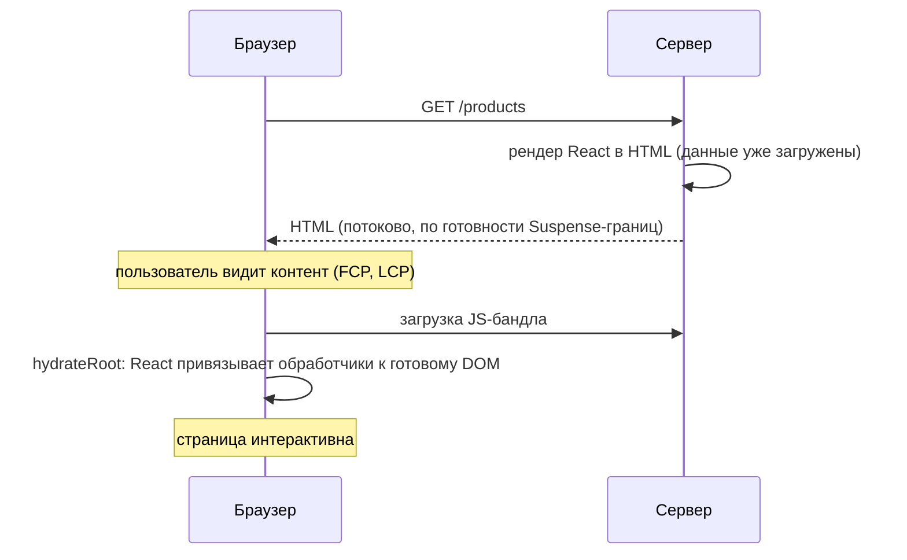
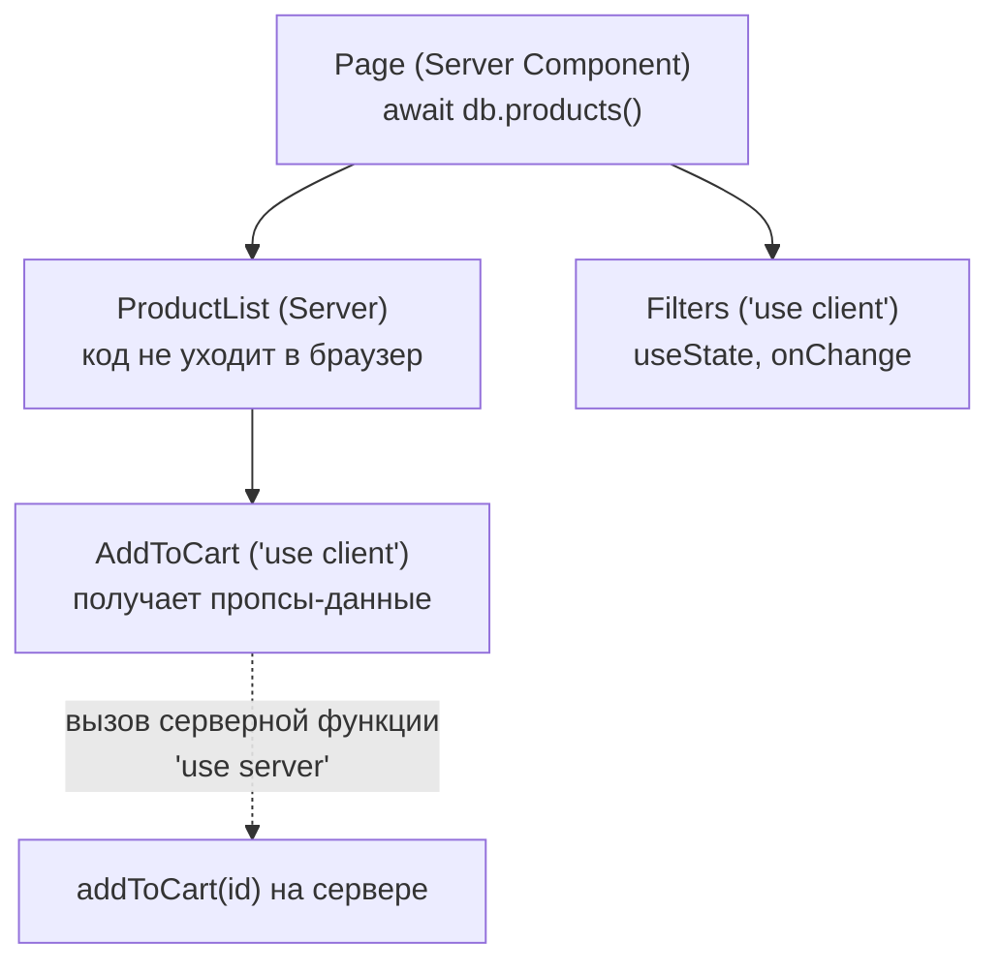

## О чём урок

Как React рендерит на сервере: какие API актуальны, а какие удалены, чем `renderToString` отличается от потокового рендера и пререндера, что такое гидратация и откуда берутся ошибки несовпадения. Вторая половина про Server Components и серверные функции: модель, границы `'use client'` и безопасность. В конце что выбрать для нового проекта.

## Зачем рендерить на сервере



При чистом клиентском рендере (CSR) браузер получает пустой `<div id="root">`, скачивает и выполняет JavaScript, и только потом пользователь видит контент. Серверный рендер (SSR) отдаёт готовый HTML: контент виден раньше, его видят поисковики и превью ссылок. Цена: сервер на каждый запрос (или сборка заранее), и страница не интерактивна, пока не загрузится JavaScript и не пройдёт гидратация. Статическая генерация (SSG) делает то же на этапе сборки.

## Серверные API React DOM

| API | Что делает |
|---|---|
| `renderToPipeableStream` | Потоковый рендер в Node.js: отдаёт оболочку сразу, содержимое границ Suspense дописывает по мере готовности |
| `renderToReadableStream` | То же на Web Streams (Deno, Bun, edge; с React 19.2 и в Node) |
| `prerender`, `prerenderToNodeStream` (`react-dom/static`) | Ждут все данные и отдают полный HTML: для статической генерации |
| `resume`, `resumeAndPrerender` (React 19.2) | Частичный пререндер: статическую оболочку готовят заранее, динамику дорендеривают на запросе |
| `renderToString` | Строка сразу, без потоков и без ожидания данных: на месте приостановленной границы fallback |
| `renderToStaticMarkup` | HTML без гидратации (письма, статические фрагменты) |

`renderToNodeStream` и `renderToStaticNodeStream` удалены в React 19. Атрибута `data-reactroot` и контрольных сумм в HTML нет с React 16.

```jsx run
import { Suspense, use } from 'react'
import { renderToString } from 'react-dom/server'
import { prerender } from 'react-dom/static'

const stats = new Promise((resolve) => setTimeout(() => resolve(42), 20))

function Stats() {
  const value = use(stats)
  return <p>Orders: {value}</p>
}

function Page() {
  return (
    <main>
      <h1>Dashboard</h1>
      <Suspense fallback={<p>Loading…</p>}>
        <Stats />
      </Suspense>
    </main>
  )
}

// Drop React's markers so the result is easy to read.
const clean = (html) => html.replace(/<!--.*?-->|<template[\s\S]*?<\/template>/g, '')
console.log('renderToString:', clean(renderToString(<Page />)))
const { prelude } = await prerender(<Page />)
console.log('prerender:', clean(await new Response(prelude).text()))
```

```output
renderToString: <main><h1>Dashboard</h1><p>Loading…</p></main>
prerender: <main><h1>Dashboard</h1><p>Orders: 42</p></main>
```

`renderToString` не стал ждать данные и отдал fallback (данные загрузятся уже на клиенте), `prerender` дождался промиса. Потоковый `renderToPipeableStream` сначала отдал бы оболочку с fallback, а затем в том же ответе дописал бы `<p>Orders: 42</p>` и маленький скрипт, который вставит его на место. Пользователь видит страницу раньше, медленная часть не держит остальные.

## Гидратация

`hydrateRoot(container, <App />)` не создаёт DOM заново: React рендерит то же дерево на клиенте, сопоставляет его с готовым HTML и подключает обработчики. Поэтому **первый рендер на клиенте должен дать тот же HTML, что на сервере**. Если текст не совпал, React перерендерит ближайшую границу Suspense (или весь корень) на клиенте и сообщит об этом через `onRecoverableError`:

```jsx dom
import { act } from 'react'
import { hydrateRoot } from 'react-dom/client'
import { renderToString } from 'react-dom/server'

function Clock({ now }) {
  return <time>{now}</time>
}

const container = document.createElement('div')
container.innerHTML = renderToString(<Clock now="10:00:00" />)
await act(() =>
  hydrateRoot(container, <Clock now="10:00:01" />, {
    onRecoverableError: (error) => console.log('recoverable:', error.message.split('.')[0]),
  }),
)
console.log(container.innerHTML)
```

```output
recoverable: Hydration failed because the server rendered text didn't match the client
<time>10:00:01</time>
```

Типичные причины: `Date.now()`, `Math.random()`, `typeof window !== 'undefined'` в рендере, локаль и часовой пояс, неверная вложенность HTML (`<div>` внутри `<p>`), расширения браузера, правящие DOM. Решения:

- **id** для `htmlFor`, `aria-describedby` и подобного генерирует `useId`: на сервере и клиенте он даёт одинаковые значения, а `Math.random()` нет;
- одно расходящееся значение (время) помечают `suppressHydrationWarning` на элементе, это работает только на один уровень;
- компонент, которому нужен браузер (`localStorage`, часовой пояс пользователя), с React 19.3 вызывает `use(browser())` из `react-dom`: на сервере он приостанавливается и в HTML попадает fallback ближайшего Suspense, на клиенте рендерится как обычно. Раньше для этого писали `useEffect(() => setMounted(true), [])` и второй проход рендера.

```jsx dom
import { act, useId } from 'react'
import { hydrateRoot } from 'react-dom/client'
import { renderToString } from 'react-dom/server'

function Field({ label }) {
  const id = useId()
  return (
    <p>
      <label htmlFor={id}>{label}</label> <input id={id} />
    </p>
  )
}
function Form() {
  return <><Field label="Name" /><Field label="Email" /></>
}

const container = document.createElement('div')
container.innerHTML = renderToString(<Form />)
const serverIds = [...container.querySelectorAll('input')].map((i) => i.id)
await act(() => hydrateRoot(container, <Form />, { onRecoverableError: (e) => console.log('mismatch:', e.message) }))
const clientIds = [...container.querySelectorAll('input')].map((i) => i.id)
console.log(new Set(serverIds).size, 'unique ids,', JSON.stringify(serverIds) === JSON.stringify(clientIds) ? 'same after hydration' : 'changed')
```

```output
2 unique ids, same after hydration
```

**Выборочная гидратация** (selective hydration, React 18+): каждая граница Suspense гидратируется независимо. Пока грузится код одной части, остальные уже интерактивны, и если пользователь кликнул в ещё не гидратированную область, React гидратирует её первой.

## Server Components



**Server Component** выполняется только на сервере (при запросе или при сборке) и отправляет клиенту не код, а результат рендера. Это не то же самое, что SSR: SSR превращает в HTML и клиентские компоненты, а Server Components вообще не попадают в клиентский бандл.

- Server Component может быть `async` и читать данные напрямую: `const post = await db.posts.find(id)`. Асинхронными бывают только Server Components.
- У него нет состояния, эффектов и обработчиков событий.
- Директивы для Server Component нет: в приложениях с RSC это поведение по умолчанию.
- `'use client'` в начале файла отмечает **границу**: этот модуль и всё, что он импортирует, попадает на клиент. Server Component может рендерить клиентский и передавать ему пропсы, но только сериализуемые: примитивы, простые объекты и массивы, `Date`, `Map`, `Set`, промисы, JSX, серверные функции. Обычные функции и классы нельзя.
- Клиентский компонент не может импортировать серверный, но может получить его как `children`.
- Промис можно создать в Server Component и передать клиентскому, который прочитает его через `use`.

```jsx
// app/posts/[id]/page.jsx: a Server Component (no directive)
import { LikeButton } from './LikeButton'

export default async function PostPage({ params }) {
  const { id } = await params
  const post = await db.posts.find(id)
  return (
    <article>
      <h1>{post.title}</h1>
      <LikeButton postId={post.id} initialLikes={post.likes} />
    </article>
  )
}
```

```jsx
// LikeButton.jsx
'use client'
import { useOptimistic } from 'react'
import { like } from './actions'

export function LikeButton({ postId, initialLikes }) {
  const [likes, addLike] = useOptimistic(initialLikes, (n) => n + 1)
  return (
    <form action={async () => { addLike(); await like(postId) }}>
      <button>♥ {likes}</button>
    </form>
  )
}
```

## Серверные функции

`'use server'` помечает асинхронную функцию (или все экспорты файла), которую клиент может вызвать: при вызове браузер отправляет запрос, сервер выполняет функцию и возвращает результат. С сентября 2024 они называются Server Functions (Server Actions это серверные функции, переданные в `action` формы или вызванные из Action).

```js
// actions.js
'use server'

export async function like(postId) {
  const user = await getCurrentUser()
  if (!user) throw new Error('Not signed in')
  if (typeof postId !== 'string') throw new Error('Bad input')
  await db.likes.add({ postId, userId: user.id })
}
```

Безопасность:

- Серверная функция это **публичный эндпоинт**. Её аргументы полностью под контролем клиента: проверяйте тип и формат и проверяйте права текущего пользователя внутри функции. То, что кнопку видит только админ, ничего не защищает.
- Возвращайте только нужные поля, а не всю запись из базы.
- Держите React и фреймворк обновлёнными: в декабре 2025 в декодировании запросов к серверным функциям нашли уязвимость с удалённым выполнением кода без аутентификации (CVE-2025-55182, CVSS 10.0; исправлено в 19.0.1, 19.1.2 и 19.2.1), затем ещё две (отказ в обслуживании и раскрытие исходного кода). Уязвимы были приложения с поддержкой RSC, даже без собственных серверных функций.

## Что выбрать

- Create React App объявлен устаревшим в феврале 2025. Для новых проектов React рекомендует **фреймворк**: Next.js (App Router, RSC), React Router в режиме фреймворка, Expo для мобильных. Для SPA без сервера или постепенного перехода подходит **Vite** с роутером (React Router в data mode, TanStack Router).
- Нужны SEO и быстрый первый показ: SSR или SSG. Внутренняя панель за логином: часто хватает CSR.
- Server Components требуют поддержки бандлера и сервера, поэтому их используют через фреймворк.

## Главное

- Актуальные API: потоковые `renderToPipeableStream` и `renderToReadableStream`, `prerender` для статики, `resume` для частичного пререндера; `renderToString` не ждёт данные.
- Гидратация требует одинакового первого рендера; `useId` для id, `suppressHydrationWarning` для одного значения, `use(browser())` для браузерных компонентов.
- Выборочная гидратация: границы Suspense оживают независимо, приоритет у области взаимодействия.
- Server Components выполняются только на сервере, могут быть `async`, передают клиентским компонентам только сериализуемые пропсы.
- Серверные функции это публичные эндпоинты: проверка входа и прав внутри, обновления безопасности обязательны.
