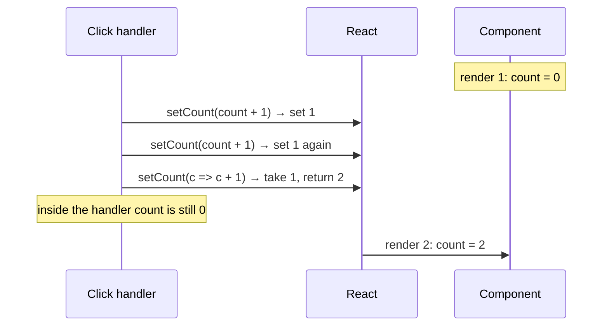
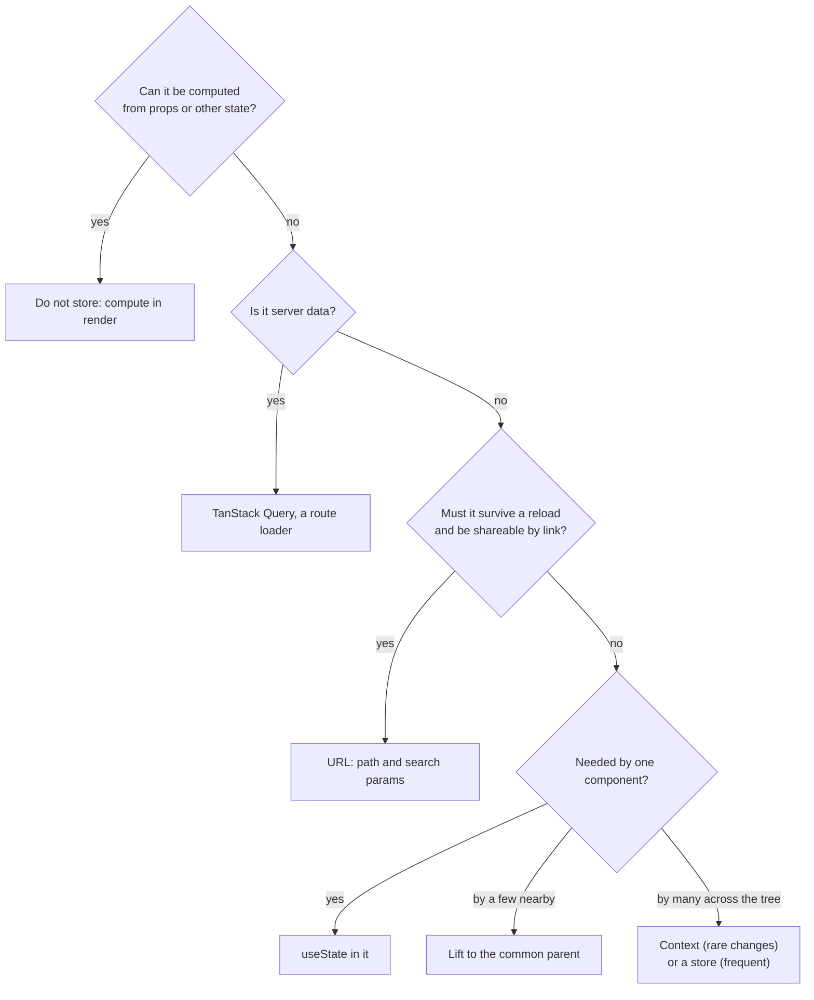

## What this lesson covers

How `useState` works: why state is a snapshot, how React groups updates (batching), why objects in state change only through copies, and where derived data belongs. The second half is about events: delegation, `onChange`, portals and forms.

## State is a snapshot



On every render a component gets **the state value as of that render**. `setCount` does not change the `count` variable; it queues an update and requests a new render:

```jsx dom
import { act, useState } from 'react'
import { createRoot } from 'react-dom/client'

function Counter() {
  const [count, setCount] = useState(0)
  console.log('render', count)
  function addThreeWrong() {
    setCount(count + 1)
    setCount(count + 1)
    setCount(count + 1)
    console.log('count in handler', count)
  }
  return (
    <>
      <button id="wrong" onClick={addThreeWrong}>wrong</button>
      <button id="right" onClick={() => [1, 2, 3].forEach(() => setCount((c) => c + 1))}>right</button>
    </>
  )
}

const container = document.createElement('div')
const root = createRoot(container)
await act(() => root.render(<Counter />))
await act(() => container.querySelector('#wrong').click())
await act(() => container.querySelector('#right').click())
```

```output
render 0
count in handler 0
render 1
render 4
```

Three calls to `setCount(count + 1)` wrote "0 + 1" three times. An updater function `c => c + 1` receives the result of the previous one in the queue, so three calls gave +3. The rule: if the new value depends on the old one, pass a function. Inside the handler `count` stays old until the end; you cannot "read the new value right after `setState`": it will be there in the next render.

If the new value equals the old one by `Object.is`, React skips rendering the children and the effects (the component itself may be called once more, but the result is thrown away).

## Batching

Updates made in one synchronous piece of code are applied by React in a single render. Before React 18 this was true only inside React event handlers; since React 18 with `createRoot` batching is automatic everywhere: in `setTimeout`, promises and native handlers.

```jsx dom
import { act, useState } from 'react'
import { flushSync } from 'react-dom'
import { createRoot } from 'react-dom/client'

let setA, setB
function App() {
  const [a, _setA] = useState(0)
  const [b, _setB] = useState(0)
  setA = _setA
  setB = _setB
  console.log('render', a, b)
  return null
}

const root = createRoot(document.createElement('div'))
await act(() => root.render(<App />))
await act(async () => {
  await new Promise((resolve) => setTimeout(resolve, 10))
  setA(1)
  setB(1)
})
await act(() => {
  flushSync(() => setA(2))
  setB(2)
})
```

```output
render 0 0
render 1 1
render 2 1
render 2 2
```

After `await` two updates produced one render. `flushSync` forces an update to be applied and the DOM to be updated immediately, which is a separate render. You rarely need it: for example, to scroll to a just-added item right after `setState`.

## Objects and arrays only by copy

React compares state by reference. Mutating an object and passing the same object back means "nothing changed" to React:

```jsx dom
import { act, useState } from 'react'
import { createRoot } from 'react-dom/client'

let user, setUser
function Profile() {
  ;[user, setUser] = useState({ name: 'Ann', city: 'Oslo' })
  console.log('render', user.city)
  return null
}

const root = createRoot(document.createElement('div'))
await act(() => root.render(<Profile />))
await act(() => {
  user.city = 'Rome' // mutation: same object
  setUser(user)
})
await act(() => setUser({ ...user, city: 'Rome' }))
```

```output
render Oslo
render Rome
```

After the mutation there was no render: same reference. A new object via spread produced a render. For arrays: `[...list, item]`, `list.filter(...)`, `list.map(...)`, `toSorted()` instead of in-place `push`, `splice` and `sort`. For deeply nested data, flatten the structure or use Immer (`useImmer`), which lets you write "mutations" on a draft.

## Where data belongs



- **Do not store derived data.** If a value is computed from props or state, compute it during render: `const fullName = first + ' ' + last`. A `useState` + `useEffect(() => setFullName(...))` pair gives an extra render with a stale value.
- **An expensive calculation** goes into `useMemo` (or is left to React Compiler, see the performance lesson).
- **Reset when the entity changes** with `key`, not an effect: `<EditForm key={user.id} user={user} />`.
- **Shared by several components**: lift it to the closest common parent and pass it down as props; the child reports changes through a callback (`onChange`).
- **Many related transitions** (a form, a wizard, a state machine) fit `useReducer` better: handlers say what happened (`dispatch({ type: 'submitted' })`), and the reducer, a pure function, decides how the state changes. `dispatch` is stable across renders.

## Rules of hooks

Call hooks only at the top level of a component or your own hook: not in conditions, loops, after an early `return` or in nested functions. React finds a hook's state by call order (internally a linked list on the Fiber node): if the order changes, the values get mixed up. Your own hook's name starts with `use` so that the `eslint-plugin-react-hooks` linter can check this. There is one exception: `use()` can be called in conditions and loops.

## Events

- Handlers are written in JSX (`onClick`, `onKeyDown`); React attaches **one listener per event type to the root container** (since React 17, previously to `document`) and delivers the event to the right components itself.
- A handler gets a `SyntheticEvent`: a wrapper with the same interface as the native event (`target`, `preventDefault()`, `stopPropagation()`), with the native object in `e.nativeEvent`. There has been no event pooling since React 17, so the event can be read asynchronously too.
- `onChange` on text fields fires on every input, like the native `input` event, not like the native `change` (which arrives on blur):

```jsx dom
import { act } from 'react'
import { createRoot } from 'react-dom/client'

function Search() {
  function handleChange(e) {
    setTimeout(() => console.log('later:', e.type, e.target.value))
    console.log('now:', e.type, e.nativeEvent.type)
  }
  return <input onChange={handleChange} />
}

const container = document.createElement('div')
document.body.append(container)
await act(() => createRoot(container).render(<Search />))
const input = container.querySelector('input')
const setValue = Object.getOwnPropertyDescriptor(HTMLInputElement.prototype, 'value').set
setValue.call(input, 'r')
input.dispatchEvent(new Event('input', { bubbles: true }))
await new Promise((resolve) => setTimeout(resolve, 0))
```

```output
now: change input
later: change r
```

- Bubbling follows **the React tree**, not the DOM. Portals show this: the button sits elsewhere in the document, yet the click reaches the parent component's handler:

```jsx dom
import { act } from 'react'
import { createPortal } from 'react-dom'
import { createRoot } from 'react-dom/client'

const modalRoot = document.createElement('div')
document.body.append(modalRoot)

function App() {
  return (
    <div onClick={() => console.log('App got the click')}>
      {createPortal(<button>Inside the portal</button>, modalRoot)}
    </div>
  )
}

const container = document.createElement('div')
document.body.append(container)
await act(() => createRoot(container).render(<App />))
console.log('button is inside the app div:', container.contains(modalRoot.querySelector('button')))
modalRoot.querySelector('button').click()
```

```output
button is inside the app div: false
App got the click
```

- `e.stopPropagation()` stops bubbling through the React tree. Native listeners on elements between the target and the root have already run by then, because React learns about the event only at the root.
- `onMouseEnter` and `onMouseLeave` do not bubble; since React 17 `onScroll` does not bubble either. The capture phase: `onClickCapture`.

## Forms: controlled and uncontrolled

- **Controlled field**: `value={state}` and `onChange`; the value lives in state. Needed for live validation, masks, fields that depend on each other.
- **Uncontrolled**: `defaultValue`; the value lives in the DOM and is read on submit. Since React 19 this is the normal path for forms with `action`: the function gets `FormData`, and after a successful submit React resets the fields itself (see the Actions lesson).
- Do not switch one field between modes: `value={undefined}` followed by `value="x"` triggers a warning. For an empty controlled field use `''`.
- `<input type="file">` is always uncontrolled.

## Key points

- State is a snapshot of a render; `setState` schedules a new render. Pass a function when the value depends on the old one.
- Since React 18 updates are batched everywhere; `flushSync` applies an update immediately.
- Objects and arrays in state are replaced by copies; a mutation does not trigger a render.
- Compute derived data during render, reset with `key`, lift shared state to a parent, put complex transitions in `useReducer`.
- Events are delegated to the root, bubble through the React tree (portals too), `onChange` means input, and there is no event pooling.
