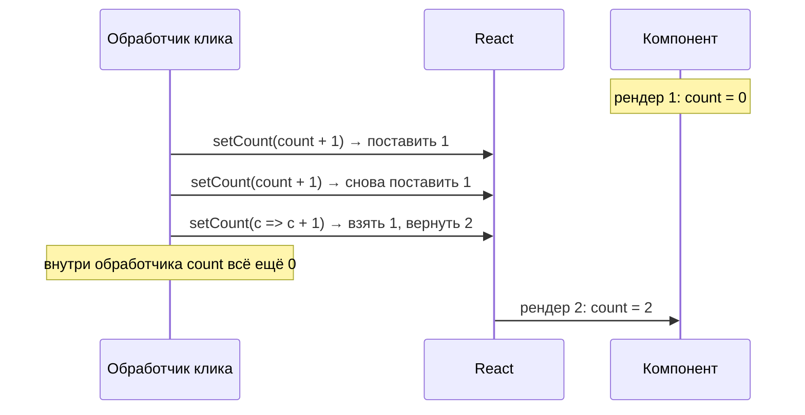
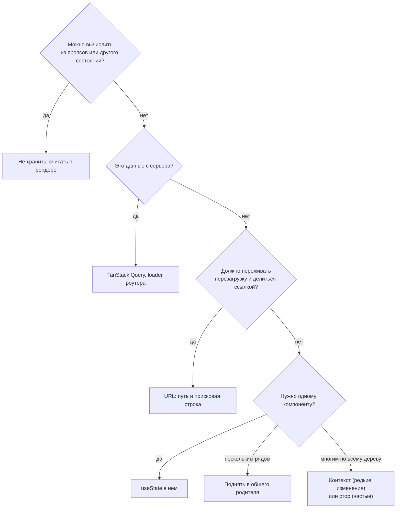

## О чём урок

Как работает `useState`: почему состояние это снимок, как React группирует обновления (батчинг), почему объекты в состоянии меняют только копированием, где хранить производные данные. Вторая половина про события: делегирование, `onChange`, порталы и формы.

## Состояние это снимок



При каждом рендере компонент получает **значение состояния на момент этого рендера**. `setCount` не меняет переменную `count`, он ставит обновление в очередь и запрашивает новый рендер:

```jsx dom
import { act, useState } from 'react'
import { createRoot } from 'react-dom/client'

function Counter() {
  const [count, setCount] = useState(0)
  console.log('render', count)
  function addThreeWrong() {
    setCount(count + 1)
    setCount(count + 1)
    setCount(count + 1)
    console.log('count in handler', count)
  }
  return (
    <>
      <button id="wrong" onClick={addThreeWrong}>wrong</button>
      <button id="right" onClick={() => [1, 2, 3].forEach(() => setCount((c) => c + 1))}>right</button>
    </>
  )
}

const container = document.createElement('div')
const root = createRoot(container)
await act(() => root.render(<Counter />))
await act(() => container.querySelector('#wrong').click())
await act(() => container.querySelector('#right').click())
```

```output
render 0
count in handler 0
render 1
render 4
```

Три вызова `setCount(count + 1)` трижды записали «0 + 1». Функция-обновление `c => c + 1` получает результат предыдущей из очереди, поэтому три вызова дали +3. Правило: если новое значение зависит от старого, передавайте функцию. Внутри обработчика `count` остаётся старым до конца, «прочитать новое значение сразу после `setState`» нельзя: оно будет в следующем рендере.

Если новое значение совпадает со старым по `Object.is`, React пропускает рендер детей и эффекты (сам компонент иногда ещё раз вызывается, но результат отбрасывается).

## Батчинг

Обновления, сделанные в одном синхронном куске кода, React применяет одним рендером. До React 18 так было только в обработчиках событий React; с React 18 и `createRoot` батчинг автоматический везде: в `setTimeout`, промисах и нативных обработчиках.

```jsx dom
import { act, useState } from 'react'
import { flushSync } from 'react-dom'
import { createRoot } from 'react-dom/client'

let setA, setB
function App() {
  const [a, _setA] = useState(0)
  const [b, _setB] = useState(0)
  setA = _setA
  setB = _setB
  console.log('render', a, b)
  return null
}

const root = createRoot(document.createElement('div'))
await act(() => root.render(<App />))
await act(async () => {
  await new Promise((resolve) => setTimeout(resolve, 10))
  setA(1)
  setB(1)
})
await act(() => {
  flushSync(() => setA(2))
  setB(2)
})
```

```output
render 0 0
render 1 1
render 2 1
render 2 2
```

После `await` два обновления дали один рендер. `flushSync` заставляет применить обновление и обновить DOM немедленно, это отдельный рендер. Он нужен редко: например, чтобы прокрутить к только что добавленному элементу сразу после `setState`.

## Объекты и массивы только копией

React сравнивает состояние по ссылке. Мутация объекта и передача его же обратно для React «ничего не изменилось»:

```jsx dom
import { act, useState } from 'react'
import { createRoot } from 'react-dom/client'

let user, setUser
function Profile() {
  ;[user, setUser] = useState({ name: 'Ann', city: 'Oslo' })
  console.log('render', user.city)
  return null
}

const root = createRoot(document.createElement('div'))
await act(() => root.render(<Profile />))
await act(() => {
  user.city = 'Rome' // mutation: same object
  setUser(user)
})
await act(() => setUser({ ...user, city: 'Rome' }))
```

```output
render Oslo
render Rome
```

После мутации рендера не было: ссылка та же. Новый объект через spread дал рендер. Для массивов: `[...list, item]`, `list.filter(...)`, `list.map(...)`, `toSorted()` вместо `push`, `splice` и `sort` на месте. Для глубоко вложенных данных лучше сделать структуру плоской или взять Immer (`useImmer`), который позволяет писать «мутации» над черновиком.

## Где хранить данные



- **Производное не храните.** Если значение вычисляется из пропсов или состояния, считайте его при рендере: `const fullName = first + ' ' + last`. Пара `useState` + `useEffect(() => setFullName(...))` даёт лишний рендер с устаревшим значением.
- **Тяжёлое вычисление** оберните в `useMemo` (или доверьте React Compiler, урок про производительность).
- **Сброс при смене сущности** делают через `key`, а не эффектом: `<EditForm key={user.id} user={user} />`.
- **Общее для нескольких компонентов** поднимают в ближайшего общего родителя и передают вниз пропсами; ребёнок сообщает об изменениях колбэком (`onChange`).
- **Много связанных переходов** (форма, мастер, конечный автомат) удобнее в `useReducer`: обработчики говорят, что произошло (`dispatch({ type: 'submitted' })`), а редьюсер, чистая функция, решает, как меняется состояние. `dispatch` стабилен между рендерами.

## Правила хуков

Хуки вызывают только на верхнем уровне компонента или своего хука: не в условиях, циклах, после раннего `return` и не во вложенных функциях. React находит состояние хука по порядку вызова (внутри это связный список на узле Fiber): если порядок изменится, значения перепутаются. Своё имя хук начинает с `use`, чтобы линтер `eslint-plugin-react-hooks` мог это проверить. Исключение одно: `use()` можно вызывать в условиях и циклах.

## События

- Обработчики пишут в JSX (`onClick`, `onKeyDown`), React вешает **один слушатель на каждый тип события на корневой контейнер** (с React 17, раньше на `document`) и сам доставляет событие нужным компонентам.
- Обработчик получает `SyntheticEvent`: обёртку с тем же интерфейсом, что у нативного события (`target`, `preventDefault()`, `stopPropagation()`), сам нативный объект в `e.nativeEvent`. Пула событий нет с React 17, событие можно читать и асинхронно.
- `onChange` у текстовых полей срабатывает на каждый ввод, как нативное `input`, а не как нативный `change` (тот приходит при потере фокуса):

```jsx dom
import { act } from 'react'
import { createRoot } from 'react-dom/client'

function Search() {
  function handleChange(e) {
    setTimeout(() => console.log('later:', e.type, e.target.value))
    console.log('now:', e.type, e.nativeEvent.type)
  }
  return <input onChange={handleChange} />
}

const container = document.createElement('div')
document.body.append(container)
await act(() => createRoot(container).render(<Search />))
const input = container.querySelector('input')
const setValue = Object.getOwnPropertyDescriptor(HTMLInputElement.prototype, 'value').set
setValue.call(input, 'r')
input.dispatchEvent(new Event('input', { bubbles: true }))
await new Promise((resolve) => setTimeout(resolve, 0))
```

```output
now: change input
later: change r
```

- Всплытие идёт **по дереву React**, а не по DOM. Это видно на порталах: кнопка физически в другом месте документа, но клик доходит до обработчика родительского компонента:

```jsx dom
import { act } from 'react'
import { createPortal } from 'react-dom'
import { createRoot } from 'react-dom/client'

const modalRoot = document.createElement('div')
document.body.append(modalRoot)

function App() {
  return (
    <div onClick={() => console.log('App got the click')}>
      {createPortal(<button>Inside the portal</button>, modalRoot)}
    </div>
  )
}

const container = document.createElement('div')
document.body.append(container)
await act(() => createRoot(container).render(<App />))
console.log('button is inside the app div:', container.contains(modalRoot.querySelector('button')))
modalRoot.querySelector('button').click()
```

```output
button is inside the app div: false
App got the click
```

- `e.stopPropagation()` останавливает всплытие по дереву React. Нативные слушатели на элементах между целью и корнем к этому моменту уже сработали, ведь React узнаёт о событии только на корне.
- `onMouseEnter` и `onMouseLeave` не всплывают; `onScroll` с React 17 тоже не всплывает. Фаза перехвата: `onClickCapture`.

## Формы: управляемые и неуправляемые

- **Управляемое поле**: `value={state}` и `onChange`, значение живёт в состоянии. Нужно для валидации на лету, масок, полей, зависящих друг от друга.
- **Неуправляемое**: `defaultValue`, значение живёт в DOM и читается при отправке. С React 19 это обычный путь для форм с `action`: функция получает `FormData`, а после успешной отправки React сам сбрасывает поля (урок про Actions).
- Нельзя переключать одно поле между режимами: `value={undefined}` потом `value="x"` даёт предупреждение. Для пустого управляемого поля используйте `''`.
- `<input type="file">` всегда неуправляемый.

## Главное

- Состояние это снимок рендера; `setState` планирует новый рендер. Зависимое от старого значение передавайте функцией.
- С React 18 обновления батчатся везде; `flushSync` применяет обновление немедленно.
- Объекты и массивы в состоянии заменяют копией; мутация не вызывает рендер.
- Производное считают при рендере, сброс делают через `key`, общее поднимают к родителю, сложные переходы в `useReducer`.
- События делегируются на корень, всплывают по дереву React (порталы тоже), `onChange` это ввод, пула событий нет.
