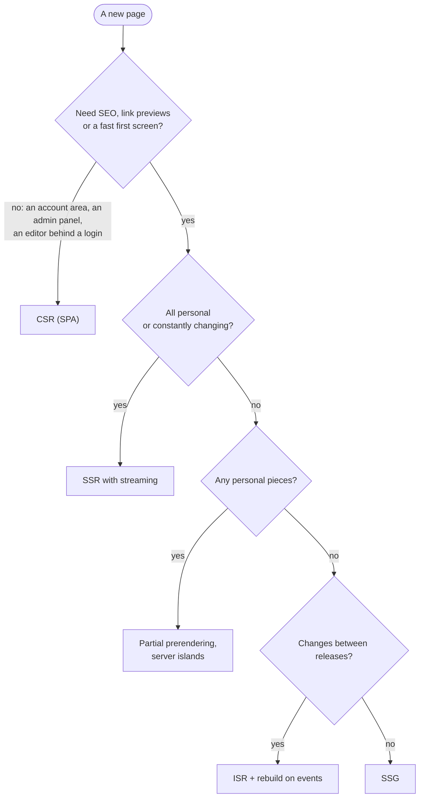

## What this lesson covers

The summary of the track: how to choose a rendering strategy and justify it in an interview. The order of reasoning, what SEO and link previews really need, how the strategies affect Core Web Vitals, typical scenarios (a blog, a shop, a dashboard, a feed, SaaS) and a ready answer. The example runs in Node.js and shows what a search crawler sees.

## The order of reasoning



After choosing the mode comes a separate question: **how much JavaScript the client needs**. If there are few interactive spots (an article, a catalog), islands, Server Components or lazy hydration pay off (the `render-less-js` lesson).

## SEO and link previews

```ts run
const products: Record<string, { name: string; description: string }> = {
  '7': { name: 'Trail shoes', description: 'Light shoes for rocky trails.' },
}
const html = (head: string, body = '') => `<!doctype html><html><head>${head}</head><body>${body}</body></html>`

// SPA: the server knows nothing about products and answers every URL with the same shell.
function spaServer(path: string) {
  return new Response(html('<title>Shop</title>', '<div id="root"></div><script src="/app.js"></script>'), {
    status: 200,
    headers: { 'Content-Type': 'text/html' },
  })
}

// SSR: the server looks the product up before rendering, so status and meta tags are right.
function ssrServer(path: string) {
  const product = products[path.split('/').pop()!]
  if (!product) {
    return new Response(html('<title>Not found | Shop</title><meta name="robots" content="noindex">', '<h1>Not found</h1>'), { status: 404 })
  }
  const head = `<title>${product.name} | Shop</title>
<meta name="description" content="${product.description}">
<meta property="og:title" content="${product.name}">
<link rel="canonical" href="https://shop.example.com${path}">`
  return new Response(html(head, `<h1>${product.name}</h1>`), { status: 200 })
}

// A crawler or a link preview bot: reads the first HTML, does not run JavaScript.
async function crawl(name: string, res: Response) {
  const page = await res.text()
  const pick = (re: RegExp) => page.match(re)?.[1] ?? '-'
  console.log(name.padEnd(18), res.status, '| title:', pick(/<title>(.*?)<\/title>/).padEnd(20), '| og:title:', pick(/property="og:title" content="(.*?)"/))
}

for (const path of ['/products/7', '/products/999']) {
  await crawl(`SPA ${path}`, spaServer(path))
  await crawl(`SSR ${path}`, ssrServer(path))
}
```

```output
SPA /products/7    200 | title: Shop                 | og:title: -
SSR /products/7    200 | title: Trail shoes | Shop   | og:title: Trail shoes
SPA /products/999  200 | title: Shop                 | og:title: -
SSR /products/999  404 | title: Not found | Shop     | og:title: -
```

- **Google runs JavaScript**, but not right away: a page is crawled first, then queued for rendering in headless Chromium, and only then is the rendered HTML indexed. Google's JavaScript SEO docs still call server rendering or prerendering a good idea: it is faster both for people and for crawlers that do not run JavaScript.
- **Social and messenger bots** (link previews with an image and a title) usually read only the first HTML. The `og:title`, `og:image`, `twitter:card` tags must be in the server response, otherwise the preview shows "Shop" without an image, like the SPA in the example.
- **Soft 404.** An SPA answers `200` to any URL, and a nonexistent product looks like a normal page to a crawler. Google advises SPAs to either redirect to a URL the server answers with `404`, or add `<meta name="robots" content="noindex">` with a script. With SSR the server answers `404` right away.
- **The canonical URL** (`<link rel="canonical">`) is better served in the server HTML; a `noindex` added by JavaScript is unreliable: seeing it in the original HTML, Google may not render the page at all.

## Impact on Core Web Vitals

| Metric | What hurts it | What helps |
|---|---|---|
| LCP (main content) | CSR: content only after JS and data; slow TTFB with SSR | SSG and ISR from a CDN, streaming, partial prerendering, `fetchpriority="high"` for the main image |
| INP (responsiveness) | Heavy hydration after display, a large bundle | Less JS (islands, Server Components), selective and lazy hydration, code splitting |
| CLS (stability) | Streaming placeholders of the wrong size, content of a different size after hydration | Skeletons with dimensions, the same server and client render |
| TTFB | SSR with sequential queries, a distant database | Caching HTML on a CDN, parallel data loading, streaming the shell |

Metrics and how to measure them are covered in detail in the performance track.

## Typical scenarios

| Product | Choice | Why |
|---|---|---|
| Docs, a blog, a landing page | SSG (Astro, Next.js, Nuxt), islands for interactivity | The same for everyone, SEO, cheap hosting |
| An online shop | Catalog and product pages: ISR or partial prerendering; the cart and the user's price: dynamic parts; checkout: SSR or CSR | Catalog SEO and speed, fresh prices and stock |
| A news feed, a social network | SSR with streaming, a personal feed; articles: ISR | Personal, changes often, link previews needed |
| A dashboard, an admin panel, SaaS behind a login | CSR (SPA), optionally with an SSR shell | No SEO needed, lots of interactivity, user data |
| SaaS marketing pages + the app | Hybrid: marketing SSG, the app CSR, a mode per route | Different parts have different requirements |

## How to answer in an interview

1. "First the requirements: whether indexing and link previews are needed, whether the content is the same for everyone, how often it changes, which devices and networks the users have."
2. "For the catalog and product pages I'd take static generation with rebuilds: pages on a CDN, rebuilt after a period and by a CMS webhook when a price changes. The personal cart and the regional price go into dynamic parts: partial prerendering in Next.js or server islands."
3. "The account area behind the login I'd make client-rendered: no SEO needed, and lots of interactivity."
4. "So that hydration does not hurt INP, I keep interactive parts small: Server Components or islands for static parts, lazy hydration for what is below the first screen."
5. "I watch the details: correct `404` statuses and redirects from the server, meta and `og:` tags in the server HTML, escaping data in the page, `private` for personal HTML, streaming placeholders sized like the content."

The answer shows that the choice follows from the requirements and is made per route, not "we use Next.js, so SSR everywhere".

## Key points

- The order: are SEO and a fast first screen needed; is the content the same for everyone; how often does it change. Then separately: how much JavaScript the client needs.
- Google runs JavaScript with a delay and still recommends server rendering or prerendering; link preview bots read only the first HTML, so `og:` tags must be in the server response.
- An SPA answers `200` to nonexistent URLs (a soft 404); SSR returns a real `404`; the canonical URL and `noindex` are more reliable in the server HTML.
- LCP is helped by CDNs, SSG and streaming; INP is hurt by heavy hydration; CLS by placeholders of the wrong size; TTFB by sequential queries and a distant database.
- A shop: ISR or partial prerendering for the catalog, dynamic parts for personal data; a dashboard: CSR; content: SSG with islands. Choose the mode per route.
