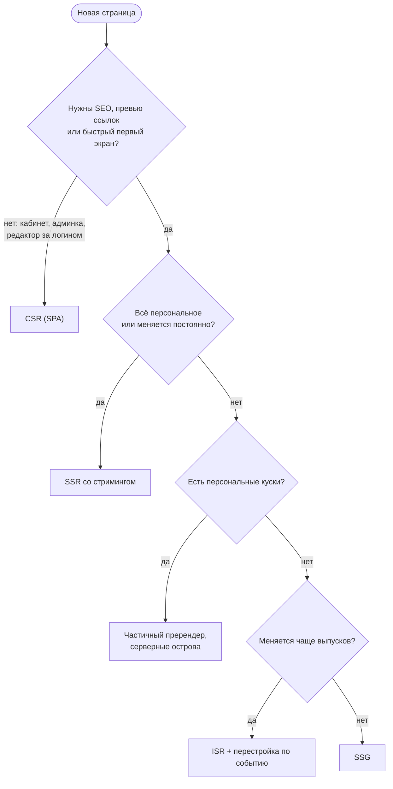

## О чём урок

Итог трека: как выбрать стратегию рендеринга и обосновать её на собеседовании. Порядок рассуждения, что на самом деле нужно для SEO и превью ссылок, как стратегии влияют на Core Web Vitals, типичные сценарии (блог, магазин, дашборд, лента, SaaS) и готовый ответ. Пример выполняется в Node.js и показывает, что видит поисковый робот.

## Порядок рассуждения



После выбора режима отдельный вопрос: **сколько JavaScript нужно клиенту**. Если интерактивных мест мало (статья, каталог), выигрыш дадут острова, Server Components или ленивая гидратация (урок `render-less-js`).

## SEO и превью ссылок

```ts run
const products: Record<string, { name: string; description: string }> = {
  '7': { name: 'Trail shoes', description: 'Light shoes for rocky trails.' },
}
const html = (head: string, body = '') => `<!doctype html><html><head>${head}</head><body>${body}</body></html>`

// SPA: the server knows nothing about products and answers every URL with the same shell.
function spaServer(path: string) {
  return new Response(html('<title>Shop</title>', '<div id="root"></div><script src="/app.js"></script>'), {
    status: 200,
    headers: { 'Content-Type': 'text/html' },
  })
}

// SSR: the server looks the product up before rendering, so status and meta tags are right.
function ssrServer(path: string) {
  const product = products[path.split('/').pop()!]
  if (!product) {
    return new Response(html('<title>Not found | Shop</title><meta name="robots" content="noindex">', '<h1>Not found</h1>'), { status: 404 })
  }
  const head = `<title>${product.name} | Shop</title>
<meta name="description" content="${product.description}">
<meta property="og:title" content="${product.name}">
<link rel="canonical" href="https://shop.example.com${path}">`
  return new Response(html(head, `<h1>${product.name}</h1>`), { status: 200 })
}

// A crawler or a link preview bot: reads the first HTML, does not run JavaScript.
async function crawl(name: string, res: Response) {
  const page = await res.text()
  const pick = (re: RegExp) => page.match(re)?.[1] ?? '-'
  console.log(name.padEnd(18), res.status, '| title:', pick(/<title>(.*?)<\/title>/).padEnd(20), '| og:title:', pick(/property="og:title" content="(.*?)"/))
}

for (const path of ['/products/7', '/products/999']) {
  await crawl(`SPA ${path}`, spaServer(path))
  await crawl(`SSR ${path}`, ssrServer(path))
}
```

```output
SPA /products/7    200 | title: Shop                 | og:title: -
SSR /products/7    200 | title: Trail shoes | Shop   | og:title: Trail shoes
SPA /products/999  200 | title: Shop                 | og:title: -
SSR /products/999  404 | title: Not found | Shop     | og:title: -
```

- **Google выполняет JavaScript**, но не сразу: страница сначала сканируется, потом ставится в очередь на рендер в безголовом Chromium, и только потом индексируется отрендеренный HTML. Google в документации по JavaScript SEO по-прежнему называет серверный рендер или пререндер хорошей идеей: так быстрее и для людей, и для роботов, которые не выполняют JavaScript.
- **Боты соцсетей и мессенджеров** (превью ссылки с картинкой и заголовком) обычно читают только первый HTML. Теги `og:title`, `og:image`, `twitter:card` должны быть в ответе сервера, иначе превью покажет «Shop» без картинки, как у SPA в примере.
- **Мягкий 404.** SPA отвечает `200` на любой адрес, и несуществующий товар выглядит для робота нормальной страницей. Google советует для SPA либо перенаправлять на адрес, который сервер отдаёт с `404`, либо добавлять `<meta name="robots" content="noindex">` скриптом. При SSR сервер сразу отвечает `404`.
- **Канонический адрес** (`<link rel="canonical">`) лучше отдавать в HTML сервера; `noindex`, добавленный JavaScript, ненадёжен: увидев его в исходном HTML, Google может не рендерить страницу вовсе.

## Влияние на Core Web Vitals

| Метрика | Что ухудшает | Что помогает |
|---|---|---|
| LCP (главный контент) | CSR: контент только после JS и данных; медленный TTFB при SSR | SSG и ISR с CDN, стриминг, частичный пререндер, `fetchpriority="high"` для главной картинки |
| INP (отзывчивость) | Тяжёлая гидратация после показа, большой бандл | Меньше JS (острова, Server Components), выборочная и ленивая гидратация, разбиение кода |
| CLS (стабильность) | Заглушки стриминга не того размера, контент после гидратации другого размера | Скелетоны с размерами, одинаковый серверный и клиентский рендер |
| TTFB | SSR с последовательными запросами, далёкая база | Кэш HTML на CDN, параллельная загрузка данных, стриминг оболочки |

Подробно метрики и их измерение разобраны в треке производительности.

## Типичные сценарии

| Продукт | Выбор | Почему |
|---|---|---|
| Документация, блог, лендинг | SSG (Astro, Next.js, Nuxt), острова для интерактива | Одинаково для всех, SEO, дешёвый хостинг |
| Интернет-магазин | Каталог и карточки: ISR или частичный пререндер; корзина и цена для пользователя: динамические части; оформление заказа: SSR или CSR | SEO и скорость каталога, свежесть цен и наличия |
| Новостная лента, соцсеть | SSR со стримингом, персональная лента; статьи: ISR | Персональное, часто меняется, нужны превью ссылок |
| Дашборд, админка, SaaS за логином | CSR (SPA), можно с SSR оболочки | SEO не нужно, много интерактива, данные пользователя |
| Маркетинговые страницы SaaS + приложение | Гибрид: маркетинг SSG, приложение CSR, режим на маршрут | Разные требования у разных частей |

## Как ответить на собеседовании

1. «Сначала требования: нужна ли индексация и превью ссылок, одинаков ли контент для всех, как часто он меняется, какие устройства и сеть у пользователей».
2. «Для каталога и карточек товаров возьму статическую генерацию с перестройкой: страницы на CDN, перестройка по сроку и по вебхуку из CMS при изменении цены. Персональную корзину и цену для региона вынесу в динамические части: частичный пререндер в Next.js или серверные острова».
3. «Личный кабинет за логином сделаю клиентским: SEO не нужен, а интерактива много».
4. «Чтобы гидратация не портила INP, держу интерактивные части маленькими: Server Components или острова для статики, ленивая гидратация для того, что ниже первого экрана».
5. «Слежу за мелочами: правильные статусы `404` и редиректы с сервера, мета-теги и `og:` в серверном HTML, экранирование данных в странице, `private` для персонального HTML, заглушки стриминга по размеру контента».

Ответ показывает, что выбор следует из требований и делается для каждого маршрута отдельно, а не «у нас Next.js, значит SSR везде».

## Главное

- Порядок: нужны ли SEO и быстрый первый экран; одинаково ли содержимое для всех; как часто меняется. Затем отдельно: сколько JavaScript нужно клиенту.
- Google выполняет JavaScript отложенно и всё равно советует серверный рендер или пререндер; боты превью ссылок читают только первый HTML, поэтому `og:`-теги должны быть в ответе сервера.
- SPA отвечает `200` на несуществующие адреса (мягкий 404); SSR отдаёт настоящий `404`; канонический адрес и `noindex` надёжнее в серверном HTML.
- LCP улучшают CDN, SSG и стриминг; INP портит тяжёлая гидратация; CLS портят заглушки не того размера; TTFB портят последовательные запросы и далёкая база.
- Магазин: ISR или частичный пререндер для каталога, динамика для персонального; дашборд: CSR; контент: SSG с островами. Режим выбирают на маршрут.
