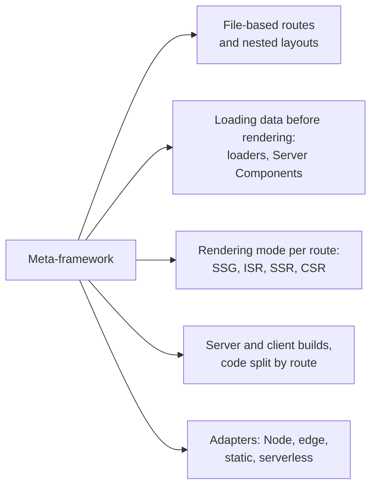
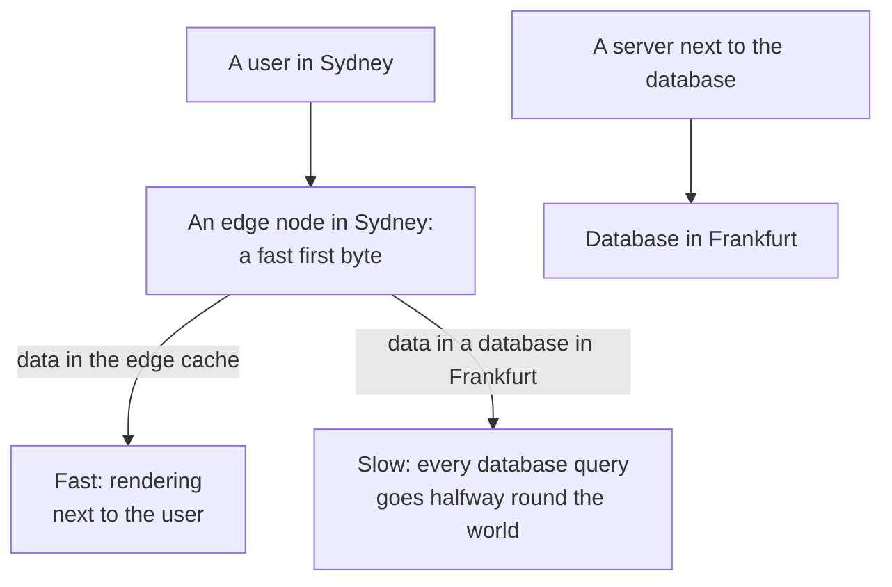

## What this lesson covers

How rendering strategies look in the meta-frameworks used in practice: Next.js 16, Nuxt 4, Angular with `@angular/ssr`, SvelteKit 3, React Router 8 in framework mode, Astro 7, plus what edge rendering is and when it helps. The main idea: the mode is set per route, and all frameworks give similar tools for that. There is no runnable code in this lesson: this is configuration that only works inside the frameworks.

## What a meta-framework does



A UI library (React, Vue, Svelte) can render components but knows nothing about routes, data, caching and deployment. A meta-framework ties these together: it finds the page by URL, loads its data on the server, picks the rendering mode, produces two builds (server and client) and packages the result for the platform.

## A mode per route

| | Static (SSG) | Rebuild (ISR) | Per request (SSR) | Client only (CSR) |
|---|---|---|---|---|
| Next.js 16 | Components without request data, `'use cache'` | `cacheLife`, `revalidateTag` | Reading `cookies()`, `headers()` inside Suspense | `'use client'` and `dynamic(..., { ssr: false })` |
| Nuxt 4 | `routeRules: { prerender: true }` | `{ isr: 3600 }`, `{ swr: 3600 }` | The default (universal rendering) | `{ ssr: false }` |
| Angular 22 | `RenderMode.Prerender` and `getPrerenderParams` | Not built in | `RenderMode.Server` | `RenderMode.Client` |
| SvelteKit 3 | `export const prerender = true` | Through the platform adapter | The default | `export const ssr = false` |
| React Router 8 | `prerender` in `react-router.config.ts` | Through cache headers | `ssr: true` (the default) | `ssr: false` (SPA mode), `clientLoader` |
| Astro 7 | The default | Route caching, CDN headers | `export const prerender = false` | `client:only` islands |

Configuration examples:

```ts
// Nuxt: nuxt.config.ts
export default defineNuxtConfig({
  routeRules: {
    '/': { prerender: true },
    '/blog/**': { isr: 3600 },
    '/products/**': { swr: 600 },
    '/account/**': { ssr: false },
  },
})
```

```ts
// Angular: app.routes.server.ts
export const serverRoutes: ServerRoute[] = [
  { path: '', renderMode: RenderMode.Prerender },
  { path: 'products/:id', renderMode: RenderMode.Server },
  { path: 'account/**', renderMode: RenderMode.Client },
]
```

```ts
// React Router: react-router.config.ts
export default {
  ssr: true,
  async prerender() {
    return ['/', '/about', ...(await getBlogSlugs()).map((slug) => `/blog/${slug}`)]
  },
} satisfies Config
```

```ts
// SvelteKit: src/routes/blog/[slug]/+page.ts
export const prerender = true // build to HTML
export const ssr = true // render on the server (default)
export const csr = true // hydrate in the browser; false gives a page with no JS at all
```

## How frameworks load data

| | Where the data is described | What the client gets |
|---|---|---|
| Next.js App Router | In async Server Components | The finished result in the RSC stream; data for client components is passed as props |
| Nuxt | `useFetch`, `useAsyncData` in components | The data in the page payload, not requested again |
| Angular | `HttpClient`, `httpResource`, resolvers | `HttpClient` responses in the transfer cache (`HttpTransferCache`) |
| SvelteKit | `load` in `+page.server.ts` or `+page.ts` | The serialized result of `load` (through `devalue`) |
| React Router | The route `loader` | The `loader` result; promises are streamed and awaited in `<Await>` |

The common principle: data is loaded at the route level **before** rendering and in parallel, not in component effects, otherwise you get a request waterfall (the `render-ssr` lesson).

## Edge rendering

**Edge** means running code on CDN nodes close to the user (Cloudflare Workers, Vercel, Netlify, Deno Deploy), usually in lightweight V8 isolates instead of full Node.js.



- The edge is good for what does not hit the central database, or hits it once: redirects, A/B tests, geolocation, session checks, personalization by cookie, serving cached pages.
- A render with several sequential database queries in another region is **slower** at the edge than on a server next to the database: the latency is multiplied by the number of queries. So rendering is often placed next to the data, while the edge keeps the cache and light logic.
- The edge runtime lacks some Node.js APIs (the file system, some modules) and limits time and memory. Isolate cold starts are short.
- In Next.js 16 the code that runs before a route (formerly `middleware.ts`) was renamed to `proxy.ts`; its purpose is the same: redirects, URL rewrites, access checks before rendering.

## How to choose a framework

- **Next.js**: React, Server Components, Cache Components, the largest ecosystem; a complex caching model and tight coupling to platform features.
- **React Router 8** (formerly Remix) and **TanStack Start**: React, route loaders, closer to web standards, a simpler model.
- **Nuxt**: Vue, convenient route rules, modules; **SvelteKit**: Svelte, page options, little JavaScript.
- **Angular with `@angular/ssr`**: when the app is already Angular; hybrid rendering and incremental hydration are built in.
- **Astro**: content sites, islands from any framework, no JavaScript by default.

## Key points

- A meta-framework ties together routes, data loading, the rendering mode, two builds and deployment adapters.
- The mode is set per route: `routeRules` in Nuxt, `RenderMode` in Angular, page options in SvelteKit, `prerender` and `ssr` in React Router, Cache Components in Next.js.
- Data is loaded at the route level before rendering and passed to the client without a second request.
- The edge gives a fast first byte next to the user, but rendering with queries to a distant database is slower at the edge; keep the cache, redirects and personalization at the edge.
- In Next.js 16 `middleware.ts` was renamed to `proxy.ts`.
