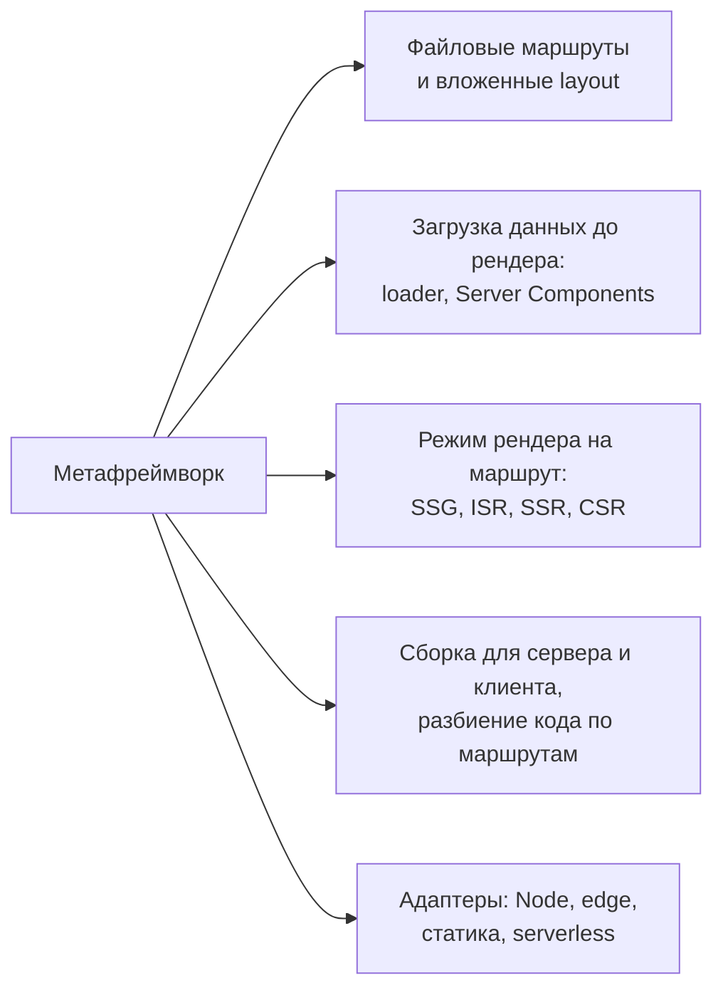
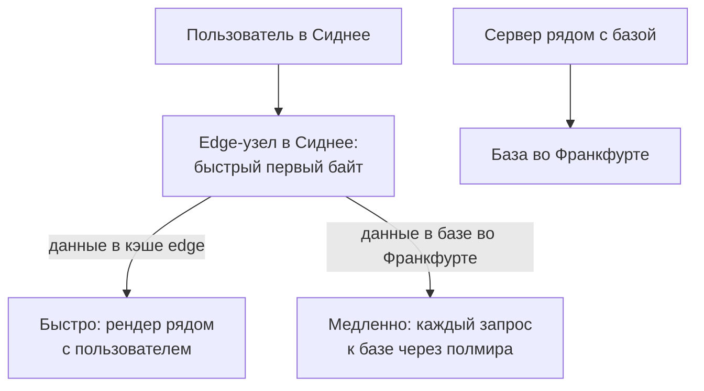

## О чём урок

Как стратегии рендеринга выглядят в метафреймворках, которые используют на практике: Next.js 16, Nuxt 4, Angular с `@angular/ssr`, SvelteKit 3, React Router 8 в режиме фреймворка, Astro 7, а также что такое edge-рендер и когда он помогает. Главная мысль: режим задаётся на маршрут, и все фреймворки дают для этого похожие инструменты. Кода для запуска в уроке нет: это конфигурация, которая работает только внутри фреймворков.

## Что делает метафреймворк



UI-библиотека (React, Vue, Svelte) умеет рендерить компоненты, но не знает про маршруты, данные, кэш и деплой. Метафреймворк связывает это: по адресу находит страницу, загружает её данные на сервере, выбирает режим рендера, собирает две сборки (серверную и клиентскую) и упаковывает результат под платформу.

## Режим на маршрут

| | Статика (SSG) | Перестройка (ISR) | На запрос (SSR) | Только клиент (CSR) |
|---|---|---|---|---|
| Next.js 16 | Компоненты без данных запроса, `'use cache'` | `cacheLife`, `revalidateTag` | Чтение `cookies()`, `headers()` внутри `Suspense` | `'use client'` и `dynamic(..., { ssr: false })` |
| Nuxt 4 | `routeRules: { prerender: true }` | `{ isr: 3600 }`, `{ swr: 3600 }` | По умолчанию (универсальный рендер) | `{ ssr: false }` |
| Angular 22 | `RenderMode.Prerender` и `getPrerenderParams` | Нет встроенного | `RenderMode.Server` | `RenderMode.Client` |
| SvelteKit 3 | `export const prerender = true` | Через адаптер платформы | По умолчанию | `export const ssr = false` |
| React Router 8 | `prerender` в `react-router.config.ts` | Через кэш-заголовки | `ssr: true` (по умолчанию) | `ssr: false` (SPA-режим), `clientLoader` |
| Astro 7 | По умолчанию | Кэш маршрутов, заголовки CDN | `export const prerender = false` | Острова `client:only` |

Примеры конфигурации:

```ts
// Nuxt: nuxt.config.ts
export default defineNuxtConfig({
  routeRules: {
    '/': { prerender: true },
    '/blog/**': { isr: 3600 },
    '/products/**': { swr: 600 },
    '/account/**': { ssr: false },
  },
})
```

```ts
// Angular: app.routes.server.ts
export const serverRoutes: ServerRoute[] = [
  { path: '', renderMode: RenderMode.Prerender },
  { path: 'products/:id', renderMode: RenderMode.Server },
  { path: 'account/**', renderMode: RenderMode.Client },
]
```

```ts
// React Router: react-router.config.ts
export default {
  ssr: true,
  async prerender() {
    return ['/', '/about', ...(await getBlogSlugs()).map((slug) => `/blog/${slug}`)]
  },
} satisfies Config
```

```ts
// SvelteKit: src/routes/blog/[slug]/+page.ts
export const prerender = true // build to HTML
export const ssr = true // render on the server (default)
export const csr = true // hydrate in the browser; false gives a page with no JS at all
```

## Как фреймворки грузят данные

| | Где описаны данные | Что получает клиент |
|---|---|---|
| Next.js App Router | В асинхронных Server Components | Готовый результат в потоке RSC; данные для клиентских компонентов передаются пропсами |
| Nuxt | `useFetch`, `useAsyncData` в компонентах | Данные в payload страницы, повторно не запрашиваются |
| Angular | `HttpClient`, `httpResource`, резолверы | Ответы `HttpClient` в кэше передачи (`HttpTransferCache`) |
| SvelteKit | `load` в `+page.server.ts` или `+page.ts` | Сериализованный результат `load` (через `devalue`) |
| React Router | `loader` маршрута | Результат `loader`; промисы стримятся и ждутся в `<Await>` |

Общий принцип: данные загружаются на уровне маршрута **до** рендера и параллельно, а не в эффектах компонентов, иначе получается водопад запросов (урок `render-ssr`).

## Edge-рендер

**Edge** это выполнение кода на узлах CDN рядом с пользователем (Cloudflare Workers, Vercel, Netlify, Deno Deploy), обычно в лёгких изолятах V8 вместо полноценного Node.js.



- Edge хорош для того, что не ходит в центральную базу или ходит один раз: редиректы, A/B-тесты, геолокация, проверка сессии, персонализация по cookie, отдача кэшированных страниц.
- Рендер с несколькими последовательными запросами к базе в другом регионе на edge **медленнее**, чем на сервере рядом с базой: задержка умножается на число запросов. Поэтому часто рендер размещают рядом с данными, а на edge оставляют кэш и лёгкую логику.
- В edge-окружении нет части API Node.js (файловая система, некоторые модули), есть ограничения на время и память. Холодный старт изолятов короткий.
- В Next.js 16 код, который выполняется перед маршрутом (бывший `middleware.ts`), переименован в `proxy.ts`; его назначение то же: перенаправления, переписывание адресов, проверка доступа до рендера.

## Как выбрать фреймворк

- **Next.js**: React, Server Components, Cache Components, самая большая экосистема; сложная модель кэширования и сильная связь с возможностями платформы.
- **React Router 8** (бывший Remix) и **TanStack Start**: React, загрузчики маршрутов, ближе к веб-стандартам, проще модель.
- **Nuxt**: Vue, удобные правила маршрутов, модули; **SvelteKit**: Svelte, опции страниц, мало JavaScript.
- **Angular с `@angular/ssr`**: если приложение уже на Angular; гибридный рендер и инкрементальная гидратация встроены.
- **Astro**: контентные сайты, острова из любых фреймворков, по умолчанию без JavaScript.

## Главное

- Метафреймворк связывает маршруты, загрузку данных, режим рендера, две сборки и адаптеры деплоя.
- Режим задают на маршрут: `routeRules` в Nuxt, `RenderMode` в Angular, опции страницы в SvelteKit, `prerender` и `ssr` в React Router, Cache Components в Next.js.
- Данные загружаются на уровне маршрута до рендера и передаются клиенту без повторного запроса.
- Edge даёт быстрый первый байт рядом с пользователем, но рендер с запросами к далёкой базе на edge медленнее; на edge оставляют кэш, редиректы и персонализацию.
- В Next.js 16 `middleware.ts` переименован в `proxy.ts`.
