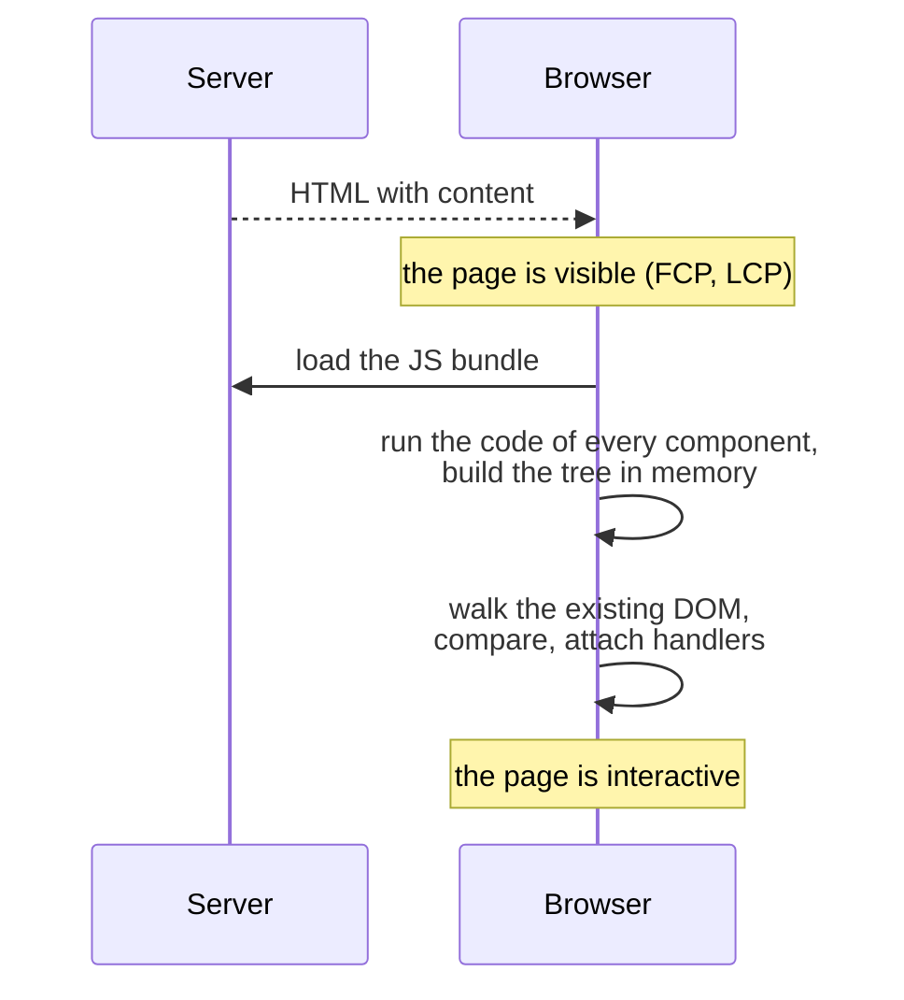
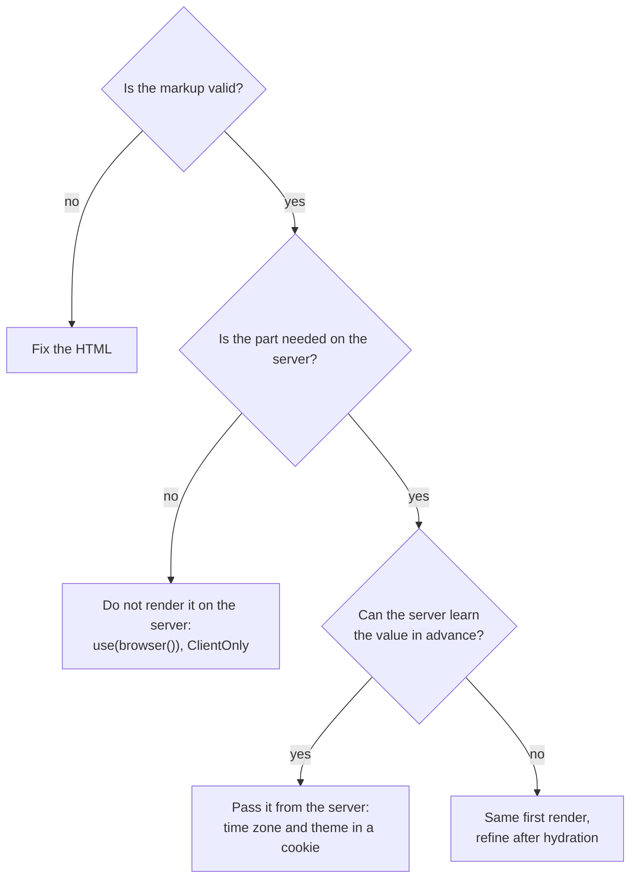

## What this lesson covers

What really happens during hydration and what it costs, what the user sees while the page is "visible but not working", why server and client HTML do not match and how to fix it properly: two render passes, `use(browser())` from React 19.3, stable ids, attributes for allowed differences in Vue and Angular. The examples run in jsdom on React 19.3.

## What hydration does



Hydration is not "just attaching handlers". The framework **runs every component's code again**: it calls component functions, hooks and `setup`, evaluates templates, builds the tree in memory, then walks the existing DOM and compares it with that tree. No new DOM nodes are created, but all the other work of a client render remains. So:

- A large page can hold the main thread for seconds after it becomes visible: TBT grows and INP gets worse.
- The time between display and interactivity is called the "uncanny valley": the button is drawn, but a click does nothing.
- The less JavaScript hydration needs, the better; islands, Server Components and lazy hydration are built on this (the `render-less-js` lesson).

What happens to a click before hydration depends on the framework: React replays discrete events (clicks, input) for Suspense boundaries that are not hydrated yet and hydrates them first; Angular records events and replays them after hydration (`withEventReplay()`, the default in new projects); without such support the click is lost. Hydration is visible in the Performance tab of Chrome DevTools (React's tracks show it separately), not in Lighthouse.

## Why the HTML does not match

The first client render must produce **exactly the same** HTML as the server. Common causes of differences:

| Cause | Example |
|---|---|
| Time, time zone, locale | `new Date().toLocaleString()`: the server in UTC, the user in another zone |
| Random values | `Math.random()`, `crypto.randomUUID()` for an `id` in the markup |
| Browser APIs during render | `localStorage`, `window.innerWidth`, `typeof window !== 'undefined' ? ... : ...` |
| User data only in the browser | A theme or a token in `localStorage` that the server does not know about |
| Invalid HTML nesting | A `<div>` inside a `<p>`, a `<tr>` without `<tbody>`, an `<a>` inside an `<a>` |
| DOM changes before hydration | Browser extensions, third-party scripts, automatic page translation |

```tsx dom
import { act, Suspense, use, useSyncExternalStore } from 'react'
import { browser } from 'react-dom'
import { hydrateRoot } from 'react-dom/client'
import { renderToString } from 'react-dom/server'

// The server runs in UTC, the user's browser in Amsterdam.
let timeZone = 'UTC'
const at = Date.UTC(2026, 10, 11, 9, 30)
const format = (zone: string) => new Intl.DateTimeFormat('en-GB', { timeStyle: 'short', timeZone: zone }).format(at)

// 1. Formats with the current environment during render: server and client disagree.
function Naive() {
  return <p>Ordered at {format(timeZone)}</p>
}
// 2. The server snapshot is used during hydration, the client value right after it.
const noop = () => () => {}
function TwoPass() {
  const zone = useSyncExternalStore(noop, () => timeZone, () => 'UTC')
  return <p>Ordered at {format(zone)}{zone === 'UTC' ? ' UTC' : ''}</p>
}
// 3. React 19.3: skip this part on the server, render its fallback instead.
function BrowserOnly() {
  use(browser())
  return <p>Ordered at {format(timeZone)}</p>
}

async function ssrThenHydrate(name: string, element: React.ReactNode) {
  timeZone = 'UTC'
  const container = document.createElement('div')
  container.innerHTML = renderToString(element)
  const serverHtml = container.innerHTML
  timeZone = 'Europe/Amsterdam'
  const errors: string[] = []
  const clean = (html: string) => html.replace(/<!--.*?-->/g, '').replace(/<template[^>]*><\/template>/g, '')
  await act(async () => {
    hydrateRoot(container, element, { onRecoverableError: (e) => errors.push(String((e as Error).message).split('.')[0]) })
  })
  console.log(`${name}: server ${JSON.stringify(clean(serverHtml))}`)
  console.log(`  after hydration ${JSON.stringify(clean(container.innerHTML))}`, errors.length ? `| ${errors[0]}` : '| no errors')
}

await ssrThenHydrate('naive', <Naive />)
await ssrThenHydrate('two-pass', <TwoPass />)
await ssrThenHydrate('browser()', <Suspense fallback={<p>Ordered today</p>}><BrowserOnly /></Suspense>)
```

```output
naive: server "<p>Ordered at 09:30</p>"
  after hydration "<p>Ordered at 10:30</p>" | Hydration failed because the server rendered text didn't match the client
two-pass: server "<p>Ordered at 09:30 UTC</p>"
  after hydration "<p>Ordered at 10:30</p>" | no errors
browser(): server "<p>Ordered today</p>"
  after hydration "<p>Ordered at 10:30</p>" | no errors
```

- The **naive** component formats the time in the current zone right during render: the server got `09:30`, the browser `10:30`. React reports the mismatch through `onRecoverableError` and **re-renders on the client** the part of the tree up to the nearest Suspense boundary (here the whole root). The server HTML of that part is thrown away, and with it the benefit of SSR; with a poorly placed boundary that is the whole page.
- **Two passes**: `useSyncExternalStore` with the third argument `getServerSnapshot` uses the same value as the server (`UTC`) during hydration, and the client value right after. The HTML matches, then the text updates. The same can be done with state changed in `useEffect`, but `useSyncExternalStore` also subscribes to changes.
- **`use(browser())`** (React 19.3) says: do not render this part on the server. On the server it suspends, and the HTML gets the nearest Suspense fallback ("Ordered today"), while in the browser the component renders as usual after hydration. It replaces the "mounted" flag trick and `typeof window` checks.

## Invalid HTML

```js dom
// What the server sent versus what the browser built from it.
const sent = '<p>Price: <div class="price">120 EUR</div></p><table><tr><td>1</td></tr></table>'
const el = document.createElement('div')
el.innerHTML = sent
console.log(el.innerHTML)
```

```output
<p>Price: </p><div class="price">120 EUR</div><p></p><table><tbody><tr><td>1</td></tr></tbody></table>
```

The server sent a string, and the browser parsed it by the HTML rules: a `<p>` cannot contain a `<div>`, so the paragraph closed early and an extra empty `<p>` appeared; a `<tbody>` was added to the table. During hydration the framework expects the structure it rendered and finds a different one. There is one fix: write valid markup (a `<span>` instead of a `<div>` inside a `<p>`, an explicit `<tbody>`). In development, React warns about invalid nesting already at render time.

## How to fix it



| Technique | Where |
|---|---|
| Two passes: the server value during hydration, then the client value | React `useSyncExternalStore` with `getServerSnapshot`, `useEffect`; Vue `onMounted`; Angular `afterNextRender` |
| Do not render on the server | React 19.3 `use(browser())` with `Suspense`; `<ClientOnly>` in Nuxt; `dynamic(..., { ssr: false })` in Next.js client components; `@defer` in Angular without `hydrate` triggers (the placeholder renders on the server) |
| Stable ids | `useId` in React, `useId` in Vue 3.5: the same on server and client |
| Learn it on the server | Time zone, theme, language in a cookie: the server renders what the client will see; dates in `<time datetime>` formatted on the client |
| Allow a known difference | React `suppressHydrationWarning` (only one element's text), Vue 3.5 `data-allow-mismatch`, Angular `ngSkipHydration` (the component is rendered again in the browser) |

The allow attributes do not fix the cause, they hide the warning: use them for genuinely different values like a timestamp, not for whole blocks.

## Key points

- Hydration runs the code of every component again and compares the tree with the existing DOM; it only skips creating DOM nodes. Heavy hydration hurts TBT and INP.
- Between display and hydration the page is visible but does not work; React and Angular replay early events, otherwise the click is lost. Measure in the DevTools Performance tab.
- Mismatch causes: time and zone, random values, browser APIs during render, browser-only data, invalid HTML nesting, DOM changes by extensions.
- On a mismatch React re-renders on the client up to the nearest Suspense boundary and reports through `onRecoverableError`; the server HTML of that part is lost.
- Fixes: the same first render and refinement after hydration, `use(browser())` in React 19.3, `useId`, values from the server via cookies, valid HTML; `suppressHydrationWarning`, `data-allow-mismatch`, `ngSkipHydration` only for pinpoint differences.
