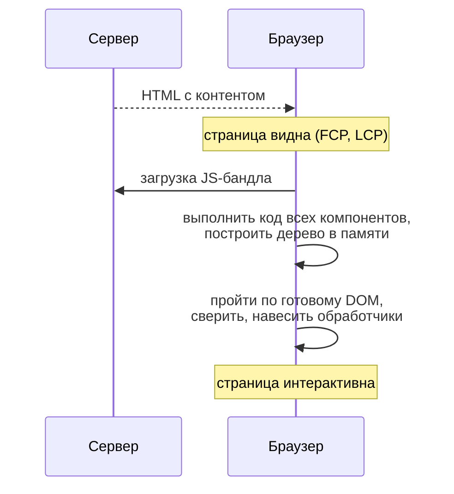
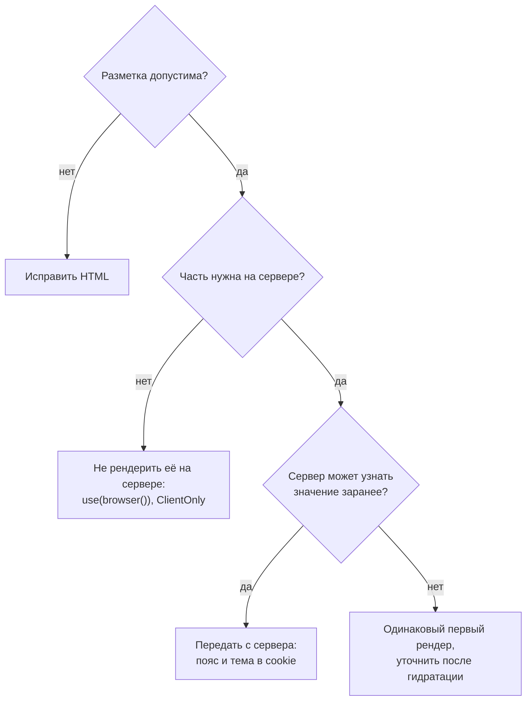

## О чём урок

Что на самом деле происходит при гидратации и сколько она стоит, что видит пользователь, пока страница «видна, но не работает», почему серверный и клиентский HTML не совпадают и как это исправлять правильно: два прохода рендера, `use(browser())` из React 19.3, стабильные идентификаторы, атрибуты для допустимых расхождений во Vue и Angular. Примеры выполняются в jsdom на React 19.3.

## Что делает гидратация



Гидратация не «просто навешивает обработчики». Фреймворк **заново выполняет код каждого компонента**: вызывает функции компонентов, хуки и `setup`, вычисляет шаблоны, строит дерево в памяти, а затем идёт по существующему DOM и сверяет его с этим деревом. Новые DOM-узлы не создаются, но вся остальная работа клиентского рендера остаётся. Поэтому:

- Большая страница может секунды держать главный поток после того, как стала видна: это растёт TBT и ухудшает INP.
- Время между показом и интерактивностью называют «зловещей долиной»: кнопка нарисована, но клик ничего не делает.
- Чем меньше JavaScript нужно для гидратации, тем лучше; на этом построены острова, Server Components и ленивая гидратация (урок `render-less-js`).

Что происходит с кликом до гидратации, зависит от фреймворка: React повторяет дискретные события (клики, ввод) для ещё не гидратированных границ `Suspense` и гидратирует их в первую очередь; Angular записывает события и воспроизводит их после гидратации (`withEventReplay()`, по умолчанию в новых проектах); без такой поддержки клик теряется. Гидратацию видно во вкладке Performance в Chrome DevTools (дорожки React показывают её отдельно), а не в Lighthouse.

## Почему HTML не совпадает

Первый рендер на клиенте должен дать **ровно тот же** HTML, что на сервере. Частые причины расхождений:

| Причина | Пример |
|---|---|
| Время, часовой пояс, локаль | `new Date().toLocaleString()`: сервер в UTC, пользователь в другом поясе |
| Случайные значения | `Math.random()`, `crypto.randomUUID()` для `id` в разметке |
| API браузера при рендере | `localStorage`, `window.innerWidth`, `typeof window !== 'undefined' ? ... : ...` |
| Данные пользователя только в браузере | Тема или токен в `localStorage`, а сервер о них не знает |
| Недопустимая вложенность HTML | `<div>` внутри `<p>`, `<tr>` без `<tbody>`, `<a>` внутри `<a>` |
| Изменения DOM до гидратации | Расширения браузера, сторонние скрипты, автоперевод страницы |

```tsx dom
import { act, Suspense, use, useSyncExternalStore } from 'react'
import { browser } from 'react-dom'
import { hydrateRoot } from 'react-dom/client'
import { renderToString } from 'react-dom/server'

// The server runs in UTC, the user's browser in Amsterdam.
let timeZone = 'UTC'
const at = Date.UTC(2026, 10, 11, 9, 30)
const format = (zone: string) => new Intl.DateTimeFormat('en-GB', { timeStyle: 'short', timeZone: zone }).format(at)

// 1. Formats with the current environment during render: server and client disagree.
function Naive() {
  return <p>Ordered at {format(timeZone)}</p>
}
// 2. The server snapshot is used during hydration, the client value right after it.
const noop = () => () => {}
function TwoPass() {
  const zone = useSyncExternalStore(noop, () => timeZone, () => 'UTC')
  return <p>Ordered at {format(zone)}{zone === 'UTC' ? ' UTC' : ''}</p>
}
// 3. React 19.3: skip this part on the server, render its fallback instead.
function BrowserOnly() {
  use(browser())
  return <p>Ordered at {format(timeZone)}</p>
}

async function ssrThenHydrate(name: string, element: React.ReactNode) {
  timeZone = 'UTC'
  const container = document.createElement('div')
  container.innerHTML = renderToString(element)
  const serverHtml = container.innerHTML
  timeZone = 'Europe/Amsterdam'
  const errors: string[] = []
  const clean = (html: string) => html.replace(/<!--.*?-->/g, '').replace(/<template[^>]*><\/template>/g, '')
  await act(async () => {
    hydrateRoot(container, element, { onRecoverableError: (e) => errors.push(String((e as Error).message).split('.')[0]) })
  })
  console.log(`${name}: server ${JSON.stringify(clean(serverHtml))}`)
  console.log(`  after hydration ${JSON.stringify(clean(container.innerHTML))}`, errors.length ? `| ${errors[0]}` : '| no errors')
}

await ssrThenHydrate('naive', <Naive />)
await ssrThenHydrate('two-pass', <TwoPass />)
await ssrThenHydrate('browser()', <Suspense fallback={<p>Ordered today</p>}><BrowserOnly /></Suspense>)
```

```output
naive: server "<p>Ordered at 09:30</p>"
  after hydration "<p>Ordered at 10:30</p>" | Hydration failed because the server rendered text didn't match the client
two-pass: server "<p>Ordered at 09:30 UTC</p>"
  after hydration "<p>Ordered at 10:30</p>" | no errors
browser(): server "<p>Ordered today</p>"
  after hydration "<p>Ordered at 10:30</p>" | no errors
```

- **Наивный** компонент форматирует время в текущем поясе прямо при рендере: сервер получил `09:30`, браузер `10:30`. React сообщает о несовпадении через `onRecoverableError` и **перерисовывает на клиенте** часть дерева до ближайшей границы `Suspense` (здесь весь корень). Серверный HTML этой части выбрасывается, а с ним и выигрыш SSR; при неудачной границе это вся страница.
- **Два прохода**: `useSyncExternalStore` с третьим аргументом `getServerSnapshot` при гидратации берёт то же значение, что на сервере (`UTC`), а сразу после неё клиентское. HTML совпадает, затем текст обновляется. То же делают через состояние, которое меняется в `useEffect`, но `useSyncExternalStore` ещё и подписывается на изменения.
- **`use(browser())`** (React 19.3) говорит: эту часть на сервере не рендерить. На сервере она приостанавливается, и в HTML попадает заглушка ближайшего `Suspense` («Ordered today»), а в браузере после гидратации компонент рендерится как обычно. Это замена приёму с флагом «смонтирован» и проверкам `typeof window`.

## Недопустимый HTML

```js dom
// What the server sent versus what the browser built from it.
const sent = '<p>Price: <div class="price">120 EUR</div></p><table><tr><td>1</td></tr></table>'
const el = document.createElement('div')
el.innerHTML = sent
console.log(el.innerHTML)
```

```output
<p>Price: </p><div class="price">120 EUR</div><p></p><table><tbody><tr><td>1</td></tr></tbody></table>
```

Сервер отправил строку, а браузер разобрал её по правилам HTML: `<p>` не может содержать `<div>`, поэтому абзац закрылся раньше и появился лишний пустой `<p>`; в таблицу добавился `<tbody>`. Фреймворк при гидратации ждёт ту структуру, которую рендерил, и находит другую. Исправление одно: писать допустимую разметку (`<span>` вместо `<div>` внутри `<p>`, явный `<tbody>`). React в режиме разработки предупреждает о недопустимой вложенности ещё на этапе рендера.

## Как исправить



| Приём | Где |
|---|---|
| Два прохода: серверное значение при гидратации, затем клиентское | React `useSyncExternalStore` с `getServerSnapshot`, `useEffect`; Vue `onMounted`; Angular `afterNextRender` |
| Не рендерить на сервере | React 19.3 `use(browser())` с `Suspense`; `<ClientOnly>` в Nuxt; `dynamic(..., { ssr: false })` в клиентских компонентах Next.js; `@defer` в Angular без триггеров `hydrate` (на сервере рендерится заглушка) |
| Стабильные идентификаторы | `useId` в React, `useId` во Vue 3.5: одинаковые на сервере и клиенте |
| Узнать на сервере | Часовой пояс, тема, язык в cookie: сервер рендерит то же, что увидит клиент; даты в `<time datetime>` с форматированием на клиенте |
| Разрешить известное расхождение | React `suppressHydrationWarning` (только текст одного элемента), Vue 3.5 `data-allow-mismatch`, Angular `ngSkipHydration` (компонент рендерится в браузере заново) |

Атрибуты-разрешения не исправляют причину, а прячут предупреждение: используйте их для действительно разных значений вроде метки времени, а не для целых блоков.

## Главное

- Гидратация заново выполняет код всех компонентов и сверяет дерево с готовым DOM; не создаёт только DOM-узлы. Большая гидратация ухудшает TBT и INP.
- Между показом и гидратацией страница видна, но не работает; React и Angular повторяют ранние события, без этого клик теряется. Измеряют во вкладке Performance DevTools.
- Причины несовпадения: время и пояс, случайные значения, API браузера при рендере, данные только в браузере, недопустимая вложенность HTML, изменения DOM расширениями.
- React при несовпадении перерисовывает на клиенте до ближайшей границы `Suspense` и сообщает через `onRecoverableError`; серверный HTML этой части теряется.
- Исправления: одинаковый первый рендер и уточнение после гидратации, `use(browser())` в React 19.3, `useId`, значения с сервера через cookie, допустимый HTML; `suppressHydrationWarning`, `data-allow-mismatch`, `ngSkipHydration` только для точечных расхождений.
