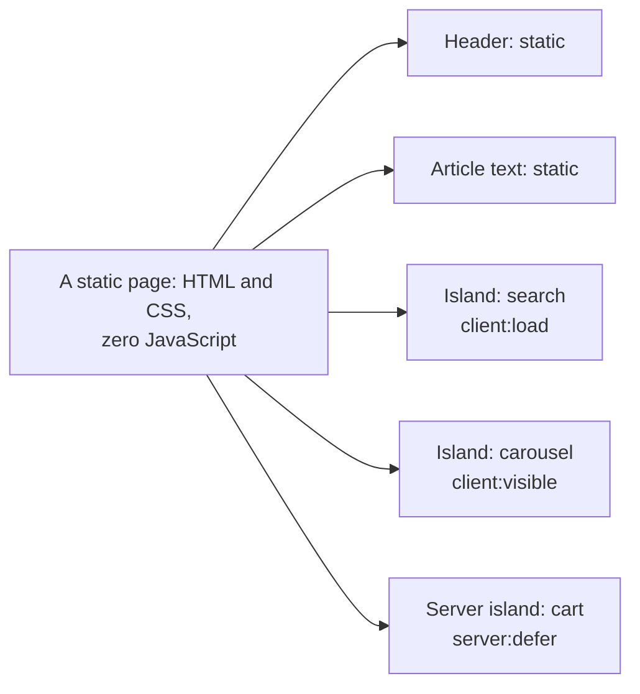
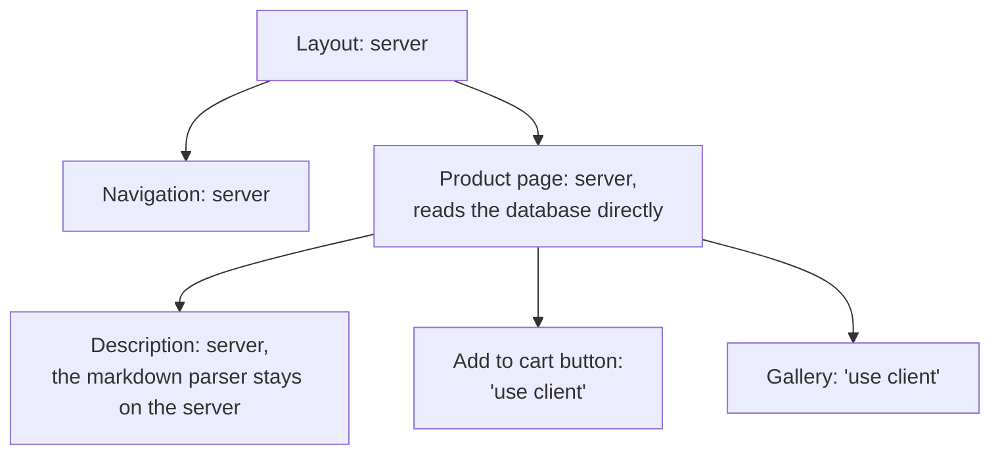

## What this lesson covers

How modern approaches lower the cost of hydration: how selective, progressive, lazy and partial hydration differ, the islands architecture (Astro), lazy hydration in Vue and Nuxt, incremental hydration in Angular, resumability (Qwik) and Server Components in React. The example runs in jsdom on Vue 3.5.

## The problem and the terms

With classic SSR the browser downloads and runs the code of **all** components on the page, even those that never change: the header, the article text, the footer. All the approaches below answer the question of how to skip that work or do it later.

| Approach | What hydrates | When the code loads | Where |
|---|---|---|---|
| Full hydration | The whole page at once | The whole bundle at once | Classic SSR |
| Selective | The whole page, but by boundaries and by priority | The whole bundle | React 18+ with Suspense |
| Progressive, lazy | The whole page, but parts later: on visibility, idle, interaction | Depends on the framework | Vue 3.5, Nuxt, Angular `@defer (hydrate on ...)` |
| Partial (islands) | Only interactive blocks; the rest never | Only the islands' code | Astro, Fresh, Eleventy with WebC |
| Resumability | Nothing: state and handlers are already in the HTML | A handler's code on the first event | Qwik |
| Server Components | Only client components | Server components' code never enters the bundle | React (Next.js, React Router) |

## Islands



In Astro, components (React, Vue, Svelte, Solid) are rendered to HTML and CSS **without JavaScript** by default. A component becomes interactive only with a directive, and each such island hydrates independently:

```astro
---
import Search from '../components/Search.tsx'
import Carousel from '../components/Carousel.vue'
import Cart from '../components/Cart.astro'
---
<Header />                                      <!-- static HTML, no JS -->
<Search client:load />                          <!-- hydrate as soon as the page loads -->
<Carousel client:visible />                     <!-- load and hydrate when it scrolls into view -->
<Comments client:idle />                        <!-- when the browser is idle -->
<Cart server:defer>                             <!-- a server island: rendered on a separate request -->
  <p slot="fallback">Loading cart…</p>
</Cart>
```

- The amount of JavaScript is proportional to the number of interactive blocks, not the size of the page. For content sites (docs, a blog, marketing, a shop catalog) this is a big difference.
- **Server islands** (`server:defer`) solve the partial prerendering task their own way: the page is static and cached, and the browser requests the personal block separately and puts it in place of the placeholder.
- The cost: islands do not share state through a common framework context; they communicate through a shared store (nanostores), events or the URL. For an app with rich interaction across the whole page (an editor, a dashboard) this is awkward.

## Lazy hydration in frameworks

```js dom
import { createSSRApp, defineAsyncComponent, h, hydrateOnInteraction, ref } from 'vue'
import { renderToString } from 'vue/server-renderer'

let downloads = 0
let setups = 0
const LikeButton = {
  setup() {
    setups++ // runs when the component comes to life in the browser
    const likes = ref(0)
    return () => h('button', { onClick: () => likes.value++ }, `Likes: ${likes.value}`)
  },
}
// A factory: the server and the browser each have their own copy of the app, as in reality.
const makeApp = () => {
  const LazyLike = defineAsyncComponent({
    loader: async () => (downloads++, LikeButton), // in a real app: () => import('./LikeButton.vue')
    hydrate: hydrateOnInteraction('click'), // hydrate on the first click
  })
  return { render: () => h('article', [h('h1', 'A long static article'), h(LazyLike)]) }
}
const until = async (check) => { for (let i = 0; i < 200 && !check(); i++) await new Promise((r) => setTimeout(r, 10)) }

// Server: everything is rendered to HTML, including the button.
const root = document.createElement('div')
root.innerHTML = await renderToString(createSSRApp(makeApp()))
document.body.append(root)
downloads = setups = 0

// Browser: the page hydrates; the button stays plain HTML.
createSSRApp(makeApp()).mount(root)
await until(() => downloads === 1)
await new Promise((r) => setTimeout(r)) // let the loaded code attach its listeners
console.log('page hydrated:', root.querySelector('button').textContent, '| code downloaded:', downloads, '| button setup ran:', setups)

root.querySelector('button').click() // hydrates the button, then the click is replayed
await until(() => root.querySelector('button').textContent !== 'Likes: 0')
console.log('first click:   ', root.querySelector('button').textContent, '| code downloaded:', downloads, '| button setup ran:', setups)
```

```output
page hydrated: Likes: 0 | code downloaded: 1 | button setup ran: 0
first click:    Likes: 1 | code downloaded: 1 | button setup ran: 1
```

- In Vue 3.5 an async component gets a hydration strategy: `hydrateOnVisible()`, `hydrateOnIdle()`, `hydrateOnInteraction('click')`, `hydrateOnMediaQuery(...)` or your own function. Until it fires, the component stays server HTML and its `setup` does not run.
- The example shows an important detail: **the code was downloaded at once** (`downloaded: 1`), only its execution and hydration were deferred. The first click brought the button to life, and Vue replayed that click: the counter became `1`.
- In Nuxt the same is done with an attribute on a lazy component: `<LazyComments hydrate-on-visible />`.
- In Angular, incremental hydration (the `ng-performance` lesson) defers the download too: an `@defer (hydrate on viewport)` block is a separate chunk downloaded only on the trigger. Triggers: `idle`, `viewport`, `interaction`, `hover`, `immediate`, `timer`, `when`, `never`.
- React has no built-in lazy hydration on visibility: it has selective hydration by Suspense boundaries and Server Components, which remove code from the bundle altogether.

## Resumability

Qwik does not hydrate at all. The server serializes into the HTML the app state, the links between components and that state, and references to event handlers. In the browser a tiny loader runs with one global handler: on the first click it finds the needed handler by an attribute, loads only its code and runs it, **resuming** from the state in the HTML instead of recomputing the app.

```tsx
import { component$, useSignal } from '@builder.io/qwik'

export const Counter = component$(() => {
  const count = useSignal(0)
  // "$" marks a lazy boundary: this handler is a separate chunk, loaded on the first click
  return <button onClick$={() => count.value++}>Clicks: {count.value}</button>
})
```

- The notes describe resumability as "serializing the call stack and promises". That is not right: what is serialized is state, subscriptions and handler references, and the call stack is not saved.
- The plus: startup cost barely depends on the app's size. The minuses: its own model (the `$` signs, serialization rules), many small downloads on first interaction (smoothed by prefetching), a small ecosystem.

## Server Components



- A server component runs only on the server (at build or per request). Its code and dependencies (a markdown parser, a database client) **never enter** the bundle, and it is not hydrated. The client gets the finished result.
- Interactive parts are marked `'use client'`: they are the "islands" inside the React tree. Only they go into the bundle and hydrate.
- Server Components and SSR are different things. SSR turns the **whole** tree into HTML, including client components, whose code then hydrates. Server Components reduce what the client needs at all. They are usually used together: Next.js renders server components, then SSR turns everything into HTML, and the client hydrates only the client components.
- On client navigation the server sends not HTML but a serialized tree (the RSC stream), and React updates the page while keeping client components' state.
- The APIs, `'use client'` boundaries, server functions and security are covered in the `react-server` lesson.

## Comparison

| | Islands (Astro) | Server Components (React) | Resumability (Qwik) | Lazy hydration (Vue, Angular) |
|---|---|---|---|---|
| JS for static parts | None | None | Almost none | Yes, but it runs later (Angular also loads it later) |
| Shared state between interactive parts | Through an external store | Regular React inside client parts | Yes | Yes, a regular app |
| Client navigation | MPA, View Transitions | SPA navigation with the RSC stream | SPA | SPA |
| Best for | Content sites | React apps with a large server side | Sites where startup is critical | Existing Vue and Angular apps |

## Key points

- Classic hydration runs the code of all components; every approach in this lesson reduces or postpones that work.
- Selective hydration (React) hydrates everything in parts; lazy hydration (Vue, Nuxt, Angular) postpones parts until a trigger; partial hydration (islands) never hydrates static parts.
- Astro: zero JavaScript without a directive; `client:load`, `client:idle`, `client:visible`; server islands `server:defer` with a fallback.
- Vue 3.5 `hydrateOnVisible`, `hydrateOnInteraction`: the code downloads at once, execution is deferred; Angular `@defer (hydrate on ...)` defers the download too.
- Qwik serializes state and handler references and loads a handler's code on the first event; the call stack is not serialized.
- Server Components run only on the server, and their code does not enter the bundle; this is not the same as SSR, and the two usually work together.
