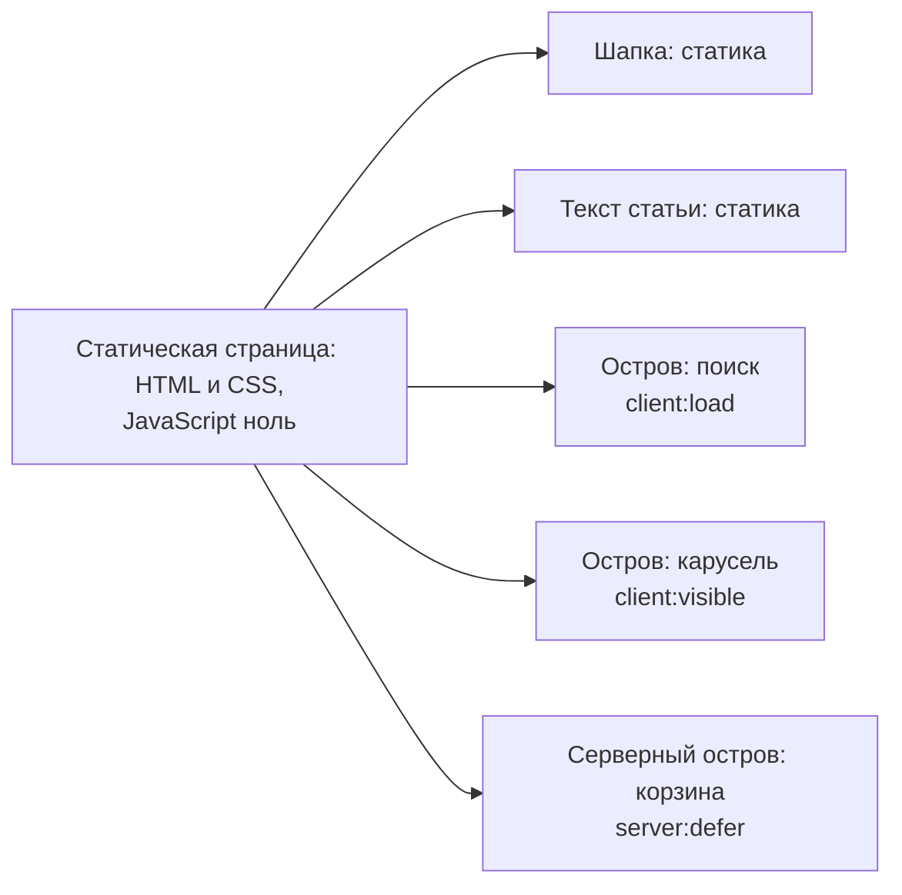
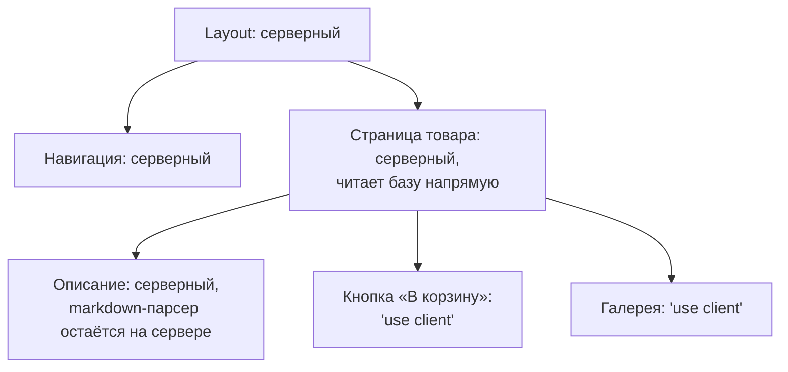

## О чём урок

Как современные подходы уменьшают цену гидратации: чем отличаются выборочная, прогрессивная, ленивая и частичная гидратация, архитектура островов (Astro), ленивая гидратация во Vue и Nuxt, инкрементальная в Angular, возобновляемость (Qwik) и Server Components в React. Пример выполняется в jsdom на Vue 3.5.

## Проблема и термины

При классическом SSR браузер скачивает и выполняет код **всех** компонентов страницы, даже тех, которые никогда не меняются: шапки, текста статьи, подвала. Все подходы ниже отвечают на вопрос, как не делать эту работу или делать её позже.

| Подход | Что гидратируется | Когда загружается код | Где встречается |
|---|---|---|---|
| Полная гидратация | Вся страница сразу | Весь бандл сразу | Классический SSR |
| Выборочная | Вся страница, но по границам и по приоритету | Весь бандл | React 18+ со `Suspense` |
| Прогрессивная, ленивая | Вся страница, но части позже: при видимости, простое, взаимодействии | Зависит от фреймворка | Vue 3.5, Nuxt, Angular `@defer (hydrate on ...)` |
| Частичная (острова) | Только интерактивные блоки; остальное никогда | Только код островов | Astro, Fresh, Eleventy с WebC |
| Возобновляемость | Ничего: состояние и обработчики уже в HTML | Код обработчика при первом событии | Qwik |
| Server Components | Только клиентские компоненты | Код серверных компонентов в бандл не попадает | React (Next.js, React Router) |

## Острова



В Astro компоненты (React, Vue, Svelte, Solid) по умолчанию рендерятся в HTML и CSS **без JavaScript**. Интерактивным компонент становится только с директивой, и каждый такой остров гидратируется независимо:

```astro
---
import Search from '../components/Search.tsx'
import Carousel from '../components/Carousel.vue'
import Cart from '../components/Cart.astro'
---
<Header />                                      <!-- static HTML, no JS -->
<Search client:load />                          <!-- hydrate as soon as the page loads -->
<Carousel client:visible />                     <!-- load and hydrate when it scrolls into view -->
<Comments client:idle />                        <!-- when the browser is idle -->
<Cart server:defer>                             <!-- a server island: rendered on a separate request -->
  <p slot="fallback">Loading cart…</p>
</Cart>
```

- Количество JavaScript пропорционально числу интерактивных блоков, а не размеру страницы. Для контентных сайтов (документация, блог, маркетинг, магазин с каталогом) это большая разница.
- **Серверные острова** (`server:defer`) решают задачу частичного пререндера по-своему: страница статична и кэшируется, а персональный блок браузер запрашивает отдельно и подставляет вместо заглушки.
- Цена: острова не делят состояние через общий контекст фреймворка; связь между ними через общий стор (nanostores), события или URL. Для приложения с богатым взаимодействием по всей странице (редактор, дашборд) это неудобно.

## Ленивая гидратация во фреймворках

```js dom
import { createSSRApp, defineAsyncComponent, h, hydrateOnInteraction, ref } from 'vue'
import { renderToString } from 'vue/server-renderer'

let downloads = 0
let setups = 0
const LikeButton = {
  setup() {
    setups++ // runs when the component comes to life in the browser
    const likes = ref(0)
    return () => h('button', { onClick: () => likes.value++ }, `Likes: ${likes.value}`)
  },
}
// A factory: the server and the browser each have their own copy of the app, as in reality.
const makeApp = () => {
  const LazyLike = defineAsyncComponent({
    loader: async () => (downloads++, LikeButton), // in a real app: () => import('./LikeButton.vue')
    hydrate: hydrateOnInteraction('click'), // hydrate on the first click
  })
  return { render: () => h('article', [h('h1', 'A long static article'), h(LazyLike)]) }
}
const until = async (check) => { for (let i = 0; i < 200 && !check(); i++) await new Promise((r) => setTimeout(r, 10)) }

// Server: everything is rendered to HTML, including the button.
const root = document.createElement('div')
root.innerHTML = await renderToString(createSSRApp(makeApp()))
document.body.append(root)
downloads = setups = 0

// Browser: the page hydrates; the button stays plain HTML.
createSSRApp(makeApp()).mount(root)
await until(() => downloads === 1)
await new Promise((r) => setTimeout(r)) // let the loaded code attach its listeners
console.log('page hydrated:', root.querySelector('button').textContent, '| code downloaded:', downloads, '| button setup ran:', setups)

root.querySelector('button').click() // hydrates the button, then the click is replayed
await until(() => root.querySelector('button').textContent !== 'Likes: 0')
console.log('first click:   ', root.querySelector('button').textContent, '| code downloaded:', downloads, '| button setup ran:', setups)
```

```output
page hydrated: Likes: 0 | code downloaded: 1 | button setup ran: 0
first click:    Likes: 1 | code downloaded: 1 | button setup ran: 1
```

- Во Vue 3.5 асинхронный компонент получает стратегию гидратации: `hydrateOnVisible()`, `hydrateOnIdle()`, `hydrateOnInteraction('click')`, `hydrateOnMediaQuery(...)` или свою функцию. До срабатывания компонент остаётся серверным HTML, его `setup` не выполняется.
- Пример показывает важную деталь: **код загрузился сразу** (`downloaded: 1`), отложено только его выполнение и гидратация. Первый клик оживил кнопку, и Vue повторил этот клик: счётчик стал `1`.
- В Nuxt то же делается атрибутом у ленивого компонента: `<LazyComments hydrate-on-visible />`.
- В Angular инкрементальная гидратация (урок `ng-performance`) откладывает и загрузку: блок `@defer (hydrate on viewport)` это отдельный чанк, который скачивается только по триггеру. Триггеры: `idle`, `viewport`, `interaction`, `hover`, `immediate`, `timer`, `when`, `never`.
- В React нет встроенной ленивой гидратации по видимости: выборочная гидратация по границам `Suspense` и Server Components, которые убирают код из бандла совсем.

## Возобновляемость

Qwik не гидратирует вовсе. Сервер сериализует в HTML состояние приложения, связи компонентов с этим состоянием и ссылки на обработчики событий. В браузере работает крошечный загрузчик с одним глобальным обработчиком: при первом клике он по атрибуту находит нужный обработчик, загружает только его код и выполняет, **продолжая** с состояния из HTML, а не пересчитывая приложение заново.

```tsx
import { component$, useSignal } from '@builder.io/qwik'

export const Counter = component$(() => {
  const count = useSignal(0)
  // "$" marks a lazy boundary: this handler is a separate chunk, loaded on the first click
  return <button onClick$={() => count.value++}>Clicks: {count.value}</button>
})
```

- Заметки описывают возобновляемость как «сериализацию стека вызовов и промисов». Это не так: сериализуются состояние, подписки и ссылки на обработчики, а стек вызовов не сохраняется.
- Плюс: стоимость запуска почти не зависит от размера приложения. Минусы: своя модель (знаки `$`, правила сериализации), много мелких загрузок при первом взаимодействии (их сглаживают предзагрузкой), небольшая экосистема.

## Server Components



- Серверный компонент выполняется только на сервере (при сборке или на запрос). Его код и зависимости (парсер markdown, клиент базы) в бандл **не попадают**, и он не гидратируется. Клиент получает готовый результат.
- Интерактивные части помечены `'use client'`: это и есть «острова» внутри дерева React. Только они попадают в бандл и гидратируются.
- Server Components и SSR это разные вещи. SSR превращает в HTML **всё** дерево, включая клиентские компоненты, и их код потом гидратируется. Server Components уменьшают то, что вообще нужно клиенту. Обычно их используют вместе: Next.js рендерит серверные компоненты, затем SSR превращает всё в HTML, а клиент гидратирует только клиентские компоненты.
- При клиентской навигации сервер присылает не HTML, а сериализованное дерево (поток RSC), и React обновляет страницу, сохраняя состояние клиентских компонентов.
- API, границы `'use client'`, серверные функции и безопасность разобраны в уроке `react-server`.

## Сравнение

| | Острова (Astro) | Server Components (React) | Возобновляемость (Qwik) | Ленивая гидратация (Vue, Angular) |
|---|---|---|---|---|
| JS для статичных частей | Нет | Нет | Почти нет | Есть, но выполняется позже (Angular грузит позже) |
| Общее состояние между интерактивными частями | Через внешний стор | Обычный React внутри клиентских частей | Да | Да, обычное приложение |
| Клиентская навигация | MPA, View Transitions | SPA-навигация с потоком RSC | SPA | SPA |
| Лучше всего для | Контентных сайтов | Приложений на React с большой серверной частью | Сайтов, где критичен старт | Существующих приложений Vue и Angular |

## Главное

- Классическая гидратация выполняет код всех компонентов; все подходы урока уменьшают эту работу или откладывают её.
- Выборочная гидратация (React) гидратирует всё по частям; ленивая (Vue, Nuxt, Angular) откладывает части до триггера; частичная (острова) не гидратирует статику никогда.
- Astro: без директивы ноль JavaScript; `client:load`, `client:idle`, `client:visible`; серверные острова `server:defer` с заглушкой.
- Vue 3.5 `hydrateOnVisible`, `hydrateOnInteraction`: код грузится сразу, откладывается выполнение; Angular `@defer (hydrate on ...)` откладывает и загрузку.
- Qwik сериализует состояние и ссылки на обработчики и загружает код обработчика при первом событии; стек вызовов не сериализуется.
- Server Components выполняются только на сервере, их код не попадает в бандл; это не то же самое, что SSR, и обычно они работают вместе.
