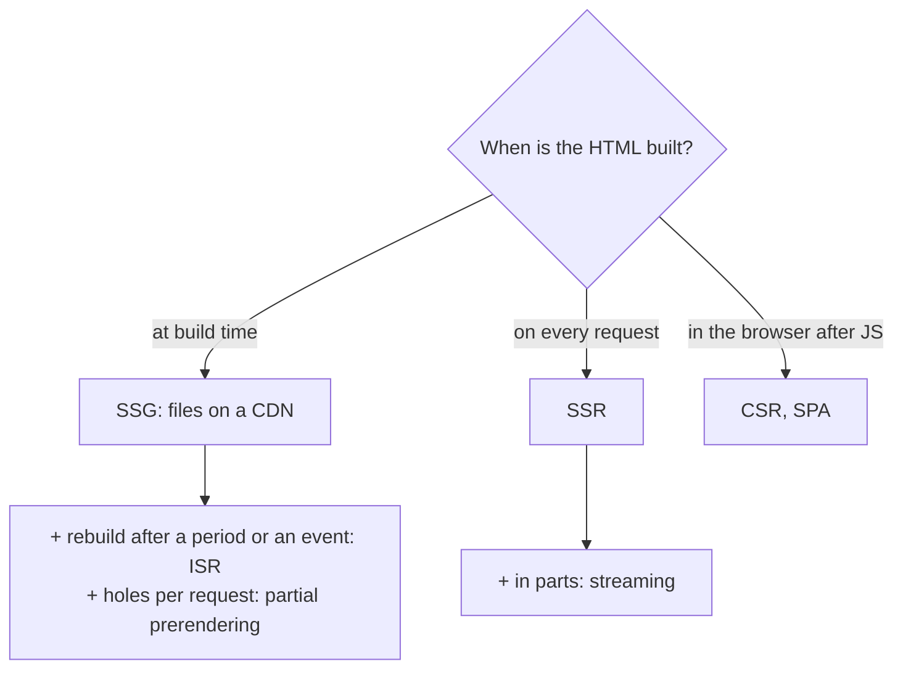
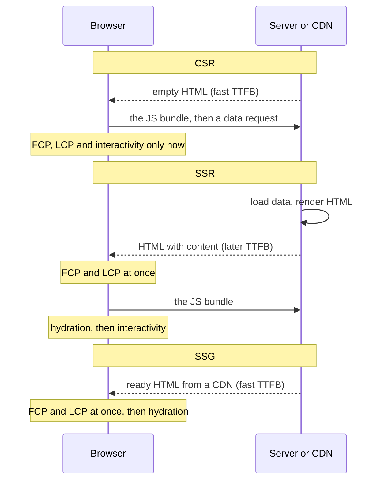

## What this lesson covers

The map of rendering strategies that any frontend system design interview asks about: where and when data and components turn into HTML. CSR, SSR, SSG, ISR, streaming, partial prerendering, islands and Server Components; what the browser, a search engine and the user see at each step; how this affects TTFB, FCP, LCP and INP. The next lessons cover each strategy in detail. The example runs on React 19.3 in Node.js.

## Two questions: where and when

Every strategy answers two questions: **where** the HTML is built (in the browser or on a server) and **when** (at build time, per request, or after JavaScript loads).



| | Where the HTML | When | Freshness | Server load | Typical example |
|---|---|---|---|---|---|
| CSR | Browser | After JS and data load | Always fresh | API only | A dashboard, an admin panel, an editor |
| SSR | Server | On every request | Fresh, personal | A render per request | A product page with price and stock, a feed |
| SSG | Build server | At build time | As of the build | None | Docs, a blog, a landing page |
| ISR | Server | At build and after a period expires | Delayed up to the period | Rare rebuilds | A catalog of thousands of products |
| Streaming SSR | Server | Per request, in parts | Fresh | Like SSR, longer connections | A page with slow blocks |
| Partial prerendering | Build + server | The shell ahead of time, holes per request | Static shell, fresh holes | Holes only | A shop: the catalog and the user's cart |
| Islands | Server (static) | Build or request | Depends on the base | As the base | A content site with a few interactive blocks |

## What arrives in the browser

```tsx run
import { renderToString } from 'react-dom/server'

type Product = { id: number; name: string; price: number }

function ProductPage({ product }: { product?: Product }) {
  if (!product) return <p>Loading…</p>
  return (
    <article>
      <h1>{product.name}</h1>
      <p>{product.price} EUR</p>
      <button>Add to cart</button>
    </article>
  )
}

const page = (title: string, body: string) =>
  `<!doctype html><html><head><title>${title}</title></head><body><div id="root">${body}</div><script type="module" src="/assets/app.js"></script></body></html>`

// CSR: the same empty shell for every URL; content appears only after app.js runs and fetches data.
const csr = page('Shop', '')
// SSR (per request) or SSG (at build time): the HTML already contains the content.
const product = { id: 7, name: 'Trail shoes', price: 120 }
const ssr = page(`${product.name} | Shop`, renderToString(<ProductPage product={product} />))

// What a crawler, a link preview or a user with slow JS sees before any JavaScript runs:
const visibleText = (html: string) =>
  html.replace(/<script[\s\S]*?<\/script>/g, '').replace(/<[^>]+>/g, ' ').replace(/\s+/g, ' ').trim()
console.log('CSR:', JSON.stringify(visibleText(csr)))
console.log('SSR:', JSON.stringify(visibleText(ssr)))
```

```output
CSR: "Shop"
SSR: "Trail shoes | Shop Trail shoes 120 EUR Add to cart"
```

- With **CSR** the server sends the same empty shell for any URL. The content, the tab title and the meta tags appear only after JavaScript loads and runs and the data is fetched. A search crawler or a social bot that does not run JavaScript sees "Shop".
- With **SSR** and **SSG** the HTML already contains the product: the user sees it before JavaScript loads, and so do search engines and link previews. The only difference is the moment: SSR builds this HTML on every request, SSG once at build time.
- The "Add to cart" button is in the SSR markup but does not work yet: the handlers appear after **hydration** (the `render-hydration` lesson).

## The timeline



| Metric | CSR | SSR | SSG and ISR | Streaming |
|---|---|---|---|---|
| TTFB (first byte) | Fast | Waits for data and rendering | Fast, from a CDN | Fast: the shell at once |
| FCP, LCP (first and main content) | Late: after JS and data | Early | Earliest | Early for the shell, the rest as it is ready |
| INP (responsiveness) | Good after loading | Risk: the page is visible, but hydration holds the main thread | The same hydration risk | Hydrating in parts softens it |
| JS size | The whole app | The whole app, for hydration | The same | The same; less with islands and Server Components |

The key idea interviews expect: **SSR speeds up display, not interactivity**. A server-rendered page still downloads and runs the same JavaScript to come alive, and while hydration runs, clicks are not handled. That is why the strategies of recent years (islands, Server Components, resumability, lazy hydration) reduce the amount of JavaScript the client needs.

## SPA and MPA

- **SPA** (single-page application): after the first load, a client-side router handles navigation without reloading the document. Fast transitions and state kept between pages; a large bundle and SEO trouble with pure CSR.
- **MPA** (multi-page application): every navigation loads a new HTML document from the server. Simple, good for SEO and the first display; slower transitions, and state is lost.
- Modern meta-frameworks (Next.js, Nuxt, SvelteKit, Angular with SSR) combine both: the first request is server HTML, later navigations are client-side. And MPAs are sped up with prefetching (Speculation Rules, the `net-loading` lesson) and animated transitions (cross-document View Transitions).

## A mode per route

One strategy for the whole app is rare. In one shop, the home page and blog posts are built at build time, the catalog is rebuilt hourly, the product page renders per request, and the cart and account work only in the browser. Every meta-framework lets you set the mode **per route** (the `render-frameworks` lesson).

## Key points

- A strategy is defined by two questions: where the HTML is built (browser or server) and when (build, request, after JS).
- CSR sends an empty shell: content, title and meta tags appear after JavaScript; crawlers without JavaScript see an empty page.
- SSR and SSG send ready HTML: fast FCP and LCP, SEO and link previews; SSR per request, SSG at build time, ISR rebuilds after a period or on an event.
- SSR speeds up display, not interactivity: hydration runs the same JavaScript, and until it ends the page does not respond.
- An SPA navigates on the client, an MPA loads a document per navigation; meta-frameworks combine both.
- Choose the mode per route, not for the whole app.
