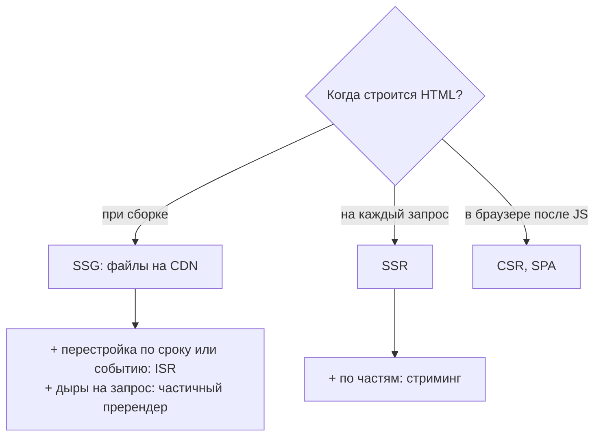
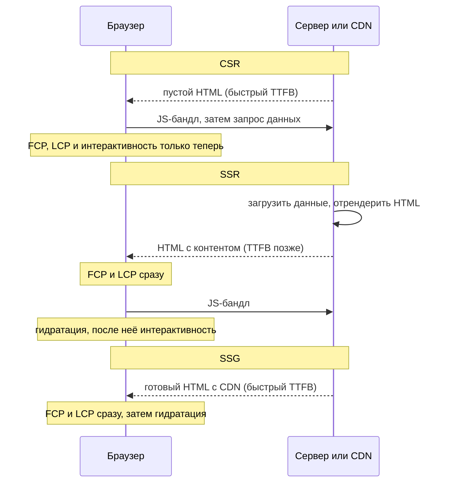

## О чём урок

Карта стратегий рендеринга, о которой спрашивают в любом frontend system design: где и когда превращаются в HTML данные и компоненты. CSR, SSR, SSG, ISR, стриминг, частичный пререндер, острова и Server Components; что видит браузер, поисковик и пользователь на каждом шаге; как это отражается на метриках TTFB, FCP, LCP и INP. Следующие уроки разбирают каждую стратегию подробно. Пример выполняется на React 19.3 в Node.js.

## Два вопроса: где и когда

Любая стратегия отвечает на два вопроса: **где** строится HTML (в браузере или на сервере) и **когда** (при сборке, при запросе или после загрузки JavaScript).



| | Где HTML | Когда | Свежесть | Нагрузка на сервер | Типичный пример |
|---|---|---|---|---|---|
| CSR | Браузер | После загрузки JS и данных | Всегда свежие | Только API | Кабинет, админка, редактор |
| SSR | Сервер | На каждый запрос | Свежие, персональные | Рендер на запрос | Карточка товара с ценой и наличием, лента |
| SSG | Сервер сборки | При сборке | На момент сборки | Нет | Документация, блог, лендинг |
| ISR | Сервер | При сборке и после истечения срока | С задержкой до срока | Редкие перестройки | Каталог из тысяч товаров |
| Стриминг SSR | Сервер | На запрос, по частям | Свежие | Как SSR, соединение дольше | Страница с медленными блоками |
| Частичный пререндер | Сборка + сервер | Оболочка заранее, дыры на запрос | Оболочка статична, дыры свежие | Только дыры | Магазин: каталог и корзина пользователя |
| Острова | Сервер (статика) | Сборка или запрос | Зависит от основы | Как у основы | Контентный сайт с парой интерактивных блоков |

## Что приходит в браузер

```tsx run
import { renderToString } from 'react-dom/server'

type Product = { id: number; name: string; price: number }

function ProductPage({ product }: { product?: Product }) {
  if (!product) return <p>Loading…</p>
  return (
    <article>
      <h1>{product.name}</h1>
      <p>{product.price} EUR</p>
      <button>Add to cart</button>
    </article>
  )
}

const page = (title: string, body: string) =>
  `<!doctype html><html><head><title>${title}</title></head><body><div id="root">${body}</div><script type="module" src="/assets/app.js"></script></body></html>`

// CSR: the same empty shell for every URL; content appears only after app.js runs and fetches data.
const csr = page('Shop', '')
// SSR (per request) or SSG (at build time): the HTML already contains the content.
const product = { id: 7, name: 'Trail shoes', price: 120 }
const ssr = page(`${product.name} | Shop`, renderToString(<ProductPage product={product} />))

// What a crawler, a link preview or a user with slow JS sees before any JavaScript runs:
const visibleText = (html: string) =>
  html.replace(/<script[\s\S]*?<\/script>/g, '').replace(/<[^>]+>/g, ' ').replace(/\s+/g, ' ').trim()
console.log('CSR:', JSON.stringify(visibleText(csr)))
console.log('SSR:', JSON.stringify(visibleText(ssr)))
```

```output
CSR: "Shop"
SSR: "Trail shoes | Shop Trail shoes 120 EUR Add to cart"
```

- При **CSR** сервер отдаёт одну и ту же пустую оболочку на любой адрес. Содержимое, заголовок вкладки и мета-теги появятся только после загрузки и выполнения JavaScript и запроса за данными. Поисковый робот или бот соцсети, который не выполняет JavaScript, увидит «Shop».
- При **SSR** и **SSG** HTML уже содержит товар: его видят пользователь до загрузки JavaScript, поисковики и превью ссылок. Разница между ними только в моменте: SSR строит этот HTML на каждый запрос, SSG один раз при сборке.
- Кнопка «Add to cart» в SSR-разметке есть, но пока не работает: обработчики появятся после **гидратации** (урок `render-hydration`).

## Шкала времени



| Метрика | CSR | SSR | SSG и ISR | Стриминг |
|---|---|---|---|---|
| TTFB (первый байт) | Быстро | Ждёт данных и рендера | Быстро, с CDN | Быстро: оболочка сразу |
| FCP, LCP (первый и главный контент) | Поздно: после JS и данных | Рано | Раньше всех | Рано для оболочки, по мере готовности для остального |
| INP (отзывчивость) | Хорошо после загрузки | Риск: страница видна, но гидратация занимает главный поток | Тот же риск гидратации | Гидратация частями смягчает |
| Объём JS | Всё приложение | Всё приложение для гидратации | То же | То же; меньше с островами и Server Components |

Главная мысль, которую ждут на собеседовании: **SSR ускоряет показ, но не интерактивность**. Страница, отрендеренная на сервере, всё равно скачивает и выполняет тот же JavaScript, чтобы ожить, и пока гидратация идёт, клики не обрабатываются. Поэтому стратегии последних лет (острова, Server Components, возобновляемость, ленивая гидратация) уменьшают количество JavaScript, которое нужно клиенту.

## SPA и MPA

- **SPA** (одностраничное приложение): после первой загрузки переходы между страницами делает клиентский роутер, без перезагрузки документа. Быстрые переходы и состояние между страницами; большой бандл и сложности с SEO при чистом CSR.
- **MPA** (многостраничное приложение): каждый переход загружает новый HTML-документ с сервера. Просто, хорошо для SEO и первого показа; переходы медленнее и состояние теряется.
- Современные метафреймворки (Next.js, Nuxt, SvelteKit, Angular с SSR) совмещают оба: первый запрос это серверный HTML, дальнейшие переходы клиентские. А MPA ускоряют предзагрузкой (Speculation Rules, урок `net-loading`) и анимацией переходов (View Transitions между документами).

## Режим на маршрут

Одна стратегия на всё приложение встречается редко. В одном магазине главная и статьи блога собираются при сборке, каталог перестраивается раз в час, карточка товара рендерится на запрос, корзина и личный кабинет работают только в браузере. Все метафреймворки позволяют задать режим **на маршрут** (урок `render-frameworks`).

## Главное

- Стратегию определяют два вопроса: где строится HTML (браузер или сервер) и когда (сборка, запрос, после JS).
- CSR отдаёт пустую оболочку: контент, заголовок и мета-теги появляются после JavaScript; роботы без JavaScript видят пустую страницу.
- SSR и SSG отдают готовый HTML: быстрые FCP и LCP, SEO и превью ссылок; SSR на каждый запрос, SSG при сборке, ISR перестраивает по сроку или событию.
- SSR ускоряет показ, но не интерактивность: гидратация выполняет тот же JavaScript, и до её конца страница не отвечает.
- SPA делает переходы на клиенте, MPA загружает документ на каждый переход; метафреймворки совмещают оба.
- Режим выбирают на маршрут, а не на всё приложение.
