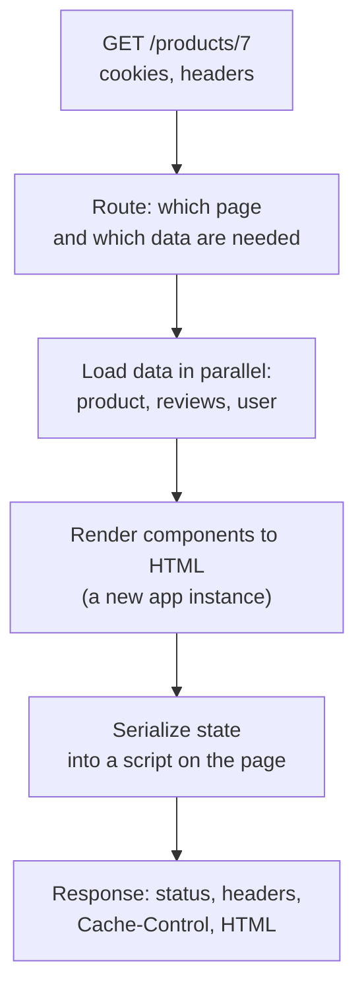
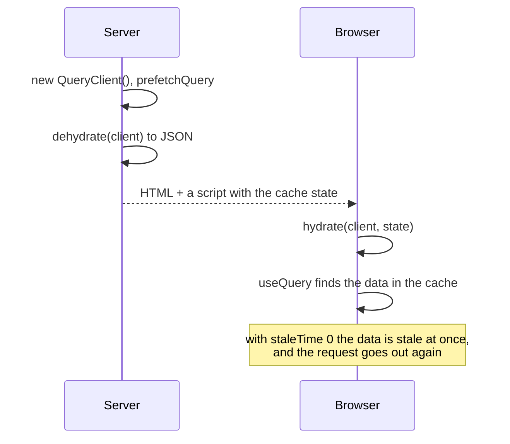
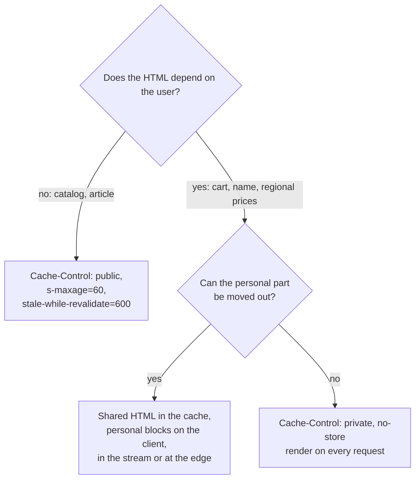

## What this lesson covers

How server rendering works regardless of the framework: the request path, what you must not do in code that runs on the server, how to pass data to the client without opening an XSS hole, how to avoid loading the data a second time in the browser, how to cache HTML, and what SSR costs. The APIs of specific frameworks are covered in the `react-server`, `vue-app` and `ng-performance` lessons. The examples run in jsdom and Node.js on TanStack Query 5.

## The request path



- The server knows the route, the cookies and the request headers, so it can return the right status at once (`404` for a nonexistent product, `301` for an old URL), personal data and meta tags.
- **Data is loaded in parallel and before rendering** (route loaders, `loader` in React Router, `asyncData` and `useFetch` in Nuxt, resolvers and `httpResource` in Angular, async Server Components). Sequential requests on the server add up in TTFB.
- The response time is set by the **slowest** data source. Streaming (the `render-streaming` lesson) and timeouts with a fallback help against this.

## Code on the server

The same component code runs both in Node.js and in the browser. On the server:

| Forbidden or risky | Why | What to do |
|---|---|---|
| `window`, `document`, `localStorage` during render | They do not exist on the server | Read them after hydration (`useEffect`, `onMounted`, `afterNextRender`) |
| Timers and subscriptions during render | Effects do not run on the server, but a timer or subscription in the component body is created on the server and never cleaned up | Only in effects that run in the browser |
| Shared state in a module (a store singleton, a cache in a variable) | One process serves all users: one request's data leaks into another's response | Create the store, the query cache and the app **per request** |
| Secrets in data for the client | Everything serialized into the page is visible in the source | Send the client only the fields it needs |

Cross-request state leaks are sneaky: in development there is one user, and the bug is invisible. That is why `createSSRApp` in Vue, `new QueryClient()` and a Pinia or Redux store are created inside the request handler, not at module level.

## Data from server to client

The server has already loaded the data to render the HTML. If the client loads it again during hydration, that is an extra request, and while it runs the component may show a loading state over the ready content. So the data is put into the page:

```js dom
const data = { user: 'Ann', bio: 'Hi! </script><script>window.stolen = document.cookie</script>' }

// Naive: JSON is valid JavaScript, but the HTML parser does not know about JSON.
const naive = `<script>window.__DATA__ = ${JSON.stringify(data)}</script>`

// Safe: "<" never appears literally, so "</script>" or "<!--" cannot end the tag.
const serialize = (value) => JSON.stringify(value).replace(/</g, '\\u003c')
const safe = `<script>window.__DATA__ = ${serialize(data)}</script>`

for (const [name, html] of [['naive', naive], ['safe ', safe]]) {
  const doc = new DOMParser().parseFromString(html, 'text/html')
  const scripts = [...doc.querySelectorAll('script')].map((s) => s.textContent.slice(0, 32))
  console.log(name, scripts.length, 'script(s):', scripts)
}
console.log('round trip:', JSON.parse(serialize(data)).bio === data.bio)
```

```output
naive 2 script(s): [
  'window.__DATA__ = {"user":"Ann",',
  'window.stolen = document.cookie'
]
safe  1 script(s): [ 'window.__DATA__ = {"user":"Ann",' ]
round trip: true
```

- `JSON.stringify` produces valid JavaScript, but the HTML parser knows nothing about JSON: when it meets `</script>` inside a string, it closes the tag. The rest of the user-supplied data (a name, a review, a description) becomes a new `<script>` tag, and the browser runs someone else's code. This is an XSS that has been found in real apps.
- The defense: never let the `<` character appear in the output (`<` in JSON means the same character), or the `devalue` (Nuxt, SvelteKit) and `serialize-javascript` libraries. Frameworks do this themselves: `__NEXT_DATA__` and the RSC stream in Next.js, the payload in Nuxt, `TransferState` and the `HttpClient` cache in Angular. Hand-written code is the danger.
- Serialize only what is needed and no secrets: everything that ends up in the page is visible under "View page source".

## Not loading it twice

With a query library, data is passed through **dehydrate** and **hydrate** of the cache: the server fills the cache, serializes it into the page, and the client restores the cache before rendering.

```ts run
import { QueryClient, QueryObserver, dehydrate, hydrate } from '@tanstack/query-core'

let fetches = 0
const fetchProduct = async () => (fetches++, { id: 7, name: 'Trail shoes' })
const options = { queryKey: ['product', 7], queryFn: fetchProduct }

// Server: a new QueryClient per request (a shared one would leak data between users).
const serverClient = new QueryClient()
await serverClient.prefetchQuery(options)
const payload = JSON.stringify(dehydrate(serverClient)) // goes into the HTML, escaped as shown above
console.log('server fetched:', fetches)

// Client, two setups: default staleTime 0, and staleTime 60 s.
for (const staleTime of [0, 60_000]) {
  fetches = 0
  const client = new QueryClient({ defaultOptions: { queries: { staleTime, gcTime: Infinity } } })
  hydrate(client, JSON.parse(payload))
  const observer = new QueryObserver(client, options)
  const unsubscribe = observer.subscribe(() => {})
  await new Promise((r) => setTimeout(r, 10))
  console.log(`staleTime ${staleTime}:`, observer.getCurrentResult().data?.name, '| client fetches on mount:', fetches)
  unsubscribe()
}
```

```output
server fetched: 1
staleTime 0: Trail shoes | client fetches on mount: 1
staleTime 60000: Trail shoes | client fetches on mount: 0
```



- The data came from the server in both cases, but with `staleTime: 0` (the default) it is considered stale immediately, and the client requests it again on mount. The TanStack Query docs advise a `staleTime` above zero with SSR.
- The `QueryClient` on the server is new for every request, otherwise one user's cache reaches another.
- The same technique in other stacks: `HttpTransferCache` in Angular (`HttpClient` requests made on the server are not sent again), `useFetch` and `useAsyncData` in Nuxt (data in the payload), Server Components in React (the data stays on the server, the client gets the finished result).

## Caching HTML

SSR on every request is expensive, so HTML is cached on a CDN when it is the same for everyone.



- `s-maxage` sets the lifetime for shared caches (CDN), `max-age` for the browser; `stale-while-revalidate` lets the stale version be served while a new one is built in the background (the `net-caching` lesson).
- Personal HTML in a shared cache is a data leak: one user sees another's name and cart. Such responses are marked `private` or `no-store`. `Vary: Cookie` formally splits the cache but in practice disables it: every user has their own cookies.
- So the page is split: the shared HTML is cached, and the personal parts arrive separately (a request from the browser, in the stream or from the edge). Partial prerendering and server islands develop this idea (the `render-static` and `render-less-js` lessons).

## What SSR costs

- **The server**: rendering every request costs CPU time; under load TTFB grows. You need Node.js or an edge runtime, not just static hosting.
- **The code**: everything must work in two environments; "`window is not defined`" errors and cross-request leaks.
- **Errors**: if rendering fails, you need a strategy: an error page or falling back to client rendering (CSR) for that block.
- **Interactivity** does not get faster: hydration runs the same JavaScript (the `render-hydration` lesson).

## Key points

- The server knows the route, cookies and headers: the right status at once, meta tags, personal data; data is loaded in parallel and before rendering, and TTFB equals the slowest source.
- There is no `window` or `localStorage` on the server, and effects do not run; the store, cache and app are created per request, otherwise data leaks between users.
- Data reaches the client inside the page; `JSON.stringify` in a `<script>` without escaping `<` is an XSS; frameworks and `devalue` do this safely.
- A query cache is passed through dehydrate and hydrate; with SSR, `staleTime` above zero, otherwise the client refetches.
- Shared HTML is cached on a CDN (`s-maxage`, `stale-while-revalidate`), personal HTML only `private`; personal parts are moved out of the shared HTML.
- SSR costs a server and code complexity and does not speed up interactivity.
