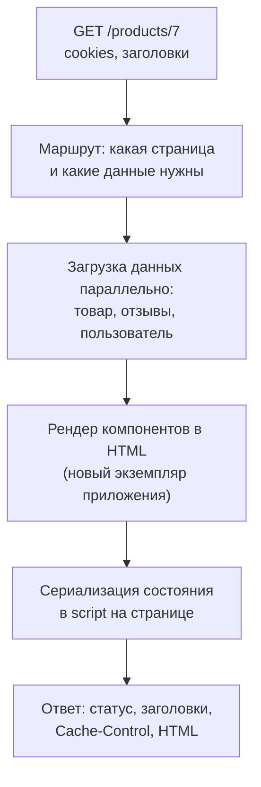
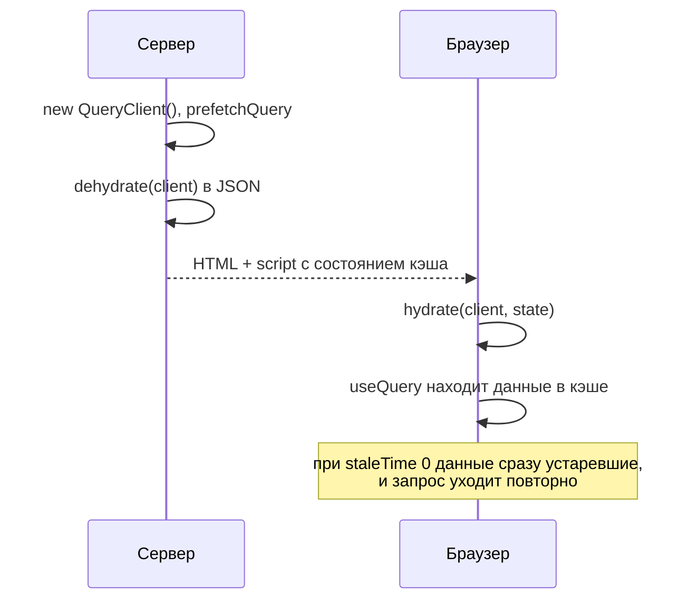
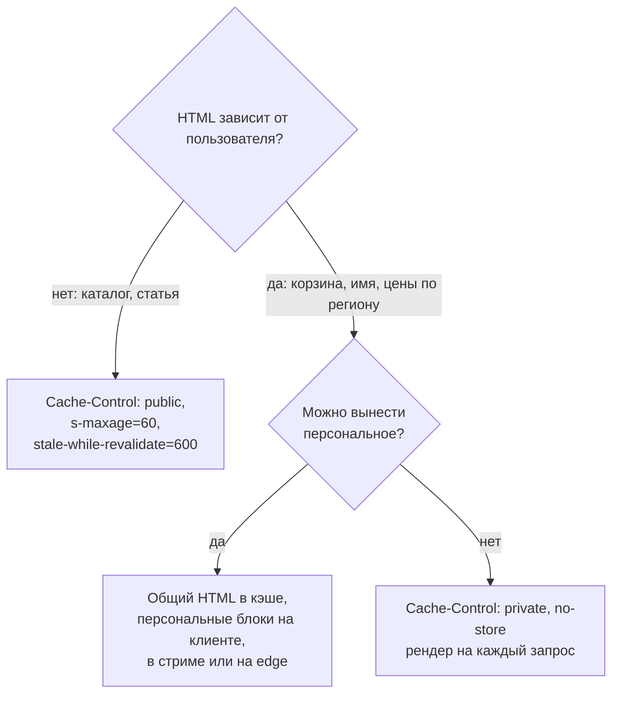

## О чём урок

Как устроен серверный рендер независимо от фреймворка: путь запроса, что нельзя делать в коде, который выполняется на сервере, как передать данные клиенту и не открыть XSS, как не загружать данные второй раз в браузере, как кэшировать HTML и во что обходится SSR. API конкретных фреймворков разобраны в уроках `react-server`, `vue-app` и `ng-performance`. Примеры выполняются в jsdom и Node.js на TanStack Query 5.

## Путь запроса



- Сервер знает маршрут, cookie и заголовки запроса, поэтому может сразу вернуть правильный статус (`404` для несуществующего товара, `301` для старого адреса), персональные данные и мета-теги.
- **Данные грузят параллельно и до рендера** (загрузчики маршрутов, `loader` в React Router, `asyncData` и `useFetch` в Nuxt, резолверы и `httpResource` в Angular, асинхронные Server Components). Последовательные запросы на сервере складываются в TTFB.
- Время ответа определяется **самым медленным** источником данных. Против этого помогает стриминг (урок `render-streaming`) и таймауты с запасным вариантом.

## Код на сервере

Один и тот же код компонентов выполняется и в Node.js, и в браузере. На сервере:

| Нельзя или опасно | Почему | Что делать |
|---|---|---|
| `window`, `document`, `localStorage` при рендере | Их нет на сервере | Читать после гидратации (`useEffect`, `onMounted`, `afterNextRender`) |
| Таймеры и подписки при рендере | Эффекты на сервере не запускаются, а таймер или подписка в теле компонента создадутся на сервере и не будут сняты | Только в эффектах, которые выполняются в браузере |
| Общее состояние в модуле (синглтон стора, кэш в переменной) | Один процесс обслуживает всех пользователей: данные одного запроса утекут в ответ другому | Создавать стор, кэш запросов и приложение **на каждый запрос** |
| Секреты в данных для клиента | Всё, что сериализовано в страницу, видно в исходном коде | Отдавать клиенту только нужные поля |

Утечка состояния между запросами коварна: в разработке один пользователь, и ошибки не видно. Поэтому `createSSRApp` во Vue, `new QueryClient()` и стор Pinia или Redux создаются внутри обработчика запроса, а не на уровне модуля.

## Данные с сервера на клиент

Сервер уже загрузил данные, чтобы отрендерить HTML. Если клиент при гидратации загрузит их снова, получится лишний запрос, а пока он идёт, компонент может показать загрузку поверх готового контента. Поэтому данные кладут в страницу:

```js dom
const data = { user: 'Ann', bio: 'Hi! </script><script>window.stolen = document.cookie</script>' }

// Naive: JSON is valid JavaScript, but the HTML parser does not know about JSON.
const naive = `<script>window.__DATA__ = ${JSON.stringify(data)}</script>`

// Safe: "<" never appears literally, so "</script>" or "<!--" cannot end the tag.
const serialize = (value) => JSON.stringify(value).replace(/</g, '\\u003c')
const safe = `<script>window.__DATA__ = ${serialize(data)}</script>`

for (const [name, html] of [['naive', naive], ['safe ', safe]]) {
  const doc = new DOMParser().parseFromString(html, 'text/html')
  const scripts = [...doc.querySelectorAll('script')].map((s) => s.textContent.slice(0, 32))
  console.log(name, scripts.length, 'script(s):', scripts)
}
console.log('round trip:', JSON.parse(serialize(data)).bio === data.bio)
```

```output
naive 2 script(s): [
  'window.__DATA__ = {"user":"Ann",',
  'window.stolen = document.cookie'
]
safe  1 script(s): [ 'window.__DATA__ = {"user":"Ann",' ]
round trip: true
```

- `JSON.stringify` даёт корректный JavaScript, но HTML-парсер ничего не знает о JSON: встретив `</script>` внутри строки, он закрывает тег. Остаток данных, присланных пользователем (имя, отзыв, описание), становится новым тегом `<script>`, и браузер выполняет чужой код. Это XSS, найденный в реальных приложениях.
- Защита: не допускать символ `<` в выводе (`<` в JSON означает тот же символ), либо библиотеки `devalue` (Nuxt, SvelteKit) и `serialize-javascript`. Фреймворки делают это сами: `__NEXT_DATA__` и поток RSC в Next.js, payload в Nuxt, `TransferState` и кэш `HttpClient` в Angular. Опасен ручной код.
- Сериализуют только нужное и без секретов: всё, что попало в страницу, видно в «Просмотре кода страницы».

## Не загружать второй раз

С библиотекой запросов данные передают через **dehydrate** и **hydrate** кэша: сервер заполняет кэш, сериализует его в страницу, клиент восстанавливает кэш до рендера.

```ts run
import { QueryClient, QueryObserver, dehydrate, hydrate } from '@tanstack/query-core'

let fetches = 0
const fetchProduct = async () => (fetches++, { id: 7, name: 'Trail shoes' })
const options = { queryKey: ['product', 7], queryFn: fetchProduct }

// Server: a new QueryClient per request (a shared one would leak data between users).
const serverClient = new QueryClient()
await serverClient.prefetchQuery(options)
const payload = JSON.stringify(dehydrate(serverClient)) // goes into the HTML, escaped as shown above
console.log('server fetched:', fetches)

// Client, two setups: default staleTime 0, and staleTime 60 s.
for (const staleTime of [0, 60_000]) {
  fetches = 0
  const client = new QueryClient({ defaultOptions: { queries: { staleTime, gcTime: Infinity } } })
  hydrate(client, JSON.parse(payload))
  const observer = new QueryObserver(client, options)
  const unsubscribe = observer.subscribe(() => {})
  await new Promise((r) => setTimeout(r, 10))
  console.log(`staleTime ${staleTime}:`, observer.getCurrentResult().data?.name, '| client fetches on mount:', fetches)
  unsubscribe()
}
```

```output
server fetched: 1
staleTime 0: Trail shoes | client fetches on mount: 1
staleTime 60000: Trail shoes | client fetches on mount: 0
```



- Данные пришли с сервера в обоих случаях, но со `staleTime: 0` (по умолчанию) они считаются устаревшими сразу, и клиент запрашивает их ещё раз при монтировании. Документация TanStack Query советует при SSR ставить `staleTime` больше нуля.
- `QueryClient` на сервере новый для каждого запроса, иначе кэш одного пользователя попадёт к другому.
- Тот же приём в других стеках: `HttpTransferCache` в Angular (запросы `HttpClient` с сервера повторно не отправляются), `useFetch` и `useAsyncData` в Nuxt (данные в payload), Server Components в React (данные остаются на сервере, клиент получает готовый результат).

## Кэширование HTML

SSR на каждый запрос дорог, поэтому HTML кэшируют на CDN, если он одинаков для всех.



- `s-maxage` задаёт срок для общих кэшей (CDN), `max-age` для браузера; `stale-while-revalidate` позволяет отдавать устаревшую версию, пока в фоне строится новая (урок `net-caching`).
- Персональный HTML в общем кэше это утечка данных: один пользователь увидит имя и корзину другого. Такие ответы помечают `private` или `no-store`. `Vary: Cookie` формально разделяет кэш, но на практике отключает его: у каждого пользователя свои cookie.
- Поэтому страницу делят: общий HTML кэшируется, персональные части приходят отдельно (запросом из браузера, в стриме или с edge). Эту идею развивают частичный пререндер и серверные острова (уроки `render-static` и `render-less-js`).

## Во что обходится SSR

- **Сервер**: рендер на каждый запрос стоит процессорного времени; под нагрузкой растёт TTFB. Нужен Node.js или edge-окружение, а не только статический хостинг.
- **Код**: всё должно работать в двух средах; ошибки «`window is not defined`» и утечки между запросами.
- **Ошибки**: если рендер упал, нужна стратегия: страница ошибки или откат к клиентскому рендеру (CSR) этого блока.
- **Интерактивность** не ускоряется: гидратация выполняет тот же JavaScript (урок `render-hydration`).

## Главное

- Сервер знает маршрут, cookie и заголовки: сразу правильный статус, мета-теги, персональные данные; данные грузят параллельно и до рендера, TTFB равен самому медленному источнику.
- На сервере нет `window` и `localStorage`, эффекты не выполняются; стор, кэш и приложение создаются на каждый запрос, иначе данные утекут между пользователями.
- Данные передают клиенту в странице; `JSON.stringify` в `<script>` без экранирования `<` это XSS; фреймворки и `devalue` делают это безопасно.
- Кэш запросов передают через dehydrate и hydrate; при SSR `staleTime` больше нуля, иначе клиент перезапросит данные.
- Общий HTML кэшируют на CDN (`s-maxage`, `stale-while-revalidate`), персональный только `private`; персональные части выносят из общего HTML.
- SSR стоит сервера и сложности кода и не ускоряет интерактивность.
