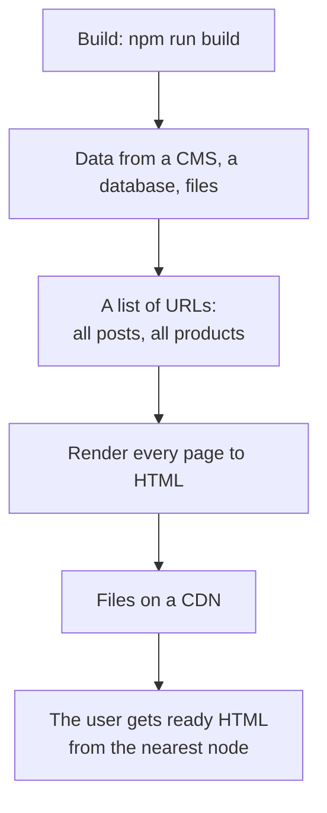
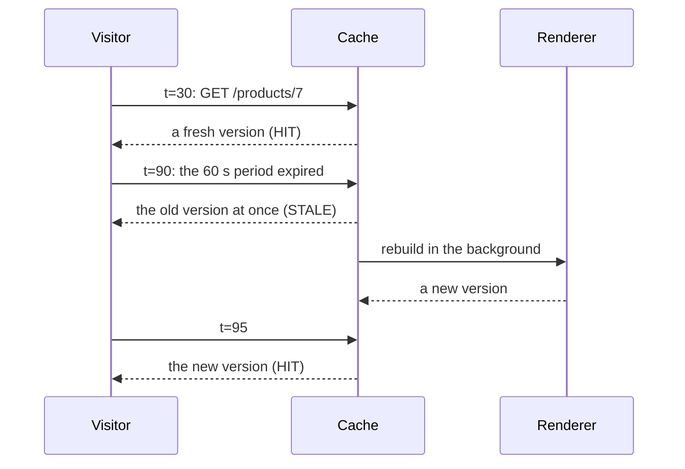
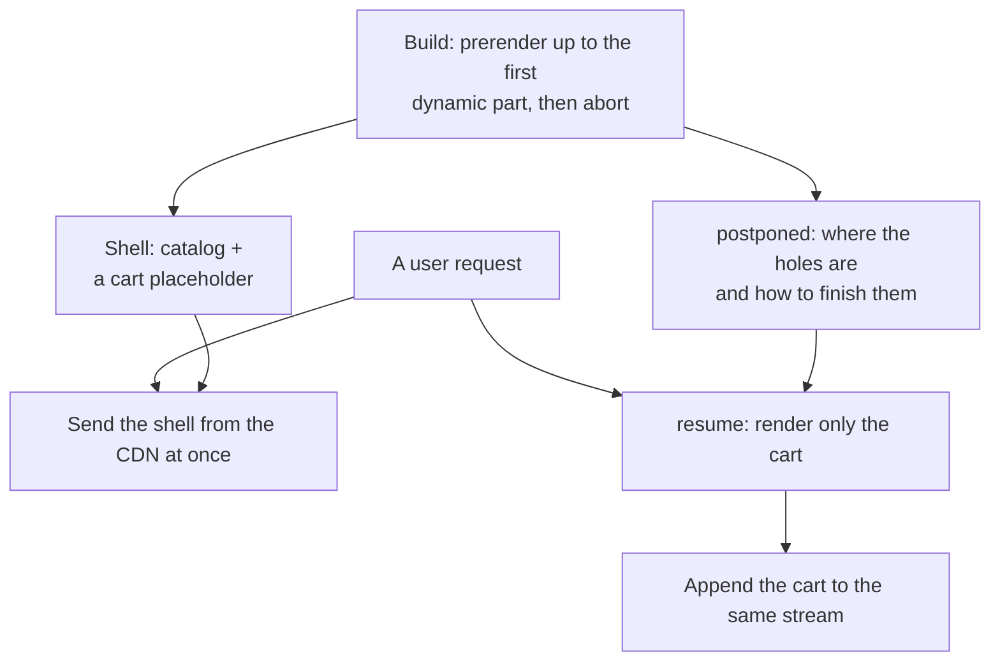

## What this lesson covers

Everything built ahead of time: static generation (SSG) and its limits, incremental regeneration (ISR) and why it works "on request" rather than "on a timer", rebuilding on an event, partial prerendering, where a static shell and dynamic holes arrive in one response, and what it looks like in Next.js 16 (Cache Components). The examples run in Node.js; partial prerendering uses the real React 19.3 APIs `prerender` and `resume`.

## SSG



- The fastest and cheapest option: HTML is served as files from a CDN, no app server is needed, no rendering per request.
- For dynamic routes (`/blog/:slug`) the build needs a **list of parameters**: `generateStaticParams` in Next.js, `getPrerenderParams` in Angular, `entries` in SvelteKit, a `prerender` list in React Router, link crawling (`crawlLinks`) in Nuxt.
- Limits: data as of the build (a change in the CMS needs a rebuild), build time grows with the number of pages (100 thousand products take long to build), and the HTML cannot contain personal data.
- It fits docs, blogs, landing pages, marketing pages: the content is the same for everyone and changes rarely.

## ISR: rebuilding after a period

Incremental regeneration removes two SSG limits: pages can be built not all at once but on the first request, and updated without a full rebuild.

```ts run
// Incremental Static Regeneration as stale-while-revalidate: a page is regenerated
// on a request after it expires, not on a timer; the visitor who triggers it gets the old page.
type Entry = { html: string; generatedAt: number; tags: string[] }
let now = 0 // seconds, a fake clock
let price = 120
let renders = 0

const cache = new Map<string, Entry>()
const revalidateAfter = 60
const render = async (path: string): Promise<Entry> => {
  renders++
  return { html: `${path}: ${price} EUR (built at ${now}s)`, generatedAt: now, tags: ['product-7'] }
}

async function serve(path: string) {
  const entry = cache.get(path)
  if (!entry) {
    const fresh = await render(path) // first visit (or not prerendered at build): render and cache
    cache.set(path, fresh)
    return `MISS  ${fresh.html}`
  }
  if (now - entry.generatedAt > revalidateAfter) {
    render(path).then((fresh) => cache.set(path, fresh)) // in the background
    return `STALE ${entry.html}`
  }
  return `HIT   ${entry.html}`
}

// On-demand revalidation: a webhook from the CMS marks pages by tag as stale.
const revalidateTag = (tag: string) => {
  for (const [path, entry] of cache) if (entry.tags.includes(tag)) cache.delete(path)
}

const log = async (t: number) => {
  now = t
  console.log(`t=${String(t).padStart(3)}s`, await serve('/products/7'))
  await Promise.resolve()
}
await log(0)
await log(30)
price = 99 // changed in the CMS, nobody told the cache
await log(90) // expired: the old page is served, a new one is built in the background
await log(95)
price = 89
revalidateTag('product-7') // the CMS calls the revalidation webhook
await log(100)
console.log('renders:', renders)
```

```output
t=  0s MISS  /products/7: 120 EUR (built at 0s)
t= 30s HIT   /products/7: 120 EUR (built at 0s)
t= 90s STALE /products/7: 120 EUR (built at 0s)
t= 95s HIT   /products/7: 99 EUR (built at 90s)
t=100s MISS  /products/7: 89 EUR (built at 100s)
renders: 3
```



- The page is rebuilt **on a request after the period expires**, not on a timer: the visitor at second 90 got the old price `120`, and the next one saw the new `99`. While nobody visits, nothing is rebuilt. It is the same model as `stale-while-revalidate` in the HTTP cache.
- So the ISR period is not "how often to update" but "how stale the page is allowed to be". A price changed in the CMS shows up with a delay of up to the period plus one request.
- **Rebuilding on an event** removes the delay: the CMS calls a webhook, and the app marks pages stale by tag or path (`revalidateTag`, `revalidatePath` in Next.js; in the example `revalidateTag('product-7')` and the new price `89` at once). The period stays as insurance against a missed event.
- In Nuxt the same is set with a route rule: `'/blog/**': { isr: 3600 }` (cached on the platform's CDN) or `{ swr: 3600 }` (cached on the server or a proxy).

## Partial prerendering

A shop page is almost entirely the same for everyone (the catalog, the description), but it has small personal parts (the cart, the name, a regional price). Before, one such part made the whole page dynamic. Partial prerendering splits it: a **static shell** is built ahead of time and served from a CDN, and the **holes** are rendered per request and appended to the same response.

```tsx run
import { Suspense, use } from 'react'
import { prerender } from 'react-dom/static'
import { resume } from 'react-dom/server'

let requestTime = false
const waitForRequest = new Promise(() => {}) // never resolves during the build

function Cart() {
  if (!requestTime) use(waitForRequest) // personal data: only known at request time
  return <p>Cart: 3 items</p>
}
function App() {
  return (
    <main>
      <h1>Catalog</h1>
      <p>Static content, same for everyone</p>
      <Suspense fallback={<p>Loading cart…</p>}>
        <Cart />
      </Suspense>
    </main>
  )
}
const short = (html: string) => html.replace(/<script>[\s\S]*?<\/script>/g, '<script>…</script>').replace(/<!--.*?-->/g, '')

// Build time: render what can be rendered, then stop. The prelude goes to the CDN.
const controller = new AbortController()
setTimeout(() => controller.abort())
const { prelude, postponed } = await prerender(<App />, { signal: controller.signal, onError() {} })
console.log('build, static shell:', short(await new Response(prelude).text()))
const saved = JSON.stringify(postponed) // the "holes" to fill later, stored next to the shell

// Request time: the CDN sends the shell at once, the server renders only the holes.
requestTime = true
const rest = await resume(<App />, JSON.parse(saved))
console.log('request, the rest:  ', short(await new Response(rest).text()))
```

```output
build, static shell: <main><h1>Catalog</h1><p>Static content, same for everyone</p><template id="B:0"></template><p>Loading cart…</p></main><script>…</script>
request, the rest:   <div hidden id="S:0"><p>Cart: 3 items</p></div><script>…</script>
```



- `prerender` from `react-dom/static` renders everything it can and, after `abort()`, returns `prelude` (the shell with placeholders in place of unfinished Suspense boundaries) and `postponed` (a serializable description of the holes). `resume` from `react-dom/server` renders only the holes at request time and streams them, as in the `render-streaming` lesson.
- The user gets the shell instantly, as with SSG, and the personal parts with the render delay of only those parts, not the whole page.

In Next.js 16 this model is called **Cache Components** (the evolution of Partial Prerendering). Since 16.4 it is recommended for all apps and enabled in new projects, and in Next.js 17 it becomes the default. Cacheable parts are marked with a directive, and dynamic ones are wrapped in Suspense:

```tsx
// next.config.ts: { cacheComponents: true }
import { Suspense } from 'react'
import { cacheLife, cacheTag } from 'next/cache'

export default function ProductPage({ params }: { params: Promise<{ id: string }> }) {
  return (
    <>
      <ProductInfo params={params} /> {/* in the static shell */}
      <Suspense fallback={<CartSkeleton />}>
        <Cart /> {/* rendered at request time: reads cookies */}
      </Suspense>
    </>
  )
}

async function ProductInfo({ params }: { params: Promise<{ id: string }> }) {
  'use cache'
  const { id } = await params
  cacheLife('hours') // how long the cached result lives
  cacheTag(`product-${id}`) // for revalidateTag(`product-${id}`) from a CMS webhook
  const product = await db.products.find(id)
  return <h1>{product.name}</h1>
}
```

- `'use cache'` acts like `Cache-Control` for a component or a function: the result is cached, `cacheLife` sets the lifetime, `cacheTag` lets you drop it on an event.
- Everything that reads request data (`cookies()`, `headers()`, `searchParams`) and is not cached must be inside Suspense, otherwise the build reports an error: this is how Next.js knows where the shell boundary lies.
- `export const ensureStatic = 'navigation'` (16.4) forbids dynamic parts on a route that must be fully static.

Similar ideas in other tools: Astro server islands (`server:defer`) add dynamic blocks to a static page with a request from the browser (the `render-less-js` lesson), and Nuxt and Angular route rules mix modes at the level of whole pages.

## What to choose

| Situation | Strategy |
|---|---|
| The content is the same for everyone and changes with releases | SSG |
| Thousands of pages that change sometimes, a delay of minutes is fine | ISR with a period and rebuilds on events |
| An almost static page with personal pieces | Partial prerendering (Cache Components, server islands) |
| Everything is personal or changes every second | SSR (with streaming) or CSR |

## Key points

- SSG builds HTML at build time and serves it from a CDN: fast and cheap; dynamic routes need a parameter list; data as of the build, build time grows with the number of pages.
- ISR rebuilds a page on a request after the period expires (stale-while-revalidate): that visitor gets the old version, the next one the new; the period means allowed staleness, not update frequency.
- Rebuilding on an event (`revalidateTag`, a CMS webhook) removes the delay; the period stays as insurance.
- Partial prerendering: a static shell ahead of time, dynamic holes per request in the same response; in React that is `prerender` with `postponed` and `resume`.
- Next.js 16.4: Cache Components (`'use cache'`, `cacheLife`, `cacheTag`, dynamic parts in Suspense) are recommended for all apps and become the default in Next.js 17.
