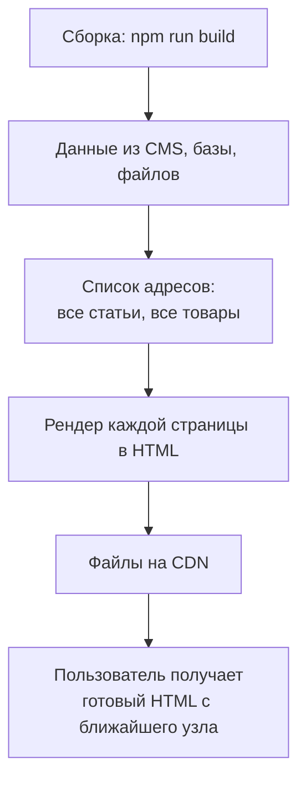
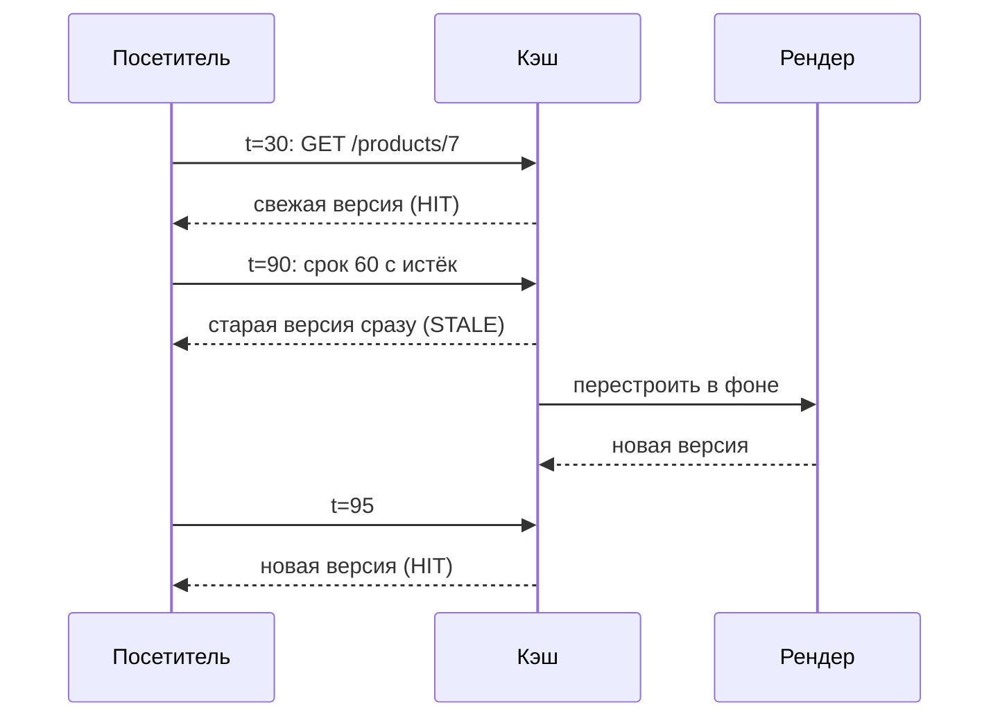
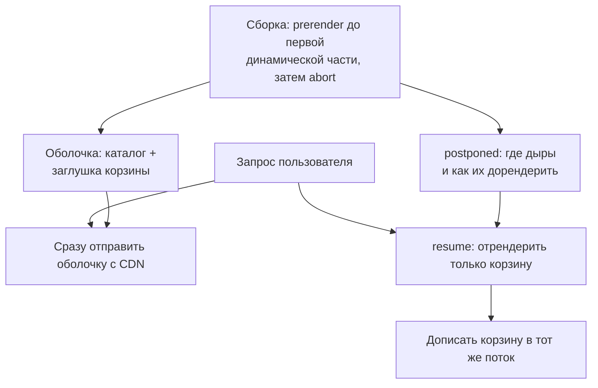

## О чём урок

Всё, что строится заранее: статическая генерация (SSG) и её ограничения, инкрементальная регенерация (ISR) и почему она работает «по запросу», а не «по таймеру», перестройка по событию, частичный пререндер, где статическая оболочка и динамические дыры приходят в одном ответе, и как это выглядит в Next.js 16 (Cache Components). Примеры выполняются в Node.js; частичный пререндер на настоящих API React 19.3 `prerender` и `resume`.

## SSG



- Самый быстрый и дешёвый вариант: HTML раздаётся как файлы с CDN, сервер приложения не нужен, нет рендера на запрос.
- Для динамических маршрутов (`/blog/:slug`) сборке нужен **список параметров**: `generateStaticParams` в Next.js, `getPrerenderParams` в Angular, `entries` в SvelteKit, список `prerender` в React Router, обход ссылок (`crawlLinks`) в Nuxt.
- Ограничения: данные на момент сборки (изменение в CMS требует пересборки), время сборки растёт с числом страниц (100 тысяч товаров собираются долго), персональных данных в HTML быть не может.
- Подходит для документации, блогов, лендингов, маркетинговых страниц: содержимое одинаково для всех и меняется редко.

## ISR: перестройка после срока

Инкрементальная регенерация снимает два ограничения SSG: страницы можно собирать не все сразу, а при первом запросе, и обновлять без полной пересборки.

```ts run
// Incremental Static Regeneration as stale-while-revalidate: a page is regenerated
// on a request after it expires, not on a timer; the visitor who triggers it gets the old page.
type Entry = { html: string; generatedAt: number; tags: string[] }
let now = 0 // seconds, a fake clock
let price = 120
let renders = 0

const cache = new Map<string, Entry>()
const revalidateAfter = 60
const render = async (path: string): Promise<Entry> => {
  renders++
  return { html: `${path}: ${price} EUR (built at ${now}s)`, generatedAt: now, tags: ['product-7'] }
}

async function serve(path: string) {
  const entry = cache.get(path)
  if (!entry) {
    const fresh = await render(path) // first visit (or not prerendered at build): render and cache
    cache.set(path, fresh)
    return `MISS  ${fresh.html}`
  }
  if (now - entry.generatedAt > revalidateAfter) {
    render(path).then((fresh) => cache.set(path, fresh)) // in the background
    return `STALE ${entry.html}`
  }
  return `HIT   ${entry.html}`
}

// On-demand revalidation: a webhook from the CMS marks pages by tag as stale.
const revalidateTag = (tag: string) => {
  for (const [path, entry] of cache) if (entry.tags.includes(tag)) cache.delete(path)
}

const log = async (t: number) => {
  now = t
  console.log(`t=${String(t).padStart(3)}s`, await serve('/products/7'))
  await Promise.resolve()
}
await log(0)
await log(30)
price = 99 // changed in the CMS, nobody told the cache
await log(90) // expired: the old page is served, a new one is built in the background
await log(95)
price = 89
revalidateTag('product-7') // the CMS calls the revalidation webhook
await log(100)
console.log('renders:', renders)
```

```output
t=  0s MISS  /products/7: 120 EUR (built at 0s)
t= 30s HIT   /products/7: 120 EUR (built at 0s)
t= 90s STALE /products/7: 120 EUR (built at 0s)
t= 95s HIT   /products/7: 99 EUR (built at 90s)
t=100s MISS  /products/7: 89 EUR (built at 100s)
renders: 3
```



- Страница перестраивается **по запросу после истечения срока**, а не по таймеру: посетитель на 90-й секунде получил старую цену `120`, а новую `99` увидел уже следующий. Пока никто не заходит, ничего не перестраивается. Это та же модель, что `stale-while-revalidate` в HTTP-кэше.
- Поэтому срок ISR это не «как часто обновлять», а «насколько устаревшей странице разрешено быть». Цена, изменённая в CMS, видна с задержкой до срока плюс один запрос.
- **Перестройка по событию** убирает задержку: CMS вызывает вебхук, и приложение помечает страницы устаревшими по тегу или пути (`revalidateTag`, `revalidatePath` в Next.js; в примере `revalidateTag('product-7')` и сразу новая цена `89`). Срок остаётся страховкой на случай пропущенного события.
- В Nuxt то же задаётся правилом маршрута: `'/blog/**': { isr: 3600 }` (кэш на CDN платформы) или `{ swr: 3600 }` (кэш на сервере или прокси).

## Частичный пререндер

Страница магазина почти вся одинакова для всех (каталог, описание), но в ней есть маленькие персональные части (корзина, имя, цена для региона). Раньше из-за одной такой части вся страница становилась динамической. Частичный пререндер делит её: **статическая оболочка** строится заранее и раздаётся с CDN, а **дыры** рендерятся на запрос и дописываются в тот же ответ.

```tsx run
import { Suspense, use } from 'react'
import { prerender } from 'react-dom/static'
import { resume } from 'react-dom/server'

let requestTime = false
const waitForRequest = new Promise(() => {}) // never resolves during the build

function Cart() {
  if (!requestTime) use(waitForRequest) // personal data: only known at request time
  return <p>Cart: 3 items</p>
}
function App() {
  return (
    <main>
      <h1>Catalog</h1>
      <p>Static content, same for everyone</p>
      <Suspense fallback={<p>Loading cart…</p>}>
        <Cart />
      </Suspense>
    </main>
  )
}
const short = (html: string) => html.replace(/<script>[\s\S]*?<\/script>/g, '<script>…</script>').replace(/<!--.*?-->/g, '')

// Build time: render what can be rendered, then stop. The prelude goes to the CDN.
const controller = new AbortController()
setTimeout(() => controller.abort())
const { prelude, postponed } = await prerender(<App />, { signal: controller.signal, onError() {} })
console.log('build, static shell:', short(await new Response(prelude).text()))
const saved = JSON.stringify(postponed) // the "holes" to fill later, stored next to the shell

// Request time: the CDN sends the shell at once, the server renders only the holes.
requestTime = true
const rest = await resume(<App />, JSON.parse(saved))
console.log('request, the rest:  ', short(await new Response(rest).text()))
```

```output
build, static shell: <main><h1>Catalog</h1><p>Static content, same for everyone</p><template id="B:0"></template><p>Loading cart…</p></main><script>…</script>
request, the rest:   <div hidden id="S:0"><p>Cart: 3 items</p></div><script>…</script>
```



- `prerender` из `react-dom/static` рендерит всё, что может, и после `abort()` возвращает `prelude` (оболочку с заглушками на месте незавершённых границ `Suspense`) и `postponed` (сериализуемое описание дыр). `resume` из `react-dom/server` при запросе рендерит только дыры и отдаёт их потоком, как в уроке `render-streaming`.
- Пользователь получает оболочку мгновенно, как при SSG, а персональные части с задержкой рендера только их, а не всей страницы.

В Next.js 16 эта модель называется **Cache Components** (развитие Partial Prerendering). С версии 16.4 её рекомендуют для всех приложений и включают в новых проектах, а в Next.js 17 она станет режимом по умолчанию. Кэшируемые части помечают директивой, а динамические оборачивают в `Suspense`:

```tsx
// next.config.ts: { cacheComponents: true }
import { Suspense } from 'react'
import { cacheLife, cacheTag } from 'next/cache'

export default function ProductPage({ params }: { params: Promise<{ id: string }> }) {
  return (
    <>
      <ProductInfo params={params} /> {/* in the static shell */}
      <Suspense fallback={<CartSkeleton />}>
        <Cart /> {/* rendered at request time: reads cookies */}
      </Suspense>
    </>
  )
}

async function ProductInfo({ params }: { params: Promise<{ id: string }> }) {
  'use cache'
  const { id } = await params
  cacheLife('hours') // how long the cached result lives
  cacheTag(`product-${id}`) // for revalidateTag(`product-${id}`) from a CMS webhook
  const product = await db.products.find(id)
  return <h1>{product.name}</h1>
}
```

- `'use cache'` действует как `Cache-Control` для компонента или функции: результат кэшируется, `cacheLife` задаёт срок, `cacheTag` позволяет сбросить его по событию.
- Всё, что читает данные запроса (`cookies()`, `headers()`, `searchParams`) и не закэшировано, должно быть внутри `Suspense`, иначе сборка сообщит об ошибке: так Next.js знает, где проходит граница оболочки.
- `export const ensureStatic = 'navigation'` (16.4) запрещает динамическим частям попасть на маршрут, который должен быть полностью статичным.

Похожие идеи в других инструментах: серверные острова Astro (`server:defer`) дописывают динамические блоки в статическую страницу запросом из браузера (урок `render-less-js`), а правила маршрутов Nuxt и Angular смешивают режимы на уровне целых страниц.

## Что выбрать

| Ситуация | Стратегия |
|---|---|
| Содержимое одинаково для всех, меняется при выпуске | SSG |
| Тысячи страниц, меняются иногда, допустима задержка в минуты | ISR со сроком и перестройкой по событию |
| Почти статичная страница с персональными кусками | Частичный пререндер (Cache Components, серверные острова) |
| Всё персональное или меняется каждую секунду | SSR (со стримингом) или CSR |

## Главное

- SSG строит HTML при сборке и раздаёт с CDN: быстро и дёшево; нужен список параметров для динамических маршрутов; данные на момент сборки, время сборки растёт с числом страниц.
- ISR перестраивает страницу по запросу после истечения срока (stale-while-revalidate): этот посетитель получает старую версию, следующий новую; срок означает допустимую устарелость, а не частоту обновления.
- Перестройка по событию (`revalidateTag`, вебхук CMS) убирает задержку; срок остаётся страховкой.
- Частичный пререндер: статическая оболочка заранее, динамические дыры на запрос в том же ответе; в React это `prerender` с `postponed` и `resume`.
- Next.js 16.4: Cache Components (`'use cache'`, `cacheLife`, `cacheTag`, динамика в `Suspense`) рекомендованы для всех приложений, по умолчанию с Next.js 17.
