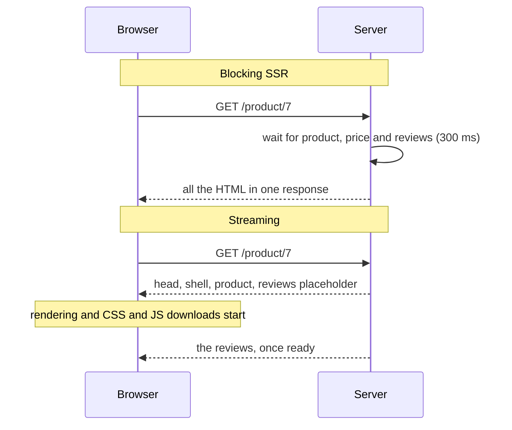
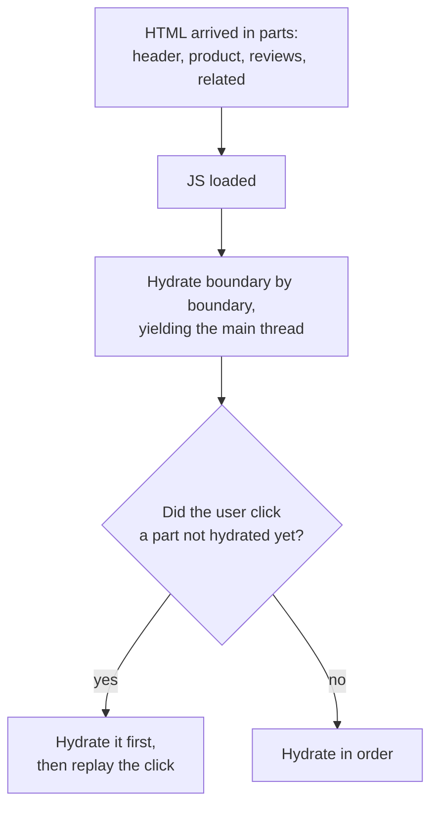

## What this lesson covers

Streaming server rendering: why it beats blocking SSR, how React sends the shell at once and the slow parts later and out of order, how Vue differs, what selective hydration is, when `onAllReady` is needed, and the limits of streaming (status and headers, buffering in proxies, layout shifts). The examples run in Node.js on React 19.3 and Vue 3.5.

## Blocking SSR and streaming



With blocking SSR the response waits for the slowest data source, and until then the user sees a blank screen. With streaming the server sends `<head>`, the shell and everything that is already ready at once, and appends the slow parts to the same response. The browser starts painting and downloading CSS and JavaScript without waiting for the reviews. In React the stream's boundaries are set by `Suspense`: whatever suspended inside arrives later, and the `fallback` is shown until then.

## How React streams

```tsx run
import { Suspense, use } from 'react'
import { renderToReadableStream } from 'react-dom/server'

let arrived = false
const reviews = new Promise<string[]>((resolve) =>
  setTimeout(() => {
    arrived = true
    resolve(['Great fit', 'Runs small'])
  }, 300),
)

function Reviews() {
  const items = use(reviews) // suspends until the data is there
  return <ul>{items.map((r) => <li key={r}>{r}</li>)}</ul>
}

function Page() {
  return (
    <html>
      <body>
        <h1>Trail shoes</h1>
        <p>120 EUR</p>
        <Suspense fallback={<p>Loading reviews…</p>}>
          <Reviews />
        </Suspense>
      </body>
    </html>
  )
}

const stream = await renderToReadableStream(<Page />, { bootstrapModules: ['/assets/client.js'] })
const short = (html: string) =>
  html.replace(/<script>[\s\S]*?<\/script>/g, '<script>…</script>').replace(/<link[^>]*>/g, '').replace(/<!--.*?-->/g, '')
for await (const chunk of stream.pipeThrough(new TextDecoderStream())) {
  console.log(arrived ? 'after data: ' : 'before data:', short(chunk))
}
```

```output
before data: <!DOCTYPE html><html><head></head><body><h1>Trail shoes</h1><p>120 EUR</p><template id="B:0"></template><p>Loading reviews…</p><script>…</script><script type="module" src="/assets/client.js" id="_R_" async=""></script>
after data:  <div hidden id="S:0"><ul><li>Great fit</li><li>Runs small</li></ul></div><script>…</script>
after data:  </body></html>
```

- **The first chunk** went out before the data arrived: the title, the price, the "Loading reviews…" placeholder in place of the reviews marked with `<template id="B:0">`, and right away the app's script tag. The browser is already painting the page and downloading JavaScript.
- **The second chunk** came once the data was ready: the reviews in a hidden `<div hidden id="S:0">` and a small inline script that moves them into the `B:0` placeholder's place. This is how React sends ready parts **out of order**: a slow block in the middle of the page does not hold up fast blocks after it.
- It works without the app's JavaScript: an inline script does the swap, so the user sees the reviews even while the main bundle is still loading.
- In the Next.js App Router every Suspense boundary and every `loading.tsx` file gives such a stream automatically; in React Router and SvelteKit a loader can return a promise, and its part of the page arrives later (`<Await>` in React Router, `{#await}` in SvelteKit).

## Vue streams in order

```js run
import { createSSRApp, defineComponent, h, Suspense } from 'vue'
import { renderToWebStream } from 'vue/server-renderer'

let arrived = false
const Reviews = defineComponent({
  async setup() {
    const items = await new Promise((resolve) =>
      setTimeout(() => {
        arrived = true
        resolve(['Great fit', 'Runs small'])
      }, 300),
    )
    return () => h('ul', items.map((r) => h('li', r)))
  },
})
const app = createSSRApp({
  render: () => h('main', [h('h1', 'Trail shoes'), h(Suspense, null, { default: () => h(Reviews), fallback: () => h('p', 'Loading reviews…') })]),
})

for await (const chunk of renderToWebStream(app).pipeThrough(new TextDecoderStream())) {
  console.log(arrived ? 'after data: ' : 'before data:', chunk.replace(/<!--.*?-->/g, ''))
}
```

```output
before data: <main><h1>Trail shoes</h1>
after data:  <ul><li>Great fit</li><li>Runs small</li></ul>
after data:  </main>
```

Vue 3 streams too (`renderToWebStream`, `renderToNodeStream`), but **in document order**: everything before the async component goes out at once, then the stream waits for it in place, and the Suspense fallback never reaches the HTML. The claim from the notes that streaming with placeholders works "in Vue 3+" the same way as in React does not hold: Vue's gain is that the start of the page and `<head>` leave earlier, not that fast blocks overtake a slow one. Out-of-order output exists in React, SolidStart and Marko.

## Selective hydration



- In React each Suspense boundary hydrates **separately**: there is no need to wait until everything arrives and loads. Hydration is split into parts and yields the main thread, so input is not blocked for long.
- If the user clicks a part that is not alive yet, React hydrates it out of turn and replays the event.
- An error inside a boundary on the server does not break the page: the fallback goes into the HTML, and the client tries to render that part itself.
- This is not partial hydration: in the end the whole page hydrates. Islands can leave parts unhydrated altogether (the `render-less-js` lesson).

## The shell, onAllReady and crawlers

| Moment | What it means | For whom |
|---|---|---|
| The shell is ready (`onShellReady`, or when `renderToReadableStream` returned the stream) | Everything outside Suspense is rendered, the response can start | Regular users: fast TTFB and FCP |
| Everything is ready (`onAllReady`, `await stream.allReady`) | All Suspense boundaries resolved | Search crawlers and static generation: they need the full HTML in one piece |
| `prerender` from `react-dom/static` | Waits for everything, no streaming needed | SSG and partial prerendering (the `render-static` lesson) |

The notes call `onAllReady` a "fallback for old browsers", but its purpose is different: to wait for all the content when a stream is not needed. A common technique: detect a crawler by `User-Agent` and wait for `allReady` for it, while users get the stream at once.

## Limits of streaming

- **Status and headers leave with the first byte.** If after the shell was sent it turns out the product does not exist, a `404` status can no longer be set. So whatever the status, a redirect or caching depends on (does the product exist, is access allowed) is checked **before** the shell, and only secondary blocks go into Suspense.
- **Buffering on the way.** A proxy, a load balancer or compression may accumulate the response and send it whole: then the streaming is invisible. In nginx that is `X-Accel-Buffering: no` or `proxy_buffering off`, and compression needs a flush after every part.
- **Layout shifts.** When content replaces a placeholder of a different size, the page jumps (CLS). The placeholder must take the same space as the content (a skeleton with dimensions).
- **Load and caching.** The connection is held longer; caching a stream on a CDN is harder. Static parts are better prerendered (the `render-static` lesson).
- **Grouping matters more than the number of boundaries.** Boundaries that are too fine give a "flicker" of many placeholders; group what appears together.

## Key points

- Streaming sends `<head>` and the shell at once and the slow parts later in the same response: fast TTFB and FCP, CSS and JS download earlier.
- React puts a placeholder marked `B:0` and sends the ready content later in a hidden `<div>` with an inline script that moves it: out of order, without waiting for the bundle.
- Vue 3 streams in order: it waits for the async component in place and does not send the Suspense fallback.
- React's selective hydration brings boundaries to life separately, and out of turn where the user clicked; it is not partial hydration.
- `onShellReady` for people, `onAllReady` and `prerender` for crawlers and SSG.
- Status and headers are fixed with the first byte: check what matters before the shell; turn off proxy buffering; placeholders sized like the content against CLS.
