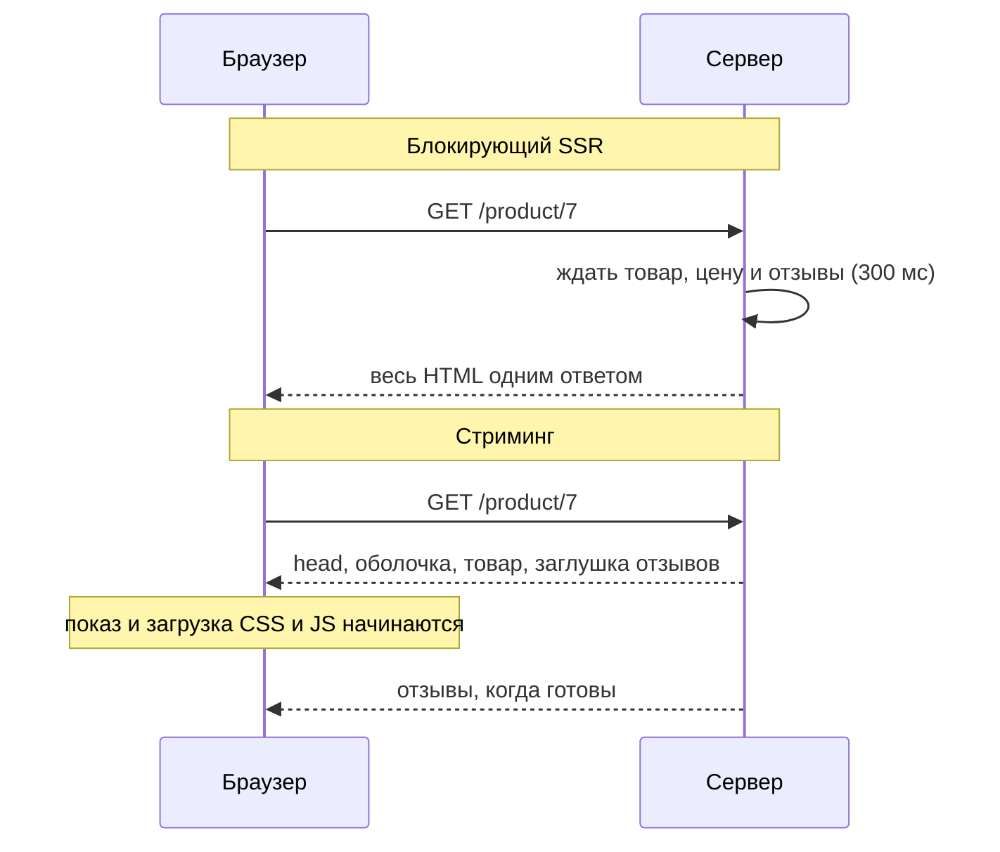
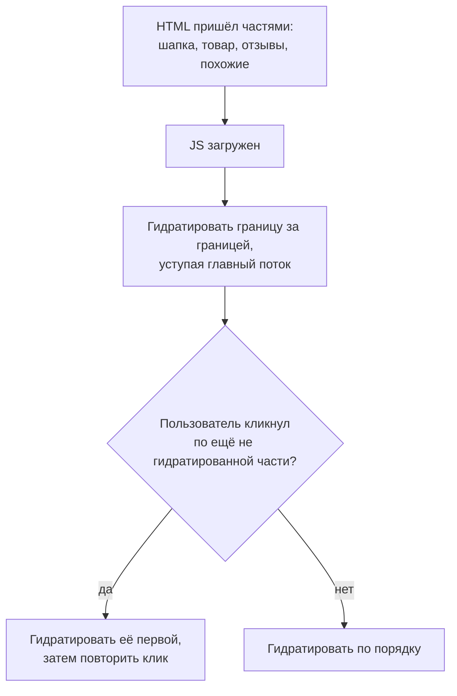

## О чём урок

Потоковый серверный рендер: чем он лучше блокирующего, как React отправляет оболочку сразу, а медленные части позже и не по порядку, чем от этого отличается Vue, что такое выборочная гидратация, когда нужен `onAllReady`, и какие ограничения у стриминга (статус и заголовки, буферизация на прокси, сдвиги макета). Примеры выполняются в Node.js на React 19.3 и Vue 3.5.

## Блокирующий SSR и стриминг



При блокирующем SSR ответ ждёт самый медленный источник данных, и пользователь до этого видит белый экран. При стриминге сервер отправляет `<head>`, оболочку и всё, что уже готово, сразу, а медленные части дописывает в тот же ответ. Браузер начинает рисовать и загружать CSS и JavaScript, не дожидаясь отзывов. В React границы потока задаёт `Suspense`: всё, что внутри приостановилось, приходит позже, а до этого показывается `fallback`.

## Как React отдаёт поток

```tsx run
import { Suspense, use } from 'react'
import { renderToReadableStream } from 'react-dom/server'

let arrived = false
const reviews = new Promise<string[]>((resolve) =>
  setTimeout(() => {
    arrived = true
    resolve(['Great fit', 'Runs small'])
  }, 300),
)

function Reviews() {
  const items = use(reviews) // suspends until the data is there
  return <ul>{items.map((r) => <li key={r}>{r}</li>)}</ul>
}

function Page() {
  return (
    <html>
      <body>
        <h1>Trail shoes</h1>
        <p>120 EUR</p>
        <Suspense fallback={<p>Loading reviews…</p>}>
          <Reviews />
        </Suspense>
      </body>
    </html>
  )
}

const stream = await renderToReadableStream(<Page />, { bootstrapModules: ['/assets/client.js'] })
const short = (html: string) =>
  html.replace(/<script>[\s\S]*?<\/script>/g, '<script>…</script>').replace(/<link[^>]*>/g, '').replace(/<!--.*?-->/g, '')
for await (const chunk of stream.pipeThrough(new TextDecoderStream())) {
  console.log(arrived ? 'after data: ' : 'before data:', short(chunk))
}
```

```output
before data: <!DOCTYPE html><html><head></head><body><h1>Trail shoes</h1><p>120 EUR</p><template id="B:0"></template><p>Loading reviews…</p><script>…</script><script type="module" src="/assets/client.js" id="_R_" async=""></script>
after data:  <div hidden id="S:0"><ul><li>Great fit</li><li>Runs small</li></ul></div><script>…</script>
after data:  </body></html>
```

- **Первый кусок** ушёл до прихода данных: заголовок, цена, на месте отзывов заглушка «Loading reviews…» с меткой `<template id="B:0">`, и сразу тег скрипта приложения. Браузер уже рисует страницу и качает JavaScript.
- **Второй кусок** пришёл, когда данные готовы: отзывы в скрытом `<div hidden id="S:0">` и маленький встроенный скрипт, который переносит их на место заглушки `B:0`. Так React отправляет готовые части **не по порядку**: медленный блок в середине страницы не задерживает быстрые блоки после него.
- Работает без JavaScript приложения: подстановку делает встроенный скрипт, поэтому пользователь видит отзывы, даже пока основной бандл ещё загружается.
- В Next.js App Router каждая граница `Suspense` и файл `loading.tsx` дают такой поток автоматически; в React Router и SvelteKit загрузчик может вернуть промис, и его часть страницы придёт позже (`<Await>` в React Router, `{#await}` в SvelteKit).

## Vue отдаёт по порядку

```js run
import { createSSRApp, defineComponent, h, Suspense } from 'vue'
import { renderToWebStream } from 'vue/server-renderer'

let arrived = false
const Reviews = defineComponent({
  async setup() {
    const items = await new Promise((resolve) =>
      setTimeout(() => {
        arrived = true
        resolve(['Great fit', 'Runs small'])
      }, 300),
    )
    return () => h('ul', items.map((r) => h('li', r)))
  },
})
const app = createSSRApp({
  render: () => h('main', [h('h1', 'Trail shoes'), h(Suspense, null, { default: () => h(Reviews), fallback: () => h('p', 'Loading reviews…') })]),
})

for await (const chunk of renderToWebStream(app).pipeThrough(new TextDecoderStream())) {
  console.log(arrived ? 'after data: ' : 'before data:', chunk.replace(/<!--.*?-->/g, ''))
}
```

```output
before data: <main><h1>Trail shoes</h1>
after data:  <ul><li>Great fit</li><li>Runs small</li></ul>
after data:  </main>
```

Vue 3 тоже стримит (`renderToWebStream`, `renderToNodeStream`), но **по порядку документа**: всё до асинхронного компонента уходит сразу, затем поток ждёт его на месте, и заглушка `Suspense` в HTML не попадает вовсе. Утверждение из заметок, что стриминг с заглушками работает «в Vue 3+» так же, как в React, не подтверждается: выигрыш Vue в том, что начало страницы и `<head>` уходят раньше, а не в том, что медленный блок обгоняют быстрые. Вывод не по порядку есть в React, SolidStart и Marko.

## Выборочная гидратация



- В React каждая граница `Suspense` гидратируется **отдельно**: не нужно ждать, пока придёт и загрузится всё. Гидратация разбита на части и уступает главный поток, поэтому ввод не блокируется надолго.
- Если пользователь кликнул по части, которая ещё не ожила, React гидратирует её вне очереди и повторяет событие.
- Ошибка внутри границы на сервере не ломает страницу: в HTML уходит заглушка, а клиент пытается отрендерить эту часть сам.
- Это не частичная гидратация: в итоге гидратируется вся страница. Не гидратировать части вовсе умеют острова (урок `render-less-js`).

## Оболочка, onAllReady и роботы

| Момент | Что значит | Для кого |
|---|---|---|
| Оболочка готова (`onShellReady`, или когда `renderToReadableStream` вернул поток) | Всё вне `Suspense` отрендерено, можно начинать ответ | Обычные пользователи: быстрый TTFB и FCP |
| Всё готово (`onAllReady`, `await stream.allReady`) | Дождались всех границ `Suspense` | Поисковые роботы и статическая генерация: им нужен полный HTML одним куском |
| `prerender` из `react-dom/static` | Ждёт всё, стриминг не нужен | SSG и частичный пререндер (урок `render-static`) |

Заметки называют `onAllReady` «запасным вариантом для старых браузеров», но его назначение другое: дождаться всего контента, когда поток не нужен. Частый приём: определить робота по `User-Agent` и для него ждать `allReady`, а пользователям отдавать поток сразу.

## Ограничения стриминга

- **Статус и заголовки уходят с первым байтом.** Если после отправки оболочки выяснилось, что товара нет, статус `404` уже не поставить. Поэтому то, от чего зависит статус, редирект или кэширование (существует ли товар, есть ли доступ), проверяют **до** оболочки, а в `Suspense` прячут только второстепенные блоки.
- **Буферизация по дороге.** Прокси, балансировщик или сжатие могут копить ответ и отдавать его целиком: стриминг тогда не виден. В nginx это `X-Accel-Buffering: no` или `proxy_buffering off`, у сжатия нужен сброс буфера после каждой части.
- **Сдвиги макета.** Когда контент заменяет заглушку другого размера, страница прыгает (CLS). Заглушка должна занимать то же место, что контент (скелетон с размерами).
- **Нагрузка и кэш.** Соединение держится дольше; кэшировать поток на CDN сложнее. Статические части лучше пререндерить (урок `render-static`).
- **Порядок важнее числа границ.** Слишком мелкие границы дают «мигание» множества заглушек; группируйте то, что появляется вместе.

## Главное

- Стриминг отправляет `<head>` и оболочку сразу, медленные части позже в том же ответе: быстрый TTFB и FCP, CSS и JS качаются раньше.
- React ставит заглушку с меткой `B:0`, а готовый контент присылает позже в скрытом `<div>` со встроенным скриптом, который его переносит: не по порядку, без ожидания бандла.
- Vue 3 стримит по порядку: ждёт асинхронный компонент на месте, заглушку `Suspense` не отправляет.
- Выборочная гидратация React оживляет границы по отдельности и вне очереди там, где пользователь кликнул; это не частичная гидратация.
- `onShellReady` для людей, `onAllReady` и `prerender` для роботов и SSG.
- Статус и заголовки фиксируются с первым байтом: важное проверяют до оболочки; отключайте буферизацию на прокси; заглушки по размеру контента против CLS.
