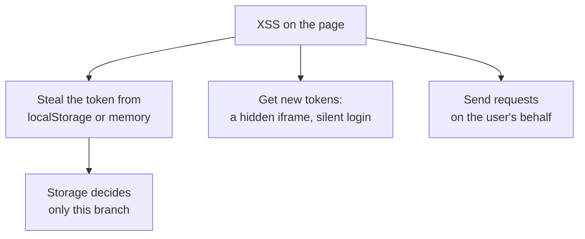
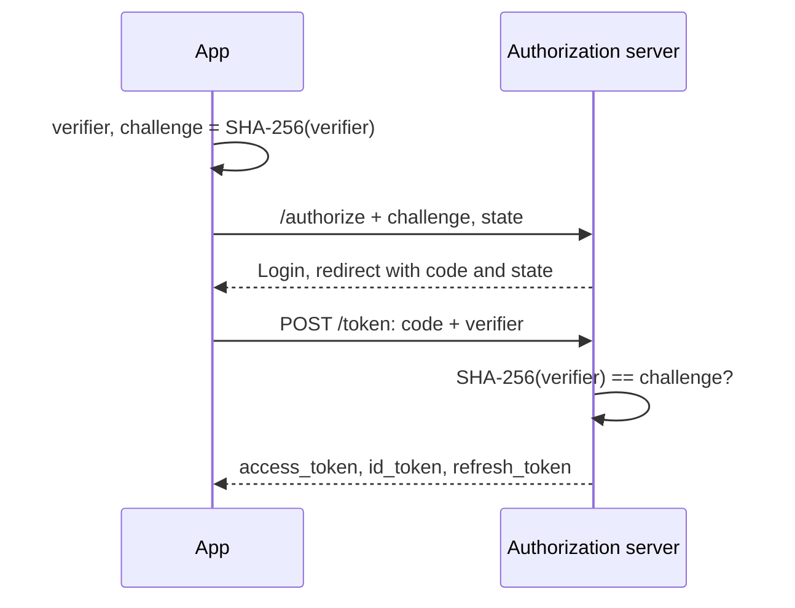

## What this lesson covers

Login and tokens in a frontend app: a cookie session or tokens, where to store a token and why under XSS this decides less than it seems, OAuth 2.0 and OpenID Connect with PKCE, the architectures from RFC 10017 (August 2026) with the BFF first, what is forbidden (the implicit flow, passwords in OAuth), JWTs and their typical mistakes, token refresh with rotation, and passkeys. Cookie attributes are covered in the `net-cookies-storage` lesson, an interceptor with token refresh in the `ng-architecture` lesson. The examples run in Node.js.

## A session or tokens

| | A cookie session | Tokens in the browser |
|---|---|---|
| What the client holds | A session ID in an `HttpOnly` cookie | An access token (often a JWT) and a refresh token |
| How it reaches the server | The browser attaches the cookie itself | Code adds `Authorization: Bearer ...` |
| Logout and revocation | Delete the session on the server, instantly | The access token lives until it expires |
| Risk | CSRF (the `sec-csrf` lesson) | A script on the page reads the token |
| When | The frontend and API on one site | An API on another domain, mobile clients, third-party APIs |

RFC 10017 advises directly: if the frontend and API are yours and live on one site, OAuth between them is usually **not needed**. Login can be delegated to a provider through OpenID Connect, followed by an ordinary cookie session.

## Where to store a token and what it changes



- **`localStorage` and `sessionStorage`**: any script of the origin reads them; the token goes to the attacker and works from their computer until it expires. A refresh token there means access for days and weeks.
- **Memory** (a variable, a closure, a Web Worker): the token does not survive a reload and is harder to get, but RFC 10017 shows that a closure is bypassed by replacing built-in functions (`fetch`, `toString`), and above all the attacker's script can **start a login itself** in a hidden iframe and get its own tokens while the user has a session with the provider.
- **An `HttpOnly` cookie**: a script cannot read it at all. The attacker can only send requests while the user is on the page and does not take access away with them.

The conclusion: storage limits the **consequences**, not XSS itself. Protection against XSS (the `sec-xss` and `sec-csp` lessons) matters more than the choice of storage.

## OAuth and OpenID Connect with PKCE

**OAuth 2.0** gives an app access to an API on the user's behalf; **OpenID Connect** (a layer on top of OAuth) adds login: an ID token with data about the user. In the browser, only the **authorization code flow with PKCE** is used.



```ts run
// PKCE (RFC 7636): the app proves that it started the login itself.
const base64url = (bytes: Uint8Array) => btoa(String.fromCharCode(...bytes)).replace(/\+/g, '-').replace(/\//g, '_').replace(/=+$/, '')

async function challengeFor(verifier: string) {
  const digest = await crypto.subtle.digest('SHA-256', new TextEncoder().encode(verifier))
  return base64url(new Uint8Array(digest))
}

// 1. Before the redirect: a random verifier stays in the app, its hash goes into the URL.
const verifier = base64url(crypto.getRandomValues(new Uint8Array(32)))
const authorize = new URL('https://auth.example/authorize')
authorize.search = new URLSearchParams({
  response_type: 'code',
  client_id: 'shop-web',
  redirect_uri: 'https://shop.example/callback',
  scope: 'openid profile',
  state: crypto.randomUUID(),
  code_challenge: await challengeFor(verifier),
  code_challenge_method: 'S256',
}).toString()
console.log([...authorize.searchParams.keys()].join(' '))
console.log('verifier length:', verifier.length, '| challenge length:', authorize.searchParams.get('code_challenge')!.length)

// 2. The authorization server stored the challenge; on the code exchange it hashes the verifier.
const stored = authorize.searchParams.get('code_challenge')
console.log('our verifier    :', (await challengeFor(verifier)) === stored)
console.log('attacker guess  :', (await challengeFor('guessed-by-attacker')) === stored)

// The test vector from RFC 7636, appendix B
console.log(await challengeFor('dBjftJeZ4CVP-mB92K27uhbUJU1p1r_wW1gFWFOEjXk'))
```

```output
response_type client_id redirect_uri scope state code_challenge code_challenge_method
verifier length: 43 | challenge length: 43
our verifier    : true
attacker guess  : false
E9Melhoa2OwvFrEMTJguCHaoeK1t8URWbuGJSstw-cM
```

- **PKCE** (RFC 7636) protects the authorization code: an intercepted code (through history, logs, a malicious app with the same redirect scheme) is useless without the `verifier`, which never left the app. The last line is the test vector from appendix B of RFC 7636: the implementation matches the specification.
- **`state`** ties the response to the request this same browser started: protection against a planted response (CSRF on login). OpenID Connect adds a `nonce` for the ID token.
- The authorization server compares `redirect_uri` **exactly** with the registered one, without patterns: otherwise the code goes to someone else's address.

What is forbidden (RFC 9700, January 2025, and RFC 10017):

- **The implicit flow** (`response_type=token`): the token came straight in the URL, ended up in history and `Referer`, and could not be protected with PKCE.
- **Resource Owner Password Credentials**: the app asks for the user's password at the provider. It breaks the very idea of OAuth and is incompatible with two-factor authentication.

## Architectures from RFC 10017

| Architecture | Where the tokens are | Protection under XSS |
|---|---|---|
| **BFF** (Backend for Frontend), recommended | Only on the BFF server; the browser holds an `HttpOnly` session cookie with the BFF, which adds the token to API requests | No tokens in the browser; the attacker can only send requests through the page while it is open |
| Token-Mediating Backend | The server obtains tokens, gives the access token to the browser, keeps the refresh token | The access token can be stolen, the refresh token cannot |
| Browser-based OAuth client | Everything in the browser, a public client with PKCE | Exposed to all scenarios, including getting new tokens |

A BFF is an ordinary server component (Next.js, Nuxt, a separate service) that works as a **confidential client** with its own secret. Its cookie is protected like any session: `HttpOnly`, `Secure`, `SameSite`, the `__Host-` prefix, plus CSRF protection.

## JWT

```ts run
// A JWT is three base64url parts: header.payload.signature. It is signed, not encrypted.
const jwt =
  'eyJhbGciOiJSUzI1NiIsInR5cCI6IkpXVCJ9.' +
  'eyJzdWIiOiJ1c2VyXzQyIiwicm9sZSI6InVzZXIiLCJlbWFpbCI6ImFubmFAZXhhbXBsZS5jb20iLCJleHAiOjE3OTQ1MDAwMDB9.' +
  'c2lnbmF0dXJlLWJ5dGVz'
const decode = (part: string) => JSON.parse(atob(part.replace(/-/g, '+').replace(/_/g, '/')))

const [header, payload] = jwt.split('.').slice(0, 2).map(decode)
console.log('header :', JSON.stringify(header))
console.log('payload:', JSON.stringify(payload))
console.log('expires:', new Date(payload.exp * 1000).toISOString())

// Changing the payload is easy; only the server can tell, by checking the signature.
const forged = [jwt.split('.')[0], btoa(JSON.stringify({ ...payload, role: 'admin' })).replace(/=+$/, ''), jwt.split('.')[2]].join('.')
console.log('forged role:', decode(forged.split('.')[1]).role)
```

```output
header : {"alg":"RS256","typ":"JWT"}
payload: {"sub":"user_42","role":"user","email":"anna@example.com","exp":1794500000}
expires: 2026-11-12T16:13:20.000Z
forged role: admin
```

- A JWT is `header.payload.signature` in base64url. It is **signed, not encrypted**: anyone can read the contents, so it holds no secrets and no unnecessary personal data.
- Changing the data is easy; only the **server** detects it, by checking the signature. The client may decode a JWT to show a name or learn the expiry, but it does not make permission decisions based on it.
- Server-side verification mistakes (RFC 8725): taking `alg` from the token itself (the `alg: none` attack and swapping RS256 for HS256), not checking `exp`, `aud` and `iss`. The server fixes the algorithm.
- A JWT cannot be revoked before it expires without a revocation list. That is why access tokens live for minutes, and a refresh token holds the long session.

## Token refresh

- **Refresh token rotation**: on every refresh the server issues a new refresh token and revokes the old one. If the old one arrives again, it was stolen, and the server revokes the whole chain.
- **Binding to the client** (sender-constrained tokens, DPoP): the token works only together with a key that cannot be extracted from the browser, so a stolen token is useless on another machine.
- Parallel requests with an expired token must wait for **one** refresh, otherwise rotation treats the second request as theft (an interceptor example is in the `ng-architecture` lesson).

## Passkeys

Passkeys (WebAuthn) replace the password with a key pair: the private key is stored on the device or in a password manager, the site gets only the public key. The signature is bound to the site's domain, so a passkey **does not work on a phishing domain**, and there is nothing to steal from the database. For the frontend, these are calls to `navigator.credentials.create()` and `get()` with data from the server, and `autocomplete="username webauthn"` on the login field for suggestions from the password manager.

## Key points

- The frontend and API on one site: an ordinary session in an `HttpOnly` cookie; OAuth between them is not needed.
- Token storage limits the consequences of XSS, not XSS itself: tokens are stolen from `localStorage`, memory is bypassed, an `HttpOnly` cookie is out of a script's reach.
- In the browser, only the authorization code flow with PKCE and `state`; the implicit flow and passwords in OAuth are forbidden (RFC 9700).
- RFC 10017 recommends a BFF: tokens on the server, only a session cookie in the browser.
- A JWT is signed but not encrypted; the server verifies it with a fixed algorithm and checks `exp`, `aud`, `iss`.
- Short access tokens, refresh token rotation with chain revocation; passkeys resist phishing.
