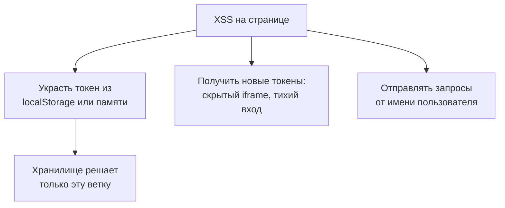
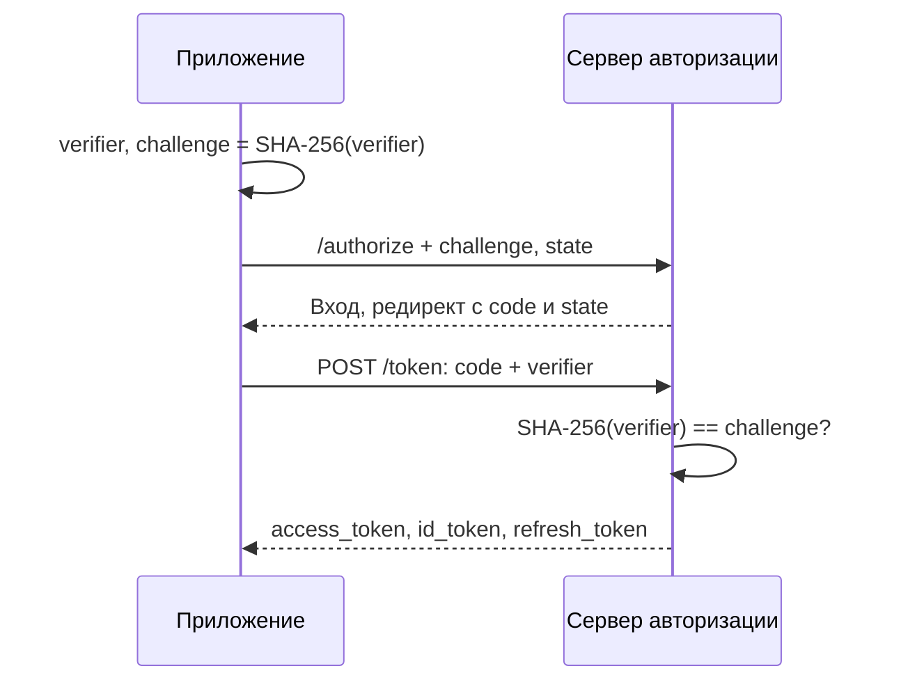

## О чём урок

Вход и токены во фронтенд-приложении: сессия в cookie или токены, где хранить токен и почему при XSS это решает меньше, чем кажется, OAuth 2.0 и OpenID Connect с PKCE, архитектуры из RFC 10017 (август 2026) с BFF во главе, что запрещено (implicit flow, пароль в OAuth), JWT и его типичные ошибки, обновление токенов с ротацией и passkeys. Атрибуты cookie разобраны в уроке `net-cookies-storage`, перехватчик с обновлением токена в уроке `ng-architecture`. Примеры выполняются в Node.js.

## Сессия или токены

| | Сессия в cookie | Токены в браузере |
|---|---|---|
| Что у клиента | Идентификатор сессии в `HttpOnly`-cookie | Access-токен (часто JWT) и refresh-токен |
| Как уходит на сервер | Браузер прикладывает cookie сам | Код добавляет `Authorization: Bearer ...` |
| Выход и отзыв | Удалить сессию на сервере, мгновенно | Access-токен живёт до истечения срока |
| Риск | CSRF (урок `sec-csrf`) | Скрипт на странице читает токен |
| Когда | Фронтенд и API на одном сайте | API на чужом домене, мобильные клиенты, сторонние API |

RFC 10017 прямо советует: если фронтенд и API ваши и живут на одном сайте, OAuth для связи между ними обычно **не нужен**. Вход можно делегировать провайдеру через OpenID Connect, а дальше держать обычную сессию в cookie.

## Где хранить токен и что это меняет



- **`localStorage` и `sessionStorage`**: любой скрипт источника читает их, токен уходит атакующему и работает с его компьютера, пока не истечёт. Refresh-токен там означает доступ на дни и недели.
- **Память** (переменная, замыкание, Web Worker): токен не переживает перезагрузку и его труднее достать, но RFC 10017 показывает, что замыкание обходится подменой встроенных функций (`fetch`, `toString`), а главное, скрипт атакующего может **сам запустить вход** в скрытом iframe и получить свои токены, пока у пользователя есть сессия у провайдера.
- **`HttpOnly`-cookie**: скрипт не прочитает её вообще. Атакующий может только отправлять запросы, пока пользователь на странице, и не уносит доступ с собой.

Вывод: хранилище ограничивает **последствия**, а не сам XSS. Защита от XSS (уроки `sec-xss`, `sec-csp`) важнее выбора хранилища.

## OAuth и OpenID Connect с PKCE

**OAuth 2.0** выдаёт приложению доступ к API от имени пользователя, **OpenID Connect** (надстройка над OAuth) добавляет вход: ID-токен с данными о пользователе. Для браузера используется только **authorization code flow с PKCE**.



```ts run
// PKCE (RFC 7636): the app proves that it started the login itself.
const base64url = (bytes: Uint8Array) => btoa(String.fromCharCode(...bytes)).replace(/\+/g, '-').replace(/\//g, '_').replace(/=+$/, '')

async function challengeFor(verifier: string) {
  const digest = await crypto.subtle.digest('SHA-256', new TextEncoder().encode(verifier))
  return base64url(new Uint8Array(digest))
}

// 1. Before the redirect: a random verifier stays in the app, its hash goes into the URL.
const verifier = base64url(crypto.getRandomValues(new Uint8Array(32)))
const authorize = new URL('https://auth.example/authorize')
authorize.search = new URLSearchParams({
  response_type: 'code',
  client_id: 'shop-web',
  redirect_uri: 'https://shop.example/callback',
  scope: 'openid profile',
  state: crypto.randomUUID(),
  code_challenge: await challengeFor(verifier),
  code_challenge_method: 'S256',
}).toString()
console.log([...authorize.searchParams.keys()].join(' '))
console.log('verifier length:', verifier.length, '| challenge length:', authorize.searchParams.get('code_challenge')!.length)

// 2. The authorization server stored the challenge; on the code exchange it hashes the verifier.
const stored = authorize.searchParams.get('code_challenge')
console.log('our verifier    :', (await challengeFor(verifier)) === stored)
console.log('attacker guess  :', (await challengeFor('guessed-by-attacker')) === stored)

// The test vector from RFC 7636, appendix B
console.log(await challengeFor('dBjftJeZ4CVP-mB92K27uhbUJU1p1r_wW1gFWFOEjXk'))
```

```output
response_type client_id redirect_uri scope state code_challenge code_challenge_method
verifier length: 43 | challenge length: 43
our verifier    : true
attacker guess  : false
E9Melhoa2OwvFrEMTJguCHaoeK1t8URWbuGJSstw-cM
```

- **PKCE** (RFC 7636) защищает код авторизации: перехваченный код (через историю, логи, вредоносное приложение с той же схемой редиректа) бесполезен без `verifier`, который не покидал приложение. Последняя строка это тестовый вектор из приложения B к RFC 7636: реализация совпадает со спецификацией.
- **`state`** связывает ответ с запросом, который начал этот же браузер: защита от подсунутого ответа (CSRF на вход). OpenID Connect добавляет `nonce` для ID-токена.
- `redirect_uri` сервер авторизации сверяет **точно** с зарегистрированным, без шаблонов: иначе код уходит на чужой адрес.

Что запрещено (RFC 9700, январь 2025, и RFC 10017):

- **Implicit flow** (`response_type=token`): токен приходил прямо в URL, оседал в истории и `Referer` и не мог быть защищён PKCE.
- **Resource Owner Password Credentials**: приложение спрашивает пароль пользователя от провайдера. Ломает саму идею OAuth и несовместимо с двухфакторной аутентификацией.

## Архитектуры по RFC 10017

| Архитектура | Где токены | Защита при XSS |
|---|---|---|
| **BFF** (Backend for Frontend), рекомендуется | Только на сервере BFF; браузер держит `HttpOnly`-cookie сессии с BFF, BFF добавляет токен к запросам в API | Токенов в браузере нет; атакующий может только отправлять запросы через страницу, пока она открыта |
| Token-Mediating Backend | Сервер получает токены, access-токен отдаёт в браузер, refresh-токен держит у себя | Можно украсть access-токен, но не refresh |
| Браузерный OAuth-клиент | Всё в браузере, публичный клиент с PKCE | Уязвимы все сценарии, включая получение новых токенов |

BFF это обычный серверный компонент (Next.js, Nuxt, отдельный сервис), который работает **конфиденциальным клиентом** со своим секретом. Защищают его cookie как любую сессию: `HttpOnly`, `Secure`, `SameSite`, префикс `__Host-`, плюс защита от CSRF.

## JWT

```ts run
// A JWT is three base64url parts: header.payload.signature. It is signed, not encrypted.
const jwt =
  'eyJhbGciOiJSUzI1NiIsInR5cCI6IkpXVCJ9.' +
  'eyJzdWIiOiJ1c2VyXzQyIiwicm9sZSI6InVzZXIiLCJlbWFpbCI6ImFubmFAZXhhbXBsZS5jb20iLCJleHAiOjE3OTQ1MDAwMDB9.' +
  'c2lnbmF0dXJlLWJ5dGVz'
const decode = (part: string) => JSON.parse(atob(part.replace(/-/g, '+').replace(/_/g, '/')))

const [header, payload] = jwt.split('.').slice(0, 2).map(decode)
console.log('header :', JSON.stringify(header))
console.log('payload:', JSON.stringify(payload))
console.log('expires:', new Date(payload.exp * 1000).toISOString())

// Changing the payload is easy; only the server can tell, by checking the signature.
const forged = [jwt.split('.')[0], btoa(JSON.stringify({ ...payload, role: 'admin' })).replace(/=+$/, ''), jwt.split('.')[2]].join('.')
console.log('forged role:', decode(forged.split('.')[1]).role)
```

```output
header : {"alg":"RS256","typ":"JWT"}
payload: {"sub":"user_42","role":"user","email":"anna@example.com","exp":1794500000}
expires: 2026-11-12T16:13:20.000Z
forged role: admin
```

- JWT это `заголовок.данные.подпись` в base64url. Он **подписан, а не зашифрован**: любой читает содержимое, поэтому в нём нет секретов и лишних персональных данных.
- Изменить данные легко, обнаружит это только **сервер**, проверив подпись. Клиент может декодировать JWT, чтобы показать имя или узнать срок действия, но не принимает по нему решений о правах.
- Ошибки проверки на сервере (RFC 8725): принимать `alg` из самого токена (атака `alg: none` и подмена RS256 на HS256), не проверять `exp`, `aud` и `iss`. Алгоритм задаёт сервер.
- JWT нельзя отозвать до истечения срока без списка отзыва. Поэтому access-токены живут минуты, а длинную сессию держит refresh-токен.

## Обновление токенов

- **Ротация refresh-токена**: при каждом обновлении сервер выдаёт новый refresh-токен и отзывает старый. Если старый пришёл снова, значит его украли, и сервер отзывает всю цепочку.
- **Привязка к клиенту** (sender-constrained tokens, DPoP): токен работает только вместе с ключом, который не извлекается из браузера, поэтому украденный токен бесполезен на другой машине.
- Параллельные запросы с истёкшим токеном должны дождаться **одного** обновления, иначе ротация сочтёт второй запрос кражей (пример перехватчика в уроке `ng-architecture`).

## Passkeys

Passkeys (WebAuthn) заменяют пароль парой ключей: закрытый ключ хранится на устройстве или в менеджере паролей, сайт получает только открытый. Подпись привязана к домену сайта, поэтому passkey **не работает на фишинговом домене** и его нечего украсть из базы. Для фронтенда это вызовы `navigator.credentials.create()` и `get()` с данными от сервера и `autocomplete="username webauthn"` в поле логина для подсказки из менеджера.

## Главное

- Фронтенд и API на одном сайте: обычная сессия в `HttpOnly`-cookie, OAuth между ними не нужен.
- Хранилище токена ограничивает последствия XSS, а не сам XSS: из `localStorage` токен крадут, память обходится, cookie `HttpOnly` скрипту недоступна.
- Для браузера только authorization code с PKCE и `state`; implicit flow и пароль в OAuth запрещены (RFC 9700).
- RFC 10017 рекомендует BFF: токены на сервере, в браузере только cookie сессии.
- JWT подписан, но не зашифрован; проверяет его сервер с фиксированным алгоритмом и проверкой `exp`, `aud`, `iss`.
- Короткие access-токены, ротация refresh-токенов с отзывом цепочки; passkeys устойчивы к фишингу.
