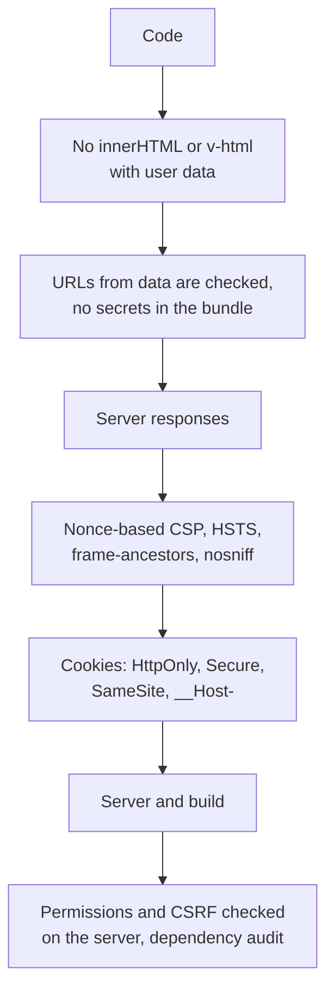

## What this lesson covers

A summary of the track in a form handy for work and interviews: what to check in an app before release, an automatic header check in CI, the specifics of React, Vue, Angular and Next.js, what else leaks from the frontend (source maps, errors, URLs), and how to answer "how would you secure this app" and "where do you store the token" in an interview and in system design. The example runs in Node.js.

## The pre-release check



| Area | What to check |
|---|---|
| Data output | No `innerHTML`, `dangerouslySetInnerHTML`, `v-html`, `bypassSecurityTrust*` with user data without a sanitizer; links from data pass a scheme check |
| Secrets | No keys with write access in the bundle; `VITE_` and `NEXT_PUBLIC_` variables are public |
| Headers | A strict CSP, HSTS, `frame-ancestors`, `nosniff`, COOP; CORS with an exact list of origins |
| Session | Cookies `HttpOnly`, `Secure`, `SameSite=Lax` or `Strict`, the `__Host-` prefix; CSRF protection on the server |
| Permissions | Every endpoint and Server Function checks permissions itself; hidden buttons are only interface |
| Dependencies | A lock file, install scripts from a list, an audit in CI, SRI for CDN scripts |
| Leaks | Source maps are not served publicly, errors without stacks or data, tokens and personal data not in URLs |

## A header check in CI

```ts run
// A check that can run in CI against a staging URL: which protective headers are missing or weak.
type Rule = [header: string, ok: (value: string | null) => boolean, hint: string]
const rules: Rule[] = [
  ['Content-Security-Policy', (v) => !!v && /'(nonce|sha256)-/.test(v) && !/'unsafe-inline'/.test(v), "strict CSP: nonce or hash, no 'unsafe-inline'"],
  ['Strict-Transport-Security', (v) => Number(v?.match(/max-age=(\d+)/)?.[1] ?? 0) >= 31536000, 'HSTS for at least a year'],
  ['X-Content-Type-Options', (v) => v === 'nosniff', 'nosniff'],
  ['Referrer-Policy', (v) => v !== 'unsafe-url' && v !== 'no-referrer-when-downgrade', 'no full URLs to other sites'],
  ['Cross-Origin-Opener-Policy', (v) => v === 'same-origin' || v === 'same-origin-allow-popups', 'isolate the window from popups'],
]
const framing = (h: Headers) => /frame-ancestors/.test(h.get('Content-Security-Policy') ?? '') || !!h.get('X-Frame-Options')

function audit(name: string, headers: Headers) {
  const problems = rules.filter(([h, ok]) => !ok(headers.get(h))).map(([h, , hint]) => `${h} (${hint})`)
  if (!framing(headers)) problems.push('frame-ancestors or X-Frame-Options (clickjacking)')
  console.log(`${name}: ${problems.length ? problems.length + ' problem(s)' : 'ok'}`)
  for (const p of problems) console.log('  -', p)
}

audit('legacy app', new Headers({ 'Content-Security-Policy': "script-src 'self' 'unsafe-inline' https://cdn.example", 'X-Content-Type-Options': 'nosniff', 'Referrer-Policy': 'unsafe-url' }))
audit('new app', new Headers({
  'Content-Security-Policy': "script-src 'nonce-r4nd0m' 'strict-dynamic'; object-src 'none'; base-uri 'none'; frame-ancestors 'self'",
  'Strict-Transport-Security': 'max-age=63072000; includeSubDomains; preload',
  'X-Content-Type-Options': 'nosniff',
  'Referrer-Policy': 'strict-origin-when-cross-origin',
  'Cross-Origin-Opener-Policy': 'same-origin',
}))
```

```output
legacy app: 5 problem(s)
  - Content-Security-Policy (strict CSP: nonce or hash, no 'unsafe-inline')
  - Strict-Transport-Security (HSTS for at least a year)
  - Referrer-Policy (no full URLs to other sites)
  - Cross-Origin-Opener-Policy (isolate the window from popups)
  - frame-ancestors or X-Frame-Options (clickjacking)
new app: ok
```

- The check runs against the staging URL after a deploy and fails if protection was removed by accident (a new proxy, a CDN, a move to another host).
- `'unsafe-inline'` in `script-src` without a nonce makes a CSP useless against XSS; domains in the list do not protect either (the `sec-csp` lesson).
- `Referrer-Policy` can be left unset: browsers default to `strict-origin-when-cross-origin`. Explicit `unsafe-url` and `no-referrer-when-downgrade` are dangerous: they send the full address with parameters to other sites.
- HSTS for a year or more, with `includeSubDomains`; `preload` is added once all subdomains are certainly on HTTPS.

## Frameworks

| | Built in | Where people go wrong |
|---|---|---|
| React 19 | Text escaping, blocking `javascript:` in URLs | `dangerouslySetInnerHTML`, writing to the DOM through a `ref`, state data in HTML with custom SSR |
| Vue 3 | Escaping of text and attributes | `v-html`, `:href` without a scheme check, a template from a user string, the full build with the compiler requires `unsafe-eval` |
| Angular | Sanitizing `[innerHTML]`, URLs and styles; XSRF in `HttpClient`; Trusted Types; a nonce through `ngCspNonce` | `bypassSecurityTrust*`, `ElementRef.nativeElement`, server templates with data inside an Angular template |
| Next.js | Server Actions only via `POST` and an `Origin` check; a nonce through `proxy.ts` | A Server Function without a permission check; secrets in client components; passing extra object fields to a client component |

In December 2025 critical vulnerabilities were found in React Server Components (code execution on the server, denial of service, source code exposure): framework updates with security fixes are installed immediately, not in the planned cycle (the `react-server` lesson).

## What else leaks from the frontend

- **Source maps** in production expose the source code, comments and sometimes paths and keys. They are uploaded to an error monitoring service (Sentry and similar) and not served publicly, or served only inside the network.
- **Errors**: a stack trace, SQL and other users' data in an API response or on an error page. The user sees a generic text and an ID for support.
- **URLs**: tokens, password reset codes and personal data in parameters end up in history, server logs and `Referer`. They are passed in the request body or in the `#` fragment, which is not sent to the server.
- **Storage**: `localStorage` survives logging out; on logout the user's data is cleared, which is especially important on a shared computer.
- **Analytics and logs**: form fields, tokens and personal data must not get into analytics events or session recordings.

## How to answer in an interview

To "how would you secure this app", answer by layers, not with a list of terms:

1. **Threat model**: which data is valuable (payments, personal data), who the users are, where the trust boundaries are (the browser, the BFF, the API, third-party services).
2. **Foreign code on the page (XSS)**: the framework's escaping, no raw HTML or a sanitizer, a strict CSP, Trusted Types.
3. **Requests on the user's behalf (CSRF)**: `SameSite`, checking `Sec-Fetch-Site` and `Origin`, tokens for forms.
4. **Authentication**: a session in an `HttpOnly` cookie or a BFF; OAuth only with PKCE; short tokens and rotation; permissions on the server.
5. **Isolation**: `frame-ancestors`, COOP, `postMessage` checks, foreign content in a `sandbox` on a separate domain.
6. **Supply chain**: a lock file, audits, delaying versions, SRI, a minimum of third-party tags.
7. **Observation**: CSP reports, error monitoring, alerts on login anomalies.

In system design (RADIO) security shows up twice: in the requirements (roles, where the token is stored, regulation) and in the optimizations, alongside accessibility and performance.

Common short questions:

- "Where do you store a JWT?" Preferably nowhere in the browser: a BFF and an `HttpOnly` cookie. If in the browser, then in memory with a short lifetime and refresh token rotation, understanding that under XSS this limits only theft.
- "Does CORS protect against CSRF?" No: CORS forbids reading the response, while a simple request goes out and is carried out.
- "Why a CSP if React escapes?" Escaping protects only output through React; a CSP also protects against mistakes in your code, libraries and third-party scripts.

## Key points

- Before release: data output and links, secrets in the bundle, headers, cookie flags, permissions and CSRF on the server, dependencies, leaks.
- Headers are checked automatically on staging after every deploy: infrastructure changes break them most often.
- Frameworks' built-in protection is removed by their own loopholes: `dangerouslySetInnerHTML`, `v-html`, `bypassSecurityTrust*`, direct DOM, a Server Function without a permission check.
- Do not serve source maps publicly, errors without stacks, no tokens in URLs, clear data on logout.
- The interview answer goes by layers: threat model, XSS, CSRF, authentication, isolation, dependencies, observation.
