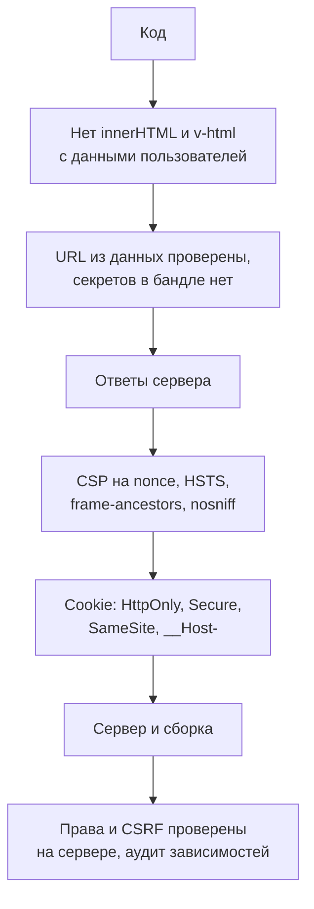

## О чём урок

Сводка трека в виде, удобном для работы и собеседования: что проверить в приложении перед релизом, автоматическая проверка заголовков в CI, особенности React, Vue, Angular и Next.js, что ещё утекает с фронтенда (карты исходников, ошибки, URL), и как отвечать на вопросы «как защитить это приложение» и «где хранить токен» на собеседовании и в system design. Пример выполняется в Node.js.

## Проверка перед релизом



| Область | Что проверить |
|---|---|
| Вывод данных | Нет `innerHTML`, `dangerouslySetInnerHTML`, `v-html`, `bypassSecurityTrust*` с пользовательскими данными без санитайзера; ссылки из данных проходят проверку схемы |
| Секреты | В бандле нет ключей с правом записи; переменные `VITE_` и `NEXT_PUBLIC_` публичны |
| Заголовки | Строгая CSP, HSTS, `frame-ancestors`, `nosniff`, COOP; CORS с точным списком источников |
| Сессия | Cookie `HttpOnly`, `Secure`, `SameSite=Lax` или `Strict`, префикс `__Host-`; защита от CSRF на сервере |
| Права | Каждый эндпоинт и Server Function проверяет права сам; скрытые кнопки только интерфейс |
| Зависимости | Lock-файл, скрипты установки по списку, аудит в CI, SRI для скриптов с CDN |
| Утечки | Карты исходников не раздаются публично, ошибки без стека и данных, токены и персональные данные не в URL |

## Проверка заголовков в CI

```ts run
// A check that can run in CI against a staging URL: which protective headers are missing or weak.
type Rule = [header: string, ok: (value: string | null) => boolean, hint: string]
const rules: Rule[] = [
  ['Content-Security-Policy', (v) => !!v && /'(nonce|sha256)-/.test(v) && !/'unsafe-inline'/.test(v), "strict CSP: nonce or hash, no 'unsafe-inline'"],
  ['Strict-Transport-Security', (v) => Number(v?.match(/max-age=(\d+)/)?.[1] ?? 0) >= 31536000, 'HSTS for at least a year'],
  ['X-Content-Type-Options', (v) => v === 'nosniff', 'nosniff'],
  ['Referrer-Policy', (v) => v !== 'unsafe-url' && v !== 'no-referrer-when-downgrade', 'no full URLs to other sites'],
  ['Cross-Origin-Opener-Policy', (v) => v === 'same-origin' || v === 'same-origin-allow-popups', 'isolate the window from popups'],
]
const framing = (h: Headers) => /frame-ancestors/.test(h.get('Content-Security-Policy') ?? '') || !!h.get('X-Frame-Options')

function audit(name: string, headers: Headers) {
  const problems = rules.filter(([h, ok]) => !ok(headers.get(h))).map(([h, , hint]) => `${h} (${hint})`)
  if (!framing(headers)) problems.push('frame-ancestors or X-Frame-Options (clickjacking)')
  console.log(`${name}: ${problems.length ? problems.length + ' problem(s)' : 'ok'}`)
  for (const p of problems) console.log('  -', p)
}

audit('legacy app', new Headers({ 'Content-Security-Policy': "script-src 'self' 'unsafe-inline' https://cdn.example", 'X-Content-Type-Options': 'nosniff', 'Referrer-Policy': 'unsafe-url' }))
audit('new app', new Headers({
  'Content-Security-Policy': "script-src 'nonce-r4nd0m' 'strict-dynamic'; object-src 'none'; base-uri 'none'; frame-ancestors 'self'",
  'Strict-Transport-Security': 'max-age=63072000; includeSubDomains; preload',
  'X-Content-Type-Options': 'nosniff',
  'Referrer-Policy': 'strict-origin-when-cross-origin',
  'Cross-Origin-Opener-Policy': 'same-origin',
}))
```

```output
legacy app: 5 problem(s)
  - Content-Security-Policy (strict CSP: nonce or hash, no 'unsafe-inline')
  - Strict-Transport-Security (HSTS for at least a year)
  - Referrer-Policy (no full URLs to other sites)
  - Cross-Origin-Opener-Policy (isolate the window from popups)
  - frame-ancestors or X-Frame-Options (clickjacking)
new app: ok
```

- Проверка запускается по адресу тестового стенда после деплоя и падает, если защиту случайно убрали (новый прокси, CDN, перенос на другой хостинг).
- `'unsafe-inline'` в `script-src` без nonce делает CSP бесполезной против XSS; домены в списке тоже не защищают (урок `sec-csp`).
- `Referrer-Policy` можно не задавать: по умолчанию браузеры используют `strict-origin-when-cross-origin`. Опасны явные `unsafe-url` и `no-referrer-when-downgrade`, которые отправляют полный адрес с параметрами на другие сайты.
- HSTS на год и больше, с `includeSubDomains`; `preload` добавляют, когда все поддомены точно на HTTPS.

## Фреймворки

| | Встроено | Где ошибаются |
|---|---|---|
| React 19 | Экранирование текста, блокировка `javascript:` в URL | `dangerouslySetInnerHTML`, запись в DOM через `ref`, данные состояния в HTML при своём SSR |
| Vue 3 | Экранирование текста и атрибутов | `v-html`, `:href` без проверки схемы, шаблон из пользовательской строки, полная сборка с компилятором требует `unsafe-eval` |
| Angular | Санитизация `[innerHTML]`, URL и стилей; XSRF в `HttpClient`; Trusted Types; nonce через `ngCspNonce` | `bypassSecurityTrust*`, `ElementRef.nativeElement`, серверные шаблоны с данными внутри шаблона Angular |
| Next.js | Server Actions только `POST` и проверка `Origin`; nonce через `proxy.ts` | Server Function без проверки прав; секреты в клиентских компонентах; передача лишних полей объекта в клиентский компонент |

В декабре 2025 в React Server Components нашли критические уязвимости (выполнение кода на сервере, отказ в обслуживании, раскрытие исходного кода): обновления фреймворков с исправлениями безопасности ставят сразу, а не в плановом цикле (урок `react-server`).

## Что ещё утекает с фронтенда

- **Карты исходников** в продакшене раскрывают исходный код, комментарии и иногда пути и ключи. Их загружают в сервис мониторинга ошибок (Sentry и подобные) и не раздают публично, или раздают только внутри сети.
- **Ошибки**: стек, SQL и данные других пользователей в ответе API или на странице ошибки. Пользователь видит общий текст и идентификатор для поддержки.
- **URL**: токены, коды сброса пароля и персональные данные в параметрах уходят в историю, логи серверов и `Referer`. Их передают в теле запроса или фрагменте `#`, который не отправляется на сервер.
- **Хранилища**: `localStorage` переживает выход из аккаунта; при выходе очищают данные пользователя, а на общем компьютере это особенно важно.
- **Аналитика и логи**: поля форм, токены и персональные данные не должны попадать в события аналитики и сессии записи экрана.

## Как отвечать на собеседовании

На вопрос «как защитить это приложение» отвечают по слоям, а не списком терминов:

1. **Модель угроз**: какие данные ценны (платежи, личные данные), кто пользователи, где границы доверия (браузер, BFF, API, сторонние сервисы).
2. **Чужой код на странице (XSS)**: экранирование фреймворка, запрет сырого HTML или санитайзер, строгая CSP, Trusted Types.
3. **Запросы от имени пользователя (CSRF)**: `SameSite`, проверка `Sec-Fetch-Site` и `Origin`, токены для форм.
4. **Аутентификация**: сессия в `HttpOnly`-cookie или BFF; OAuth только с PKCE; короткие токены и ротация; права на сервере.
5. **Изоляция**: `frame-ancestors`, COOP, проверка `postMessage`, чужой контент в `sandbox` на отдельном домене.
6. **Цепочка поставок**: lock-файл, аудит, задержка версий, SRI, минимум сторонних тегов.
7. **Наблюдение**: отчёты CSP, мониторинг ошибок, алерты на аномалии входа.

В system design (RADIO) безопасность появляется дважды: в требованиях (роли, где хранится токен, регуляторика) и в оптимизациях вместе с доступностью и производительностью.

Частые короткие вопросы:

- «Где хранить JWT?» Лучше нигде в браузере: BFF и `HttpOnly`-cookie. Если в браузере, то в памяти с коротким сроком и ротацией refresh-токена, понимая, что при XSS это ограничивает только кражу.
- «CORS защищает от CSRF?» Нет: CORS запрещает читать ответ, а простой запрос уходит и выполняется.
- «Зачем CSP, если React экранирует?» Экранирование защищает только вывод через React; CSP защищает и от ошибок в коде, библиотеках и сторонних скриптах.

## Главное

- Перед релизом: вывод данных и ссылки, секреты в бандле, заголовки, флаги cookie, права и CSRF на сервере, зависимости, утечки.
- Заголовки проверяют автоматически на стенде после каждого деплоя: их чаще всего ломают изменения инфраструктуры.
- Встроенная защита фреймворков снимается их же лазейками: `dangerouslySetInnerHTML`, `v-html`, `bypassSecurityTrust*`, прямой DOM, Server Function без проверки прав.
- Карты исходников не раздавать публично, ошибки без стека, токены не в URL, данные чистить при выходе.
- Ответ на собеседовании идёт по слоям: модель угроз, XSS, CSRF, аутентификация, изоляция, зависимости, наблюдение.
