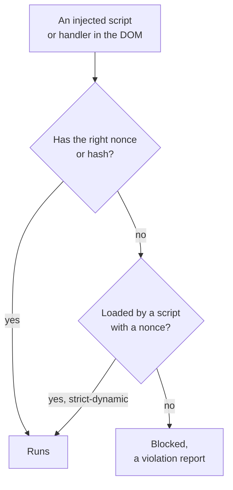
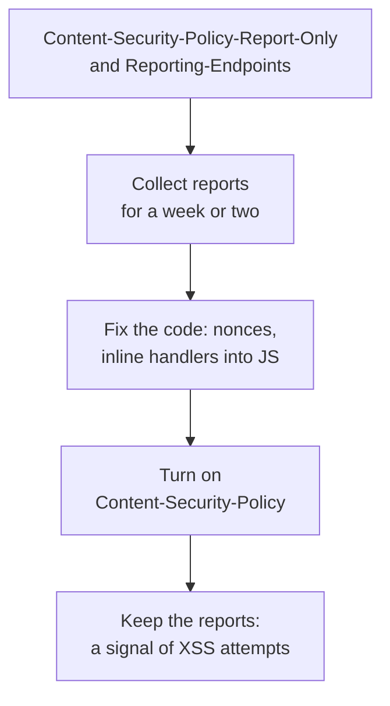

## What this lesson covers

The second layer of defense against XSS: Content Security Policy (CSP) and Trusted Types. Why domain lists in a CSP get bypassed, how a strict nonce- or hash-based policy works and what `strict-dynamic` gives, which other directives are required, how to roll out a policy without breakage through report-only mode, how frameworks pass the nonce, and how Trusted Types close dangerous DOM sinks. The example runs in Node.js on a Hono server.

## Why a second layer

Escaping and sanitizing (the `sec-xss` lesson) work as long as they are applied correctly everywhere. One forgotten line with `innerHTML`, a third-party widget, a vulnerable dependency, and XSS is possible again. A CSP tells the browser **which code on the page to treat as its own**: nothing else runs, even if it got into the DOM.



## Domain lists do not work

The old approach listed allowed domains: `script-src 'self' https://cdn.example https://www.google-analytics.com`. Google research showed that such policies are almost always bypassable:

- the allowed domains host JSONP endpoints, old versions of Angular and other libraries that will run code from a string;
- a shared CDN (`cdnjs`, `unpkg`) allows loading **any** package, including a vulnerable one;
- without `'unsafe-inline'` old sites break, and with it the policy does not protect at all.

## A strict policy

```http
Content-Security-Policy:
  script-src 'nonce-{random value}' 'strict-dynamic';
  object-src 'none';
  base-uri 'none';
  frame-ancestors 'none';
  require-trusted-types-for 'script'
```

```ts run
import { Hono } from 'hono'
import { NONCE, secureHeaders } from 'hono/secure-headers'

const app = new Hono<{ Variables: { secureHeadersNonce: string } }>()
app.use(
  secureHeaders({
    contentSecurityPolicy: {
      scriptSrc: [NONCE, "'strict-dynamic'"], // a new random nonce for every response
      objectSrc: ["'none'"],
      baseUri: ["'none'"],
      frameAncestors: ["'none'"],
      requireTrustedTypesFor: ["'script'"],
    },
  }),
)
app.get('/', (c) => {
  const nonce = c.get('secureHeadersNonce')
  return c.html(`<script nonce="${nonce}" src="/assets/main.js"></script>`)
})

const [a, b] = [await app.request('/'), await app.request('/')]
const csp = a.headers.get('Content-Security-Policy')!
const nonceA = csp.match(/'nonce-([^']+)'/)![1]
const nonceB = b.headers.get('Content-Security-Policy')!.match(/'nonce-([^']+)'/)![1]
console.log(csp.replace(nonceA, '{nonce}').split('; ').join(';\n  '))
console.log('nonce in the header matches the <script>:', (await a.text()).includes(`nonce="${nonceA}"`))
console.log('the next response has a different nonce:', nonceA !== nonceB)
console.log('other headers:')
for (const name of ['Strict-Transport-Security', 'X-Content-Type-Options', 'X-Frame-Options', 'Referrer-Policy', 'Cross-Origin-Opener-Policy', 'X-XSS-Protection'])
  console.log(`  ${name}: ${a.headers.get(name)}`)
```

```output
script-src 'nonce-{nonce}' 'strict-dynamic';
  object-src 'none';
  base-uri 'none';
  frame-ancestors 'none';
  require-trusted-types-for 'script'
nonce in the header matches the <script>: true
the next response has a different nonce: true
other headers:
  Strict-Transport-Security: max-age=15552000; includeSubDomains
  X-Content-Type-Options: nosniff
  X-Frame-Options: SAMEORIGIN
  Referrer-Policy: no-referrer
  Cross-Origin-Opener-Policy: same-origin
  X-XSS-Protection: 0
```

- **Nonce**: a random value, new for **every response**. The server puts it into the header and into the `nonce` attribute of its `<script>` tags. An injected script does not know the nonce: the page with it has already been sent. A nonce that is the same in all responses (hard-coded in a template or cached by a CDN together with the page) gives no protection.
- **A hash** (`'sha256-...'`) instead of a nonce: for static pages without a server, where every response is the same. It allows the specific content of an inline script.
- **`'strict-dynamic'`**: a script with a nonce can load other scripts (the bundler loads chunks, a tag manager adds tags), and they are allowed too. Domain lists and `'self'` are then ignored, so the policy cannot be bypassed through an allowed domain.
- **`object-src 'none'`**: no plugins (`<object>`, `<embed>`), an old path to code execution. **`base-uri 'none'`**: an injected `<base href>` cannot redirect relative script paths to someone else's server.
- The output also shows other headers the middleware sets by default; `frame-ancestors` and COOP are covered in the `sec-isolation` lesson. If both `frame-ancestors` and `X-Frame-Options` are set, the browser follows `frame-ancestors`.

## What else a strict policy forbids

- **Inline handlers** `onclick="..."` and `javascript:` links: handlers are attached from code (`addEventListener`; frameworks do this themselves).
- **`eval`, `new Function`, `setTimeout` with a string**: blocked without `'unsafe-eval'`. It is required by the full Vue build that compiles templates in the browser and by Angular's JIT mode; production builds of Vite, Angular CLI, React and Next.js work without it (Next.js adds `'unsafe-eval'` only in development).
- **Inline styles** `style="..."` are restricted by `style-src`. A strict CSP for styles is needed less often: CSS cannot run a script, but it can fake the interface and extract data with attribute selectors. Many start with `script-src` and add `style-src` later.
- Workers and the Service Worker are governed by `worker-src`; without it, `child-src`, then `script-src`. There is no special value for the Service Worker.

## Rolling out without breakage



```http
Reporting-Endpoints: csp="https://app.example/csp-reports"
Content-Security-Policy-Report-Only: script-src 'nonce-r4nd0m' 'strict-dynamic'; object-src 'none'; base-uri 'none'; report-to csp
```

- **Report-Only** blocks nothing, it only sends violation reports: this is how inline handlers, third-party scripts and browser extensions (their reports are filtered out) are found.
- `report-to` with the `Reporting-Endpoints` header is the modern way; `report-uri` is deprecated but added next to it for older browsers.
- A CSP in `<meta http-equiv>` suits a static SPA without a server, but it does not support `frame-ancestors`, `sandbox` or reports. A header is more reliable.

| Where the nonce comes from | How |
|---|---|
| Next.js | `proxy.ts` generates a nonce for each request and sets the header; Next.js adds the nonce to its own scripts. Pages with a nonce are rendered dynamically; static generation does not work for them |
| Angular | The `ngCspNonce` attribute on the root element or the `CSP_NONCE` token: Angular adds the nonce to the styles it inserts itself |
| Vite | `html.cspNonce`: a placeholder the server replaces with a random value in each response |
| Your own server | Middleware, as in the example; the nonce is passed into the template |

## Trusted Types

A CSP controls **where** code comes from, but it does not fully close DOM XSS: a string in `innerHTML` creates markup with handlers, and the script that inserted it was legitimate. **Trusted Types** forbid passing plain strings to dangerous sinks.

```ts
// Content-Security-Policy: require-trusted-types-for 'script'; trusted-types app-html dompurify
import DOMPurify from 'dompurify'

const policy = trustedTypes.createPolicy('app-html', {
  createHTML: (input) => DOMPurify.sanitize(input), // the only place where HTML strings become markup
})

element.innerHTML = userInput // TypeError: the sink requires TrustedHTML, the violation is reported
element.innerHTML = policy.createHTML(userInput) // allowed: went through the policy
element.textContent = userInput // always allowed: text is not a sink
```

- After `require-trusted-types-for 'script'`, sinks such as `innerHTML`, `eval` and `script.src` accept only `TrustedHTML`, `TrustedScript` and `TrustedScriptURL` objects. **Policies** create them, and the `trusted-types` directive limits which policies may be created.
- Dangerous code is reduced to a few policies that are easy to check in review, instead of searching the whole project.
- Angular supports Trusted Types out of the box, and DOMPurify can return `TrustedHTML`. A `default` policy is used as a temporary measure for legacy code.
- Since 2026 Trusted Types are in all major browsers (Chrome and Edge 83, Firefox 148, Safari 26), so the directive can be turned on without caveats; it is rolled out the same way, through Report-Only.

## Key points

- A CSP is the second layer: a script without the right nonce or hash does not run, even if it got into the DOM.
- Domain lists are bypassed through JSONP, shared CDNs and old libraries; the strict policy: `script-src 'nonce-...' 'strict-dynamic'; object-src 'none'; base-uri 'none'`.
- A new nonce for every response; hashes for static pages; `strict-dynamic` allows scripts loaded by a trusted script.
- A strict policy forbids `onclick` in markup, `javascript:` and `eval`; production framework builds work without `'unsafe-eval'`.
- Roll out through `Content-Security-Policy-Report-Only` and `report-to`, then enforce; `<meta>` does not support `frame-ancestors` or reports.
- Trusted Types forbid strings in dangerous sinks; HTML is created only through reviewed policies. Supported in all browsers since 2026.
