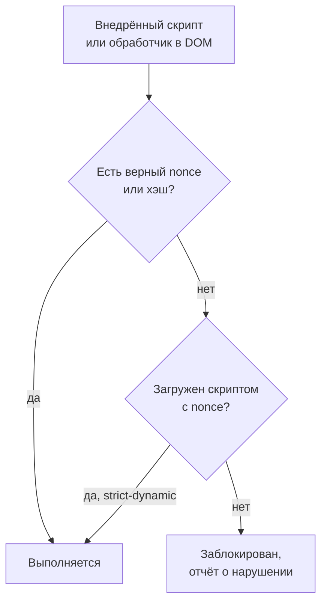
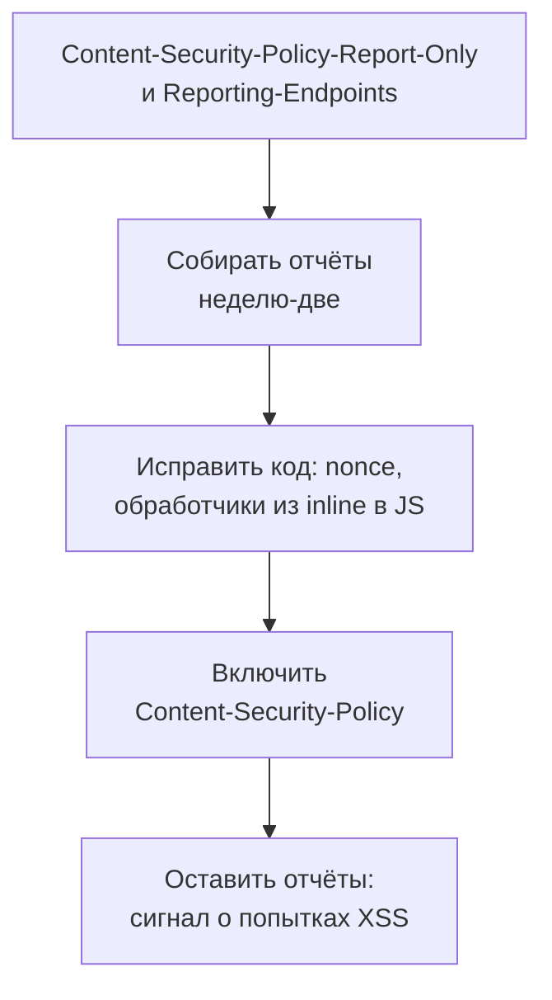

## О чём урок

Второй слой защиты от XSS: Content Security Policy (CSP) и Trusted Types. Почему списки доменов в CSP обходят, как устроена строгая политика на nonce или хэшах и что даёт `strict-dynamic`, какие ещё директивы обязательны, как внедрять политику без поломок через режим отчётов, как фреймворки передают nonce, и как Trusted Types закрывают опасные приёмники в DOM. Пример выполняется в Node.js на сервере Hono.

## Зачем второй слой

Экранирование и санитизация (урок `sec-xss`) работают, пока везде применены правильно. Одна забытая строка с `innerHTML`, сторонний виджет, уязвимая зависимость, и XSS снова возможен. CSP говорит браузеру, **какой код страницы считать своим**: всё остальное не выполняется, даже если попало в DOM.



## Списки доменов не работают

Старый подход перечислял разрешённые домены: `script-src 'self' https://cdn.example https://www.google-analytics.com`. Исследование Google показало, что такие политики почти всегда обходятся:

- на разрешённых доменах есть JSONP-эндпоинты, старые версии Angular и другие библиотеки, которые выполнят код из строки;
- общий CDN (`cdnjs`, `unpkg`) разрешает загрузить **любой** пакет, включая уязвимый;
- без `'unsafe-inline'` старые сайты ломаются, а с ним политика не защищает вообще.

## Строгая политика

```http
Content-Security-Policy:
  script-src 'nonce-{случайное значение}' 'strict-dynamic';
  object-src 'none';
  base-uri 'none';
  frame-ancestors 'none';
  require-trusted-types-for 'script'
```

```ts run
import { Hono } from 'hono'
import { NONCE, secureHeaders } from 'hono/secure-headers'

const app = new Hono<{ Variables: { secureHeadersNonce: string } }>()
app.use(
  secureHeaders({
    contentSecurityPolicy: {
      scriptSrc: [NONCE, "'strict-dynamic'"], // a new random nonce for every response
      objectSrc: ["'none'"],
      baseUri: ["'none'"],
      frameAncestors: ["'none'"],
      requireTrustedTypesFor: ["'script'"],
    },
  }),
)
app.get('/', (c) => {
  const nonce = c.get('secureHeadersNonce')
  return c.html(`<script nonce="${nonce}" src="/assets/main.js"></script>`)
})

const [a, b] = [await app.request('/'), await app.request('/')]
const csp = a.headers.get('Content-Security-Policy')!
const nonceA = csp.match(/'nonce-([^']+)'/)![1]
const nonceB = b.headers.get('Content-Security-Policy')!.match(/'nonce-([^']+)'/)![1]
console.log(csp.replace(nonceA, '{nonce}').split('; ').join(';\n  '))
console.log('nonce in the header matches the <script>:', (await a.text()).includes(`nonce="${nonceA}"`))
console.log('the next response has a different nonce:', nonceA !== nonceB)
console.log('other headers:')
for (const name of ['Strict-Transport-Security', 'X-Content-Type-Options', 'X-Frame-Options', 'Referrer-Policy', 'Cross-Origin-Opener-Policy', 'X-XSS-Protection'])
  console.log(`  ${name}: ${a.headers.get(name)}`)
```

```output
script-src 'nonce-{nonce}' 'strict-dynamic';
  object-src 'none';
  base-uri 'none';
  frame-ancestors 'none';
  require-trusted-types-for 'script'
nonce in the header matches the <script>: true
the next response has a different nonce: true
other headers:
  Strict-Transport-Security: max-age=15552000; includeSubDomains
  X-Content-Type-Options: nosniff
  X-Frame-Options: SAMEORIGIN
  Referrer-Policy: no-referrer
  Cross-Origin-Opener-Policy: same-origin
  X-XSS-Protection: 0
```

- **Nonce**: случайное значение, новое для **каждого ответа**. Сервер вставляет его в заголовок и в атрибут `nonce` своих `<script>`. Внедрённый скрипт nonce не знает: страница с ним уже отдана. Nonce, одинаковый во всех ответах (зашитый в шаблон или закэшированный CDN вместе со страницей), защиты не даёт.
- **Хэш** (`'sha256-...'`) вместо nonce: для статических страниц без сервера, где каждый ответ одинаковый. Разрешает конкретное содержимое встроенного скрипта.
- **`'strict-dynamic'`**: скрипт с nonce может подключать другие скрипты (бандлер грузит чанки, менеджер тегов добавляет теги), и они тоже разрешены. Списки доменов и `'self'` при этом игнорируются, поэтому обойти политику через разрешённый домен нельзя.
- **`object-src 'none'`**: запрет плагинов (`<object>`, `<embed>`), старый путь выполнения кода. **`base-uri 'none'`**: внедрённый `<base href>` не перенаправит относительные пути скриптов на чужой сервер.
- В выводе видны и другие заголовки, которые middleware ставит по умолчанию; `frame-ancestors` и COOP разобраны в уроке `sec-isolation`. Если заданы и `frame-ancestors`, и `X-Frame-Options`, браузер следует `frame-ancestors`.

## Что ещё запрещает строгая политика

- **Встроенные обработчики** `onclick="..."` и ссылки `javascript:`: обработчики назначают из кода (`addEventListener`, фреймворки делают это сами).
- **`eval`, `new Function`, `setTimeout` со строкой**: без `'unsafe-eval'` блокируются. Его требуют полная сборка Vue с компиляцией шаблонов в браузере и JIT-режим Angular; production-сборки Vite, Angular CLI, React и Next.js без него работают (Next.js добавляет `'unsafe-eval'` только в режиме разработки).
- **Встроенные стили** `style="..."` ограничивает `style-src`. Строгая CSP для стилей нужна реже: через CSS не выполнить скрипт, но можно подделать интерфейс и вытащить данные селекторами атрибутов. Многие начинают со `script-src` и добавляют `style-src` позже.
- Воркеры и Service Worker регулирует `worker-src`; при его отсутствии `child-src`, потом `script-src`. Специального значения для Service Worker нет.

## Внедрение без поломок



```http
Reporting-Endpoints: csp="https://app.example/csp-reports"
Content-Security-Policy-Report-Only: script-src 'nonce-r4nd0m' 'strict-dynamic'; object-src 'none'; base-uri 'none'; report-to csp
```

- **Report-Only** ничего не блокирует, только присылает отчёты о нарушениях: так находят встроенные обработчики, сторонние скрипты, расширения браузера (их отчёты фильтруют).
- `report-to` с заголовком `Reporting-Endpoints` это современный способ; `report-uri` устарел, но его добавляют рядом для старых браузеров.
- CSP в `<meta http-equiv>` подходит для статического SPA без сервера, но не поддерживает `frame-ancestors`, `sandbox` и отчёты. Заголовок надёжнее.

| Где nonce | Как |
|---|---|
| Next.js | `proxy.ts` генерирует nonce для каждого запроса и ставит заголовок; Next.js сам добавляет nonce к своим скриптам. Страницы с nonce рендерятся динамически, статическая генерация для них не работает |
| Angular | Атрибут `ngCspNonce` на корневом элементе или токен `CSP_NONCE`: Angular добавит nonce к стилям, которые вставляет сам |
| Vite | `html.cspNonce`: заполнитель, который сервер заменяет случайным значением в каждом ответе |
| Свой сервер | Middleware, как в примере; nonce пробрасывают в шаблон |

## Trusted Types

CSP контролирует, **откуда** код, но не закрывает DOM XSS полностью: строка в `innerHTML` создаёт разметку с обработчиками, а скрипт, который её вставил, был легальным. **Trusted Types** запрещают передавать в опасные приёмники обычные строки.

```ts
// Content-Security-Policy: require-trusted-types-for 'script'; trusted-types app-html dompurify
import DOMPurify from 'dompurify'

const policy = trustedTypes.createPolicy('app-html', {
  createHTML: (input) => DOMPurify.sanitize(input), // the only place where HTML strings become markup
})

element.innerHTML = userInput // TypeError: the sink requires TrustedHTML, the violation is reported
element.innerHTML = policy.createHTML(userInput) // allowed: went through the policy
element.textContent = userInput // always allowed: text is not a sink
```

- После `require-trusted-types-for 'script'` приёмники `innerHTML`, `eval`, `script.src` и подобные принимают только объекты `TrustedHTML`, `TrustedScript`, `TrustedScriptURL`. Их создают **политики**, а директива `trusted-types` ограничивает, какие политики можно создать.
- Опасный код сводится к нескольким политикам, которые легко проверить на ревью, вместо поиска по всему проекту.
- Angular поддерживает Trusted Types из коробки, DOMPurify умеет возвращать `TrustedHTML`. Политику `default` используют как временную меру для старого кода.
- С 2026 года Trusted Types есть во всех основных браузерах (Chrome и Edge 83, Firefox 148, Safari 26), поэтому директиву можно включать без оговорок; внедряют так же, через Report-Only.

## Главное

- CSP это второй слой: скрипт без верного nonce или хэша не выполнится, даже если попал в DOM.
- Списки доменов обходятся через JSONP, общие CDN и старые библиотеки; строгая политика: `script-src 'nonce-...' 'strict-dynamic'; object-src 'none'; base-uri 'none'`.
- Nonce новый для каждого ответа; для статики хэши; `strict-dynamic` разрешает скрипты, подключённые доверенным скриптом.
- Строгая политика запрещает `onclick` в разметке, `javascript:` и `eval`; production-сборки фреймворков работают без `'unsafe-eval'`.
- Внедряют через `Content-Security-Policy-Report-Only` и `report-to`, потом включают; `<meta>` не поддерживает `frame-ancestors` и отчёты.
- Trusted Types запрещают строки в опасных приёмниках; HTML создаётся только через проверенные политики. Поддержка во всех браузерах с 2026 года.
