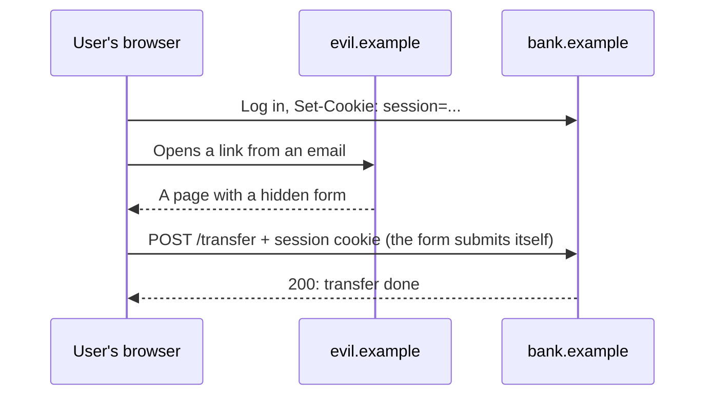

## What this lesson covers

CSRF (cross-site request forgery): how another page sends a request on the user's behalf, why CORS does not save you, what `SameSite` gives and where it falls short, modern protection with Fetch Metadata (`Sec-Fetch-Site`) and an `Origin` check, CSRF tokens (synchronizer and signed double-submit), what Angular, Next.js and other frameworks do, and when CSRF is not a concern at all. The examples run in Node.js.

## How the attack works



- The browser attaches cookies to a request to `bank.example` **no matter who initiated it**: a form, an image, a `fetch` from another site.
- The attacker does not need to read the response: it is enough that the request is carried out (a transfer, an email change, a deletion).
- CORS does not stop it: a simple `POST` with a form or a `fetch` with `Content-Type: text/plain` goes out without a preflight; CORS only prevents reading the response (the `net-cors` lesson).
- Vulnerable are requests that **change state** and are authenticated by something the browser attaches itself: cookies, HTTP Basic, client certificates. An API that expects a token in the `Authorization` header is not exposed to CSRF: another page does not know the token and cannot make the browser add it.

## SameSite: good, but not everything

| `SameSite` | A cross-site `POST` with a form | Following a link (`GET`) |
|---|---|---|
| `Strict` | No cookie | No cookie: the user arrives "logged out" |
| `Lax` | No cookie | With the cookie |
| `None` (requires `Secure`) | With the cookie | With the cookie |

`SameSite=Lax` closes the classic attack, but you cannot rely on it alone:

- **`Lax` is the default only in Chromium**. In Firefox it is behind a flag, in Safari it is not there; a cookie without the attribute goes out with cross-site requests in those browsers.
- `SameSite` looks at the **site**, not the origin: a request from `blog.bank.example` or a compromised subdomain counts as same-site.
- `Lax` lets `GET` through. If `GET /logout` or `GET /delete?id=7` change data, the attack works with a link.

That is why the server checks the request itself.

## Fetch Metadata and Origin

Browsers add `Sec-Fetch-*` headers to every request, which a page cannot forge: `Sec-Fetch-Site` tells where the request came from (`same-origin`, `same-site`, `cross-site`, or `none` if the user typed the address or opened a bookmark). OWASP recommends it as the primary signal against CSRF, with an `Origin` check for old browsers without these headers.

```ts run
import { Hono } from 'hono'

const app = new Hono()
const SAFE = ['GET', 'HEAD', 'OPTIONS']
const ORIGIN = 'https://bank.example'

// Protection on the server: Fetch Metadata first, Origin as a fallback for old browsers.
app.use(async (c, next) => {
  if (SAFE.includes(c.req.method)) return next()
  const site = c.req.header('Sec-Fetch-Site')
  if (site) return site === 'same-origin' || site === 'none' ? next() : c.text(`blocked: Sec-Fetch-Site ${site}`, 403)
  const origin = c.req.header('Origin')
  if (origin) return origin === ORIGIN ? next() : c.text(`blocked: Origin ${origin}`, 403)
  return c.text('blocked: no Sec-Fetch-Site and no Origin', 403)
})
app.post('/transfer', (c) => c.text('transferred'))
app.get('/balance', (c) => c.text('balance shown'))

// What different browsers and pages send (the browser sets these headers, a page cannot).
const requests: [string, string, Record<string, string>][] = [
  ['form on evil.example', 'POST', { 'Sec-Fetch-Site': 'cross-site', Origin: 'https://evil.example' }],
  ['fetch from the bank app', 'POST', { 'Sec-Fetch-Site': 'same-origin', Origin: ORIGIN }],
  ['subdomain blog.bank.example', 'POST', { 'Sec-Fetch-Site': 'same-site', Origin: 'https://blog.bank.example' }],
  ['old browser, evil page', 'POST', { Origin: 'https://evil.example' }],
  ['link from email (GET)', 'GET', { 'Sec-Fetch-Site': 'cross-site' }],
]
for (const [who, method, headers] of requests) {
  const res = await app.request(method === 'GET' ? '/balance' : '/transfer', { method, headers })
  console.log(who.padEnd(28), method.padEnd(4), res.status, await res.text())
}
```

```output
form on evil.example         POST 403 blocked: Sec-Fetch-Site cross-site
fetch from the bank app      POST 200 transferred
subdomain blog.bank.example  POST 403 blocked: Sec-Fetch-Site same-site
old browser, evil page       POST 403 blocked: Origin https://evil.example
link from email (GET)        GET  200 balance shown
```

- The form from another site is rejected by `Sec-Fetch-Site: cross-site`; the app's own request goes through.
- The request from a subdomain is rejected too: stricter than `SameSite`. If subdomains must send requests, list them explicitly.
- A browser without Fetch Metadata is stopped by the `Origin` check.
- `GET` is let through: safe methods must not change state. This is a requirement for the API, not a weakening of the protection.
- Ready-made middleware does this too; for example, `csrf()` in Hono checks `Origin` and `Sec-Fetch-Site`.

## CSRF tokens

A token is a random value that only your page knows. The server accepts a state-changing request only if the token came in a header or a hidden form field. Another site does not know the token: it cannot read your page or cookie because of the same-origin policy.

- **Synchronizer token**: the token is stored in the server session and inserted into the page. For apps with server-side state.
- **Double-submit cookie**: the token sits in a cookie that the page's script reads and copies into a header; the server compares one with the other. The naive version is vulnerable: an attacker on a subdomain can **write** their own cookie. That is why the token is signed and bound to the session.

```ts run
// Signed double-submit cookie: the token is bound to the session with an HMAC.
const enc = new TextEncoder()
const key = await crypto.subtle.importKey('raw', enc.encode('server-secret-from-env'), { name: 'HMAC', hash: 'SHA-256' }, false, ['sign', 'verify'])
const toHex = (buf: ArrayBuffer) => [...new Uint8Array(buf)].map((b) => b.toString(16).padStart(2, '0')).join('')
const fromHex = (s: string) => new Uint8Array(s.match(/../g)!.map((h) => parseInt(h, 16)))

async function issueToken(sessionId: string) {
  const random = toHex(crypto.getRandomValues(new Uint8Array(16)).buffer)
  const mac = toHex(await crypto.subtle.sign('HMAC', key, enc.encode(`${sessionId}!${random}`)))
  return `${mac}.${random}` // goes to a cookie readable by the app and back in a header
}
async function check(sessionId: string, cookie: string | undefined, header: string | undefined) {
  if (!cookie || cookie !== header) return 'rejected: header does not match the cookie'
  const [mac, random] = cookie.split('.')
  // verify() compares in constant time, unlike ===
  const ok = await crypto.subtle.verify('HMAC', key, fromHex(mac), enc.encode(`${sessionId}!${random}`))
  return ok ? 'accepted' : 'rejected: token belongs to another session'
}

const alice = await issueToken('session-alice')
const mallory = await issueToken('session-mallory') // the attacker has their own valid token
console.log('app request     :', await check('session-alice', alice, alice))
console.log('evil form       :', await check('session-alice', alice, undefined)) // another site cannot read the cookie
console.log('injected cookie :', await check('session-alice', mallory, mallory)) // e.g. set from a hijacked subdomain
```

```output
app request     : accepted
evil form       : rejected: header does not match the cookie
injected cookie : rejected: token belongs to another session
```

- Another site's form cannot add the header with the token: the request is rejected.
- An attacker who planted their own cookie with a valid token in the victim's browser is rejected too: the signature is bound to another session.
- The signature is compared with `crypto.subtle.verify`, not `===`: an ordinary string comparison reveals by its timing how many characters matched.

## In frameworks

- **Angular**: `HttpClient` reads the `XSRF-TOKEN` cookie and sends `X-XSRF-TOKEN` with all state-changing requests to relative and same-origin URLs (not with `GET` and `HEAD`); the server issues and checks the token. The names are configured with `withXsrfConfiguration`.
- **Next.js Server Actions**: only `POST` is accepted, Next.js compares `Origin` with `Host` and rejects a mismatch; for proxies there is the `serverActions.allowedOrigins` list. User permissions are checked inside the action.
- **Server frameworks** (Django, Rails, Laravel, Spring Security) turn CSRF tokens on by default; an SPA takes the token from a cookie or a meta tag and sends it in a header.
- **An API with a token in `Authorization`** (not a cookie) does not need CSRF protection, but then the token is available to scripts, and XSS becomes the main risk (the `sec-auth` lesson).

## Related attacks

- **Login CSRF**: the attacker logs into **their own** account in the victim's browser, and the victim enters card details into someone else's account. The login form is protected the same way.
- **Clickjacking**: the user is made to press a button on your page inside an invisible iframe themselves. Tokens do not help: the request is genuine. The protection is in the `sec-isolation` lesson.

## Key points

- CSRF: another page sends a request, and the browser attaches the user's cookies; the attacker does not need the response.
- CORS does not protect: a simple `POST` goes out without a preflight. State-changing requests with cookies are vulnerable; a token in `Authorization` is not exposed to CSRF.
- `SameSite=Lax` closes the classic attack, but it is the default only in Chromium, looks at the site (subdomains count as same-site) and lets `GET` through.
- The server checks `Sec-Fetch-Site` (the OWASP recommendation) and `Origin` as a fallback; `GET` does not change state.
- CSRF tokens: synchronizer for server sessions; double-submit only signed and bound to the session.
- Angular sends `X-XSRF-TOKEN` itself, Next.js checks `Origin` for Server Actions; your code still checks permissions.
