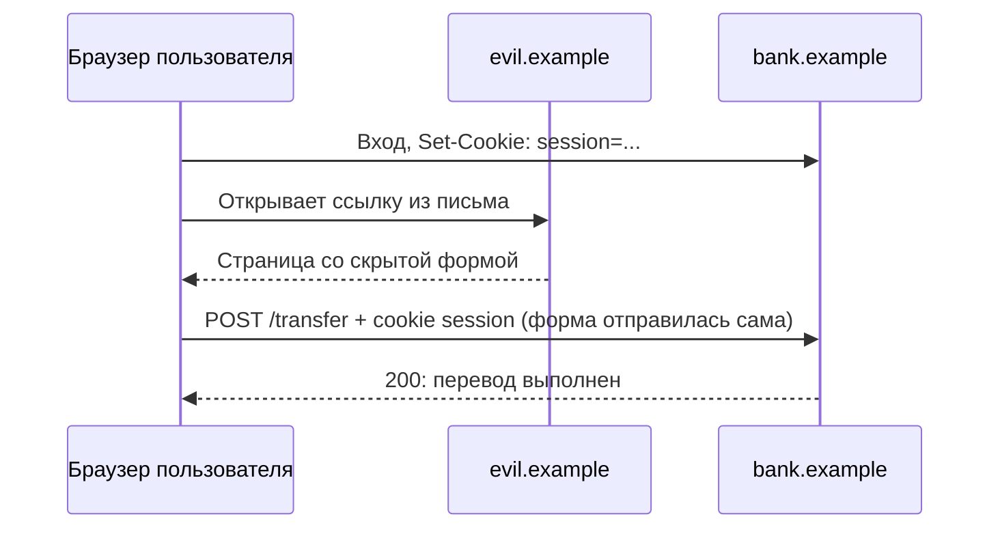

## О чём урок

CSRF (cross-site request forgery): как чужая страница отправляет запрос от имени пользователя, почему CORS от этого не спасает, что даёт `SameSite` и где его не хватает, современная защита через Fetch Metadata (`Sec-Fetch-Site`) и проверку `Origin`, CSRF-токены (synchronizer и подписанный double-submit), что делают Angular, Next.js и другие фреймворки, и когда CSRF не страшен вообще. Примеры выполняются в Node.js.

## Как работает атака



- Браузер прикладывает cookie к запросу на `bank.example`, **кто бы его ни инициировал**: форма, картинка, `fetch` с другого сайта.
- Атакующему не нужно читать ответ: ему достаточно, чтобы запрос выполнился (перевод, смена почты, удаление).
- CORS не мешает: простой `POST` формой или `fetch` с `Content-Type: text/plain` уходит без предварительного запроса, CORS лишь не даст прочитать ответ (урок `net-cors`).
- Уязвимы запросы, которые **меняют состояние** и аутентифицируются тем, что браузер прикладывает сам: cookie, HTTP Basic, клиентские сертификаты. API, которое ждёт токен в заголовке `Authorization`, CSRF не подвержено: чужая страница не знает токен и не может заставить браузер его добавить.

## SameSite: хорошо, но не всё

| `SameSite` | Межсайтовый `POST` формой | Переход по ссылке (`GET`) |
|---|---|---|
| `Strict` | Без cookie | Без cookie: пользователь приходит «разлогиненным» |
| `Lax` | Без cookie | С cookie |
| `None` (нужен `Secure`) | С cookie | С cookie |

`SameSite=Lax` закрывает классическую атаку, но полагаться только на него нельзя:

- **По умолчанию `Lax` только в Chromium**. В Firefox это за флагом, в Safari нет; cookie без атрибута там уходит с межсайтовыми запросами.
- `SameSite` смотрит на **site**, а не на origin: запрос с `blog.bank.example` или со взломанного поддомена считается своим.
- `Lax` пропускает `GET`. Если `GET /logout` или `GET /delete?id=7` меняют данные, атака работает ссылкой.

Поэтому сервер проверяет запрос сам.

## Fetch Metadata и Origin

Браузеры добавляют к каждому запросу заголовки `Sec-Fetch-*`, которые страница не может подделать: `Sec-Fetch-Site` говорит, откуда запрос (`same-origin`, `same-site`, `cross-site` или `none`, если пользователь сам ввёл адрес или открыл закладку). OWASP рекомендует его как основной сигнал против CSRF, а для старых браузеров без этих заголовков сверять `Origin`.

```ts run
import { Hono } from 'hono'

const app = new Hono()
const SAFE = ['GET', 'HEAD', 'OPTIONS']
const ORIGIN = 'https://bank.example'

// Protection on the server: Fetch Metadata first, Origin as a fallback for old browsers.
app.use(async (c, next) => {
  if (SAFE.includes(c.req.method)) return next()
  const site = c.req.header('Sec-Fetch-Site')
  if (site) return site === 'same-origin' || site === 'none' ? next() : c.text(`blocked: Sec-Fetch-Site ${site}`, 403)
  const origin = c.req.header('Origin')
  if (origin) return origin === ORIGIN ? next() : c.text(`blocked: Origin ${origin}`, 403)
  return c.text('blocked: no Sec-Fetch-Site and no Origin', 403)
})
app.post('/transfer', (c) => c.text('transferred'))
app.get('/balance', (c) => c.text('balance shown'))

// What different browsers and pages send (the browser sets these headers, a page cannot).
const requests: [string, string, Record<string, string>][] = [
  ['form on evil.example', 'POST', { 'Sec-Fetch-Site': 'cross-site', Origin: 'https://evil.example' }],
  ['fetch from the bank app', 'POST', { 'Sec-Fetch-Site': 'same-origin', Origin: ORIGIN }],
  ['subdomain blog.bank.example', 'POST', { 'Sec-Fetch-Site': 'same-site', Origin: 'https://blog.bank.example' }],
  ['old browser, evil page', 'POST', { Origin: 'https://evil.example' }],
  ['link from email (GET)', 'GET', { 'Sec-Fetch-Site': 'cross-site' }],
]
for (const [who, method, headers] of requests) {
  const res = await app.request(method === 'GET' ? '/balance' : '/transfer', { method, headers })
  console.log(who.padEnd(28), method.padEnd(4), res.status, await res.text())
}
```

```output
form on evil.example         POST 403 blocked: Sec-Fetch-Site cross-site
fetch from the bank app      POST 200 transferred
subdomain blog.bank.example  POST 403 blocked: Sec-Fetch-Site same-site
old browser, evil page       POST 403 blocked: Origin https://evil.example
link from email (GET)        GET  200 balance shown
```

- Форма с чужого сайта отклонена по `Sec-Fetch-Site: cross-site`, запрос самого приложения прошёл.
- Запрос с поддомена тоже отклонён: строже, чем `SameSite`. Если поддомены должны отправлять запросы, их перечисляют явно.
- Браузер без Fetch Metadata остановлен проверкой `Origin`.
- `GET` пропускается: безопасные методы не должны менять состояние. Это требование к API, а не послабление защиты.
- Такую проверку дают и готовые middleware, например `csrf()` в Hono проверяет `Origin` и `Sec-Fetch-Site`.

## CSRF-токены

Токен это случайное значение, которое знает только ваша страница. Сервер принимает изменяющий запрос, только если токен пришёл в заголовке или скрытом поле формы. Чужой сайт токен не знает: прочитать его страницу или cookie он не может из-за политики одного источника.

- **Synchronizer token**: токен хранится в серверной сессии и вставляется в страницу. Для приложений с состоянием на сервере.
- **Double-submit cookie**: токен лежит в cookie, которую скрипт страницы читает и копирует в заголовок; сервер сравнивает одно с другим. Наивная версия уязвима: атакующий с поддомена может **записать** свою cookie. Поэтому токен подписывают и привязывают к сессии.

```ts run
// Signed double-submit cookie: the token is bound to the session with an HMAC.
const enc = new TextEncoder()
const key = await crypto.subtle.importKey('raw', enc.encode('server-secret-from-env'), { name: 'HMAC', hash: 'SHA-256' }, false, ['sign', 'verify'])
const toHex = (buf: ArrayBuffer) => [...new Uint8Array(buf)].map((b) => b.toString(16).padStart(2, '0')).join('')
const fromHex = (s: string) => new Uint8Array(s.match(/../g)!.map((h) => parseInt(h, 16)))

async function issueToken(sessionId: string) {
  const random = toHex(crypto.getRandomValues(new Uint8Array(16)).buffer)
  const mac = toHex(await crypto.subtle.sign('HMAC', key, enc.encode(`${sessionId}!${random}`)))
  return `${mac}.${random}` // goes to a cookie readable by the app and back in a header
}
async function check(sessionId: string, cookie: string | undefined, header: string | undefined) {
  if (!cookie || cookie !== header) return 'rejected: header does not match the cookie'
  const [mac, random] = cookie.split('.')
  // verify() compares in constant time, unlike ===
  const ok = await crypto.subtle.verify('HMAC', key, fromHex(mac), enc.encode(`${sessionId}!${random}`))
  return ok ? 'accepted' : 'rejected: token belongs to another session'
}

const alice = await issueToken('session-alice')
const mallory = await issueToken('session-mallory') // the attacker has their own valid token
console.log('app request     :', await check('session-alice', alice, alice))
console.log('evil form       :', await check('session-alice', alice, undefined)) // another site cannot read the cookie
console.log('injected cookie :', await check('session-alice', mallory, mallory)) // e.g. set from a hijacked subdomain
```

```output
app request     : accepted
evil form       : rejected: header does not match the cookie
injected cookie : rejected: token belongs to another session
```

- Чужая форма не может добавить заголовок с токеном: запрос отклонён.
- Атакующий, подсунувший в браузер жертвы свою cookie с валидным токеном, тоже отклонён: подпись привязана к другой сессии.
- Сравнение подписи через `crypto.subtle.verify`, а не `===`: обычное сравнение строк выдаёт по времени, сколько символов совпало.

## Во фреймворках

- **Angular**: `HttpClient` читает cookie `XSRF-TOKEN` и отправляет `X-XSRF-TOKEN` во всех изменяющих запросах на относительные и свои URL (не в `GET` и `HEAD`); сервер выдаёт и проверяет токен. Имена настраиваются `withXsrfConfiguration`.
- **Next.js Server Actions**: принимаются только `POST`, Next.js сверяет `Origin` с `Host` и отклоняет несовпадение; для прокси список `serverActions.allowedOrigins`. Права пользователя проверяют внутри действия.
- **Серверные фреймворки** (Django, Rails, Laravel, Spring Security) включают CSRF-токены по умолчанию; SPA забирает токен из cookie или мета-тега и отправляет заголовком.
- **API с токеном в `Authorization`** (не cookie) CSRF не нужен, но тогда токен доступен скрипту, и главным риском становится XSS (урок `sec-auth`).

## Похожие атаки

- **Login CSRF**: атакующий входит в **свой** аккаунт в браузере жертвы, и та вводит данные карты в чужой аккаунт. Форму входа защищают так же.
- **Кликджекинг**: пользователя заставляют самого нажать кнопку на вашей странице внутри невидимого iframe. Токены не помогают: запрос настоящий. Защита в уроке `sec-isolation`.

## Главное

- CSRF: чужая страница отправляет запрос, а браузер прикладывает cookie пользователя; ответ атакующему не нужен.
- CORS не защищает: простой `POST` уходит без preflight. Уязвимы изменяющие запросы с cookie; токен в `Authorization` CSRF не подвержен.
- `SameSite=Lax` закрывает классическую атаку, но по умолчанию только в Chromium, смотрит на site (поддомены свои) и пропускает `GET`.
- Сервер проверяет `Sec-Fetch-Site` (рекомендация OWASP) и `Origin` как запасной вариант; `GET` не меняет состояние.
- CSRF-токены: synchronizer для серверных сессий, double-submit только подписанный и привязанный к сессии.
- Angular отправляет `X-XSRF-TOKEN` сам, Next.js сверяет `Origin` для Server Actions; права всё равно проверяет код.
