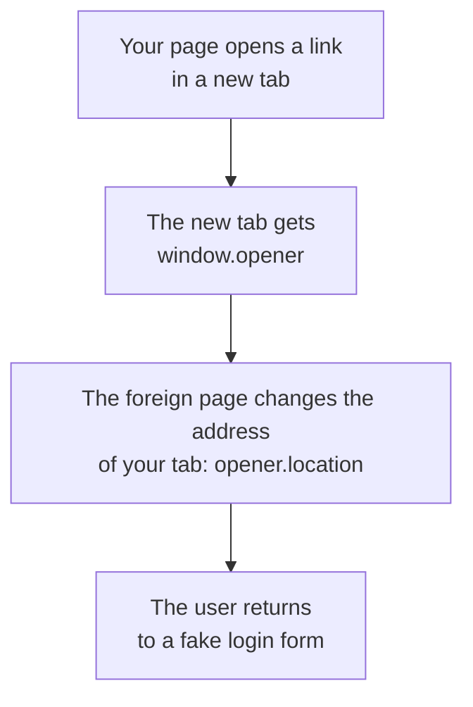

## What this lesson covers

How pages and windows of different origins affect each other and how to limit that: clickjacking and `frame-ancestors`, `window.opener` and `noopener`, Cross-Origin-Opener-Policy, messaging with `postMessage`, foreign code in an iframe with `sandbox`, cross-origin isolation (COEP, CORP) for `SharedArrayBuffer`, CORS misconfigurations, and open redirects. The examples run in jsdom and Node.js.

## Clickjacking

The attacker loads your page in a transparent iframe on top of theirs ("win a prize, click here"). The user presses a button **on your page**, with their own cookies: "Delete account", "Allow access", "Transfer". CSRF tokens do not help: the request is genuine, your page sent it.

```http
Content-Security-Policy: frame-ancestors 'none'     # cannot be embedded anywhere
Content-Security-Policy: frame-ancestors 'self' https://partner.example   # only by itself and a partner
X-Frame-Options: DENY                               # the old header, only DENY or SAMEORIGIN
```

- `frame-ancestors` in the CSP decides **who can embed** your page. If both headers are set, the browser follows `frame-ancestors`; `X-Frame-Options` is kept for very old browsers.
- The directive works only in a response header, not in `<meta>`.
- "Frame busting" scripts (`if (top !== self) top.location = ...`) are bypassed by the `sandbox` attribute on the attacker's iframe; you cannot rely on them.
- `SameSite=Lax` or `Strict` on the session cookie helps too: in a page embedded on another site the user will not be logged in.

## Windows and `opener`



- The attack is called **reverse tabnabbing**. Today `target="_blank"` implies `rel="noopener"` by default in all browsers (Chrome 88, Firefox 79, Safari 12.1), but `window.open(url)` from code still provides `opener`: pass `'noopener'` as the third argument.
- **Cross-Origin-Opener-Policy: same-origin** puts your page into a separate group of windows: windows of other origins get no reference to it and cannot control it, even if they opened it themselves. It also protects against cross-site leaks (XS-Leaks), where another page counts the frames of your window or watches its navigation.
- If the page opens a login or payment popup of another origin and waits for a reply, `same-origin-allow-popups` is used.

## `postMessage`

`postMessage` is a safe way to talk to iframes and windows of other origins, if both sides check who they are talking to.

```js dom
// The page embeds a payment widget in an iframe and listens for its messages.
const checks = {
  'none        ': () => true,
  'includes    ': (origin) => origin.includes('pay.example'),
  'endsWith    ': (origin) => origin.endsWith('pay.example'),
  'exact match ': (origin) => ['https://pay.example'].includes(origin),
}
const results = Object.fromEntries(Object.keys(checks).map((k) => [k, []]))
for (const [name, accept] of Object.entries(checks)) {
  window.addEventListener('message', (event) => {
    if (!accept(event.origin)) return
    results[name].push(event.origin.replace('https://', ''))
  })
}
// The browser sets event.origin; a page cannot fake it, but anyone can send a message.
for (const origin of ['https://pay.example', 'https://pay.example.evil.net', 'https://notpay.example', 'null'])
  window.dispatchEvent(new MessageEvent('message', { data: { type: 'paid', amount: 0 }, origin }))

for (const [name, accepted] of Object.entries(results)) console.log(name, '->', accepted.join(', '))
```

```output
none         -> pay.example, pay.example.evil.net, notpay.example, null
includes     -> pay.example, pay.example.evil.net, notpay.example
endsWith     -> pay.example, notpay.example
exact match  -> pay.example
```

- The browser sets `event.origin` itself; a page cannot forge it. But **anyone** can send a message: any tab that holds a reference to your window.
- Checks with `includes` and `endsWith` let through `pay.example.evil.net` and `notpay.example`: an attacker registers such a domain in a minute. Check for an **exact match** against a list of origins.
- The `null` origin belongs to iframes with `sandbox` and to pages from `data:` URLs; it cannot be trusted.
- When sending, name the recipient: `iframe.contentWindow.postMessage(data, 'https://pay.example')`. With the `'*'` wildcard, the data goes to whatever document is in the iframe at that moment (for example, after a redirect).
- Message data is input from another origin: it is not inserted into `innerHTML` and not passed to `eval`.

## Foreign code in an iframe

User widgets, HTML previews, plugins and code playgrounds run in an iframe:

```html
<iframe src="https://sandbox.usercontent.example/widget/42"
        sandbox="allow-scripts"
        allow="clipboard-write"></iframe>
```

- **A separate origin** (better a separate site, like `usercontent.example`): foreign code does not see your DOM, cookies or `localStorage`.
- **`sandbox`** without values forbids scripts, forms, popups and navigating the parent; what is needed is returned one by one (`allow-scripts`, `allow-forms`). The combination `allow-scripts allow-same-origin` for a document of your own origin cancels the sandbox: the code inside can remove the attribute itself.
- **`allow`** (Permissions Policy) grants the iframe access to the camera, geolocation, the clipboard; an iframe of another origin has none of them by default.
- `new Function`, `with`, Proxy and the `node:vm` module are not sandboxes: the Node docs state plainly that `vm` is not a security mechanism.

## Cross-origin isolation

`SharedArrayBuffer`, precise timers and `performance.measureUserAgentSpecificMemory()` are available only on an isolated page: after the Spectre vulnerability, such APIs made it possible to read the memory of other resources in the same process.

```http
Cross-Origin-Opener-Policy: same-origin
Cross-Origin-Embedder-Policy: require-corp      # or credentialless
```

- **COEP `require-corp`**: the page loads foreign resources only if they allow it with a `Cross-Origin-Resource-Policy: cross-origin` header or through CORS. `credentialless` is simpler: foreign resources load without cookies.
- The check in code: `self.crossOriginIsolated === true`. It is needed for multithreaded WebAssembly (ffmpeg.wasm, SQLite in the browser) and heavy editors.
- **CORP** (`Cross-Origin-Resource-Policy: same-site`) on your responses forbids other sites from embedding your images and scripts into their processes.

## CORS misconfigurations

CORS relaxes the same-origin policy (the `net-cors` lesson). The danger is not the technology itself but settings that let any site read responses made with the user's cookies:

- **reflecting `Origin`**: the server copies any incoming `Origin` into `Access-Control-Allow-Origin` together with `Access-Control-Allow-Credentials: true`. Any site reads the user's personal data;
- **a substring check**: `origin.endsWith('example.com')` lets through `evilexample.com`, just as in the `postMessage` example;
- **trusting `null`**: `Access-Control-Allow-Origin: null` with credentials opens access to a sandboxed iframe on any site;
- **trusting all subdomains**: XSS on any of them gives read access to the API.

The right way: an exact list of origins and the `Vary: Origin` header, so a cache does not serve one origin's permission to another.

## Open redirects

After login the app sends the user back by `?next=...`. If `next` is not checked, the link `https://shop.example/login?next=https://evil.example`, carrying your domain, leads to a phishing copy, and in OAuth such a redirect can carry away the authorization code.

```ts run
// After login the app sends the user to ?next=... An open redirect sends them to a phishing page.
const ORIGIN = 'https://shop.example'
const naive = (next: string) => (next.startsWith('/') ? next : '/')
function safe(next: string) {
  const url = new URL(next, ORIGIN) // parse the way the browser will
  return url.origin === ORIGIN ? url.pathname + url.search + url.hash : '/'
}

for (const next of ['/orders?id=7', 'https://evil.example/login', '//evil.example/login', '/\\evil.example/login', 'javascript:alert(1)']) {
  const host = new URL(naive(next), ORIGIN).host // where the browser goes after Location: <naive>
  console.log(JSON.stringify(next).padEnd(28), `naive: ${host}`.padEnd(21), `safe: ${safe(next)}`)
}
```

```output
"/orders?id=7"               naive: shop.example   safe: /orders?id=7
"https://evil.example/login" naive: shop.example   safe: /
"//evil.example/login"       naive: evil.example   safe: /
"/\\evil.example/login"      naive: evil.example   safe: /
"javascript:alert(1)"        naive: shop.example   safe: /
```

- The `startsWith('/')` check lets through `//evil.example` (an address without a scheme) and `/\evil.example`: the browser treats a backslash as a forward slash.
- The reliable way is to parse the address with the same parser the browser uses (`new URL`) and compare the **origin** with the expected one; on a mismatch, go to the home page.
- Links from user profiles and the `redirect_uri` on your own server are checked the same way.

## Key points

- Clickjacking is closed by `frame-ancestors` in the CSP header (`X-Frame-Options` for old browsers); JS frame busting does not work.
- `target="_blank"` already implies `noopener`, `window.open` does not; COOP `same-origin` separates your window from foreign ones.
- `postMessage`: an exact comparison of `event.origin` against a list and an explicit recipient when sending, never `'*'` for data.
- Foreign code: a separate site, `sandbox` with minimal permissions, no `allow-scripts allow-same-origin` pair for your own origin; `vm` and `new Function` are not sandboxes.
- `SharedArrayBuffer` requires cross-origin isolation: COOP `same-origin` and COEP `require-corp` or `credentialless`.
- CORS is dangerous with `Origin` reflected along with credentials, substrings and `null`; open redirects are closed by comparing the origin after `new URL`.
