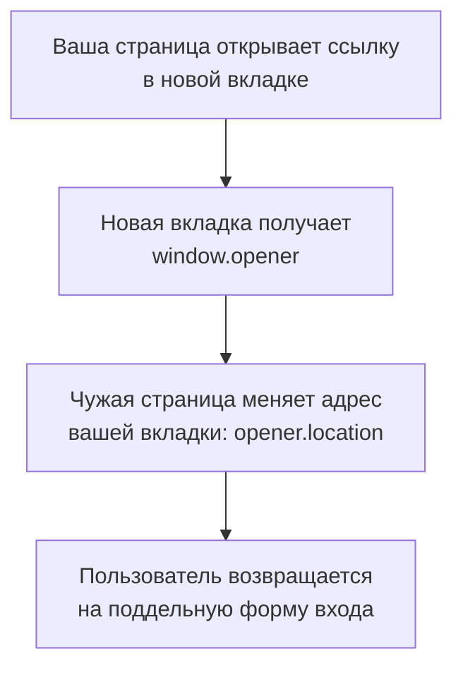

## О чём урок

Как страницы и окна разных источников влияют друг на друга и как это ограничить: кликджекинг и `frame-ancestors`, `window.opener` и `noopener`, Cross-Origin-Opener-Policy, обмен сообщениями через `postMessage`, чужой код в iframe с `sandbox`, cross-origin isolation (COEP, CORP) для `SharedArrayBuffer`, ошибки настройки CORS и открытые редиректы. Примеры выполняются в jsdom и Node.js.

## Кликджекинг

Атакующий загружает вашу страницу в прозрачный iframe поверх своей («выиграйте приз, нажмите сюда»). Пользователь нажимает кнопку **на вашей странице**, со своими cookie: «Удалить аккаунт», «Разрешить доступ», «Перевести». CSRF-токены не помогают: запрос настоящий, его отправила ваша страница.

```http
Content-Security-Policy: frame-ancestors 'none'     # нельзя встраивать никуда
Content-Security-Policy: frame-ancestors 'self' https://partner.example   # только себе и партнёру
X-Frame-Options: DENY                               # старый заголовок, только DENY или SAMEORIGIN
```

- `frame-ancestors` в CSP решает, **кто может встроить** вашу страницу. Если заданы оба заголовка, браузер следует `frame-ancestors`; `X-Frame-Options` оставляют для очень старых браузеров.
- Директива работает только в заголовке ответа, не в `<meta>`.
- Скрипты «frame busting» (`if (top !== self) top.location = ...`) обходятся атрибутом `sandbox` у iframe атакующего; полагаться на них нельзя.
- `SameSite=Lax` или `Strict` у cookie сессии тоже помогает: во встроенной на чужом сайте странице пользователь окажется не залогинен.

## Окна и `opener`



- Атака называется **reverse tabnabbing**. Сейчас `target="_blank"` по умолчанию подразумевает `rel="noopener"` во всех браузерах (Chrome 88, Firefox 79, Safari 12.1), но `window.open(url)` из кода по-прежнему даёт `opener`: передавайте `'noopener'` в третьем аргументе.
- **Cross-Origin-Opener-Policy: same-origin** помещает вашу страницу в отдельную группу окон: окна других источников не получают ссылку на неё и не могут ею управлять, даже если открыли её сами. Это же защищает от утечек между сайтами (XS-Leaks), где чужая страница считает фреймы вашего окна или следит за его навигацией.
- Если страница открывает всплывающее окно входа или оплаты другого источника и ждёт ответ, используют `same-origin-allow-popups`.

## `postMessage`

`postMessage` это безопасный способ общаться с iframe и окнами других источников, если обе стороны проверяют, с кем говорят.

```js dom
// The page embeds a payment widget in an iframe and listens for its messages.
const checks = {
  'none        ': () => true,
  'includes    ': (origin) => origin.includes('pay.example'),
  'endsWith    ': (origin) => origin.endsWith('pay.example'),
  'exact match ': (origin) => ['https://pay.example'].includes(origin),
}
const results = Object.fromEntries(Object.keys(checks).map((k) => [k, []]))
for (const [name, accept] of Object.entries(checks)) {
  window.addEventListener('message', (event) => {
    if (!accept(event.origin)) return
    results[name].push(event.origin.replace('https://', ''))
  })
}
// The browser sets event.origin; a page cannot fake it, but anyone can send a message.
for (const origin of ['https://pay.example', 'https://pay.example.evil.net', 'https://notpay.example', 'null'])
  window.dispatchEvent(new MessageEvent('message', { data: { type: 'paid', amount: 0 }, origin }))

for (const [name, accepted] of Object.entries(results)) console.log(name, '->', accepted.join(', '))
```

```output
none         -> pay.example, pay.example.evil.net, notpay.example, null
includes     -> pay.example, pay.example.evil.net, notpay.example
endsWith     -> pay.example, notpay.example
exact match  -> pay.example
```

- `event.origin` браузер ставит сам, страница его не подделает. Но **отправить** сообщение может кто угодно: любая вкладка, у которой есть ссылка на ваше окно.
- Проверки через `includes` и `endsWith` пропускают `pay.example.evil.net` и `notpay.example`: атакующий регистрирует такой домен за минуту. Проверяют **точное совпадение** со списком источников.
- Источник `null` бывает у iframe с `sandbox` и у страниц из `data:` URL; доверять ему нельзя.
- При отправке указывают адресата: `iframe.contentWindow.postMessage(data, 'https://pay.example')`. Со звёздочкой `'*'` данные получит любой документ, который к этому моменту оказался в iframe (например, после редиректа).
- Данные из сообщения это ввод от другого источника: их не вставляют в `innerHTML` и не передают в `eval`.

## Чужой код в iframe

Пользовательские виджеты, превью HTML, плагины и песочницы для кода запускают в iframe:

```html
<iframe src="https://sandbox.usercontent.example/widget/42"
        sandbox="allow-scripts"
        allow="clipboard-write"></iframe>
```

- **Отдельный origin** (лучше отдельный site, как `usercontent.example`): чужой код не видит ваш DOM, cookie и `localStorage`.
- **`sandbox`** без значений запрещает скрипты, формы, всплывающие окна, навигацию родителя; нужное возвращают по одному (`allow-scripts`, `allow-forms`). Комбинация `allow-scripts allow-same-origin` для документа вашего же источника отменяет песочницу: код внутри может снять атрибут сам.
- **`allow`** (Permissions Policy) выдаёт iframe доступ к камере, геолокации, буферу обмена; по умолчанию у iframe другого источника их нет.
- `new Function`, `with`, Proxy и модуль `node:vm` песочницей не являются: документация Node прямо говорит, что `vm` не механизм безопасности.

## Cross-origin isolation

`SharedArrayBuffer`, точные таймеры и `performance.measureUserAgentSpecificMemory()` доступны только в изолированной странице: после уязвимости Spectre такие API позволяли читать память чужих ресурсов в том же процессе.

```http
Cross-Origin-Opener-Policy: same-origin
Cross-Origin-Embedder-Policy: require-corp      # или credentialless
```

- **COEP `require-corp`**: страница загружает чужие ресурсы, только если они разрешили это заголовком `Cross-Origin-Resource-Policy: cross-origin` или через CORS. `credentialless` проще: чужие ресурсы грузятся без cookie.
- Проверка в коде: `self.crossOriginIsolated === true`. Нужна для многопоточного WebAssembly (ffmpeg.wasm, SQLite в браузере) и тяжёлых редакторов.
- **CORP** (`Cross-Origin-Resource-Policy: same-site`) на своих ответах запрещает другим сайтам встраивать ваши картинки и скрипты в свои процессы.

## CORS: ошибки настройки

CORS ослабляет политику одного источника (урок `net-cors`). Опасна не сама технология, а настройки, которые открывают чтение ответов с cookie пользователя любому сайту:

- **отражение `Origin`**: сервер копирует любой пришедший `Origin` в `Access-Control-Allow-Origin` вместе с `Access-Control-Allow-Credentials: true`. Любой сайт читает личные данные пользователя;
- **проверка подстрокой**: `origin.endsWith('example.com')` пропускает `evilexample.com`, так же как в примере с `postMessage`;
- **доверие `null`**: `Access-Control-Allow-Origin: null` с учётными данными открывает доступ iframe с `sandbox` на любом сайте;
- **доверие всем поддоменам**: XSS на любом из них даёт чтение API.

Правильно: точный список источников и заголовок `Vary: Origin`, чтобы кэш не отдал разрешение одного источника другому.

## Открытые редиректы

После входа приложение возвращает пользователя по `?next=...`. Если `next` не проверять, ссылка `https://shop.example/login?next=https://evil.example` с вашим доменом приведёт на фишинговую копию, а в OAuth такой редирект может унести код авторизации.

```ts run
// After login the app sends the user to ?next=... An open redirect sends them to a phishing page.
const ORIGIN = 'https://shop.example'
const naive = (next: string) => (next.startsWith('/') ? next : '/')
function safe(next: string) {
  const url = new URL(next, ORIGIN) // parse the way the browser will
  return url.origin === ORIGIN ? url.pathname + url.search + url.hash : '/'
}

for (const next of ['/orders?id=7', 'https://evil.example/login', '//evil.example/login', '/\\evil.example/login', 'javascript:alert(1)']) {
  const host = new URL(naive(next), ORIGIN).host // where the browser goes after Location: <naive>
  console.log(JSON.stringify(next).padEnd(28), `naive: ${host}`.padEnd(21), `safe: ${safe(next)}`)
}
```

```output
"/orders?id=7"               naive: shop.example   safe: /orders?id=7
"https://evil.example/login" naive: shop.example   safe: /
"//evil.example/login"       naive: evil.example   safe: /
"/\\evil.example/login"      naive: evil.example   safe: /
"javascript:alert(1)"        naive: shop.example   safe: /
```

- Проверка `startsWith('/')` пропускает `//evil.example` (адрес без схемы) и `/\evil.example`: браузер считает обратный слэш прямым.
- Надёжно разобрать адрес тем же парсером, что и браузер (`new URL`), и сравнить **origin** с ожидаемым; при несовпадении вести на главную.
- Тем же способом проверяют ссылки из профилей пользователей и `redirect_uri` на своём сервере.

## Главное

- Кликджекинг закрывает `frame-ancestors` в заголовке CSP (`X-Frame-Options` для старых браузеров); frame busting на JS не работает.
- `target="_blank"` уже подразумевает `noopener`, а `window.open` нет; COOP `same-origin` отделяет ваше окно от чужих.
- `postMessage`: точное сравнение `event.origin` со списком и явный адресат при отправке, никогда `'*'` для данных.
- Чужой код: отдельный site, `sandbox` с минимумом разрешений, без пары `allow-scripts allow-same-origin` для своего источника; `vm` и `new Function` не песочницы.
- `SharedArrayBuffer` требует cross-origin isolation: COOP `same-origin` и COEP `require-corp` или `credentialless`.
- CORS опасен отражением `Origin` с учётными данными, подстроками и `null`; открытые редиректы закрывает сравнение origin после `new URL`.
