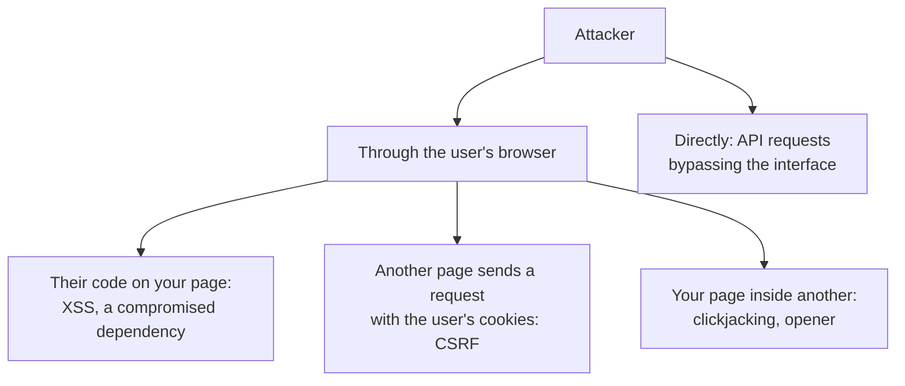
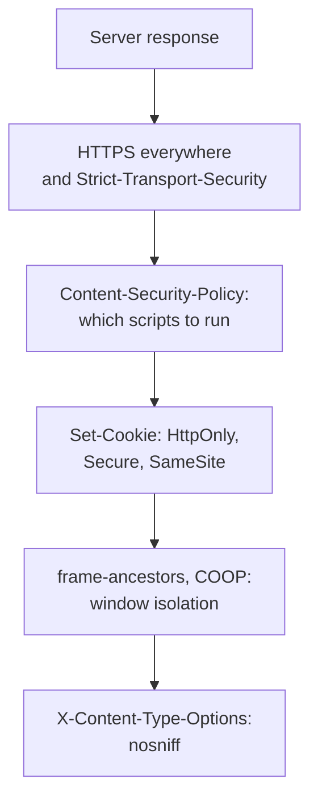

## What this lesson covers

Where frontend security starts: who we defend against and what, what the browser's security model rests on (origin and site), what the frontend cannot protect at all (secrets in the bundle, permission checks on the client), which OWASP Top 10:2025 risks concern the frontend, and which response headers turn protection on. The other lessons of the track cover each threat separately. The examples run in Node.js.

## Who attacks and what



A frontend developer is responsible for the first three paths: foreign code must not run on the page, the browser must not send a request on the user's behalf without their knowledge, and the page must not be usable from someone else's window. Only the server closes the fourth path: the attacker does not need your interface, they will send the request with `curl`.

## Origin and site

Almost all browser protection rests on two concepts:

- **Origin**: scheme, host and port. `https://app.example.com` and `https://api.example.com` are different origins. The same-origin policy (the `net-cors` lesson) stops a script of one origin from reading the responses and DOM of another.
- **Site**: the scheme and the registrable domain, that is, one label above a public suffix from the Public Suffix List. `app.example.com` and `api.example.com` are the same site. Cookie `SameSite` (the `net-cookies-storage` lesson) and the `Sec-Fetch-Site` header (the `sec-csrf` lesson) look at the site.

```ts run
// A tiny excerpt of the Public Suffix List: names under which anyone can register a site.
const publicSuffixes = ['com', 'org', 'co.uk', 'github.io']

// The site is the scheme plus the registrable domain: one label above a public suffix.
function site(url: URL): string {
  const labels = url.hostname.split('.')
  for (let i = 0; i < labels.length - 1; i++) {
    if (publicSuffixes.includes(labels.slice(i + 1).join('.'))) return `${url.protocol}//${labels.slice(i).join('.')}`
  }
  return `${url.protocol}//${url.hostname}`
}

const pairs = [
  ['https://app.example.com', 'https://app.example.com:443/orders'],
  ['https://app.example.com', 'https://api.example.com'],
  ['https://app.example.com', 'http://app.example.com'],
  ['https://shop.co.uk', 'https://evil.co.uk'],
  ['https://alice.github.io', 'https://bob.github.io'],
  ['https://app.example.com', 'https://example.org'],
]
for (const [a, b] of pairs) {
  const [x, y] = [new URL(a), new URL(b)]
  const sameOrigin = x.origin === y.origin
  const sameSite = site(x) === site(y)
  console.log(`${x.host} -> ${y.protocol}//${y.host}`.padEnd(46), `origin: ${sameOrigin ? 'same' : 'cross'}, site: ${sameSite ? 'same' : 'cross'}`)
}
```

```output
app.example.com -> https://app.example.com     origin: same, site: same
app.example.com -> https://api.example.com     origin: cross, site: same
app.example.com -> http://app.example.com      origin: cross, site: cross
shop.co.uk -> https://evil.co.uk               origin: cross, site: cross
alice.github.io -> https://bob.github.io       origin: cross, site: cross
app.example.com -> https://example.org         origin: cross, site: cross
```

- Subdomains of one domain are different origins but **the same site**. That is why a compromised or third-party subdomain (`blog.example.com` on an external host) bypasses protection built on `SameSite`.
- The scheme is part of the site: `http` and `https` with the same host are different sites (schemeful same-site).
- `co.uk` and `github.io` are on the public suffix list: `alice.github.io` and `bob.github.io` are different sites, otherwise every GitHub Pages user would count as "same-site".

## What the frontend cannot protect

Everything that reaches the browser can be read by the user, and therefore by an attacker: the bundle, API responses, `localStorage`, environment variables baked in at build time.

```ts run
import { rolldown } from 'rolldown'

// The app reads two "secrets" from the environment, as with VITE_* variables in Vite.
const files: Record<string, string> = {
  'main.js': `
    const payments = import.meta.env.VITE_PAYMENTS_SECRET
    export async function pay(amount) {
      return fetch('https://api.payments.example/charge', {
        method: 'POST',
        headers: { Authorization: 'Bearer ' + payments },
        body: JSON.stringify({ amount }),
      })
    }`,
}
const virtual = { name: 'virtual', resolveId: (id: string) => id, load: (id: string) => files[id] }

const bundle = await rolldown({
  input: 'main.js',
  plugins: [virtual],
  // Vite does the same: env variables are replaced by their values at build time.
  transform: { define: { 'import.meta.env.VITE_PAYMENTS_SECRET': JSON.stringify('sk_live_51Hx9QeZ') } },
  logLevel: 'silent',
})
const { output } = await bundle.generate({ minify: true })
const code = output[0].code
console.log('secret in the bundle:', code.includes('sk_live_51Hx9QeZ'))
console.log(code.match(/.{0,30}sk_live_51Hx9QeZ.{0,2}/)![0])
```

```output
secret in the bundle: true
eaders:{Authorization:`Bearer sk_live_51Hx9QeZ`}
```

- Variables with the `VITE_` prefix (`NEXT_PUBLIC_` in Next.js) are substituted into the code at build time and sit in the bundle in plain text. Minification and obfuscation do not hide the string.
- Secret keys (a payment provider, a database, a key with write access to a third-party API) live only on the server. The frontend calls your server, and the server calls the third-party API.
- Public keys that a service allows in the browser (a maps key restricted by domain, a payment provider's publishable key) are fine: their permissions are restricted on the service side.
- **Client-side checks do not protect.** A hidden "Delete" button, a route guard and form validation improve the interface, but the request can be sent directly. The server checks permissions and data; this is the first risk of the OWASP Top 10:2025, Broken Access Control.

## The OWASP Top 10:2025 from the frontend

| Risk | What it is on the frontend | Lesson |
|---|---|---|
| A01 Broken Access Control | Permissions enforced only by hiding buttons; CSRF; open redirects | `sec-csrf`, `sec-isolation` |
| A02 Security Misconfiguration | No CSP or other headers, CORS reflecting any `Origin`, source maps in production | `sec-csp`, `sec-checklist` |
| A03 Software Supply Chain Failures | A compromised npm package, a script from a third-party CDN without a check | `sec-supply-chain` |
| A04 Cryptographic Failures | No HTTPS, tokens in URLs, "encryption" in the browser with a key from the bundle | this lesson, `sec-auth` |
| A05 Injection | XSS, template injection, prototype pollution | `sec-xss`, `sec-supply-chain` |
| A07 Authentication Failures | Tokens in `localStorage`, the implicit flow, unverified JWTs | `sec-auth` |

## Protection at the response level



- **HTTPS everywhere**: without it, anyone on the network (public Wi-Fi, an ISP) reads and alters the page, including its scripts. `Strict-Transport-Security` (HSTS) makes the browser use only HTTPS for the site and prevents tampering with the first HTTP request.
- **`X-Content-Type-Options: nosniff`**: the browser does not guess the file type, so an "image" uploaded by a user will not run as a script.
- The other headers are covered in their own lessons; checking all of them at once is in the `sec-checklist` lesson.
- `X-XSS-Protection` is no longer needed: the built-in XSS filter was removed from browsers, and the filter itself created vulnerabilities. The recommended value is `0` or no header.

## Key points

- The frontend defends against three paths: foreign code on the page, requests on the user's behalf from another site, and use of the page from someone else's window. Only the server closes direct API requests.
- An origin is scheme, host and port; a site is the scheme and the registrable domain. Subdomains of one domain are the same site.
- Everything in the bundle is public: secrets only on the server; `VITE_` and `NEXT_PUBLIC_` end up in the code in plain text.
- Client-side checks improve the interface; the server checks permissions (A01 in the OWASP Top 10:2025).
- The response-level baseline: HTTPS and HSTS, CSP, cookie flags, `frame-ancestors`, `nosniff`; `X-XSS-Protection` is not needed.
